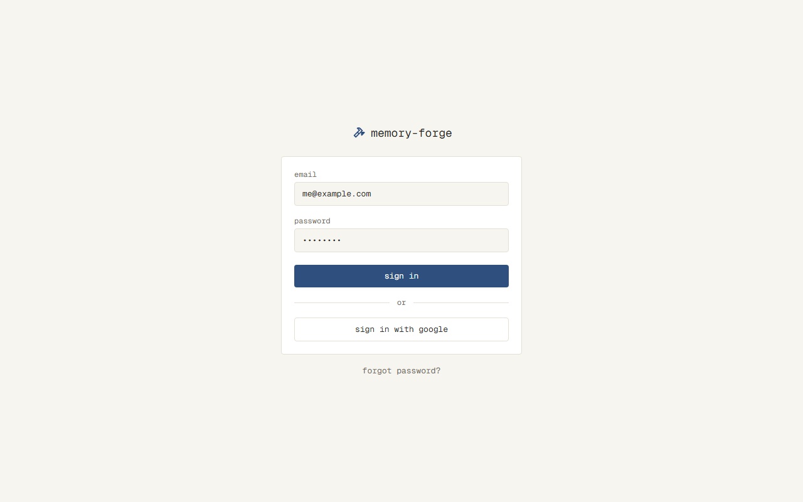
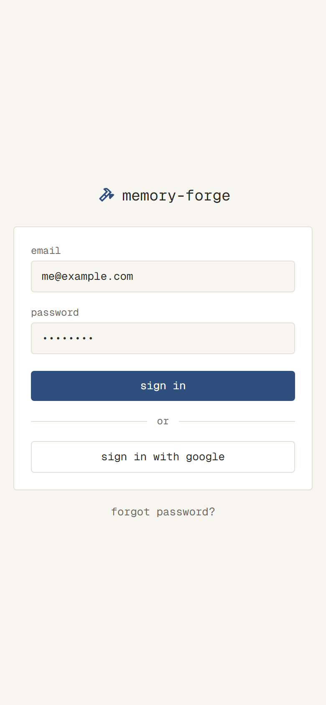
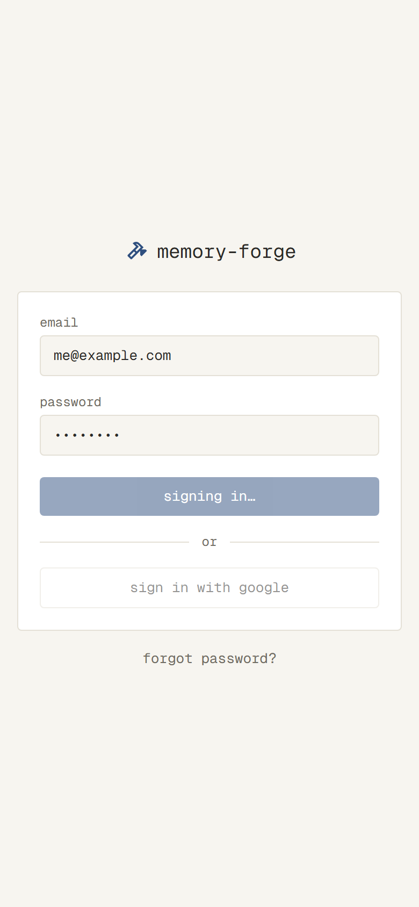
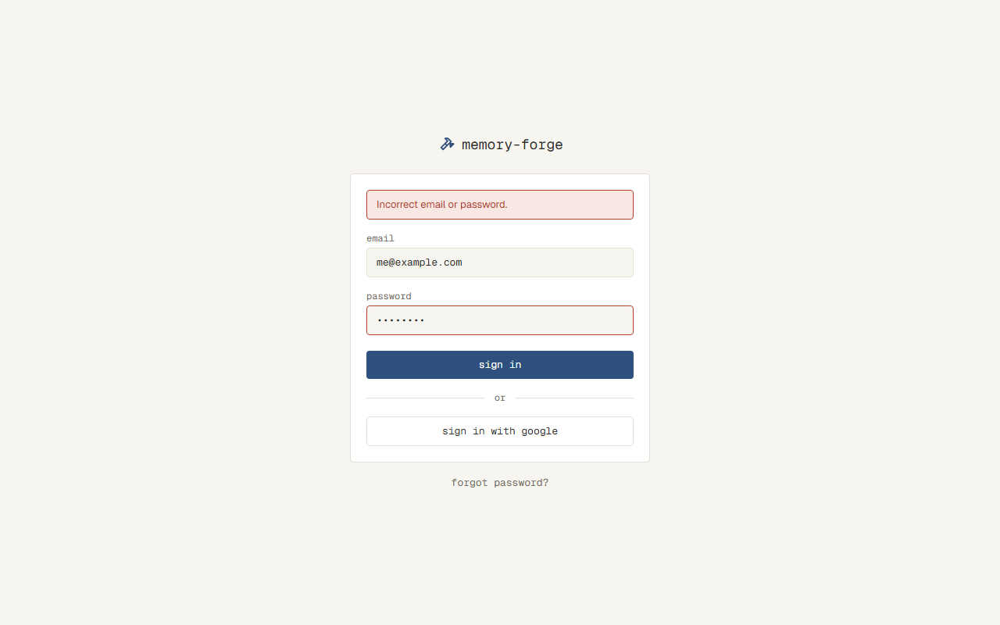
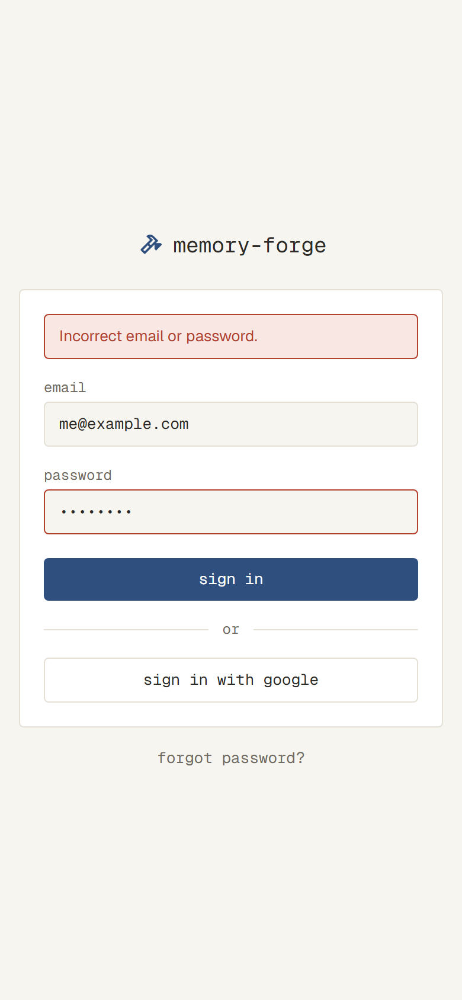
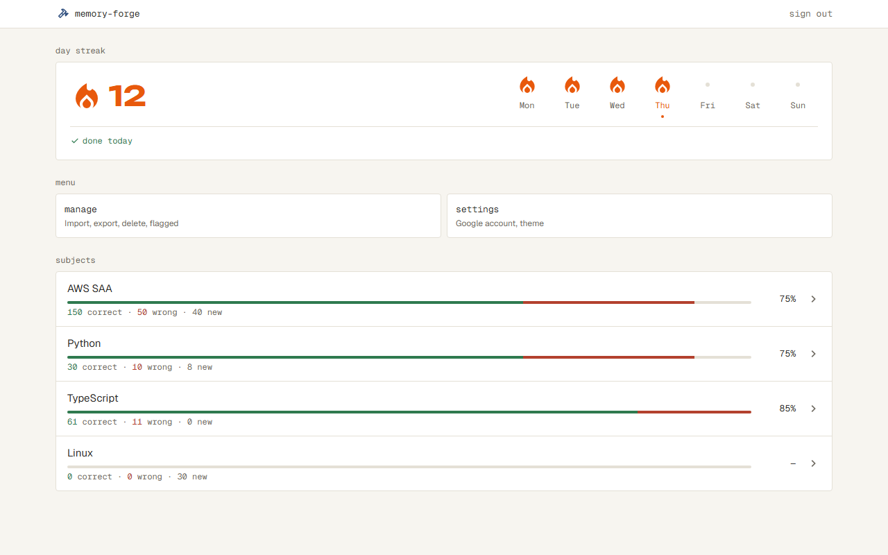
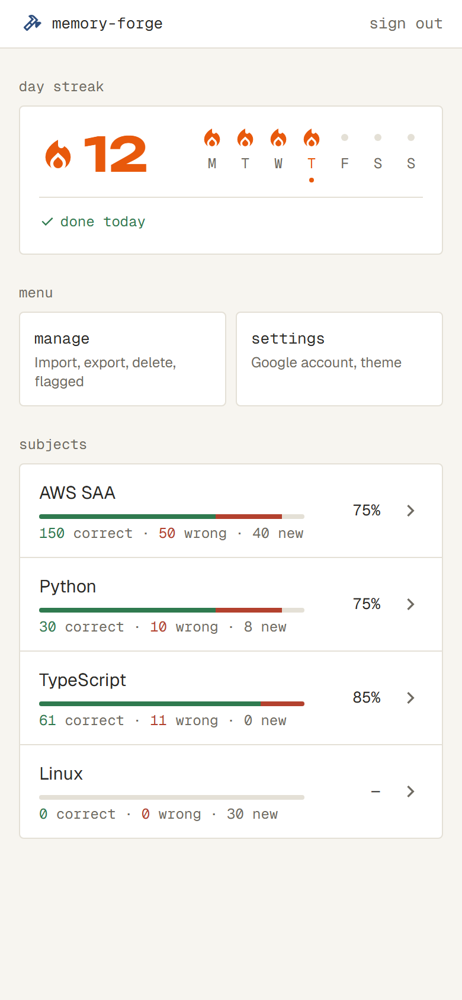

# ログインできる（#3）

## なぜ

PC とスマホで同じ問題と記録を使い、公開しても他人に問題や記録を見られないようにするため。使うのは自分ひとりなので、自分のメールアドレスとパスワードだけが通り、新しい登録はできないようにする。

## 影響する今の仕様

- `docs/specs/home.md`：仮の最初の画面（`/`）。ログインしていないと見られなくなり、上のバーが付く
- 新規：`docs/specs/sign-in.md`（Login と、ログインしていないときの扱い）
- 新規：`docs/specs/app-bar.md`（上のバー。以後のすべての画面が使う）

## 使う場面

1. 自分のアカウントを持つ人が、スマホのブラウザでアプリの URL を開くと、Login が出る。メールアドレスとパスワードを入れて sign in を押すと、Home が出る
2. 同じ人が、パスワードを打ち間違えて sign in を押すと、Login のまま「incorrect email or password」の帯が出る。メールアドレスは消えずに残る
3. 他人がアプリの URL を開いても、Login しか見られない。登録する手段もない。パスワードを当てずっぽうで5回続けて間違えると、15分は入れなくなる
4. ログインしている人が、Home の上のバーの sign out を押すと、Login に戻る。ブラウザの戻るで前の画面に戻っても、中身は見られない

## 受け入れ条件

- ログインしていない人が、Login 以外のどの画面を開いても、Login が出る。sign in すると、開こうとしていた画面に移る（Login を直接開いたときは Home）
- Login で、登録されたメールアドレスと正しいパスワードを入れて sign in を押すと、Home（または開こうとしていた画面）に移る
- メールアドレスかパスワードが違うと、Login のまま、danger の帯で「Incorrect email or password.」を出す。どちらが違ったかは出さない。入れたメールアドレスとパスワードは残し、パスワードの枠を danger にする
- 5回続けて間違えると、そこから15分は、正しいメールアドレスとパスワードでも入れず、danger の帯で「Too many attempts. Try again in 15 minutes.」を出す。15分たてば、また入れる。入れたら、間違えた回数は0に戻る
- メールアドレスかパスワードが空のまま sign in を押すと、ブラウザの「入力してください」が出て、送らない
- 送っている間は、ボタンを「signing in…」にして、ボタンと入力を押せなく（打てなく）する
- つながらないなど、サーバーのエラーのときは、Login のまま、danger の帯で「Couldn't sign in. Please try again.」を出す
- Login に forgot password? のリンクを置く。パスワードの再設定（#4）ができるまでは、押しても何も起きない
- Login に、新しく登録する手段はない
- ログインしている人が Login を開くと、Home に移る
- ログインしたままでいられるのは、最後に使ってから30日。過ぎたら、ログインしていない人と同じ扱いになる
- 上のバーは、Login と解く画面以外の、すべての画面に出る。アプリ名（memory-forge）を押すと Home、sign out を押すと Login に移る
- sign out したあとは、ログインしていない人と同じ扱いになる（戻るで前の画面に戻っても、中身は見られない）

## 画面

### Login

`docs/ui.md` の「中身の幅」のとおり、sm の幅のカードにする。上のバーは出さず、カードの上にロゴとアプリ名を出す。カードの中は、上から帯（エラーのとき）、email の入力、password の入力、sign in のボタン。forgot password? のリンクは、カードの下の外に置く。

- 帯の文言は、大文字で始め、ピリオドで終える文の形にする（小文字で短くするのは、ボタンとラベルだけ）
- スクリーンショットには、Google でログインするボタン（「or」と「sign in with google」）が写っているが、この変更では作らない（#14 で作る）

| 状態 | 表示 | スクリーンショット（PC・スマホの幅） |
| --- | --- | --- |
| 通常 | ロゴとアプリ名、email・password の入力、sign in のボタン（primary）、forgot password? のリンク |   |
| 送っている間 | ボタンが「signing in…」になって薄くなり、ボタンと入力が押せない |   |
| 違う | 入力の上に danger の帯で「Incorrect email or password.」。email と password は残り、password の枠が danger |   |
| 止めている | 入力の上に danger の帯で「Too many attempts. Try again in 15 minutes.」。見た目は「違う」の帯と同じ | なし（プロトタイプにない状態） |
| サーバーのエラー | 入力の上に danger の帯で「Couldn't sign in. Please try again.」。retry のボタンは出さない（sign in をもう一度押せば済むため）。見た目は「違う」の帯と同じ | なし（プロトタイプにない状態） |

### 上のバー

| 状態 | 表示 | スクリーンショット（PC・スマホの幅） |
| --- | --- | --- |
| 通常 | 左にロゴとアプリ名（Home へ）、右に sign out |   |

- スクリーンショットは Home のものなので、上のバーの部分だけを見る。上のバーより下（連続日数、menu、subjects）は、この変更では作らない（Home の中身は今の仮の画面のまま）

## やらないこと

- 新しい登録、自分以外の人のログイン（`docs/overview.md` の「やらないこと」）
- アプリの画面から、自分のアカウントを作る（画面の外で作る）
- パスワードの再設定（#4）。この Issue では、forgot password? のリンクを置くところまで
- Google でのログイン（#14）
- アプリの画面から、パスワードやメールアドレスを変える
- Home の中身（連続日数など）。この Issue では、今の仮の画面に上のバーを付けるだけ

## 決まっていないこと

- [x] 自分のアカウント（メールアドレスとパスワード）は、どうやって最初に作る？ アプリの画面には登録の手段がないので、画面の外で作る前提でよいか → 画面の外で作る。作り方は設計で決める
- [x] forgot password? の行き先の Reset（#4）はまだない。この Issue では、リンクを置かない／押しても何も起きない／仮の画面に移る、のどれにするか → リンクは置くが、#4 ができるまで押しても何も起きない
- [x] ログインしていない人が、Home 以外の画面を開いて Login に戻されたとき、sign in のあとは Home に行くか、開こうとしていた画面に行くか → 開こうとしていた画面に行く（スマホのブックマークから開いたときなどに不便なため）
- [x] ログインしたままでいられる長さは？ → 最後に使ってから30日（スマホのすきま時間に毎回入り直さないため）
- [x] パスワードを何度も間違えたとき、しばらく入れなくする？ → 5回続けて間違えたら、15分は入れない（公開していて、通るアカウントは1つだけなので、総当たりを防ぐため）
- [x] エラーの帯の文言は？ → 違うとき「Incorrect email or password.」、止めているとき「Too many attempts. Try again in 15 minutes.」（プロトタイプで、帯は文の形にすると決めた）
- [x] つながらないなど、サーバーのエラーのときの表示は？ → danger の帯で「Couldn't sign in. Please try again.」。retry のボタンは出さない
- [x] メールアドレスやパスワードが空のまま sign in を押したら？ → ブラウザに組み込みの「入力してください」を出して、送らない
- [x] 送っている間は、ボタンを押せなくして文言を変える？ → 「signing in…」にして押せなくする
- [x] Login の画面に、アプリ名やロゴは出す？ 上のバーは出す？ → 上のバーは出さない（sign out が意味を持たないため）。カードの上にロゴとアプリ名を出す
- [x] 入力欄のラベルの文言は？ → email、password
- [x] 帯の文言は、小文字か文の形か → 文の形（大文字で始め、ピリオドで終える）。小文字にするのはボタンとラベルだけ
- [x] 間違えたとき、パスワードは空にする？ → 合意済みのプロトタイプに合わせて、残す（枠を danger にする）
- [x] 止めているときとサーバーのエラーは、プロトタイプにない。どうするか → 文で仕様に残し、スクリーンショットは付けない（見た目は「違う」の帯と同じ）
- [x] Login の Google のボタン（#14）がスクリーンショットに写っている。どうするか → プロトタイプのまま撮る。写っていても、この変更では作らない
- [x] 上のバーのスクリーンショットは？ → Home のスクリーンショットの、上のバーの部分だけを見る
- [x] 上のバーは、どの仕様ファイルに書くか → 新しく `docs/specs/app-bar.md` を作る（以後のすべての画面が使うため）

## 調べたこと

- Better Auth（1.7 系。まだ入れていないので公式のドキュメントで確かめた。入れたら、入れた版の型定義で確かめ直す）
  - メールアドレスとパスワードで入れる。`emailAndPassword.disableSignUp` で新しい登録の入口を止められる。パスワードは既定で scrypt でハッシュにする
  - セッションは DB の表に持ち、cookie にはその token を入れる。`session.expiresIn`（長さ）と `session.updateAge`（使われたとき、前に延ばしてからこの時間がたっていたら期限を延ばす）で、「最後に使ってから」の期限にできる。`session.cookieCache` は既定では使わない（使うと、sign out しても他の端末で最大その時間だけ通る）
  - 組み込みの回数の制限は「IP ごと・時間の窓ごとの回数」で、「同じアカウントで続けて5回間違えたら15分止め、入れたら0に戻す」はできない
  - サーバーアクションから呼ぶときは、`nextCookies()` のプラグインを最後に入れないと cookie が付かない
  - Next.js 16 の proxy は Node.js で動くので、proxy の中で `auth.api.getSession()` を呼んで DB まで確かめられる
  - Drizzle の adapter があり、表の定義は Better Auth の CLI で作れる
  - Google の紐づけ（#14）は `socialProviders.google` と `linkSocial()`、パスワードの再設定（#4）は `emailAndPassword.sendResetPassword` で、同じ仕組みに足せる
- Next.js 16.4（`node_modules/next/dist/docs/`）
  - `middleware` は `proxy`（`src/proxy.ts`）に名前が変わり、Node.js で動く
  - Cache Components を有効にしていると、cookie を読む部品は `<Suspense>` の中に置く（`docs/design.md` の決まりと同じ）
- Material Symbols は `next/font/google` の一覧にない。npm の `material-symbols` のパッケージに、Outlined の書体のファイルが入っている

---

## 設計

### 選んだやり方と、選ばなかったもの

| 決めたこと | 選んだもの | 比べたもの・選ばなかった理由 |
| --- | --- | --- |
| ログインの仕組み | Better Auth | 自分で作る：ハッシュ・セッション・再設定のトークン・Google の OAuth を全部自分で書き、安全の間違いも自分で防ぐことになる。Auth.js：メールとパスワード（Credentials）を公式が勧めておらず、DB のセッションと組み合わせにくく、再設定の仕組みもない |
| ログインしているかを確かめる場所 | proxy で、DB まで確かめる | proxy は cookie があるかだけ見て、DB での確かめは各画面で行う：期限切れのときに画面の側で Login に移すことになり、開こうとしていた画面を各画面から渡す必要があって、確かめる場所が2つになる |
| 「5回続けて間違える」を数える単位 | 入れたメールアドレスごと（登録されていないメールアドレスも同じに数える） | IP ごと：IP を変えれば何度でも試せ、同じ回線の自分も止まる。アプリ全体で1つ：登録されていないメールアドレスへの間違いでも自分が止まる |
| 止めるのが解けたあと | 回数は0から数え直す。止めている間に試しても15分は延びない | 解けたあと1回間違えたらまた15分止める：自分が打ち間違えたときも、すぐ15分待つことになる |
| アイコンの書体 | npm の `material-symbols` の Outlined の書体を、`next/font/local` で配る | Google Fonts の `<link>` で使うアイコンだけ読む：軽いが、アイコンを足すたびに名前の一覧を直し、画像を比べるテストが Google への通信に頼る |
| 30日の延ばし方 | 前に延ばしてから1日たっていたら延ばす（`updateAge` を1日）。切れるのは「最後に使ってから29〜30日」と、最大で約1日早くなる | 使うたびに延ばす：画面を開くたび（先読みでも）DB に書き込む |

### 変えるファイル

ログインの決まり（`src/server/auth/`）

| ファイル | すること |
| --- | --- |
| `src/server/auth/auth.ts`（新規） | Better Auth の設定。`emailAndPassword`（`disableSignUp: true`）、`session.expiresIn` 30日・`updateAge` 1日、Drizzle の adapter、`nextCookies()`。Better Auth の HTTP の入口（`/api/auth/[...all]`）は置かない（下の「Better Auth の HTTP の入口を置かない」） |
| `src/server/auth/sign-in.ts`（新規） | sign in の決まり。止めているか → Better Auth でメールアドレスとパスワードを確かめる → 結果で回数を更新、の順に行い、`"ok" \| "incorrect" \| "locked"` を返す。メールアドレスは小文字にし、前後の空白を除いてから数える |
| `src/server/auth/lockout.ts`（新規） | 間違えた回数と止める期限の計算（DB を使わない関数）。今の時刻を引数で受け取る |
| `src/server/auth/next-path.ts`（新規） | sign in のあとに移る先を決める関数。`/` で始まり `//` で始まらないパスだけを通し、ほかは `/`（よそのサイトへ移されないように） |
| `src/server/auth/session.ts`（新規） | proxy と sign out から使う、セッションを読む・終える関数 |
| `src/server/db/schema.ts` | Better Auth の表（`user`・`session`・`account`・`verification`。CLI で作った定義を貼る）と、`sign_in_attempts` を足す |
| `drizzle/` | 上の表を作る形の変更（`npm run db:generate`） |
| `scripts/create-user.ts`（新規）と `package.json` の `user:create` | 自分のアカウントを作るスクリプト。メールアドレスとパスワードを、画面に出さない入力で聞き、Better Auth と同じハッシュで `user` と `account` に入れる。接続先は `--env-file` で選ぶ |
| `.env.example` | `BETTER_AUTH_SECRET`・`BETTER_AUTH_URL` の名前を足す |
| `.github/workflows/ci.yml` | テストと画面を撮るジョブに `BETTER_AUTH_SECRET` を渡す |

画面

| ファイル | すること |
| --- | --- |
| `src/proxy.ts`（新規） | すべての画面の前で `auth.api.getSession()` を呼ぶ。ログインしていなければ `/login?next=<開こうとしていたパス>` へ、ログインしていて `/login` を開いたら `/` へ移す。延ばした期限の cookie を返事に写す。ログインしている人への返事には `Cache-Control: private, no-store` を付ける（sign out のあと、戻るで前の画面を出さないため）。`/_next/` と書体などのファイルには動かさない |
| `src/app/login/page.tsx`（新規） | Login。ロゴとアプリ名、カード、forgot password?。`next` を読むフォームは `<Suspense>` の中に置く |
| `src/app/login/sign-in-form.tsx`（新規、`"use client"`） | フォーム。`useActionState` でサーバーアクションを呼び、結果で帯の文言を出し分ける。送っている間は `fieldset disabled` とボタンの文言で押せなくする。送れなかった（つながらない）ときも帯を出す。入れた値は送ったあとも残す（React はフォームの action のあとに入力を空にするので、値を残すやり方を実装で選び、コメントに書く） |
| `src/app/login/actions.ts`（新規） | sign in のサーバーアクション。`sign-in.ts` を呼び、`ok` なら `next-path.ts` で決めた先へ `redirect`。DB のエラーなどは `"error"` を返す |
| `src/app/(app)/layout.tsx`（新規） | Login 以外の画面の外側。上のバーを付ける（解く画面は、作るときにこのまとまりの外に置く） |
| `src/app/page.tsx` → `src/app/(app)/page.tsx` | 今の仮の Home を、上のバーの付くまとまりに移す。中身は変えない |
| `src/app/(app)/actions.ts`（新規） | sign out のサーバーアクション。セッションを終えて `/login` へ `redirect` |
| `src/app/layout.tsx` | Material Symbols の書体を `next/font/local` で読み込む |
| `src/styles/globals.css` | アイコンの書体を使うクラス（`.material-symbols-outlined` 相当）を足す |
| `src/components/logo.tsx`（新規） | ロゴ（傾けた hardware のアイコンとアプリ名）。Login と上のバーで使う |
| `src/components/app-bar.tsx`（新規） | 上のバー。左にロゴ（`/` へのリンク）、右に sign out（フォームのボタン） |
| `src/components/button.tsx`（新規） | ボタン。primary（主な操作）と、枠だけのもの |
| `src/components/text-field.tsx`（新規） | ラベル付きの入力。誤りのときに枠を danger にする |
| `src/components/banner.tsx`（新規） | 帯。この変更では danger だけを使う |
| `src/components/card.tsx`（新規） | 中身の幅のカード（sm） |
| `scripts/insert-user.ts`（新規） | `create-user.ts` からアカウントの行を入れる関数を分ける。Playwright は `import.meta` を使う `create-user.ts` を読み込めないため（タスク2で分けた） |
| `e2e/global-setup.ts`（新規）・`playwright.config.ts` | テストの前に `test` のデータベースの表を空にし、テスト用のユーザーを `create-user` と同じ関数（`insert-user.ts`）で作る。ログインした状態を `storageState` に保存して、ログインが要る画面のテストで使う |
| `e2e/login.spec.ts`（新規）・`e2e/home.spec.ts` | 画面を通したテストと、画面の画像（`home.spec.ts` はログインした状態で撮る） |

- forgot password? は、リンクの見た目の `button type="button"` にし、押しても何もしない。#4 で `Link` に置き換える
- Google でログインするボタン（「or」と「sign in with google」）は作らない（#14）

### データの変更

- Better Auth の表：`user`（自分のアカウント）、`session`（ログインしている端末ごとの行。期限を持つ）、`account`（パスワードのハッシュ。#14 で Google の行が増える）、`verification`（#4 の再設定で使う）。形は Better Auth が決める
- `sign_in_attempts`：入れたメールアドレスごとの、続けて間違えた回数と止める期限

| 列 | 型 | 意味 |
| --- | --- | --- |
| `email` | text（主キー） | 入れたメールアドレス（小文字・前後の空白なし）。登録されていないものも入る |
| `failed_count` | integer | 続けて間違えた回数。入れたら行を消す |
| `locked_until` | timestamptz（空あり） | 止める期限。5回目に間違えた時刻 + 15分 |

- 回数を足すのと、5回目なら期限を入れるのは、1つの SQL（`insert … on conflict do update`）で行う（同時に送られても数え漏れないように）
- 期限が過ぎた行で間違えたら、回数を1から数え直す（期限が過ぎていれば、回数を0とみなす）
- 登録されていないメールアドレスの行は、消さずに残る。ひとりで使うので数は増えないとみなし、掃除はしない（前提が崩れたら見直す。コメントに書く）

### 理由と前提の置き場所

`docs/design.md` に書く（複数の場所に関わる）

- 「ログインの確かめ」：ログインしているかは `src/proxy.ts` で DB まで確かめ、Login 以外のすべての画面を守る。ログインしていなくても開ける画面は `/login` だけで、足すときは proxy の一覧に足す。あとで作るデータを読み書きする `src/server/` の関数とサーバーアクションは、proxy に頼らず、自分でもセッションを確かめる（サーバーアクションは proxy を通らずに呼べるため）
- 「Better Auth の HTTP の入口を置かない」：sign in・sign out は、サーバーアクションから `auth.api` を呼ぶ。`/api/auth/[...all]` を置くと、`/sign-in/email` を直接呼んで、間違えた回数の決まりを通らずにパスワードを試せてしまう。#14 などで入口を置くときは、`/sign-in/email` と `/sign-up/email` を `disabledPaths` に入れる
- 「画面の画像を撮る・比べる仕組み」：ログインが要る画面は、global setup で作ったテスト用のユーザーの `storageState` で撮る。テスト用のユーザーのメールアドレスとパスワードは、テストのコードに書いた決まった値（`test` のデータベースにだけ入る）
- 「データベースのつながり方」の秘密の値に、`BETTER_AUTH_SECRET`（cookie の署名）と `BETTER_AUTH_URL` を足す

コードのコメントに書く（そのコードだけに関わる）

- 数える単位を入れたメールアドレスにしたことと、登録されていないものも数える理由（`sign-in.ts`）
- 30日の延ばし方が1日ごとで、最大1日早く切れること（`auth.ts`）
- `Cache-Control: private, no-store` を付ける理由（`proxy.ts`）
- 入れた値を送ったあとも残すやり方（`sign-in-form.tsx`）
- `sign_in_attempts` を掃除しない前提（`schema.ts`）

### 人間がすること

- タスク1のあと：Vercel の Production に `BETTER_AUTH_SECRET`・`BETTER_AUTH_URL`、Preview に `BETTER_AUTH_SECRET`、GitHub の Secret に `BETTER_AUTH_SECRET` を入れる。`BETTER_AUTH_SECRET` は場所ごとに別の値にする（値は AI に渡さない）
  - Preview に `BETTER_AUTH_URL` を入れないのは、公開のたびに URL が変わり、1つの値に決められないため。入れないと Better Auth はアクセスされた URL を使い、HTTP の入口も Google の戻り先もない今の作りでは困らない。Google でのログイン（#14）で決め直す
- タスク2の前に：手元の `.env.test` と `.env.local` に、`BETTER_AUTH_SECRET`（それぞれ別の値）と `BETTER_AUTH_URL`（`http://localhost:3000`）を入れる。画面のテストと `npm run dev` で、アプリが Better Auth を使うようになるため
- タスク1が本番に出たあと：本番の接続先で `npm run user:create` を実行し、自分のアカウントを作る（タスク2が本番に出る前に）

## 確かめ方

| 受け入れ条件 | 確かめ方 |
| --- | --- |
| ログインしていない人が Login 以外を開くと Login。sign in すると開こうとしていた画面（Login を直接開いたら Home） | テスト：移る先を決める関数（`next-path.ts`）を Vitest で、`/` で始まるパスは通り、`//example.com` と `https://example.com` は `/` になる。画面のテストで、ログインせずに `/missing` を開くと Login に移り、sign in すると `/missing` に移る |
| 正しいメールアドレスとパスワードで Home（または開こうとしていた画面）に移る | テスト：上の画面のテストと同じ。Login を直接開いて sign in すると `/` に移る |
| 違うと「Incorrect email or password.」。どちらが違ったかは出さない。値は残り、password の枠が danger | テスト：`sign-in.ts` を Vitest で（`test` のデータベース）、メールアドレスが違うときとパスワードが違うときが、どちらも `"incorrect"` になる。画面のテストで、帯の文言と、email・password の値が残ることを確かめる。枠の色は、画面の画像（`login-error`）で確かめる |
| 5回続けて間違えると15分は入れず「Too many attempts. …」。15分たてば入れ、入れたら0に戻る | テスト：`lockout.ts` と `sign-in.ts` を Vitest で、時刻を渡して確かめる。4回目は `"incorrect"`・5回目から `"locked"`、止めている間は正しいパスワードでも `"locked"`、15分の直前は `"locked"`・直後は `"ok"`、入れたあとは4回間違えても止まらない、期限が過ぎたあとの1回の間違いでは止まらない。画面のテストで、登録されていないメールアドレスで5回間違えて、帯の文言を確かめる |
| 空のまま押すと、ブラウザの「入力してください」が出て送らない | コードを見て確かめる：2つの入力に `required` が付いている |
| 送っている間は「signing in…」で、ボタンと入力が押せない | 触って確かめる。見た目は画面の画像（`login-loading`）でも確かめる |
| サーバーのエラーで「Couldn't sign in. Please try again.」 | テスト：画面のテストで、サーバーアクションへの通信を `page.route` で失敗させ、帯の文言を確かめる。サーバーの中のエラー（DB など）を `"error"` にするところは、コードを見て確かめる |
| forgot password? のリンクがあり、押しても何も起きない | 触って確かめる |
| 新しく登録する手段はない | コードを見て確かめる：`disableSignUp: true` で、Better Auth の HTTP の入口がなく、画面に登録へのリンクがない |
| ログインしている人が Login を開くと Home | テスト：画面のテストで、ログインした状態で `/login` を開くと `/` に移る |
| ログインしたままでいられるのは、最後に使ってから30日 | コードを見て確かめる：`session.expiresIn` と `updateAge` |
| 上のバーは Login と解く画面以外に出る。アプリ名で Home、sign out で Login | 触って確かめる：上のバーが出ること（今は Home だけ）とアプリ名のリンク。見た目は画面の画像（`home-default`）でも確かめる。sign out で Login に移るのは、下のテストで確かめる |
| sign out したあとはログインしていない人と同じ（戻るで中身が見えない） | テスト：画面のテストで、sign out すると Login に移り、ブラウザの戻るで `/` に戻っても Login が出る。テストのあとで共有のログイン状態を使えなくしないよう、このテストは自分で sign in したセッションで行う |

## タスク

- [x] 1. ログインの決まりと表：Better Auth を入れて表を作り、`npm run user:create` で自分のアカウントを作れて、sign in の関数が「違う・止めている・入れた」を受け入れ条件どおりに返せたら完了
  - `src/server/auth/`（`auth.ts`・`sign-in.ts`・`lockout.ts`・`next-path.ts`・`session.ts`）、`schema.ts` と `drizzle/`、`scripts/create-user.ts`、`.env.example`、`ci.yml`、Vitest のテスト
  - `docs/libraries/better-auth.md` の下書き。`docs/design.md` に「Better Auth の HTTP の入口を置かない」と、秘密の値の追記
  - 画面は変えない（画面からはまだ使わない）
- [x] 2. Login：ログインしていない人が Login に移され、sign in すると開こうとしていた画面に移れたら完了
  - `src/proxy.ts`、`src/app/login/`、`src/components/`（`logo`・`card`・`text-field`・`button`・`banner`）、Material Symbols の書体の読み込み、`e2e/global-setup.ts`、`e2e/login.spec.ts`、`e2e/home.spec.ts` をログインした状態で撮るように直す
  - `docs/design.md` に「ログインの確かめ」と、「画面の画像を撮る・比べる仕組み」のログインの追記
  - 合わせるスクリーンショット：`login-default.png`・`login-default-mobile.png`・`login-loading.png`・`login-loading-mobile.png`・`login-error.png`・`login-error-mobile.png`（Google のボタンは作らない）
  - 撮り直す画面：Login（新規）。Home は、ログインして撮っても見た目が変わらないこと（比べるテストが通ること）を確かめ、撮り直さない
- [ ] 3. 上のバーと sign out：Home に上のバーが出て、sign out すると Login に移り、戻っても中身が見えなくなったら完了
  - `src/app/(app)/`（`layout.tsx`・`page.tsx` を移す・`actions.ts`）、`src/components/app-bar.tsx`、`e2e/home.spec.ts` に sign out のテスト
  - 合わせるスクリーンショット：`home-default.png`・`home-default-mobile.png` の上のバーの部分だけ（その下は今の仮の画面のまま）
  - 撮り直す画面：Home
