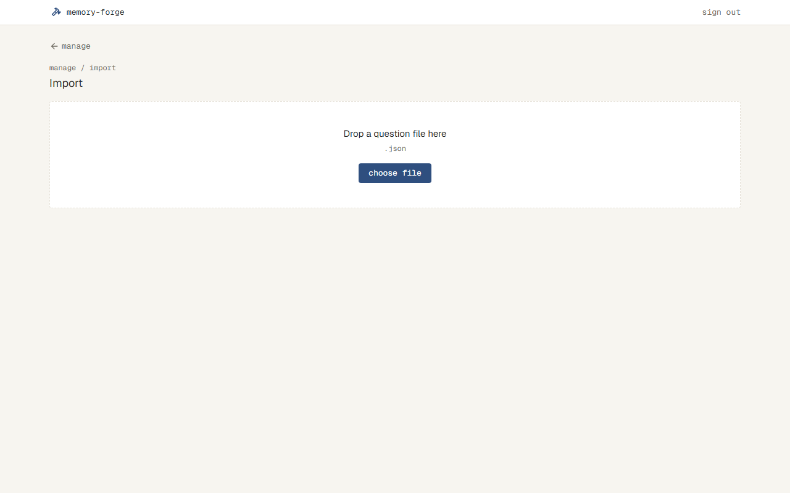
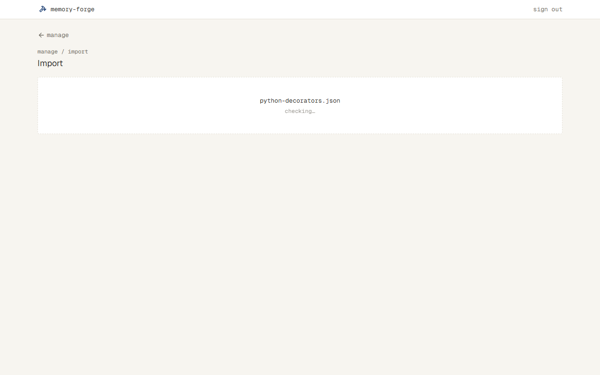
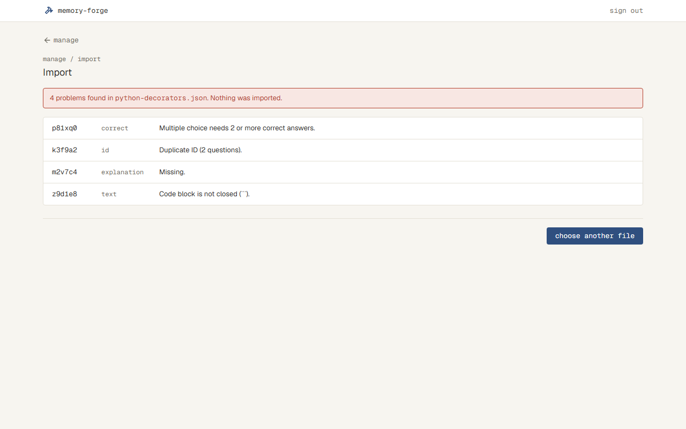
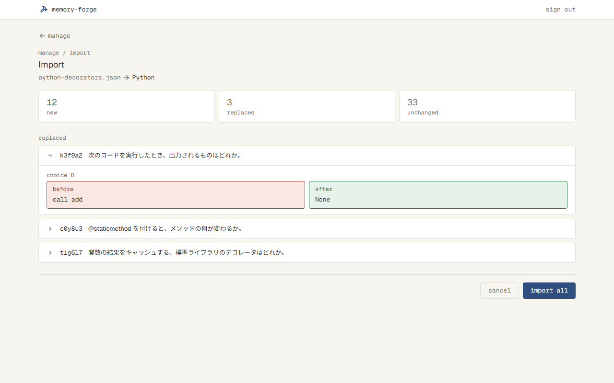
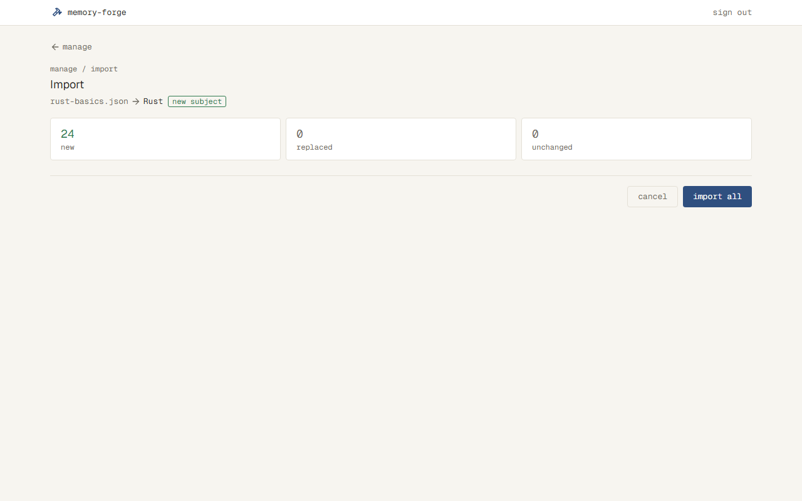
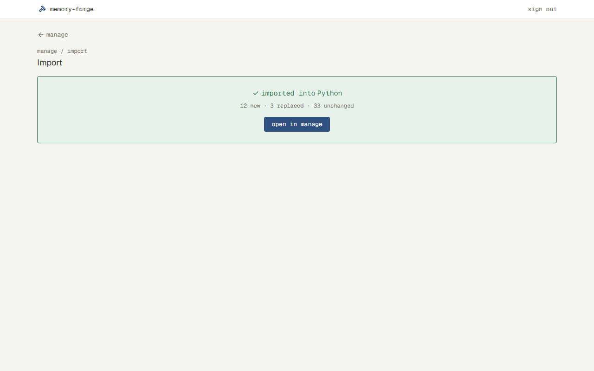
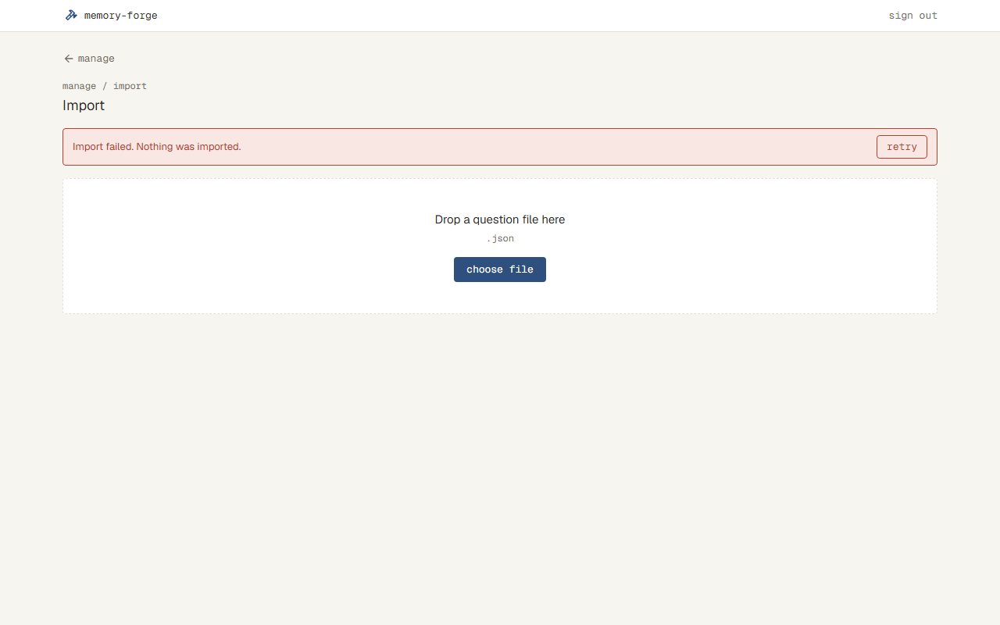

# 問題のファイルを取り込める（#5）

## なぜ

Claude Code に作らせた問題を、アプリで解けるようにするため。今のアプリには、問題を入れる手段がない。問題がないと、解く（#6）・結果（#8）・記録（#9）・一覧（#11）も作れず、触って確かめられない。

手で直したファイルなど、確かめていないファイルが来ることもあるので、取り込む前にファイルを確かめ、誤りがあれば何も取り込まない。ID が偶然重なって別の問題で古い問題を上書きしないよう、取り込む前に、何が増え、何が置き換わるかを見せる。

## 影響する今の仕様

- `docs/specs/home.md`：Home に、Manage への入り口と、Subject が0件のときの Import への入り口が増える
- 新規：`docs/specs/import.md`（Import）
- 新規：`docs/specs/manage.md`（Manage。この変更では Import への入り口だけ）
- `docs/specs/app-bar.md`：上のバーが出る画面に、Import と Manage が増える
- `docs/overview.md` の「問題づくり」：問題のファイルは「JSON か CSV」から「JSON」になる（仕上げで直す）

## 使う場面

1. Subject「Python」の問題30問（Topic「Decorators」「Generators」）を書いたファイルを持つ自分が、Home の import から Import を開き、ファイルを選ぶ。確かめが終わると、取り込む前の確認に「Python」と「new subject」、増える問題が30と出る。import all を押すと、取り込んだという知らせが出る
2. 同じ「Python」のファイルの、3問の解説を直し、5問を足した自分が、Manage の import から取り込む。取り込む前の確認に、増える5・置き換わる3・変わらない27と、置き換わる3問の前と後が出る。cancel を押すと、ファイルを選ぶところに戻り、何も変わらない
3. 正解が選択肢の中にない問題が1つ、問題文が空の問題が1つあるファイルを選んだ自分に、danger の帯で「2つの誤りがあり、何も取り込んでいない」ことと、どの問題のどの項目がどう誤りかが1行ずつ出る。choose another file で、ファイルを選ぶところに戻る

## 受け入れ条件

### 入り口

- Home の menu の manage で Manage に移る
- Home で Subject が0件のときは、Import への入り口（import）が出る
- Manage の import で Import に移る
- Import の戻るリンク（manage）で Manage に移る
- Import と Manage は、ログインしていないと見られない（`docs/specs/sign-in.md`）

### ファイルを選ぶ

- choose file でファイルを選ぶか、ファイルを選ぶところにファイルを落とすと、確かめが始まる
- 確かめている間は、そのことがわかる表示になり、別のファイルを選べない

### ファイルの確かめ

- 受け付けるのは JSON のファイル。1つのファイルに書ける Subject は1つだけ
- 次のどれかに当たると、誤りとし、何も取り込まない
  - ファイルの中に、同じ ID の問題が2つ以上ある（取り込み済みの問題と同じ ID なのは誤りではなく、「同じ問題」として置き換える）
  - 決まった項目（Subject、Topic、ID、問題の種類、問題文、選択肢、正解、解説）がそろっていない、または空
  - 正解が選択肢の中にない。単一選択で正解が1つでない。複数選択で正解が2つ以上でない
  - 選択肢が2つより少ない、または8つより多い
  - コードブロックの書き方が崩れている（``` の開きと閉じが対になっていない。言語の名前は確かめない）
  - ファイルの形が決まった形でない（JSON として読めない、項目の形が違う、Subject が2つ以上ある）
  - 問題が1,000問より多い（1,000問ちょうどは取り込める）。問題が0問
  - ファイルが 4MB より大きい（4MB ちょうどは取り込める）
- 誤りがあると、danger の帯で、誤りの数と、何も取り込んでいないことを出す。その下に、誤りごとに、問題（ID）・項目・内容を1行ずつ出す。誤りが多くても、全部を出す
  - ファイル全体の誤り（JSON として読めない、など）は、ID の列に「—」を出す
  - ID が書かれていない問題は、ID の列に何問目か（`#3` など）を出す
- 誤りの一覧の choose another file で、ファイルを選ぶところに戻る

### 取り込む前の確認

- 誤りがなければ、取り込む前の確認を出す。この時点では、まだ何も変わっていない
- ファイル名と Subject の名前を出す。まだない Subject なら、「new subject」と添える
- 増える問題・置き換わる問題・変わらない問題の数を出す
  - 増える：その Subject に、同じ ID の問題がない
  - 置き換わる：同じ ID の問題があり、中身（Topic、問題の種類、問題文、選択肢、正解、解説のどれか）が違う。Topic だけが違う（別の Topic に移した）問題も、置き換わる
  - 変わらない：同じ ID の問題があり、中身がすべて同じ
- 置き換わる問題ごとに、前と後の中身を出す
- import all を押すと、全部を取り込み、取り込んだという知らせを出す。知らせの open in manage で Manage に移る
- cancel を押すと、ファイルを選ぶところに戻る。何も変わらない

### 取り込んだあと

- 増える問題が足され、置き換わる問題は新しい中身になる。変わらない問題はそのまま
- ファイルにない、取り込み済みの問題は、消えずに残る
- 取り込み先の Subject は、ファイルに書いた Subject で決まる。まだなければ新しくできる
- 取り込んだあと、問題が1つもなくなった Topic は消える
- 取り込みは、全部が入るか、何も入らないかのどちらか（途中まで入った状態にならない）
- 確かめ中や取り込む前の確認のときに、ほかの画面へ移ったりページを閉じたりしても、何も変わらない。取り込み中なら、全部が入るか、何も入らないか

### エラー

- 確かめや取り込みの途中で、つながらないなどのサーバーのエラーが起きたら、danger の帯で出し、何も変わらない

## 画面

スクリーンショットは、印と記録（#9・#12）と、問題の作り方の説明へのリンク（#15）を隠して撮った。

### Import

- 上に、戻るリンク（manage）、パンくず（manage / import）、見出し「Import」を置く
- 置き換わる問題は、1問ずつ開閉する行にする。行には ID と問題文の1行目を出し、開くと、変わった項目ごとに、前（danger の枠）と後（success の枠）を横に並べる（スマホの幅では縦）。最初の1問だけを開いておく
- 増える・置き換わる・変わらない数は、3つの枠に横に並べ、増えるは success、置き換わるは warning（0なら muted）、変わらないは muted の数字にする

| 状態 | 表示 | スクリーンショット |
| --- | --- | --- |
| ファイルを選ぶ | 点線の枠の中に「Drop a question file here」「.json」と choose file |  |
| 確かめ中 | 点線の枠の中に、ファイル名と、点滅する「checking…」。choose file は出さない |  |
| 誤り | danger の帯「4 problems found in python-decorators.json. Nothing was imported.」、誤りの一覧（ID・項目・内容）、choose another file |  |
| 取り込む前の確認 | 「python-decorators.json → Python」、new・replaced・unchanged の数、「replaced」の見出しと置き換わる問題、cancel と import all |  |
| 取り込む前の確認（まだない Subject） | Subject の名前の右に、success の枠の「new subject」。置き換わる問題の一覧は出さない |  |
| 取り込み中 | import all を押せない表示にし、ボタンの文字を「importing…」にする。cancel も押せない（スクリーンショットなし） | |
| 取り込んだ | success の枠に「imported into Python」と、数（12 new · 3 replaced · 33 unchanged）、open in manage |  |
| サーバーのエラー | danger の帯「Import failed. Nothing was imported.」と retry。その下にファイルを選ぶところ |  |

誤りの一覧の、項目と内容の文言

| 誤り | 項目 | 内容 |
| --- | --- | --- |
| 項目がない・空 | その項目 | Missing. |
| ID が重なる | id | Duplicate ID (2 questions). |
| 複数選択で正解が2つ未満 | correct | Multiple choice needs 2 or more correct answers. |
| 単一選択で正解が1つでない | correct | Single choice needs exactly 1 correct answer. |
| 正解が選択肢にない | correct | Not one of the choices (E). |
| 選択肢の数 | choices | Needs 2 to 8 choices. |
| 種類が違う | type | Must be single or multiple. |
| コードブロックが閉じていない | text・choice B・explanation | Code block is not closed (\`\`\`). |
| 項目の形が違う（文字でない、など） | その項目 | Wrong format. |
| JSON として読めない | file | Not valid JSON. |
| 大きすぎる | file | Too large. Up to 4 MB. |
| 問題が多すぎる | questions | Too many questions (1,200). Up to 1,000. |
| 問題が0問 | questions | No questions. |

### Manage

| 状態 | 表示 |
| --- | --- |
| 通常 | 上に戻るリンク（home）、見出し「Manage」と「Import, export and delete questions.」、右に primary の import のボタン（中身は #11。スクリーンショットなし） |

### Home

スクリーンショットはなし（ほかの Issue の部分が多く写るため）。

| 状態 | 表示 |
| --- | --- |
| Subject が0件 | 「subjects」の見出しの下、点線の枠の中に「No subjects yet.」「Import a question file to get started.」と primary の import |
| 通常 | 「menu」の見出しの下に、枠の行「manage」と「Import, export, delete, flagged」 |
| Subject が1つ以上 | 「subjects」の見出しごと出さない（Subject の一覧は #6 で足す）。menu は出す |

## やらないこと

- 問題の一覧・書き出し・削除（Manage の中身）は作らない（#11）
- Home の Subject の一覧は作らない（#6）
- 解く・記録・不備の印は作らない（#6・#9・#12）。そのため「不備の印が付いた問題を取り込み直すと、印が消え、記録がリセットされる」は、印と記録を作るときに足す
- 問題の作り方のドキュメントと、Claude Code のルール・スキル（#15）。Import の下のドキュメントへのリンクは #15 で足す
- 取り込む前の確認で、問題を1問ずつ選んで取り込まない（`docs/overview.md` の「やらないこと」）
- アプリの画面で問題を書き換えない（`docs/overview.md` の「やらないこと」）
- コードを色付きで出さない（#7）

## 決まっていないこと

- [x] Manage は、import への入り口だけの仮の画面にして、中身は #11 で作る？ → そうする（`/dev-triage` で決めた）
- [x] Home は、menu の manage と、Subject が0件のときの import の入り口だけを足す？ → そうする（`/dev-triage` で決めた）
- [x] 問題のファイルの形と確かめることは、#5 で決める？ → #5 で決める。#15 はそれを使う（`/dev-triage` で決めた）
- [x] ファイルの形は、JSON と CSV の両方を受け付ける？ JSON だけにする？（`docs/overview.md` には「JSON か CSV」とある。CSV は、選択肢や正解のように数が決まらない項目と、改行の入るコードを書きにくい） → JSON だけ
- [x] 1つのファイルに書ける Subject は1つだけ？（書き出しが Subject の単位なので、合わせると取り込み直しが素直になる） → 1つだけ
- [x] 問題の種類（単一選択・複数選択）は、ファイルに書く？ 正解の数から決める？ → ファイルに書く（正解の数がずれたときに、誤りとして見つけられる）
- [x] 選択肢の数に、下限・上限はある？ → 2〜8
- [x] 1つのファイルに入れられる問題の数に、上限を設ける？ → 1,000問まで。超えたら誤りとして出す
- [x] 「コードブロックの書き方が崩れている」は、どこまで確かめる？ → ``` の開きと閉じが対になっていること。言語の名前は確かめない（色付けは #7）
- [x] 誤りがとても多いとき（例：数百）も、全部を1行ずつ出す？ → 全部を出す。誤りの数は帯に出す
- [x] 中身の比べで、Topic だけが違う問題（別の Topic に移した）は「置き換わる」でよい？ → よい
- [x] 取り込んだあと、Topic に問題が1つもなくなったとき、その Topic は消える？ 残る？ → 消える（Topic は問題の中の名前で見分けるため）
- [x] 確かめ中・取り込み中に、ほかの画面へ移ったり、ページを閉じたりしたときは、何も変わらない（取り込み中なら、全部入るか何も入らないか）でよい？ → よい
- [x] 画面の文言（帯の文、ボタン、0件の説明など）は、合意済みのプロトタイプに合わせて `/dev-proto` で決める、でよい？ → よい
- [x] 4MB を超えるファイルと、問題が0問のファイルは、誤りにする？（設計で、サーバーが受け取れる大きさから出てきた） → 誤りにする
- [x] ファイル全体の誤りと、ID が書かれていない問題は、誤りの一覧の ID の列に何を出す？ → ファイル全体は「—」、ID がない問題は `#3` のように何問目か
- [x] Home で Subject が1つ以上あるとき、「subjects」の見出しの下に何を出す？ → 見出しごと出さない。#6 で一覧を作るときに足す

## 調べたこと

インストールされている版のドキュメントと型定義で確かめた（2026-10-24）

- Next.js 16.4.0（`node_modules/next/dist/docs/.../serverActions.md`）：サーバーアクションが受け取れる大きさは、既定で 1MB。`next.config.ts` の `experimental.serverActions.bodySizeLimit` で変えられる。上限は、送るときの区切りの文字も含めた大きさで数える
- Vercel：関数が受け取れる大きさは 4.5MB まで
- drizzle-orm 0.45.4（`node-postgres`）：`db.transaction(async (tx) => ...)` で、1つのトランザクションにできる

---

## 設計

### ファイルの形

```json
{
  "subject": "Python",
  "questions": [
    {
      "id": "k3f9a2",
      "topic": "Decorators",
      "type": "single",
      "text": "次のコードを実行したとき、出力されるものはどれか。\n\n```python\n...\n```",
      "choices": ["call add", "add", "None", "エラー"],
      "correct": ["C"],
      "explanation": "..."
    }
  ]
}
```

- `type` は `single`（単一選択）か `multiple`（複数選択）
- `correct` は、選択肢の記号（A〜H。`choices` の並び順）の並び。画面の「choice D」と同じ呼び方にし、選択肢の文を書き写さずに済ませるため
- Subject は、いちばん上に1つだけ書く。「Subject が2つ以上ある」は、形が違う誤りになる
- 文字の項目は、前後の空白だけのものを「空」とみなす。比べるときと、取り込むときは、書かれたまま（空白も含めて）扱う（コードの字下げを崩さないため）
- コードブロックの確かめ：`text`・`choices` の1つずつ・`explanation` ごとに、行の始め（前の空白は除く）が ``` の行を数え、奇数なら閉じていない
- 仕上げで、この形を `docs/specs/import.md` に書く（#15 の作り方のドキュメントも、これを元にする）

### データ

- 新しい表を2つ足す（`src/server/db/schema.ts`、形の変更は `npm run db:generate`）
  - `subjects`：id（自動の番号）、名前（重ならない）、作った日時
  - `questions`：id（自動の番号）、Subject（`subjects` を指す。Subject を消すと一緒に消える）、ファイルの ID、Topic の名前、種類、問題文、選択肢（JSON の文字の並び）、正解（JSON の記号の並び）、解説、作った日時、変わった日時
    - Subject とファイルの ID の組み合わせは重ならない（データベースの決まりでも守る）
- Topic は表にせず、問題の列に名前で持つ。問題が1つもなくなった Topic は、何もしなくても消える（受け入れ条件）。Topic の一覧は、問題を Topic の名前でまとめて作る
- 持ち主（どのユーザーの問題か）の列は持たない。使う人がひとりで、仕様にない分かれ道を作らないため。複数人で使うときに足す（`docs/design.md` の「データ」に前提として書く）
- 選択肢と正解は、別の表にせず JSON の列にする。選択肢ごとに記録や印を持つ予定がなく、1問を1行で読み書きできるため

### 変えるファイル

- `src/server/import/validate.ts`（新規）：ファイルの中身（文字）を受け取り、形と決まりを確かめて、問題の並びか、誤りの並び（ID・項目・内容）を返す。データベースを使わない
  - 大きさ（4MB）・JSON として読めるか・形・問題ごとの決まり・ファイルの中の ID の重なりを確かめる。誤りは全部を集めて返す
  - 誤りの内容の文言は、ここで決める（「画面」の表）
- `src/server/import/diff.ts`（新規）：ファイルの問題と、取り込み済みの問題を比べ、増える・置き換わる・変わらないに分ける。置き換わる問題には、変わった項目ごとの前と後（項目：topic・type・text・choice A〜H・correct・explanation）を付ける。データベースを使わない
  - 選択肢の数が変わったときは、ない側を空にして出す
- `src/server/import/import.ts`（新規）：データベースを読み書きする
  - `previewImport(内容)`：確かめ → 同じ名前の Subject の問題を読む → 比べる。何も書かない
  - `applyImport(内容)`：1つのトランザクションの中で、確かめ直し → Subject がなければ作る → 増える問題を足し、置き換わる問題を書き換える → 数を返す。変わらない問題とファイルにない問題には触らない
- `src/app/(app)/manage/page.tsx`（新規）：Manage。戻るリンク（home）、見出し、import のボタン
- `src/app/(app)/manage/import/page.tsx`（新規）と、その横のサーバーアクション（`actions.ts`）、画面の動き（`import-flow.tsx`。ブラウザで動く部品）
  - 選んだファイルは、まず画面で大きさ（4MB）を確かめ、超えていれば送らずに誤りを出す。超えていなければ文字として読み、`previewImport` のアクションに送る
  - 画面は読んだ中身を持っておき、import all で、同じ中身を `applyImport` のアクションに送る。retry は、最後に失敗した操作（確かめ・取り込み）を同じ中身でやり直す
  - アクションは、`docs/design.md` の決まりどおり、自分でもセッションを確かめる
  - 状態：選ぶ・確かめ中・誤り・確認・取り込み中・取り込んだ・サーバーのエラー
- `next.config.ts`：`experimental.serverActions.bodySizeLimit` を `"4.5mb"` にする。4MB のファイルと、送るときの区切りの文字が入るように。Vercel の上限（4.5MB）は超えない（コメントに書く）
- `src/components/`：今ある部品（ボタン・帯・カード）を使う。足す部品は、戻るリンクとパンくず、ファイルを落とす点線の枠、数の枠、開閉する前と後の行、誤りの一覧の行（どれも「画面」に書いた見た目）
- `src/app/(app)/page.tsx`（Home）：「subjects」の見出しと、Subject が0件のときの点線の枠（No subjects yet. と import）、「menu」の見出しと manage の行
  - Subject の数を読むので、`docs/design.md` の決まりどおり `<Suspense>` で囲む
- `e2e/`：Import・Manage・Home の画面のテスト。状態は、テストの前に `test` のデータベースに決まった Subject と問題を入れて作る
- `docs/design.md`：「データ」に `subjects`・`questions` と、Topic を列に持つこと、持ち主の列を持たないことの前提を足す。全体の構成の `server/import/` はすでに例にある
- `docs/ui.md`：仕上げで、「画面」に書いた見た目の決まり（パンくず、数の枠、前と後の行）を移す

### 選ばなかったやり方

- Topic を別の表にする：空になった Topic を消す処理が要る。Topic に別の情報を持たせる予定がないので選ばない
- 確かめた結果をサーバーに一時的に置き、import all ではその印だけを送る：送るのは1回で済むが、一時的なデータの表と掃除が要る。1人で使うので、ファイルを2回送るほうが簡単。取り込むときにも確かめ直すので、確かめていない中身は入らない
- `correct` に選択肢の文を書く：選択肢の文を2回書くことになり、ずれやすい
- CSV も受け付ける：仕様で JSON だけにした

## 確かめ方

- 入り口（Home の manage・0件の import、Manage の import、Import の戻るリンク）：触って確かめる（行き先は画面を見ればわかる）。見た目は画像を比べるテスト
- Import と Manage はログインしていないと見られない：コードを見て確かめる（`src/proxy.ts` が `/login` 以外を止めている。新しい画面を一覧に足していないこと）
- ファイルを選ぶ・落とすと確かめが始まる、確かめ中は選べない：触って確かめる
- ファイルの確かめ（誤りの決まりと文言、ID の列の「—」と `#3`、1,000問と 4MB の境界、誤りを全部出す）：テスト（`src/server/import/validate.test.ts`。決まりごとに、当たる側と当たらない側を1つずつ。境界は両側）
- 4MB を超えるファイルを、画面で送らずに誤りにする：触って確かめる（中の決まりは `validate.ts` のテストで確かめる）
- 誤りの一覧の出し方、choose another file：画像を比べるテスト（`import-errors`）と、画面のテスト（誤りの帯の文言が出る）
- 増える・置き換わる・変わらないの分け方、変わった項目の前と後：テスト（`src/server/import/diff.test.ts`）
- 取り込む前の確認の表示（ファイル名 → Subject、new subject、数、前と後）：画像を比べるテスト（`import-preview`・`import-preview-new`）
- 取り込む前の確認では何も変わらない、cancel で何も変わらない：テスト（`previewImport` のあとで、データベースが変わっていない）
- import all で取り込む（増える・置き換わる・変わらない、ファイルにない問題が残る、新しい Subject ができる、空になった Topic が消える）：テスト（`src/server/import/import.test.ts`。`test` のデータベースを使う）。知らせは画像を比べるテスト（`import-done`）
- 全部が入るか、何も入らないか：コードを見て確かめる（`applyImport` が1つのトランザクションの中で書く）と、テスト（確かめ直しで誤りになる中身を `applyImport` に渡すと、何も書かれない）
- 画面を離れても何も変わらない：コードを見て確かめる（確かめは何も書かず、書くのは `applyImport` の1つのトランザクションだけ）
- サーバーのエラーで danger の帯と retry、何も変わらない：触って確かめる（データベースにつながらない状態を作りにくいため。見た目は合意したスクリーンショットと見比べる）
- 取り込み中の表示：触って確かめる

## タスク

- [ ] `subjects`・`questions` の表を足し、`docs/design.md` の「データ」に書く（形の変更が `dev`・`test`・CI に当たり、今あるテストが通ったら完了）
- [ ] 問題のファイルを確かめる `validate.ts` を作る（誤りの決まりと文言のテストが通ったら完了）
- [ ] 取り込む前の比べ（`diff.ts`）と、確かめ・取り込み（`import.ts`）を作る（比べと、データベースに入る・入らないのテストが通ったら完了）
- [ ] Manage と Import の画面を作る（スクリーンショット：`import-select.png`・`import-checking.png`・`import-errors.png`・`import-preview.png`・`import-preview-new.png`・`import-done.png`・`import-error.png`。Manage はスクリーンショットなし。合意した画像と見比べ、画像を比べるテストの基準を撮ったら完了）
- [ ] Home に「subjects」の0件の表示と、「menu」の manage を足す（スクリーンショットなし。「画面」の Home の表に合わせ、Home の基準の画像を撮り直したら完了）
