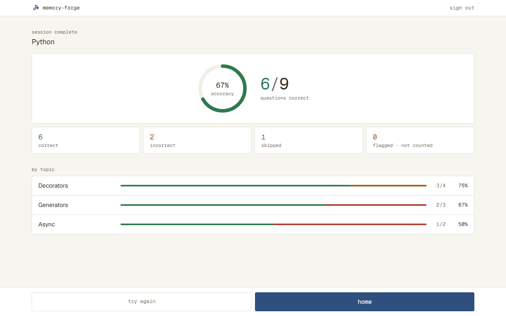

# 解き終わりに結果を見られる（#8）

## なぜ

今は、最後の問題で results を押しても Setup に戻るだけで、解いた回の出来がわからない。解き終わりに正答率・得点・数と Topic ごとの結果を出し、ひと目で出来をつかんで、もう一度解くかを決められるようにする。

## 影響する今の仕様

- `docs/specs/solve.md` の「Solve」：最後の問題の results と skip で Setup に戻る、を Result に移るに変える
- `docs/specs/solve.md` の「Setup」：Solve から戻ったときに直前の選び方のままになる場合に、Result の try again を足す
- `docs/specs/app-bar.md`：上のバーが出る画面に Result を足す
- 新規：Result（`docs/specs/solve.md` に「Result」の節を足す）

## 使う場面

1. Python の Decorators を10問解いた人が、7問正解・2問不正解・1問スキップで、最後の問題で results を押すと、「session complete」と「Python」、正答率 70% と得点 7/10、correct 7・incorrect 2・skipped 1・flagged 0 の数、Decorators の行（7/10、70%）が出る。try again を押すと、Decorators・in order・10 を選んだままの Setup に戻る
2. Python の All を20問解いた人が results を押すと、Topic ごとの行（Decorators 5/8、Typing 3/6 など）が Setup と同じ順に出て、どの Topic が弱かったかがわかる。home を押すと Home に戻る
3. 最後の問題をスキップした人には、Setup ではなく Result が出る。途中で quit した人は、今のまま Setup に戻る

## 受け入れ条件

- Solve の最後の問題で results を押すと、Result が出る。最後の問題で skip しても、Result が出る
- quit は、今のまま Setup に戻る
- いちばん上に上のバーが出る。戻るリンクは置かない
- 上に「session complete」と Subject の名前を出す
- 枠の真ん中に、正答率の円（success の線。真ん中に % と accuracy）と、得点（正解の数 / 解いた問題の数。例：7/10。正解の数は success）と「questions correct」を横に並べる
  - 得点と正答率では、スキップを不正解として数える
  - 正答率は、整数に四捨五入する（6/9 は 67%）
- 枠の下に、correct（success）・incorrect（danger）・skipped（danger）・flagged · not counted（warning）の数を、小さなカード4枚で出す
  - incorrect は、答えて間違えた数だけ（スキップは skipped にだけ数える）
  - flagged は、不備の印を付ける機能（#12）ができるまで、いつも 0
- 「by topic」の見出しの下に、Topic ごとの行を区切り線で並べる。行には、Topic の名前、割合の線、得点（3/4）、% を出す
  - 割合の線は、左から、正解（success）、前は正解したのに今回間違えた（warning）、前にも正解したことがない不正解（danger）の順に塗り分ける
  - 「前は正解したのに今回間違えた」は、今回不正解かスキップで、今回より前の記録に一度でも正解がある問題
  - 黄色の問題も、得点・%・incorrect と skipped のカードでは、今までどおり不正解として数える
  - 並びは Setup の Topic と同じ順（その Topic の問題が最初に出てくる順）。解いた回に出た Topic だけを出す
  - Topic を1つ選んで解いたときも、その1行を出す
  - Topic の名前は決まった幅に置き、長いときは1行に収めて「…」で切る。割合の線は、名前と得点の間の残りの幅いっぱいに伸ばす
  - Topic が多いときは、行が続き、ページごとスクロールする
- 下に固定して、try again（枠だけ）と home（主な操作）を同じ幅で横に並べる
  - try again で、同じ Subject の Setup に移る。Topic・順番・問題数は、直前に選んでいたもののまま
  - home で、Home に移る
- Result で読み込み直すと、結果は出ず、Setup の最初の選び方（All・in order・10）からになる。それまでに答えた分の記録は残る

## 画面

### Result

| 状態 | 表示 | スクリーンショット |
| --- | --- | --- |
| 通常 | 正答率の円と得点、4つの数、Topic ごとの行、try again と home |  |

- Topic が多いときは、行が続くだけなので、画像を付けない
- warning は、不備の印に加えて、Topic ごとの割合の線の「前は正解したのに今回間違えた」にも使う（仕上げで `docs/ui.md` の色の使い分けに足す）
- 結果は解き終わったときに手元で出すので、読み込み中とエラーの状態はない（設計で変わるなら、そのとき決める）
- 数える問題が0問のとき（全部に不備の印）は、#12 で扱う

## やらないこと

- 前に解いた回の結果を、あとから見返すこと（結果は解き終わったときだけ出す）
- 1問ずつの結果の一覧（`docs/ui.md` の「1問ずつの結果は、解き終わりの結果の画面で見る」は、仕上げのときに今の作りに合わせて直す）
- 不備の印を付ける機能と、数える問題が0問のときの表示（#12）

## 決まっていないこと

- [x] 不備の印（flagged）の数と「数える問題が0問のとき」をどうするか（印を付ける機能は #12 で、まだない） → flagged（not counted）のカードは出し、今はいつも 0。0問のときの表示は #12 で扱う
- [x] 最後の問題で skip したときも Result を出すか。quit は今のまま Setup に戻すか → 最後の skip は Result、quit は今のまま Setup
- [x] `docs/ui.md` の「1問ずつの結果は、解き終わりの結果の画面で見る」に合わせて、1問ずつの結果の一覧も出すか → 出さない
- [x] 下の操作の try again と home は、どちらを主な操作（primary）にするか → try again。/dev-proto で、合意済みのプロトタイプに合わせて home に変えた（try again は枠だけ、同じ幅で横に並べる）
- [x] 「Topic が多い」はプロトタイプにないが、画像を撮るか → 文で残し、画像は付けない
- [x] Topic ごとの割合の線で、前に正解したことがあるのに今回間違えた問題を黄色にするとき、どの問題が対象か → 今回不正解かスキップで、今回より前の記録に一度でも正解がある問題
- [x] その黄色の色 → warning（新しいトークンは作らない）
- [x] 黄色の問題は、得点・%・カードでどう数えるか → 今までどおり不正解
- [x] 割合の線の並び → 正解（緑）→ 前は正解（黄）→ 一度も正解なし（赤）
- [x] プロトタイプは flagged が 1 だが、今回はいつも 0。画像はどう撮るか → あとの Issue の分を隠して（flagged 0 で）撮る
- [x] try again で戻った Setup は、直前に選んでいた Topic・順番・問題数のままにするか → 直前の選び方のまま
- [x] 正答率の % の丸め方（例：6/9 = 66.7%） → 整数に四捨五入（67%）
- [x] Result の incorrect の数に、スキップを含めるか。得点と % では、スキップを不正解として数えるか → incorrect には含めない。得点と % では不正解として数える
- [x] Topic ごとの行の並び順。1つの Topic だけを解いたときも行を出すか → Setup と同じ順。1つでも出す
- [x] Result の上のバーは、ふつうの上のバー（ロゴと sign out）にするか。戻るリンクは置くか → ふつうの上のバー。戻るリンクは置かない
- [x] Result で読み込み直したときにどうするか → Setup の最初の選び方からになる
- [x] Setup を開いたあとに別のタブで取り込み直し、Setup にない Topic が解いた回に混ざったときの、Topic の行の並び → Setup の順のあとに、解いた回に出た順で置く
- [x] Topic ごとの % の丸め方 → 全体と同じく、整数に四捨五入
- [x] スマホの幅での、Topic の名前の決まった幅 → PC より狭い幅にし、長いときは「…」で切る

## 調べたこと

---

## 設計

### 画面の切り替え

- Result は、Setup・Solve と同じ `/subjects/[id]` の1つの画面の中の状態にする（`docs/design.md` の「解く画面の状態」のまま）。`study.tsx` の `Phase` に `{ kind: "result"; result: SessionResult }` を足す
  - 結果はブラウザにだけ持つので、読み込み直すと何もしなくても Setup の最初の選び方からになる（受け入れ条件どおり）。答えた記録は今までどおり1問ごとにサーバーに残っている
- `SolveView` の `onFinish` を2つに分ける
  - `onComplete(outcomes)`：最後の問題の results と skip。解いた回の1問ずつの結果を渡す。`study.tsx` が結果を数えて `result` に切り替える
  - `onQuit()`：quit のダイアログの quit。今のまま Setup に戻る（今の `backToSetup`）
- `SolveView` は、今の `counts`（上のバーの数）に加えて、1問ずつの結果 `outcomes` を持つ。submit が通ったら `correct` か `incorrect`、skip が通ったら `skipped` を足す（保存できなかった操作は足さない）
- try again は今の `backToSetup`（選び方は `study.tsx` の `choices` に残っている。`router.refresh()` で Setup の数を読み直す）。home は `/` へのリンク
- 上のバーは、Setup と同じ `AppBar`。戻るリンク（`PageHeader` の `back`）は置かない

### データ

- データベースの形は変えない
- `SolveQuestion`（`src/server/solve/start.ts`）に `correctBefore: boolean` を足す。start で問題を選ぶときに数えている正解の数（`correctCount`）が1以上なら true
  - 「今回より前の記録に正解がある」は、start の時点の記録で決まる。1つの回に同じ問題は2回出ないので、解いている間に足した記録が混ざることはない
  - 前提と理由は `start.ts` のコメントに書く（このファイルだけに関わる）
- 1問ずつの結果：`{ topic: string; outcome: "correct" | "incorrect" | "skipped"; correctBefore: boolean }`
- 結果の数え方は、データベースを使わない関数 `summarizeSession(outcomes, topicOrder)` にする（新しいファイル `src/server/solve/result.ts`。ブラウザの `study.tsx` から読む。`docs/design.md` の「全体の構成」の決まりどおり）
  - `topicOrder` は、Setup の Topic の名前の並び（`setup.topics` の順）。Setup と同じ順に並べるため。解いた回の中で最初に出た順は、random や lowest accuracy では Setup の順と違うことがあるので使わない
    - Setup を開いたあとに取り込み直して、`topicOrder` にない Topic が解いた回に混ざったときは、Setup の順のあとに、解いた回に出た順で置く
  - 返す形（`SessionResult`）
    - `correct`・`incorrect`・`skipped`・`flagged`（今はいつも 0）・`total`（解いた問題の数）・`accuracy`（整数の %）
    - `topics`：`{ name; total; correct; slipped; wrong; accuracy }[]`（`accuracy` は全体と同じく整数に四捨五入）。`slipped` は「前は正解したのに今回間違えた」（今回 incorrect か skipped で、`correctBefore` が true）、`wrong` はそれ以外の不正解（スキップを含む）
  - 得点と % は、スキップを不正解として数える（`correct / total`）。% は `Math.round` で整数にする
- Topic の行の割合の線は、`correct`・`slipped`・`wrong` を `total` で割った幅で塗る（`style` の `width` の %。今の `SolveBar` と同じやり方）

### 変えるファイル

| ファイル | 変えること |
| --- | --- |
| `src/server/solve/start.ts`・`start.test.ts` | `correctBefore` を足す |
| `src/server/solve/result.ts`・`result.test.ts`（新規） | `summarizeSession` と型 |
| `src/app/subjects/[id]/solve-view.tsx` | `outcomes` を持ち、`onComplete` と `onQuit` に分ける |
| `src/app/subjects/[id]/study.tsx` | `result` の状態と、Result の画面を出す |
| `src/app/subjects/[id]/result-view.tsx`（新規） | Result の画面 |
| `src/components/count-box.tsx` | `tone` に `danger` を足す（incorrect と skipped のカード） |
| `src/components/accuracy-ring.tsx`（新規） | 正答率の円（SVG の円の線。`docs/ui.md` の「解き終わりの結果」にある見せ方） |
| `src/components/topic-result-row.tsx`（新規） | Topic の行（名前・3色の割合の線・得点・%） |
| `e2e/solve.spec.ts` | results・最後の skip のテストを Result に移るものに変え、Result のテストと画像を足す |
| `e2e/questions.ts` | 前の記録（正解）を入れる手段を足す（画像の黄色の線を作るため） |
| `docs/specs/screens/result-default.png`（新規） | 本番から撮る |

- Topic の名前は決まった幅に置き、スマホの幅では PC より狭い幅にする。長いときは `truncate` で「…」で切る
- 4枚のカードは、今の `CountBox`（取り込む前の確認の数の枠）を使う。PC は横に4枚、スマホの幅では2行2列
- 下に固定した操作は、`solve-view.tsx` と同じ `sticky` の下のバーに、`Button`（outline・lg）の try again と、`buttonClass()`（primary・lg）の `Link` の home を `flex-1` で並べる
- 得点の数は display の書体（`docs/ui.md` の「文字」）

### 比べた選択肢

- 「前に正解がある」の知り方：start で問題に添えて返す（選んだ）／Result に移るときにサーバーに問い合わせる。問い合わせると Result に読み込み中と読み込めなかったときの状態が要り、今回の記録と前の記録を日時で分ける必要もあるので、選ばなかった。添える情報は正解そのものではないので、答えは先に漏れない
- 仕様の置き場所：`docs/specs/solve.md` に節を足す（選んだ）／新しい `result.md`。同じ画面の中の切り替えで、Setup に戻ったときの選び方などを1つのファイルで読めるので、分けなかった
- タスク：計算と画面の2つに分ける（選んだ）／1つにまとめる。レビューを小さくするため

## 確かめ方

| 受け入れ条件 | 確かめ方 |
| --- | --- |
| 最後の問題の results と skip で Result が出る | テスト（画面。今の「results で Setup に戻る」「最後の skip は Setup に戻る」のテストを、Result の「session complete」が出ることに変える） |
| quit は今のまま Setup に戻る | テスト（今の solve-quit のテストのまま） |
| 上のバーが出て、戻るリンクがない | 触って確かめる（画像） |
| 「session complete」と Subject の名前 | 触って確かめる（画像） |
| 正答率の円と得点。スキップを不正解として数える。整数に四捨五入 | テスト（Vitest の `summarizeSession`。スキップを含む回の得点と %、6/9 が 67%）。見た目は触って確かめる（画像） |
| 4枚のカード。incorrect にスキップを含めない | テスト（Vitest。同じテストで correct・incorrect・skipped の数）。色と並びは触って確かめる（画像） |
| flagged はいつも 0 | コードを見て確かめる |
| Topic の行の3色の塗り分け（前は正解の判定） | テスト（Vitest。今回不正解で前に正解あり → slipped、前に正解なし → wrong、スキップで前に正解あり → slipped）と、テスト（Vitest の `startSession`。正解の記録がある問題だけ `correctBefore` が true）。色は触って確かめる（画像） |
| 黄色の問題も、得点・%・カードでは不正解 | テスト（Vitest。slipped のある回の得点・%・incorrect・skipped） |
| Topic の並びは Setup の順で、出た Topic だけ。1つでも1行 | テスト（Vitest。出た順と Setup の順が違う回で、Setup の順になり、出なかった Topic は入らない。Setup にない Topic は最後に置く）。1つの Topic の回は同じ扱いなので、テストを足さない |
| Topic の名前の幅と「…」、線が残りの幅に伸びる、Topic が多いとスクロール | 触って確かめる |
| try again で、直前の選び方のままの Setup に移る | テスト（画面。今の「選び方が残る」の確かめを、Result の try again のあとに移す） |
| home で Home に移る | 触って確かめる |
| 読み込み直すと Setup の最初の選び方からになり、記録は残る | 触って確かめる（結果はブラウザにだけ持つ作り。記録が残ることは、今の `answer.test.ts` で確かめている） |

- 画像を比べるテスト：`result-default.png` を、スクリーンショットと同じ数（Decorators 3/4 で1問が黄色、Generators 2/3、Async 1/2、6/9、skipped 1）で撮る。黄色にする問題には、テストの前に正解の記録を入れておく

## タスク

- [ ] 1. 結果の数え方：`startSession` が問題に `correctBefore` を添え、`summarizeSession` で得点・%・4つの数・Topic ごとの行を数えられたら完了（画面は変わらない）
- [ ] 2. Result の画面：最後の問題の results と skip で Result が出て、try again で直前の選び方の Setup に、home で Home に移れたら完了
  - 合わせるスクリーンショット：`2026-11-03-show-session-result/result-default.png`
  - 撮る画面：`result-default.png`（新規）。Solve の画像は変わらないはず
