<!--
変更の仕様のひな形。コピーして docs/changes/<年-月-日>-<何をするか>.md を作る（例：2026-09-17-add-due-date.md）。
「なぜ」〜「調べたこと」は、AIが下書きし、人間が答えて決める（手順5）。「画面」のスクリーンショットは、プロトタイプで合意したときに足す（手順6）。
「設計」以降はAIが下書きし、人間がレビューする（手順7）。
スクリーンショットは、このファイルと同じ名前のフォルダに置く（例：2026-09-17-add-due-date/list-empty.png）。
-->

# 誤りのある問題に印を付けて、あとで直せる（#12）

## なぜ

解いていて、問題文・選択肢・正解・解説に誤りがありそうだと気づいても、今はその場で残す方法がない。誤った問題がそのまま出題され続け、誤った問題で付いた記録で正答率もずれる。
気づいた問題に印を付けて出題から外し、あとで Subject ごとにまとめて書き出して直し、取り込み直せるようにする。

## 影響する今の仕様

- `docs/specs/solve.md`
  - Setup：出せる問題の数と start（印の付いた問題を除く）
  - Solve：flag のボタン、答える前・答えたあとの flag、進み具合の数
  - Result：flagged · not counted の数（今は いつも 0）、数える問題が0問のときの表示
  - 記録：答える前に印を付けた問題は記録しない
- `docs/specs/import.md`：取り込む前の確認（印の付いた問題が置き換わるとき）、取り込んだあと（印と記録のリセット）
- `docs/specs/manage.md`：印の付いた問題の一覧、unflag、export flagged（→「決まっていないこと」の1つ目）

## 使う場面

1. Python の Decorators を10問解いている人が、4問目で正解の選択肢がおかしいと気づき、答える前に flag を押す。4問目は記録されずに5問目に進み、上に「flagged — moved on without recording」と出る。解き終わりの結果では、flagged · not counted が 1 になり、得点は 9 問のうちの数になる
2. 同じ人が、別の問題で答えて解説を読んでから、解説が誤っていると気づき flag を押す。ボタンがその場で flagged に変わり、答えた記録は残る。次に Setup で Decorators を選ぶと、印の付いた2問を除いた数で start する
3. 週末に Manage で Python の flagged を開くと、印の付いた2問だけが並ぶ。export flagged · Python で書き出して直し、取り込み直すと、取り込む前の確認で2問に「flag and records reset」と出る。import all のあと、2問は印が消え、記録のない問題として出題される

## 受け入れ条件

### Solve

- 問題の上の行の右に、flag のボタンを出す。答える前・答えたあとのどちらでも押せる
- 答える前に flag を押すと、答えずに次の問題に進み、その問題は記録しない。上に「k3f9a2 flagged — moved on without recording.」（印を付けた問題の ID）の知らせを出す
  - 知らせは、次の操作（選ぶ・submit・skip・flag）まで出す
  - 最後の問題で答える前に flag を押すと、Result に移る（知らせは出さない）
  - 正解・不正解の数は増やさず、問題の番号と線は進める
- 答えたあとに flag を押すと、その場でボタンが flagged に変わる。答えた記録は残る。Solve の中では印を外せない
- 印を付けた問題は、ほかの解く回でも出題しない
- 印を付けられなかったときは、答えの保存と同じ danger の帯「Couldn't flag this question.」と retry を出す。答える前の flag なら、次の問題に進まない

### Setup

- 出せる問題の数・start の数・「〜 has only 8 questions to ask.」は、印の付いた問題を除いて数える
- 選んだ Topic（All なら Subject）に印の付いた問題があり、出せる問題が1問以上あるときは、start の上に「⚑1 flagged excluded」（印と数は warning）を出す
- 選んだ Topic（All なら Subject）の問題に全部印が付いていると、どの順番でも、warning の文字で「No questions to ask — all 8 in Typing are flagged.」（問題の数と Topic の名前。All なら Subject の名前）と出し、start · 0 を薄くして押せない
  - lowest accuracy で、全部ではないが、印のない解いた問題がないときは、今の「No questions to ask — none in Typing have been answered yet.」

### #9 で作るもの

- Home の Subject と Setup の Topic の今の身についている具合（線・「30 correct · 10 wrong · 8 new」・%）は、まだない（#9 で作る）。次は、#9 で作るときに入れる（Issue #9 に書き残す）
  - 線・数・% には、印の付いた問題を数えない（全部に印が付いた Topic は「0 correct · 0 wrong · 0 new」と「—」）
  - Setup の Topic の行（All を含む）の数の並びの終わりに、印の付いた問題があれば、warning の flag の印と数（「· ⚑1」）を出す

### Result

- flagged · not counted に、この回で印を付けた問題の数を出す
- 印を付けた問題は、答える前でも答えたあとでも、得点・正答率・correct / incorrect / skipped・by topic に数えない（答えたあとに付けた問題の記録は残る）
- 数える問題が0問のときは、円を線だけにし、% と得点を muted の「—」、得点の下を「no questions counted」にする。by topic の一覧は出さない

### Manage

- 絞り込みの枠の中、Topic のプルダウン（と delete）の右に、flagged のボタンを置く。押すと、印の付いた問題だけの一覧になり、もう一度押すと戻る。押すと1ページ目に戻る
  - Topic と組み合わせて絞れる（Decorators の印の付いた問題だけ）
  - Topic を変えても、flagged のまま。Subject を変えると、flagged が外れる
  - 読み込み直したときや、ほかの画面から戻ったときは、flagged かどうかも、選んでいた Topic・ページと同じく残る
  - flagged を押したあとの読み込み中と読み込めなかったときは、Subject・Topic を選んだときと同じ（行の形の枠の点滅、「Couldn't load questions.」と retry）
- flagged の一覧を見ている間は、上の export が「export flagged · Python」になり、Subject の印の付いた問題を全部書き出す（Topic で絞っていても、Subject の全部の印の付いた問題）。ファイルの名前と形は、export <Subject の名前> と同じ
- Subject と Topic のプルダウンの一覧の行に、印の付いた問題があれば、問題数の左に warning の flag の印と数を出す
- 印の付いた問題の行は、flagged の一覧でもふつうの一覧でも、warning-soft の地にし、delete の左に「unflag」（flag の印と warning の文字）を出す
- unflag で、その場で印が外れる。外しても記録は変わらない
  - 外せなかったときは、絞り込みの下に danger の帯「Couldn't unflag k3f9a2.」（その問題の ID。retry は置かない）を出し、印は残す。もう一度外せたときと、選び方を変えたときに消える
  - ふつうの一覧では、行の地が戻り、unflag が消える
  - flagged の一覧では、行がすぐに消える。今のページが空になったら前のページ、全部外したら0件の表示
- flagged の一覧が0件のときは、一覧の場所に点線の枠で「No flagged questions in Python.」を出す（Topic で絞っているときは「No flagged questions in Decorators.」）
  - Subject に印の付いた問題が1問もないときは、export flagged を出さない（Topic で絞って0件でも、Subject のほかの Topic にあれば出す）

### Import

- 取り込む前の確認で、置き換わる問題の見出しを「replaced — records are kept, except for flagged questions」にする
- 印の付いた問題が置き換わるときは、その問題の行の右に、warning の flag の印と文字で「flag and records reset」と出す
- 取り込むと、置き換わった印の付いた問題は、印が消え、その問題の記録も消える
- 印の付いた問題が「変わらない」ときは、印も記録もそのまま

## 画面

- Solve：問題の上の行の右に、flag（muted の等幅の文字だけのボタン。指を乗せると warning の文字と warning-soft の地）。答えたあとに押すと、warning-soft の地と warning の文字の「flagged」。答える前の flag のあとの知らせは、問題の上に warning の枠と warning-soft の地の帯で、flag の印と等幅の文字
- Setup：start の上に「⚑1 flagged excluded」（muted の等幅の小さな文字、印と数は warning）
- Manage：flagged のボタンは枠だけ（muted の等幅の文字と flag の印）。押している間は warning の枠・warning-soft の地・warning の文字。flagged の一覧の0件は、Subject が0件のときと同じ点線の枠
- Setup の画像の、身についている具合の線と数（Topic の行の「· ⚑1」を含む）は #9 で作る。Import の画像の、いちばん下の「How to make question files」は #15 で作る。どちらも除いて合わせる
- unflag できなかったときの帯は、書き出しの失敗（`docs/specs/screens/manage-export-error.png`）と同じ見た目で文言だけが違うので、スクリーンショットを付けない
- 印を付けられなかったときの帯は、答えの保存の失敗（`docs/specs/screens/solve-error.png`）と同じ見た目で、文言だけが違うので、スクリーンショットを付けない

| 画面 | 状態 | 表示 | スクリーンショット |
| --- | --- | --- | --- |
| Setup | 印がある | start の上に「⚑1 flagged excluded」 | 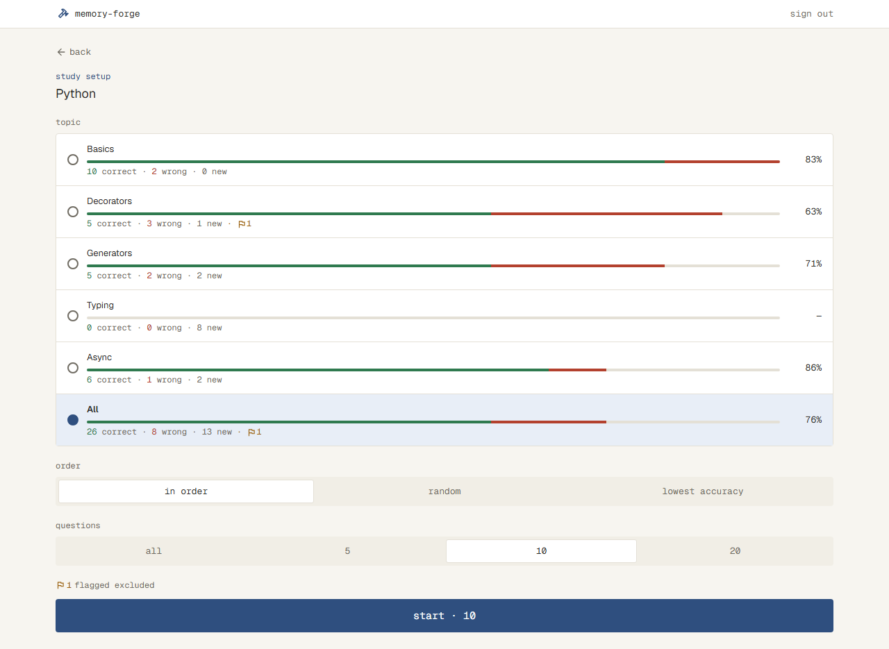 |
| Setup | 全部に印 | Typing を選び、「No questions to ask — all 8 in Typing are flagged.」と start · 0 | 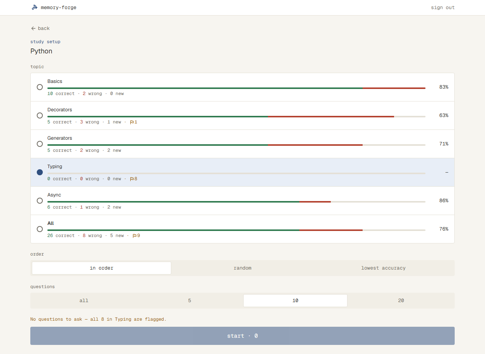 |
| Solve | 答える前 | 問題の上の行の右に flag | 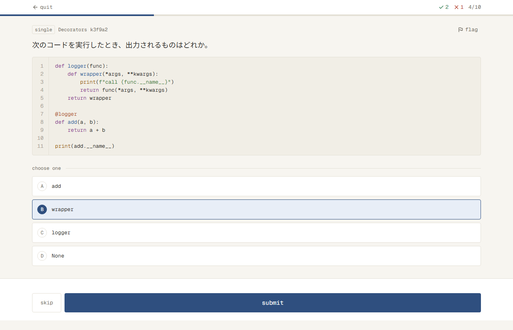 |
| Solve | 答えたあとに印 | flagged に変わる | 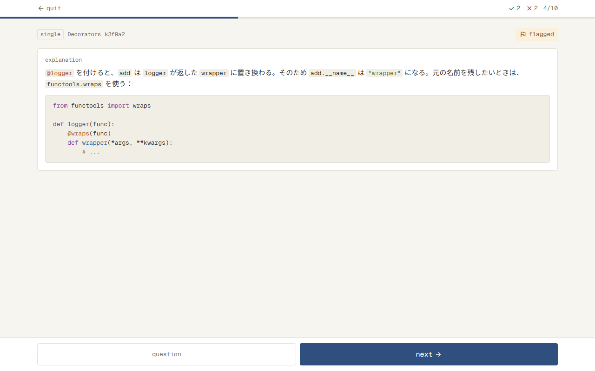 |
| Solve | 答える前に印 | 次の問題の上に「k3f9a2 flagged — moved on without recording.」 | 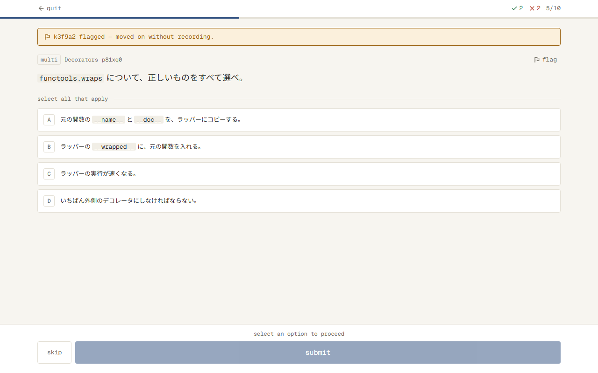 |
| Result | 印がある | flagged · not counted が 1 | 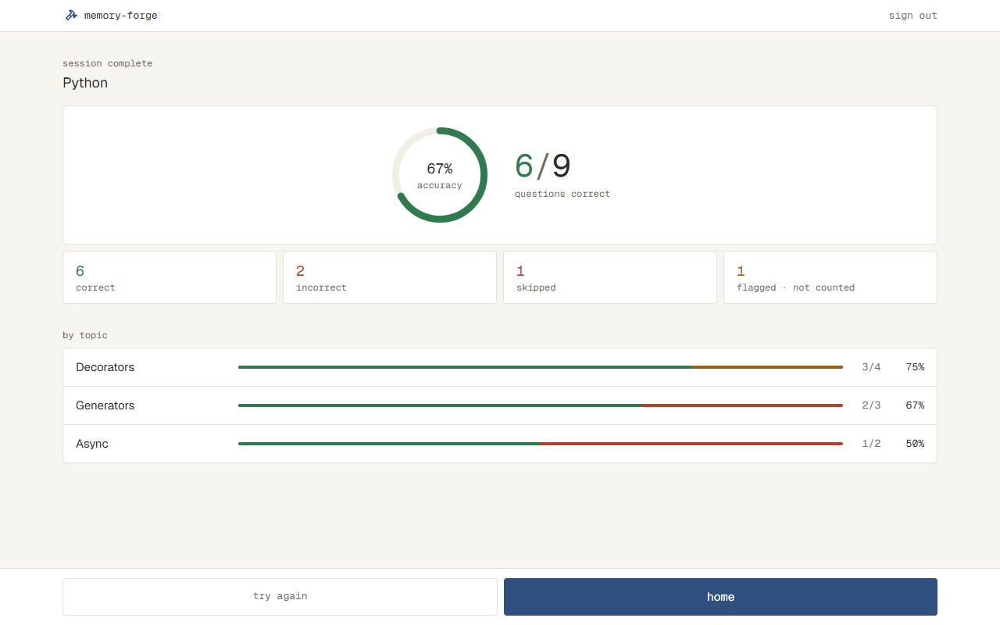 |
| Result | 全部に印 | 円を線だけにし、「—」と no questions counted | 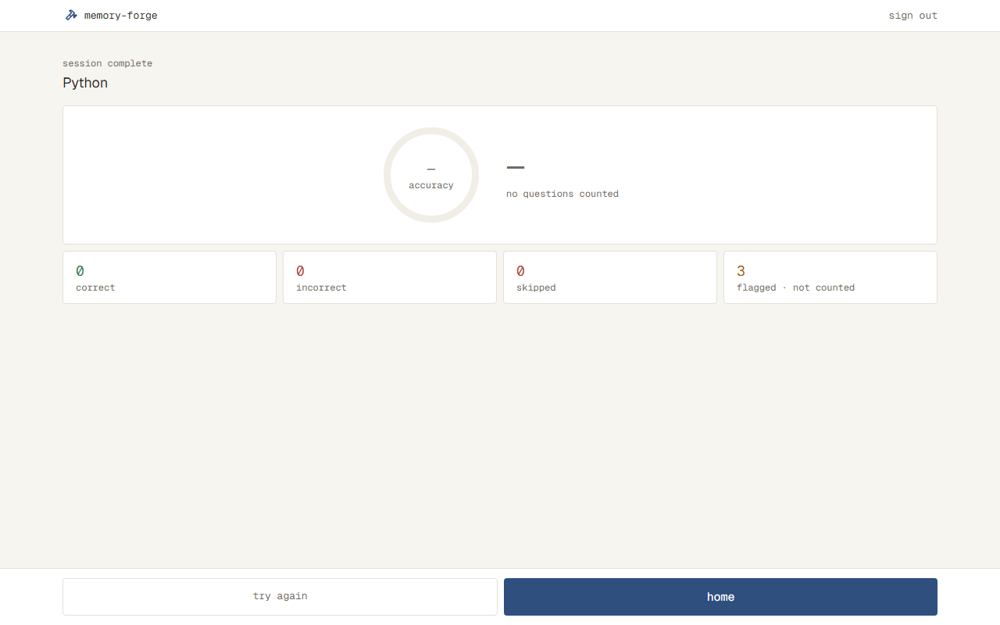 |
| Manage | 通常 | 印の付いた行は warning-soft の地と unflag、右に flagged のボタン | 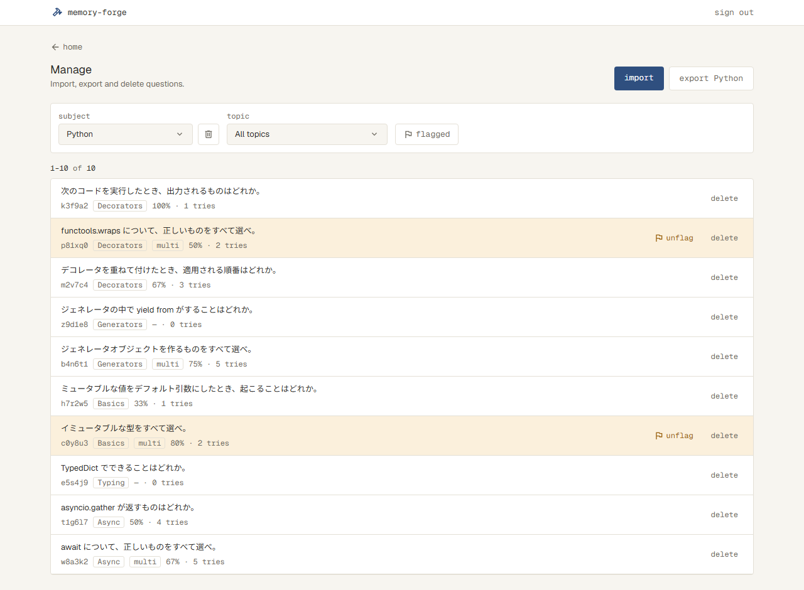 |
| Manage | Subject を開く | プルダウンの行に印の数 | 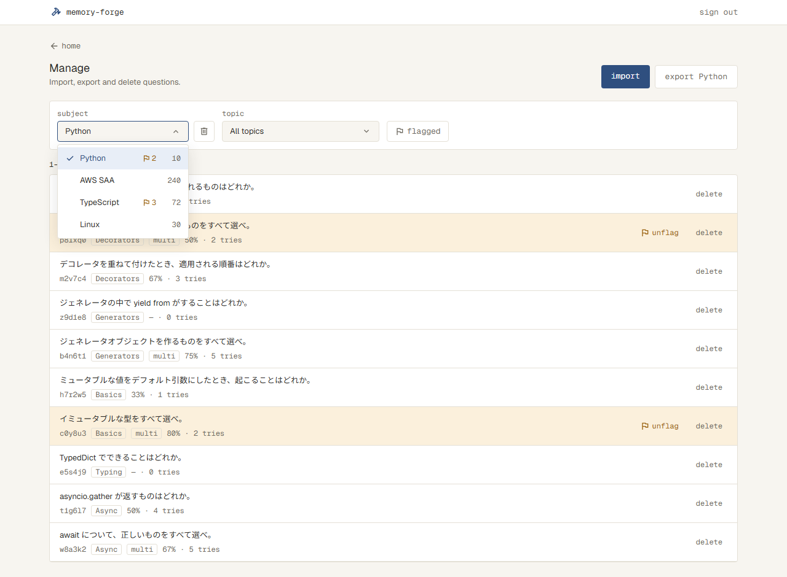 |
| Manage | Topic を開く | プルダウンの行に印の数 | 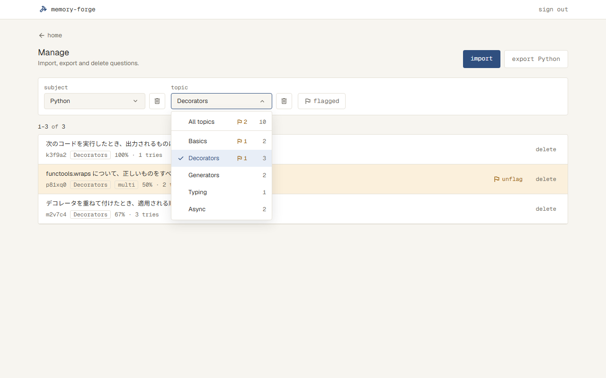 |
| Manage | flagged | 印の付いた問題だけ。export flagged · Python | 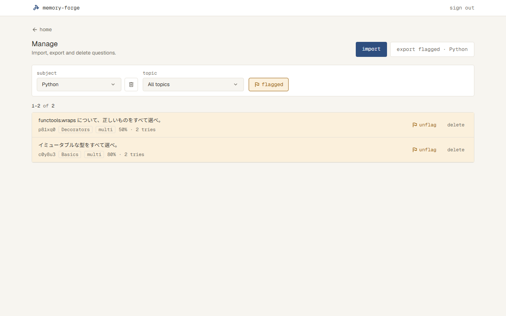 |
| Manage | flagged が0件 | 点線の枠「No flagged questions in Python.」。export は出さない | 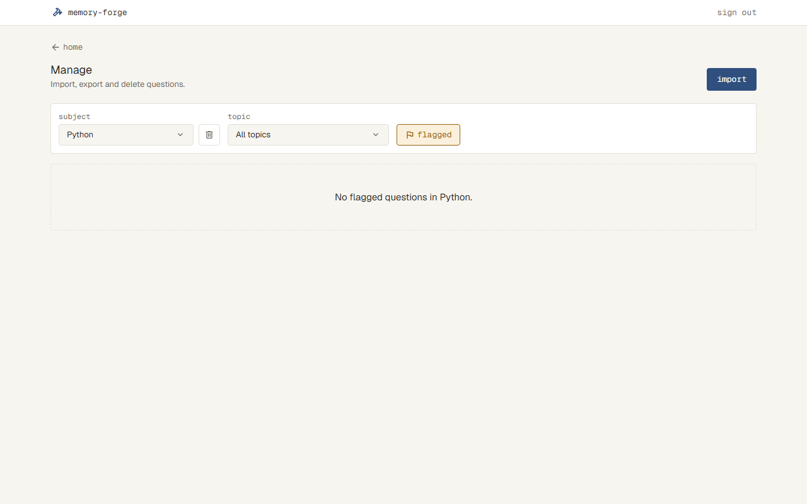 |
| Import | 取り込む前の確認 | 見出しの「except for flagged questions」と、行の右の「flag and records reset」 | 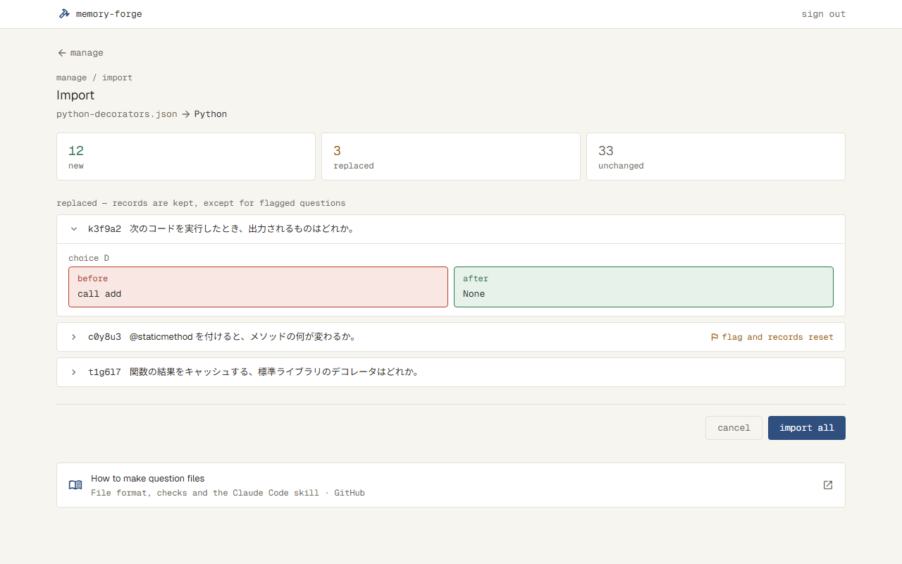 |

## やらないこと

- アプリの画面で問題を書き換えない（直すときはファイルを書き出して直し、取り込み直す。`docs/overview.md` の「やらないこと」）
- Solve の中で印を外さない（外すのは Manage の一覧から）
- 印を付けた理由（どこが誤りか）のメモは残さない

## 決まっていないこと

- [x] Manage の一覧・書き出しは、まだない #11（一覧・書き出し・削除）で作る。#12 をどう進める？ 案：(a) #11 を先に作り、そのあと #12 を全部作る (b) #12 は Solve・Setup・Result・Import だけにし、Manage の flagged・unflag・export flagged は #11 のあと（#11 に含めるか、別の Issue） → (a)。#11 を先に作り、#12 は Manage の flagged・unflag・export flagged も含めて全部作る
- [x] 答える前の flag の知らせは、いつ消える？（次の操作まで／数秒で）。最後の問題で答える前に flag したら、Result に移り、知らせは出さない？ → 次の操作（選ぶ・submit・skip・flag）まで出す。最後の問題では Result に移り、知らせは出さない
- [x] 答える前に flag した問題は、Solve の上の数（正解・不正解）と番号・線をどう進める？ 案：正解・不正解の数は増やさず、番号と線は進める → 案のまま
- [x] 答えたあとに flag した問題は、Result の得点・正答率・correct / incorrect / skipped・by topic に数える？ 「flagged · not counted」「全部に印を付けて数える問題がないとき」からは、数えない（答える前でも答えたあとでも、印の付いた問題は全部 not counted）と読める → 数えない（答えた記録は残す）
- [x] 印を付けるのに失敗したとき（つながらない）の表示と文言は？ 案：答えの保存と同じ danger の帯「Couldn't flag this question.」と retry → 案のまま
- [x] Setup で全部に印が付いているときの文言は？ 案：warning の文字で「No questions to ask — all in Decorators are flagged.」（lowest accuracy の案内に合わせる）。lowest accuracy で、解いた問題が全部印付きのときも同じ？ → 案のまま。lowest accuracy のときも同じ
- [x] Setup の Topic の行に、印の付いた問題の数を出す？（出さない案） → 出さない
- [x] 印の付いた問題が、取り込み直して「変わらない」（中身が同じ）だったときは、印と記録はそのまま？ → そのまま
- [x] 取り込む前の確認の「flag and records reset」は、どこに出す？ 案：置き換わる問題の行の右に、warning の文字で → 案のまま
- [x] Manage の flagged の一覧が0件のときの文言は？ 案：点線の枠で「No flagged questions in Python.」 → 案のまま
- [x] Home の Subject と Setup の Topic の今の身についている具合（線・数・%）に、印の付いた問題を数える？ → 数えない
- [x] （`/dev-proto` で）合意済みのプロトタイプは、Setup の Topic の行に印の数を出している（上では「出さない」と答えた） → プロトタイプどおり出す
- [x] （`/dev-proto` で）Manage の flagged の一覧が0件の状態が、プロトタイプにない → プロトタイプに足して撮る
- [x] （`/dev-proto` で）Manage の flagged の絞り込みは、Subject・Topic を変えたとき、読み込み直したときにどうなる？ → Subject を変えると外れ、Topic を変えても残る。読み込み直しても残る
- [x] （`/dev-proto` で）flagged の一覧で unflag を押すと？ → 行がすぐに消える。ページが空になったら前のページ、全部外したら0件の表示
- [x] （`/dev-proto` で）flagged の一覧が0件でも、プロトタイプは export flagged を出している（押すと0問のファイルで、取り込めない） → Subject に印の付いた問題がないときは出さない（プロトタイプも直した）
- [x] （`/dev-proto` で）Topic で絞った flagged の一覧が0件で、Subject のほかの Topic にはあるときは？ → 「No flagged questions in Decorators.」と Topic の名前で出し、export flagged は出す
- [x] （`/dev-proto` で）プロトタイプの Setup は、身についている具合の数に印の付いた問題を入れていた（上では「数えない」と答えた） → プロトタイプの表示用の数を直す（見た目は変えない）
- [x] （`/dev-proto` で）印を付けられなかったときの状態が、プロトタイプにない → 文だけ仕様に残す（スクリーンショットは付けない）
- [x] （`/dev-proto` で）lowest accuracy で、解いた問題は全部印付きだが、印のない解いていない問題があるときは、「all 8 … are flagged」が事実と合わない → 全部に印のときだけ flagged の文言。そうでなければ今の「none … have been answered yet」
- [x] （`/dev-plan` で）Setup の Topic の行の印の数と、身についている具合に印を数えないことは、まだない #9 の線と数の上にある。どうする？ → #9 に回す。#12 では作らず、Issue #9 に書き残す。Setup の画像は #9 の分を除いて合わせる
- [x] （`/dev-plan` で）unflag できなかったときは？ → 絞り込みの下に danger の帯「Couldn't unflag k3f9a2.」（retry なし）
- [x] （`/dev-plan` で）flagged を押したあとの読み込み中と読み込めなかったときは？ → Subject・Topic を選んだときと同じ
- [x] （`/dev-impl` のタスク1で）Result の % を null にすると、今の Result の画面が型エラーになる。どうする？ → タスク1では `result-view.tsx` で null のときに 0 を渡す1行を足す（印を付ける画面がまだないので null にならず、見た目は変わらない）。タスク2で「—」の表示に置き換える

## 調べたこと

---

## 設計

### データ

- `questions` に `flagged`（真偽、はじめは false、空にしない）を足す。印を付けた日時は持たない
  - 比べた選択肢：印の表を分ける（印の付いた問題を1行ずつ）。`questions` の形は変わらないが、Setup・出題・Manage・Import で読むたびに表をつなぐことになる。問題を消すと印も消えるのは、どちらでも同じ
  - 列を足すだけなので、`docs/design.md` の「データベースの形の変更は「足す」ものにする」に合う
- 印の付いた問題は、出題しない・Setup の数に入れない・Result で数えない。取り込みで置き換わったら、印を外し、その問題の記録を消す
  - 残す場所：`docs/design.md` の「データ」の「問題」。Setup・出題・Result・Manage・Import の5か所が、同じ列を同じ意味で読むため
  - 前提（崩れたら見直す）：印は1つの問題に1つで、理由のメモを持たない（「やらないこと」）。理由を持たせるなら、表にする

### 中の決まり

| ファイル | すること |
| --- | --- |
| `src/server/solve/flag.ts`（新しい） | `flagQuestion(id)`・`unflagQuestion(id)`：`flagged` を書く。もう付いている・外れているときも、そのまま成功にする。問題が消えていたら失敗にする |
| `src/server/solve/setup.ts` | Topic ごとに、印のない問題の数（`total`）・印のない問題のうち解いた数（`answered`）と、印の付いた問題の数（`flagged`）を返す |
| `src/server/solve/pick.ts` | `startNotice` に、案内の種類 `flagged`（選んだ Topic の問題が全部印付き。どの順番でも、`unanswered` より先に見る）を足す。`topicStats` で `flagged` も足し合わせる |
| `src/server/solve/start.ts` | 印の付いた問題を出さない |
| `src/server/solve/result.ts` | `Outcome` の結果に `flagged` を足す。`flagged` の問題は、得点・%・correct / incorrect / skipped・by topic に入れず、`flagged` に数える。数える問題が0問のとき、% は null |
| `src/server/manage/list.ts` | Subject と Topic の一覧に印の数を、問題の行に `flagged` を足す。選び方の `flagged` が true なら、印の付いた問題だけを、取り込んだ順にページに分ける |
| `src/server/manage/selection.ts` | 選び方（`Saved`）に `flagged` を足す。cookie に `flagged` がないとき（#12 より前の cookie）は false にする。なくなった Subject で最初の Subject にするときは false にする |
| `src/server/manage/export.ts` | `exportSubject(subjectId, flaggedOnly)`：true なら印の付いた問題だけを書き出す。ファイルの名前と形は同じ |
| `src/server/import/import.ts` | 取り込む前の確認の置き換わる問題に、今の `flagged` を足す。取り込むとき、置き換わる問題が印付きなら、同じトランザクションの中で印を外し、その問題の `answers` を消す |

- 全部に印の案内は問題の数（「all 8 in Typing」）を出すので、画面は `flagged` の数を使う

### 画面

| ファイル | すること |
| --- | --- |
| `src/app/subjects/[id]/actions.ts` | `flagAction(id)` を足す。最初に `requireSession()` を呼ぶ |
| `src/app/subjects/[id]/solve-view.tsx` | 問題の上の行の右に flag を出す。 ・答える前：`flagAction` が通ったら、結果を `flagged` にして次の問題に進み、知らせを出す（最後の問題なら Result） ・答えたあと：`flagAction` が通ったら、その問題の結果を `flagged` に変え、ボタンを flagged にする ・知らせは、次の操作（選ぶ・submit・skip・flag）で消す ・失敗したら、保存の失敗と同じ場所に帯「Couldn't flag this question.」と retry（失敗した操作に `flag` を足す） |
| `src/app/subjects/[id]/setup-form.tsx` | 「⚑1 flagged excluded」と、全部に印の案内（`flagged`） |
| `src/app/subjects/[id]/result-view.tsx` | 数える問題が0問のときの表示（`docs/ui.md` の「解き終わりの結果」）。`src/components/accuracy-ring.tsx` は % が null のとき、円を線だけにして「—」を出す |
| `src/app/(app)/manage/actions.ts` | `unflagAction(id, current)`：印を外し、今の選び方を cookie に書き直す（今のページが空になったら、`resolveSelection` が最後のページにする）。`exportAction` に `flaggedOnly` を渡す。どれも最初に `requireSession()` を呼ぶ |
| `src/app/(app)/manage/manage-view.tsx` | flagged のボタン（押すと `selectAction` で `flagged` を反転し、1ページ目。Subject を変えると false）、export の文言と出し分け、unflag の失敗の帯、flagged の一覧の0件（`EmptyState`） |
| `src/components/dropdown.tsx` | 行に印の数（`flagged`。0なら出さない）を出せるようにする |
| `src/components/question-row.tsx` | `flagged` の行は warning-soft の地にし、delete の左に unflag（押すと `onUnflag`） |
| `src/components/button.tsx` | 見た目を足す。 ・flag（muted の文字だけ。指を乗せると warning の文字と warning-soft の地。押したあとの flagged は warning-soft の地と warning の文字） ・unflag（warning の文字だけ） ・Manage の flagged（枠だけ。押している間は warning の枠・地・文字） |
| `src/components/banner.tsx` | warning の色（warning の枠と warning-soft の地）を足す。答える前の flag の知らせに使う |
| `src/app/(app)/manage/import/import-flow.tsx`・`src/components/change-row.tsx` | 置き換わる問題の見出しの文言と、印付きの行の右の「flag and records reset」 |

- 答える前の flag で記録しないこと、知らせを消すときは、`solve-view.tsx` のコメントに書く（その部品だけに関わるため）
- `docs/design.md` の「Manage の選び方」に、cookie に flagged も持つことを足す

## 確かめ方

| 受け入れ条件 | 確かめ方 |
| --- | --- |
| Solve：答える前の flag（記録しない・次に進む・知らせ・最後なら Result・数と番号） | テスト：`e2e/solve.spec.ts`（記録が増えない、知らせと ID、次の操作で消える、最後は Result、正解・不正解の数が増えず番号が進む） |
| Solve：答えたあとの flag（flagged に変わる・記録は残る） | テスト：`src/server/solve/flag.test.ts`（印が付く、記録は変わらない、もう付いていても成功、消えた問題は失敗）。`e2e/solve.spec.ts`（ボタンが flagged になる） |
| Solve：印を付けた問題は出題しない | テスト：`start.test.ts`（印の付いた問題が出ない） |
| Solve：印を付けられなかった | テスト：`e2e/solve.spec.ts`（失敗させると帯と retry。答える前なら進まない。retry で進む） |
| Setup：数から除く・flagged excluded・全部に印 | テスト：`setup.test.ts`（印のない数・解いた数・印の数）、`pick.test.ts`（`flagged` の案内。lowest accuracy で全部に印のときと、解いた問題がないだけのときの分かれ目）。文言は触って確かめる（画像：setup-default・setup-none） |
| Result：印を付けた問題を数えない・0問のとき | テスト：`result.test.ts`（答える前・答えたあとの印を数えない、`flagged` の数、0問で % が null）。見た目は触って確かめる（画像：result-default・result-all-flagged） |
| Manage：flagged の一覧（Topic と組み合わせる、1ページ目、Subject で外れる、残る、読み込み中と失敗） | テスト：`list.test.ts`（印の付いた問題だけ・Topic と組み合わせ・ページ・印の数）、`selection.test.ts`（`flagged` がない cookie、なくなった Subject）。`e2e/manage.spec.ts`（押すと絞れる、Subject を変えると外れる、読み込み直しても残る）。読み込み中と失敗は、Subject・Topic を選んだときと同じ作りなので、コードを見て確かめる（`manage-view.tsx` の `select`） |
| Manage：export flagged | テスト：`export.test.ts`（印の付いた問題だけ。Topic で絞っていても Subject の全部）。`e2e/manage.spec.ts`（文言と、Subject に印がないときに出ない） |
| Manage：unflag（ふつうの一覧・flagged の一覧・空なら前のページ・失敗） | テスト：`flag.test.ts`（印が外れる、記録は変わらない）。`e2e/manage.spec.ts`（flagged の一覧から行が消える、ページが空なら前、失敗すると帯） |
| Manage：flagged の0件 | テスト：`e2e/manage.spec.ts`（Subject の名前と、Topic で絞ったときの Topic の名前）。見た目は触って確かめる（画像：manage-flagged-empty） |
| Manage：プルダウンの印の数・印の行の見た目 | 触って確かめる（画像：manage-default・manage-subject-open・manage-topic-open・manage-flagged） |
| Import：flag and records reset・印と記録が消える・変わらないときはそのまま | テスト：`src/server/import/import.test.ts`（置き換わる印付きの問題は印と記録が消え、印のない問題の記録は残る、変わらない印付きの問題はそのまま、確認に `flagged` が入る）。見た目は触って確かめる（画像：import-preview） |
| #9 で作るもの | Issue #9 に書き残したことを確かめる |

## タスク

- [ ] 1. `questions.flagged` と、印を付ける・外す決まり、解く側の数え方（`flag.ts`・`setup.ts`・`pick.ts`・`start.ts`・`result.ts` とテスト）ができたら完了。画面は変えない
- [ ] 2. Solve で印を付けられ、Setup と Result が印を除いて数えたら完了
  - 合わせるスクリーンショット：solve-question・solve-answered-flagged・solve-flagged・setup-default・setup-none・result-default・result-all-flagged（Setup は、身についている具合の線と数を除いて合わせる）
  - flag が写る次の画像も撮り直す：solve-question・solve-answered・solve-explanation・solve-multiple・solve-answered-multiple・solve-code-choices・solve-answered-code-choices・solve-last・solve-many・solve-error・solve-quit
- [ ] 3. Manage の一覧で、印の数・印の付いた問題だけ・export flagged を読む決まり（`list.ts`・`selection.ts`・`export.ts` とテスト）ができたら完了。画面は変えない
- [ ] 4. Manage で、flagged の一覧を見て、unflag と export flagged ができたら完了
  - 合わせるスクリーンショット：manage-default・manage-subject-open・manage-topic-open・manage-flagged・manage-flagged-empty
  - flagged のボタンが写る次の画像も撮り直す：manage-default・manage-subject-open・manage-topic-open・manage-topics-many・manage-many・manage-many-mobile・manage-loading・manage-error・manage-export-error・manage-delete-subject・manage-delete-topic・manage-delete-question・manage-delete-error
- [ ] 5. 取り込み直すと、置き換わった印付きの問題の印と記録が消え、取り込む前の確認に出たら完了。`import.ts` の変更とテストも、このタスクで作る
  - 合わせるスクリーンショット：import-preview（いちばん下の「How to make question files」を除いて合わせる）
  - 見出しの文言が変わるので、次の画像も撮り直す：import-preview
