<!--
変更の仕様のひな形。コピーして docs/changes/<年-月-日>-<何をするか>.md を作る（例：2026-09-17-add-due-date.md）。
「なぜ」〜「調べたこと」は、AIが下書きし、人間が答えて決める（手順5）。「画面」のスクリーンショットは、プロトタイプで合意したときに足す（手順6）。
「設計」以降はAIが下書きし、人間がレビューする（手順7）。
スクリーンショットは、このファイルと同じ名前のフォルダに置く（例：2026-09-17-add-due-date/list-empty.png）。
-->

# 問題を一覧で見て、書き出し・削除できる（#11）

## なぜ

今の Manage には import しかなく、取り込んだ問題を見られない。問題を直すための元のファイルを取り出す方法も、要らなくなった問題を消す方法もない。
取り込んだ問題を一覧で確かめ、直すときは Subject ごとに書き出し、要らなくなった問題は Subject・Topic・1問ずつ消せるようにする。

## 影響する今の仕様

- `docs/specs/manage.md`：Manage（今は「問題の一覧・書き出し・削除は、まだない」）
- `docs/specs/import.md`：書き出したファイルを、そのまま取り込み直せること（問題のファイルの形）
- `docs/specs/home.md`・`docs/specs/solve.md`：消した Subject・Topic・問題が、Home の一覧と Setup から消える

## 使う場面

1. Python（480問、Topic が6つ）を取り込んである人が、Manage を開くと、Subject のプルダウンに Python、Topic に All topics が選ばれ、問題が50問ずつ並ぶ。下には「1–50 of 480」とページの番号が出る。Topic で Decorators を選ぶと、Decorators の問題だけになる
2. 同じ人が、Python の問題を直したくなり、export Python を押す。Python の全部の問題が1つのファイルとして保存される。直して Import で取り込み直すと、直した問題だけが「置き換わる」に出る
3. 同じ人が、もう使わない Topic「Typing」を消そうとして、Topic のプルダウンの右の delete を押す。確認のダイアログに、消える問題の数と記録のことと、取り消せないことが出る。delete を押すと Typing が一覧と Setup から消える

## 受け入れ条件

### 一覧

- Subject のプルダウンで Subject を選び、Topic のプルダウンで All topics か Topic を1つ選ぶと、その問題が一覧に並ぶ
- プルダウンの一覧の行には、名前と問題数を出す
- Subject は取り込んだ順に、Topic は Setup と同じ順（その Topic の問題が最初に出てくる順）に並べる
- 一覧は50問ずつのページに分ける。「151–200 of 480」と、前後のボタンとページの番号を出す。1ページで収まるときは、前後のボタンと番号を出さない
- 開いたときは、取り込んだ順で最初の Subject と All topics、1ページ目を選んでいる
- Subject を変えると、All topics と1ページ目に戻る
- 読み込み直したときや、ほかの画面から戻ったときは、選んでいた Subject・Topic・ページのまま
  - 選んでいた Subject がなくなっていたら最初の Subject と All topics、Topic がなくなっていたら All topics と1ページ目にする。選んでいたページがなくなっていたら、最後のページを出す
- 問題は取り込んだ順に並べる。行には、問題文の1行目（長いときは「…」で切る）と、その下に ID、Topic、種類（multi のときだけ「multi」）、問題ごとの正答率と解いた回数（「75% · 3 tries」）を出す。まだ解いていない問題は「— · 0 tries」
- 行を押しても、問題の中身は開かない
- Subject が0件のときは、点線の枠で「No subjects yet.」「Import a question file to get started.」を出す（Import へは、上の import で移る）。export は出さない
- 読み込めなかったときは、danger の帯「Couldn't load questions.」と retry を出す

### 書き出し

- export <Subject の名前>（例：export Python）で、選んでいる Subject の全部の問題を、1つのファイルに保存する。Topic で絞っていても、Subject の全部を書き出す
- ファイルの名前は、Subject の名前を小文字にし、空白とファイル名に使えない記号を「-」にしたもの（Python → python.json、Web API → web-api.json）。続くものは1つの「-」にまとめ、頭と終わりの「-」は除く（C++ / Rust → c++-rust.json）。それで名前が空になるときは subject.json
- ファイルには、取り込むファイルと同じ項目だけを入れる（記録は入れない）。問題は取り込んだ順
- 書き出したファイルは、そのまま Import で取り込み直せる。取り込み直すと、全部「変わらない」になる
  - 取り込み直せるのは、Import の上限（1,000問・4MB）までの Subject。上限を超える Subject も、止めずに書き出す
- 書き出せなかったときは、絞り込みの下に danger の帯「Couldn't export Python.」を出す（retry は置かない）

### 削除

- Subject のプルダウンの右の delete で、その Subject を消す。Topic のプルダウンの右の delete で、その Topic を消す（All topics のときは、ボタンを出さない）。問題の行から、その1問を消す
- 消す前に、確認のダイアログを出す。cancel と Esc ではそのまま、delete で消える
  - Subject：「Delete “Python”?」「5 topics, 480 questions and their records will be deleted. This can't be undone.」
  - Topic：「Delete “Typing”?」「12 questions and their records will be deleted. This can't be undone.」
  - 1問：「Delete this question?」、その下に問題文の1行目、「Its records will be deleted too. This can't be undone.」
- 消した問題の記録も一緒に消える
- 消したものは、一覧・Home・Setup から消える。問題が1つもなくなった Topic と Subject も消える
- 消したあと：Subject を消したら次の Subject（最後の Subject を消したら前の Subject。Subject が1つもなくなったら0件の表示）、Topic を消したら All topics、1問を消して今のページが空になったら前のページを出す。消したことの知らせは出さない
- delete を押してから消え終わるまでは、cancel と delete を押せず、Esc でも閉じない
- 消せなかったときは、ダイアログを閉じずに、ボタンの上に danger の帯「Couldn't delete.」を出し、何も消さない

## 画面

- Manage：上の右に import（primary）と export <Subject の名前>（枠だけ）を並べる。その下に、surface の枠の中に subject と topic のプルダウン（見出しは muted の等幅の小さな文字）を横に並べ、それぞれのすぐ右に delete の印のボタンを置く（スマホの幅では縦に並べる）
- 枠の下に、ページ（`docs/ui.md` の「ページ」）、その下に問題の一覧
- 問題の行：1行目に問題文、2行目に muted の等幅で ID、枠で囲んだ Topic、枠で囲んだ multi（multi のときだけ）、正答率と解いた回数。右に muted の等幅の「delete」を枠のない文字だけのボタンで置き、指を乗せると danger の文字と danger-soft の地
- 削除の確認のダイアログ：見出し（lg）、説明（muted）、右下に cancel（枠だけ）と delete（danger の地）
- 不備の印のもの（flagged の絞り込み、プルダウンの印の数、unflag、行の warning-soft の地）は #12 で足す。スクリーンショットは隠して撮る

| 状態 | 表示 | スクリーンショット |
| --- | --- | --- |
| 通常 | Python・All topics の1ページ目 | 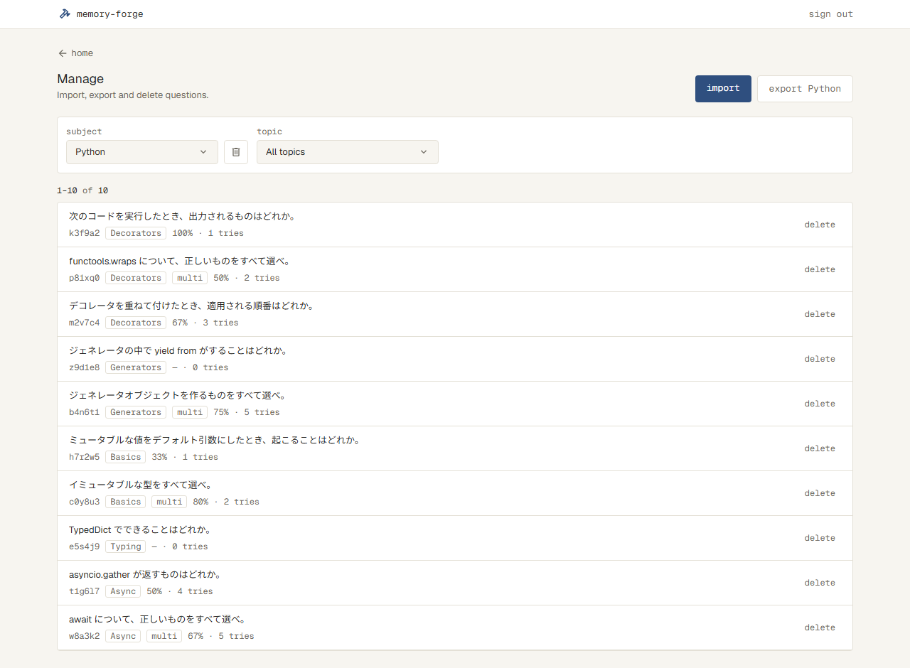 |
| Subject を開く | Subject のプルダウンを開いたところ | 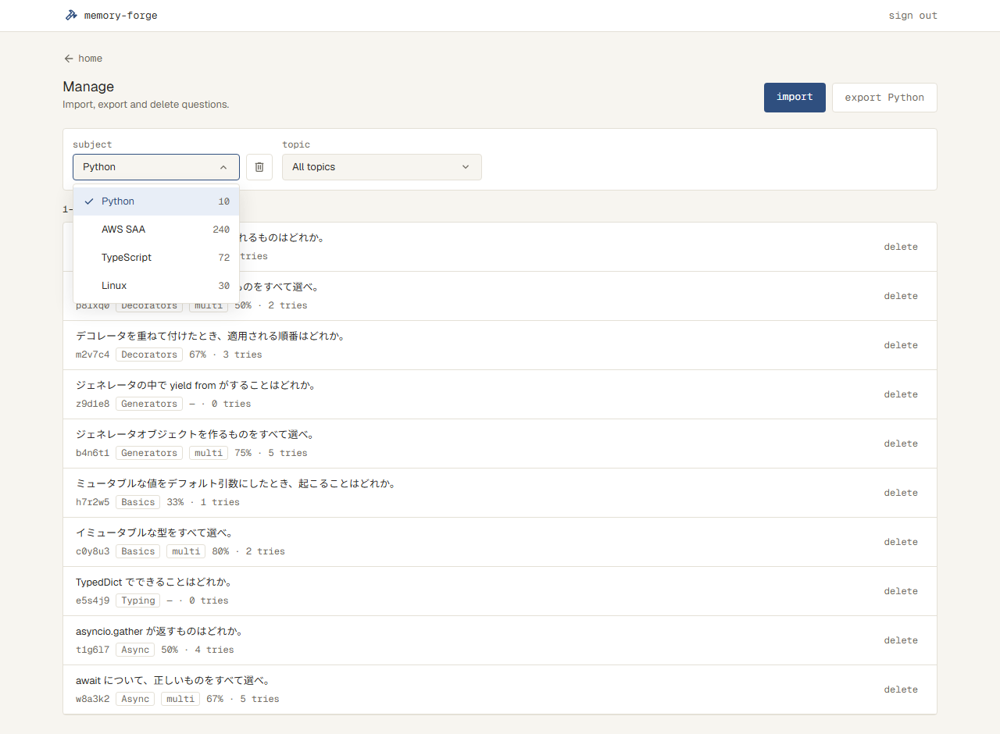 |
| Topic を開く | Topic のプルダウンを開いたところ（Decorators を選んでいる） | 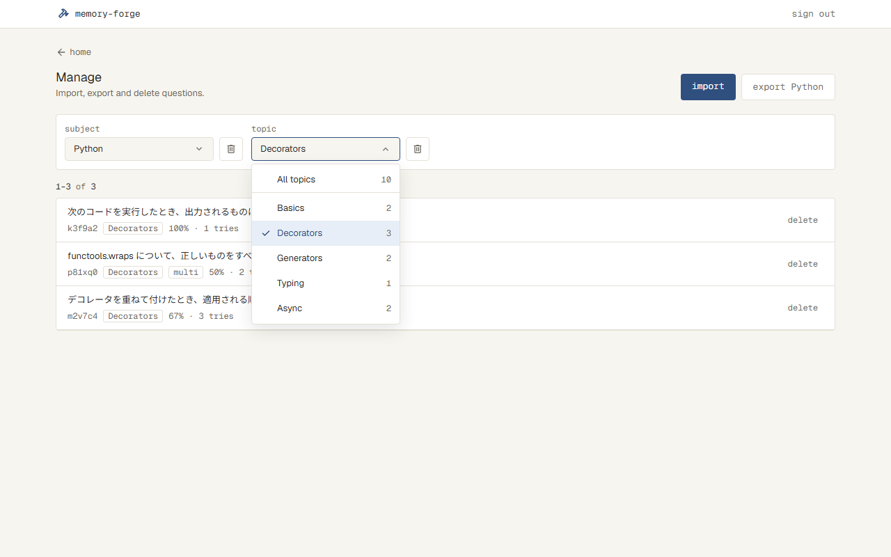 |
| Topic が多い | プルダウンの一覧の高さを止め、中をスクロールする | 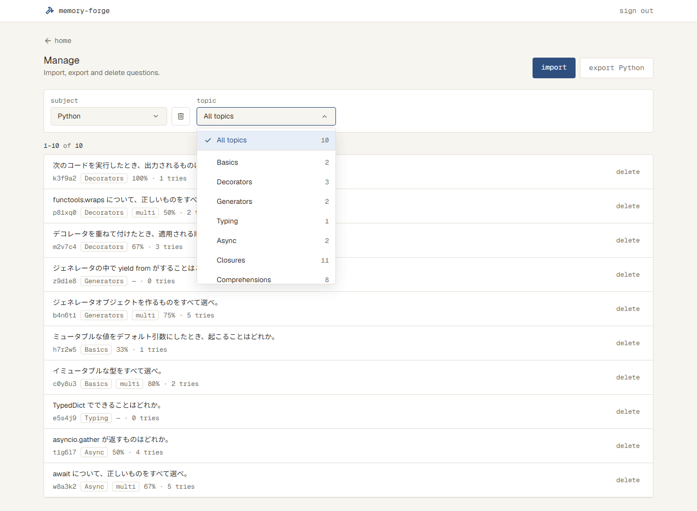 |
| Subject が0件 | 点線の枠。export とプルダウンは出さない | 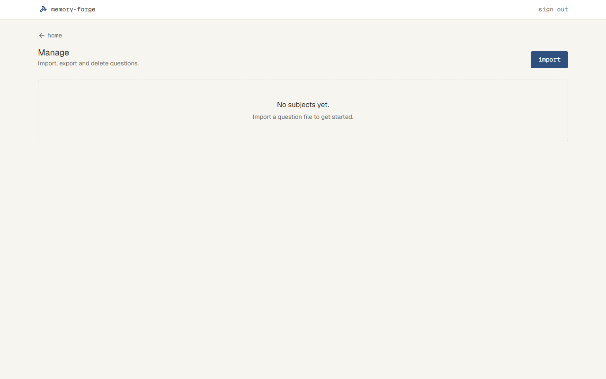 |
| 問題が多い | 480問の4ページ目。「151–200 of 480」とページの番号 | 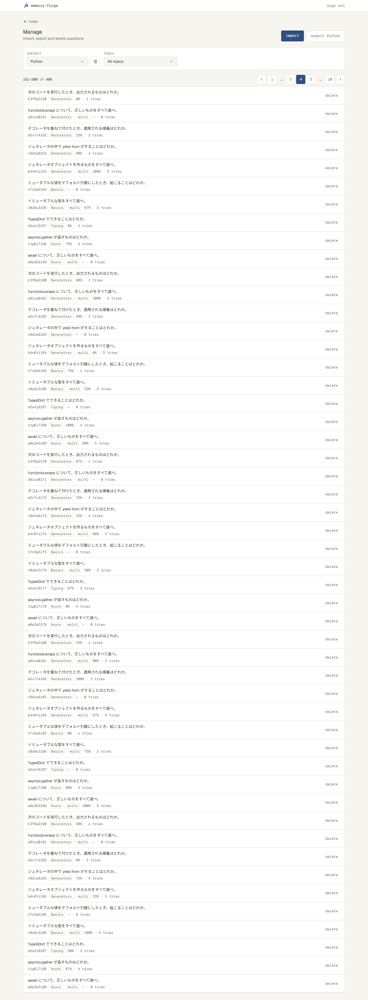 |
| 問題が多い（スマホの幅） | 番号を出さず、前後のボタンの間に「4 / 10」 | 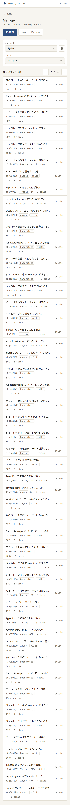 |
| 読み込み中 | 行と同じ形の枠を点滅させる | 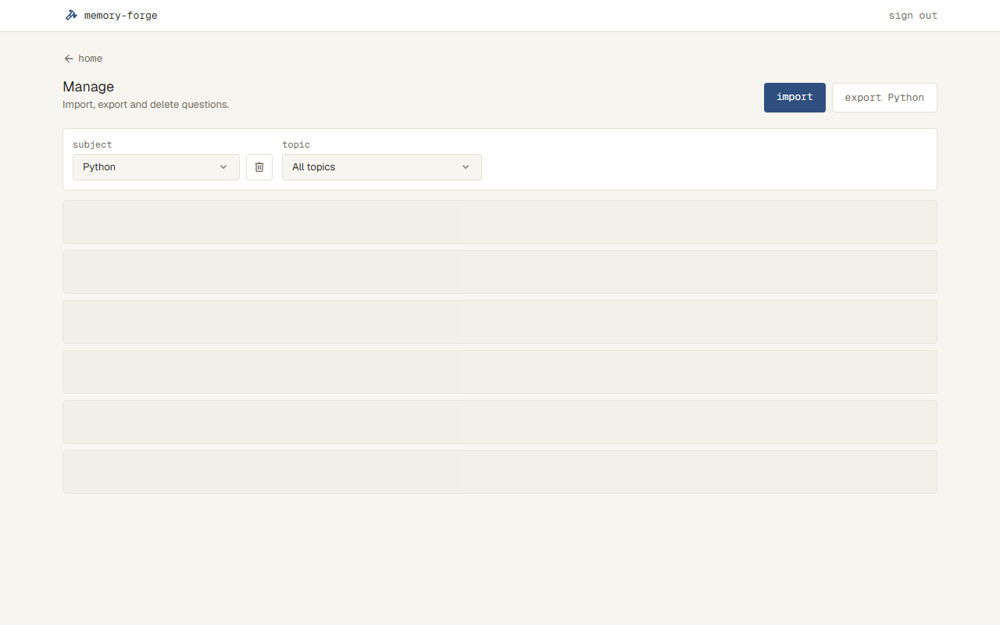 |
| 読み込めない | danger の帯「Couldn't load questions.」と retry | 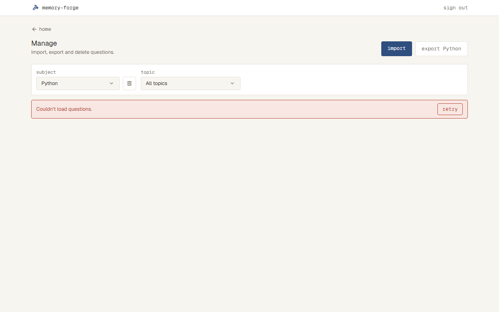 |
| 書き出せない | 絞り込みの下に danger の帯「Couldn't export Python.」 | 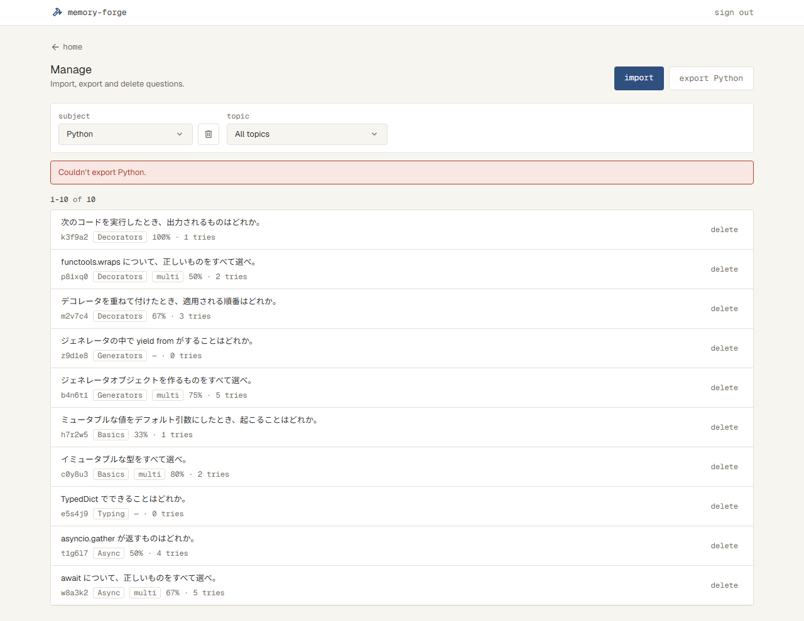 |
| 1問を消す | 確認のダイアログ | 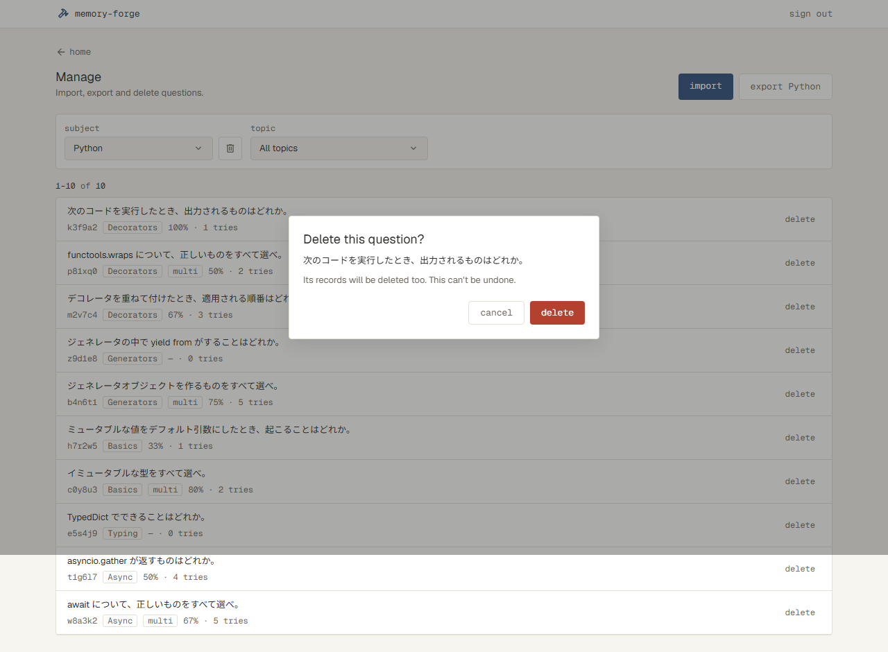 |
| Topic を消す | 確認のダイアログ | 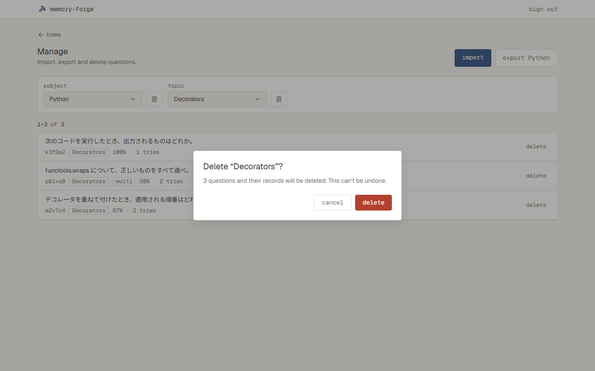 |
| Subject を消す | 確認のダイアログ | 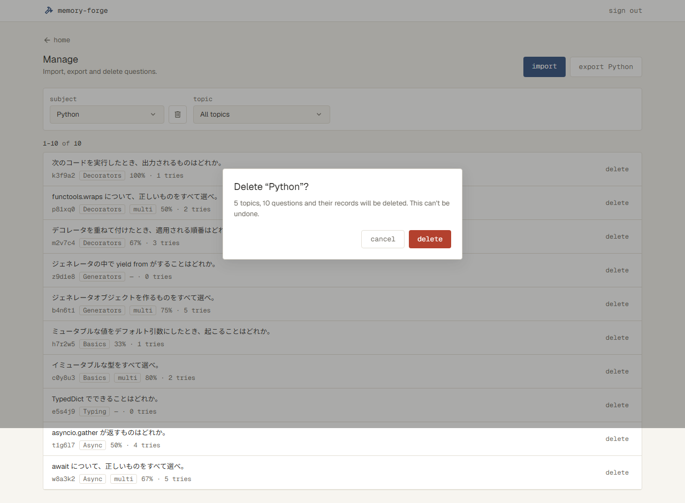 |
| 消せない | ダイアログの中に danger の帯「Couldn't delete.」 | 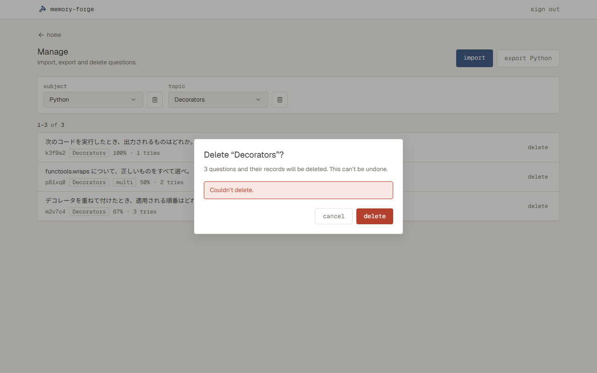 |

## やらないこと

- アプリの画面で問題を書き換えない（`docs/overview.md` の「やらないこと」）
- 不備の印の一覧（flagged）・unflag・export flagged、プルダウンの印の数は作らない（#12）
- Topic で絞って、その Topic だけを書き出すことはしない（書き出しは Subject 単位）
- 消したものを元に戻すことはしない
- 一覧の中を文字で検索したり、並べ替えたりしない

## 決まっていないこと

- [x] Manage を開いたときに選んでいる Subject は？ 案：Home と同じ並び（取り込んだ順）の最初の Subject → 案のまま
- [x] 問題の行に出すものは？ 案：ID、Topic、問題文の1行目（長いときは「…」で切る）、種類（single / multi）、正答率と解いた回数。並びは取り込んだ順（Setup の in order と同じ） → 案のまま
- [x] 行を押すと、問題の中身（選択肢・正解・解説）を見られる？ 案：見られない（確かめは書き出したファイルで） → 案のまま
- [x] 1問ずつの delete のボタンは、行のどこに、どんな形で出す？（`docs/ui.md` には Subject と Topic の delete しかない） → 合意済みのプロトタイプに合わせる（「画面」に書いた）
- [x] 書き出し・削除の失敗、Topic が多いときは、プロトタイプになかった。どうする？ → プロトタイプに足して撮る（「画面」）
- [x] Subject を変えたとき、Topic とページはどうなる？ 案：All topics と1ページ目に戻る → 案のまま
- [x] 読み込み直したときや、Setup などから戻ったとき、選んでいた Subject・Topic・ページは残る？ → 残す
- [x] 書き出すファイルの名前は？ 案：Subject の名前を小文字にしたもの（python.json）。Subject の名前に空白や記号があるときは？ → 小文字にし、空白とファイル名に使えない記号は「-」にする（「Web API」→ web-api.json）
- [x] 書き出すファイルに記録（正答率など）は入れない？（案：入れない。取り込むファイルと同じ形だけ） → 案のまま
- [x] 確認のダイアログの文言は？ 案：（下） → 案のまま。のちに `/dev-proto` で、合意済みのプロトタイプの文言に合わせた（受け入れ条件）
  - Subject：「Delete Python?」「480 questions and their records will be deleted. This can't be undone.」
  - Topic：「Delete Typing?」「12 questions and their records will be deleted. This can't be undone.」
  - 1問：「Delete k3f9a2?」「This question and its records will be deleted. This can't be undone.」
- [x] 消したあとの表示は？ 案：Subject を消したら次の Subject（なければ0件の表示）、Topic を消したら All topics、1問を消して今のページが空になったら前のページ。消したことの知らせは出す？ → 案のまま。知らせは出さない
- [x] 消して Subject の問題が0問になったら（最後の Topic・最後の1問を消したら）、Subject も消える、でよい？ → 消える
- [x] 書き出し・削除・読み込みに失敗したときの文言は？ 案：danger の帯「Couldn't load questions.」と retry／「Couldn't export Python.」／ダイアログの中に「Couldn't delete.」 → 案のまま
- [x] Subject が0件のときの文言は？ 案：Home と同じ点線の枠「No subjects yet.」「Import a question file to get started.」と import → 案のまま
- [x] Home の menu の説明「Import, export, delete, flagged」と Manage の説明「Import, export and delete questions.」は今のまま？ → 今のまま
- [x] （`/dev-plan` で）Topic のプルダウンの並びは？（プロトタイプの画像は、問題の並びと違う順だった） → Setup と同じ（その Topic の問題が最初に出てくる順）
- [x] （`/dev-plan` で）Subject が1,000問を超えると、書き出したファイルは Import の上限で取り込めない。どうする？ → 止めずに書き出す。取り込み直せるのは上限までと書く
- [x] （`/dev-plan` で）覚えていたページがなくなったら（問題が減ったなど）？ → 最後のページ。覚えていた Subject・Topic がなくなっていたら、最初の Subject・All topics
- [x] （`/dev-plan` で）最後の Subject を消したら（次がない）？ → 前の Subject
- [x] （`/dev-impl` のタスク1で）覚えていた Topic がなくなって All topics にしたとき、ページは？ → 1ページ目
- [x] （`/dev-impl` のタスク3で）Subject の名前が記号だけで、ファイルの名前が空になるときは？ → subject.json
- [x] （`/dev-plan` で）ファイルの名前で、空白や記号が続くときは？ → 1つの「-」にまとめ、頭と終わりの「-」は除く
- [x] （`/dev-plan` で）delete を押してから消え終わるまでは？ → cancel と delete を押せなくする（文言は変えない）。Esc でも閉じない

## 調べたこと

---

## 設計

### データ

- 表の形は変えない。消すときは、今の `onDelete: "cascade"`（`subjects` → `questions` → `answers`）に任せる
- 問題が1つもなくなった Subject は、消す操作と同じトランザクションの中で消す
  - 残す場所：`docs/design.md` の「データ」。Import の「問題が1つもなくなった Topic は消える」と並べて書く。Topic は表がないので、今のまま何もしなくても消える

### 中の決まり（`src/server/manage/`）

| ファイル | すること |
| --- | --- |
| `list.ts` | `getManage(saved)` は、次を返す。 ・Subject の一覧（取り込んだ順、問題数つき） ・選んだ Subject の Topic の一覧（Setup と同じ順、問題数つき） ・選んだ Topic の問題の1ページ分（`questions.id` の順に50問。ID・Topic・種類・問題文・正答率・解いた回数） ・全部の問題の数 正答率と解いた回数は、`answers` を問題ごとに数えて出す（`docs/design.md` の「データ」：数は記録から数える） |
| `selection.ts` | データベースを使わない決まり。 ・`parseSaved`：cookie の JSON を読む。ない・読めない・形が違うときは、覚えていないのと同じにする ・`resolveSelection`：覚えていた選び方を、今ある Subject・Topic・ページに合わせる。なくなった Subject は最初の Subject と All topics、なくなった Topic は All topics、なくなったページは最後のページにする ・`nextSubjectAfterDelete`：消した Subject の次の Subject。最後なら前、ほかになければなし |
| `pages.ts` | データベースを使わない決まり。 ・`pageItems(今, 最後)`：ページの番号の並び（最初・最後・今の前後、間は「…」）。1ページのときは何も出さない ・「151–200 of 480」の範囲 |
| `export.ts` | ・`exportSubject(subjectId)`：取り込むファイルと同じ形の JSON の文字と、ファイルの名前を返す。形は、`subject` と問題の並び（`id`・`topic`・`type`・`text`・`choices`・`correct`・`explanation`） ・`exportFileName(name)`（データベースを使わない）：小文字にし、空白・`\ / : * ? " < > \|`・制御文字を「-」にする。続く「-」は1つにまとめ、頭と終わりの「-」は除く |
| `delete.ts` | `deleteSubject(subjectId)`・`deleteTopic(subjectId, topic)`・`deleteQuestion(id)`。Topic や1問を消して Subject の問題が0問になったら、Subject も消す（1つのトランザクション） |

- 正答率は、Result と同じく整数に四捨五入する（`Math.round`）。まだ解いていない問題には正答率を出さず、画面で「—」にする
- 問題文の1行目は、画面で `text.split("\n")[0]` にする。Import の置き換わる問題の行（`src/components/change-row.tsx`）と同じ

### 選び方の持ち方（cookie）

- 選んでいる Subject の id・Topic の名前（All topics は null）・ページを、1つの cookie（`manage`。JSON）に持つ。サーバーは、その cookie から一覧を組み立てる
- 選び方を変えると、サーバーアクションが cookie を書く。Next.js が同じ画面をサーバーで組み立て直して返す（`node_modules/next/dist/docs/01-app/01-getting-started/07-mutating-data.md` の「Cookies」）
- 消したあとも、消すアクションの中で、次に出す選び方を cookie に書く
- cookie はブラウザを閉じるまでのもので、期限を付けない。`httpOnly` と `sameSite: "lax"` にする
- 比べた選択肢
  - URL（`/manage?subject=3&page=4`）と cookie の両方：ブラウザの戻るでページも戻る。ただ、Home の manage や Import の戻るリンクから来たときのために cookie も要り、持つ場所が2つになる
  - ブラウザの localStorage：サーバーが選び方を知らない。開くたびに読み込み中を出し、ブラウザから一覧を読み直すことになる
- 残す場所：`docs/design.md` に「Manage の選び方」を足す。画面・選び方を変えるアクション・消すアクションの3か所が、同じ cookie を使うため
  - 前提（崩れたら見直す）：選び方を、ほかの端末と分け合わない。ブラウザの戻るでページを1つずつ戻らなくてよい

### 書き出しの持ち方（サーバーアクション）

- `exportAction(subjectId)` が、JSON の文字とファイルの名前を返す。ブラウザがそれを `Blob` にし、`<a download>` で保存させる
- 比べた選択肢：ダウンロード用の URL（Route Handler）。失敗すると別のページに移るので、帯を出せない。ログインを確かめる入口も増える（`docs/design.md` の「ログインの確かめ」）
- 前提（崩れたら見直す）：書き出す中身が、Vercel の関数の返事の上限（4.5MB）より小さい
  - Import の上限は1つのファイルで 4MB なので、取り込み直せる大きさの Subject は収まる
  - 超えると「Couldn't export Python.」になる
- 残す場所：`src/app/(app)/manage/actions.ts` のコメント。そのアクションだけに関わるため

### 画面

| ファイル | すること |
| --- | --- |
| `src/app/(app)/manage/page.tsx` | 上の部分（戻るリンク・見出し・import・export）を出す。`<Suspense>` の中で cookie を読み、`getManage` を呼ぶ。読めなかったら、danger の帯「Couldn't load questions.」と retry（`RetryButton`）を出す |
| `src/app/(app)/manage/actions.ts` | `selectAction`・`exportAction`・`deleteSubjectAction`・`deleteTopicAction`・`deleteQuestionAction`。どれも最初に `requireSession()` を呼ぶ |
| `src/app/(app)/manage/manage-view.tsx` | ブラウザで動く部品。絞り込み・ページ・一覧・ダイアログを出す。 ・選び方を変えている間（`useTransition`）は、一覧の場所に行の形の枠を点滅させる ・アクションが失敗したら、帯「Couldn't load questions.」と retry を出す。retry は、同じ選び方でもう一度送る |
| `src/components/dropdown.tsx` | 新しい部品。`docs/ui.md` の「プルダウン」。押すと下に一覧を開く。選ぶ・Esc・外側を押すと閉じる。一覧の高さを止めて、中をスクロールさせる |
| `src/components/pagination.tsx` | 新しい部品。`docs/ui.md` の「ページ」。番号の並びは `pages.ts` から受け取る |
| `src/components/question-row.tsx` | 新しい部品。問題の行。1行目に問題文、2行目に ID・Topic・multi・正答率と解いた回数、右に delete を出す |
| `src/components/dialog.tsx` | 説明の下に中身を足せるようにする。1問の削除で問題文の1行目を出し、消せなかったときに帯「Couldn't delete.」を出すため |
| `src/components/button.tsx` | 3つの見た目を足す。 ・delete の印だけの枠のボタン（指を乗せると danger） ・行の delete（muted の文字だけ。指を乗せると danger の文字と danger-soft の地） ・ダイアログの delete（danger の地と on-primary の文字。`src/components/choice.tsx` と同じ組み合わせ） |

- 0件の点線の枠は、Home と同じ見た目にする。今は `src/app/(app)/page.tsx` の中にあるので、2か所で使えるように `src/components/empty-state.tsx` に分ける
- 書き出しの失敗の帯は、次のときに消す。もう一度 export を押して書き出せたとき、選び方を変えたとき
- 読み込み中と読み込めない状態の画像は、選び方を変えるアクションの返事を `page.route` で止める・失敗させて撮る。絞り込みが出たままの状態になり、スクリーンショットと同じになる
- 最初に開いたときの読み込み中と読み込めない状態は、サーバーで組み立てるので撮らない（`docs/design.md` の「画面の画像を撮る・比べる仕組み」）。コードを見て確かめる

## 確かめ方

| 受け入れ条件 | 確かめ方 |
| --- | --- |
| 一覧：プルダウンで選んだ問題が並ぶ／名前と問題数／並び（Subject・Topic） | テスト：`src/server/manage/list.test.ts`（数と並び、Topic での絞り込み） |
| 一覧：50問ずつ・「151–200 of 480」・1ページのときは出さない | テスト：`src/server/manage/pages.test.ts`（50問と51問の境、番号の「…」の出し方、範囲の文字）。`list.test.ts`（2ページ目の中身） |
| 一覧：開いたとき・Subject を変えたとき・読み込み直したとき・ほかの画面から戻ったとき・なくなったとき | テスト：`selection.test.ts`（なくなった Subject・Topic・ページ）。 `e2e/manage.spec.ts`（開くと最初の Subject と All topics。Subject を変えると All topics と1ページ目。読み込み直しても Home から戻っても同じ選び方） |
| 一覧：行に出すもの（問題文の1行目、ID、Topic、multi、正答率と回数、「— · 0 tries」） | テスト：`list.test.ts`（正答率の四捨五入と回数、解いていない問題）。見た目は触って確かめる（画像：manage-default） |
| 一覧：行を押しても開かない | コードを見て確かめる（`question-row.tsx` に、押した先がない） |
| 一覧：Subject が0件 | 触って確かめる（画像：manage-empty） |
| 一覧：読み込めなかった | テスト：`e2e/manage.spec.ts`（アクションを失敗させると帯と retry が出て、retry で一覧が出る。画像：manage-error）。最初に開いたときは、コードを見て確かめる（`page.tsx`） |
| 書き出し：Subject の全部を1つのファイルにする／記録を入れない／取り込んだ順 | テスト：`src/server/manage/export.test.ts`（Topic で絞っていても全部、項目、並び） |
| 書き出し：ファイルの名前 | テスト：`export.test.ts`（Python、Web API、C++ / Rust） |
| 書き出し：取り込み直すと全部「変わらない」 | テスト：`export.test.ts`（書き出した文字を `previewImport` に渡すと、全部 unchanged） |
| 書き出し：上限を超えても止めない | コードを見て確かめる（`export.ts` に、数を確かめるところがない） |
| 書き出し：書き出せなかった | テスト：`e2e/manage.spec.ts`（保存されるファイルの名前。失敗させると帯が出る。画像：manage-export-error） |
| 削除：ボタンの場所／All topics のときは出さない | テスト：`e2e/manage.spec.ts`（All topics では Topic の delete がない）。場所は触って確かめる |
| 削除：確認のダイアログ（文言、cancel・Esc、delete） | テスト：`e2e/manage.spec.ts`（3つの文言の中の数。cancel と Esc では消えない。画像：manage-delete-subject・manage-delete-topic・manage-delete-question） |
| 削除：記録も消える／一覧・Home・Setup から消える／0問の Topic・Subject も消える | テスト：`src/server/manage/delete.test.ts`（記録も消える。ほかの Topic・Subject は残る。最後の1問・最後の Topic を消すと Subject も消える）。 Home と Setup は同じ表を読むので、画面ではテストしない |
| 削除：消したあとの表示 | テスト：`selection.test.ts`（次の Subject、最後なら前、ほかになければなし）。 `e2e/manage.spec.ts`（Topic を消すと All topics。ページが空になると前のページ） |
| 削除：消している間 | テスト：`e2e/manage.spec.ts`（返事を止めている間は、cancel と delete を押せない） |
| 削除：消せなかった | テスト：`e2e/manage.spec.ts`（失敗させるとダイアログの中に帯が出て、一覧は変わらない。画像：manage-delete-error） |
| 画面の見た目（プルダウン、ページ、スマホの幅、指を乗せたときの色） | 触って確かめる（画像：manage-subject-open・manage-topic-open・manage-topics-many・manage-many・manage-many-mobile・manage-loading） |

## タスク

- [x] 1. 一覧に出すものを読む決まり（`src/server/manage/list.ts`・`selection.ts`・`pages.ts` とテスト）ができたら完了。画面は変えない
- [x] 2. Manage で、Subject・Topic を選んで問題の一覧をページごとに見られ、選び方が残ったら完了。書き出しと削除のボタンは、まだ出さない
  - 合わせるスクリーンショット：manage-default・manage-subject-open・manage-topic-open・manage-topics-many・manage-empty・manage-many・manage-many-mobile・manage-loading・manage-error。どれも、export と delete のボタンを除いて合わせる
- [ ] 3. export <Subject の名前> で、Subject の問題を書き出せたら完了。`export.ts` とテストも、このタスクで作る
  - 合わせるスクリーンショット：manage-export-error
  - export が写る次の画像も撮り直す：manage-default・manage-subject-open・manage-topic-open・manage-topics-many・manage-many・manage-many-mobile・manage-loading・manage-error
- [ ] 4. Subject・Topic・1問を、確認してから消せたら完了。`delete.ts`・`nextSubjectAfterDelete` とテストも、このタスクで作る
  - 合わせるスクリーンショット：manage-delete-subject・manage-delete-topic・manage-delete-question・manage-delete-error
  - delete が写る次の画像も撮り直す：manage-default・manage-subject-open・manage-topic-open・manage-topics-many・manage-many・manage-many-mobile・manage-loading・manage-error
