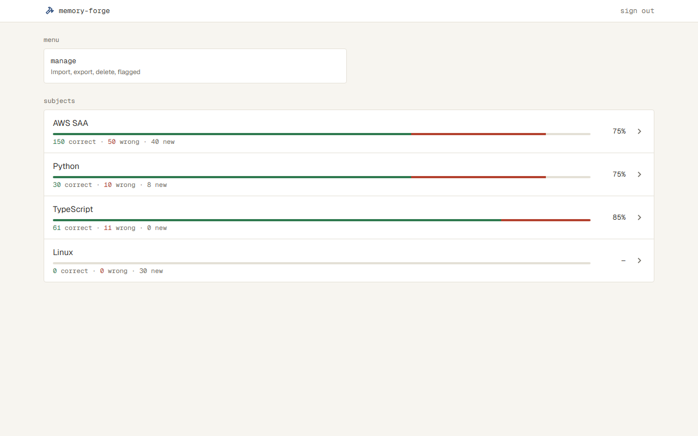
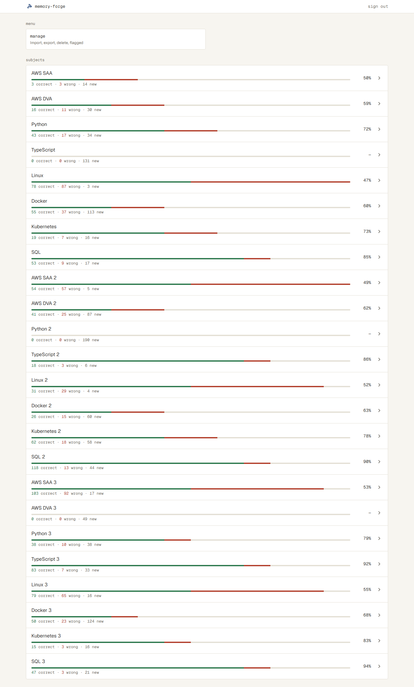
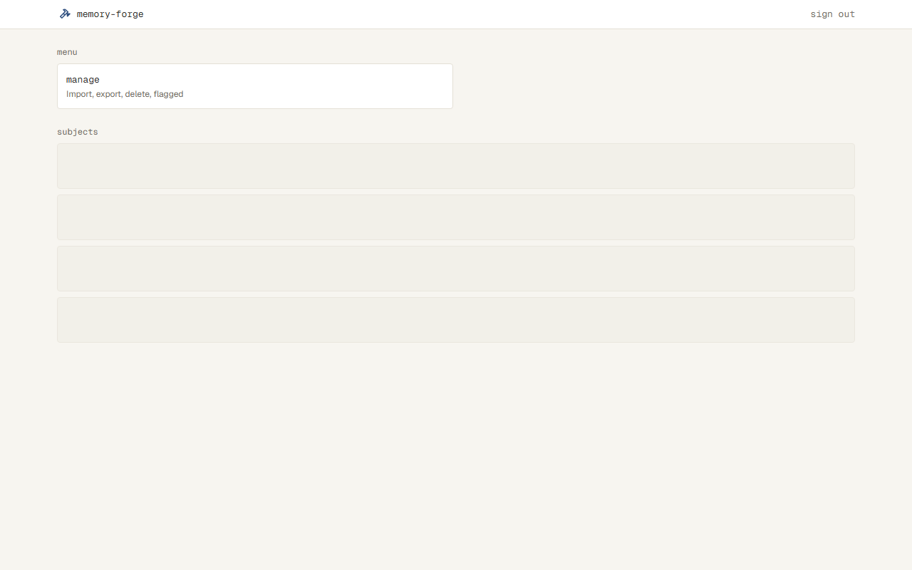
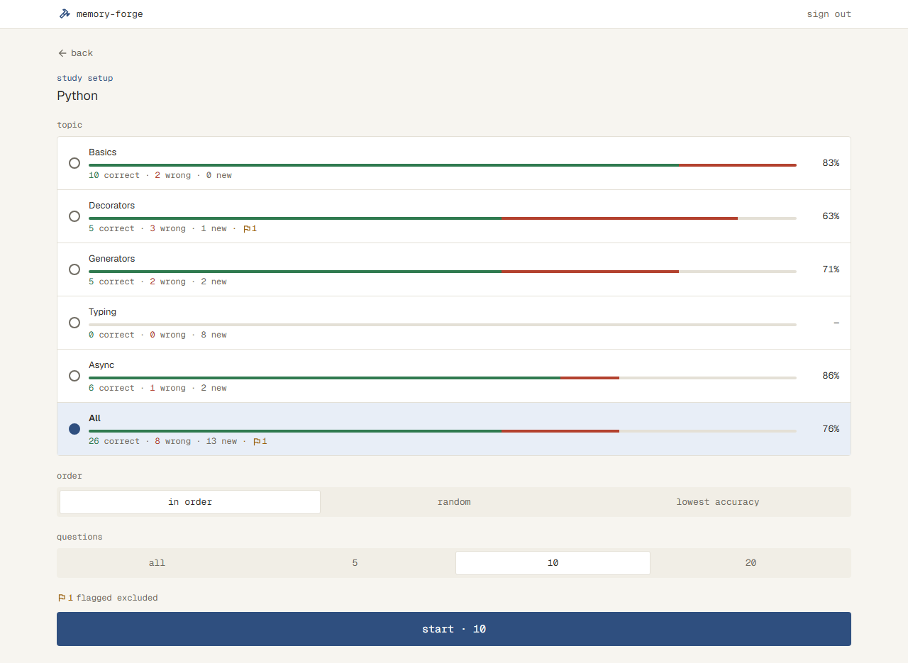
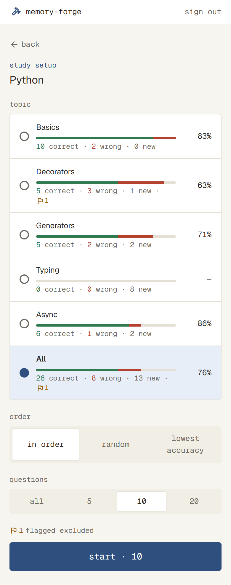
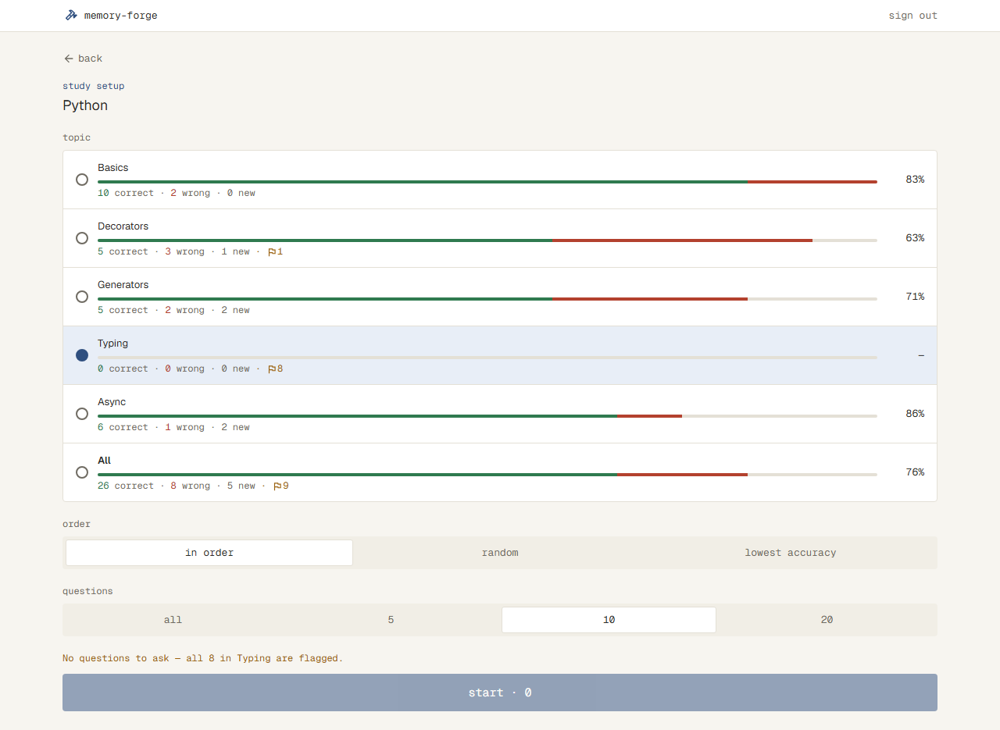
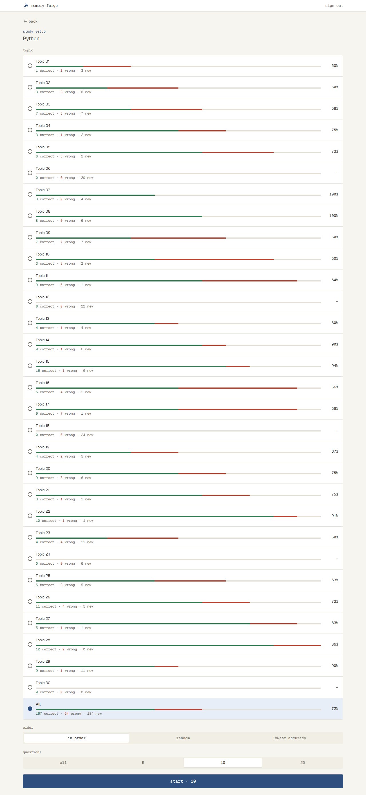

# Subject と Topic に、今の身についている具合を出す（#9）

## なぜ

どの Subject・Topic が身についていて、どこが苦手かが、今は解いてみないとわからない。Home と Setup の行に今の具合を出し、苦手な Topic を選んで解けるようにする。

Issue #9 にある「問題ごとの正答率と解いた回数（Manage）」と「正答率が低い順の出題（Setup の lowest accuracy）」は、もう `docs/specs/manage.md` と `docs/specs/solve.md` にあり、作られている。今回は残りの「Subject と Topic の具合の線」と、#12 から回ってきた「Setup の Topic の行の印の数」を作る。

## 影響する今の仕様

- `docs/specs/home.md` の「最初の画面」：Subject の行に具合を出す。読み込み中の枠の形
- `docs/specs/solve.md` の「Setup」：Topic の行（All を含む）に具合と印の数を出す。読み込み中の枠の形

## 使う場面

1. Python に48問（印なし）があり、最後の答えが正解30問・不正解10問・まだ解いていない8問の人が、Home を開くと、Python の行に、緑・赤・灰の割合で塗り分けた線と「30 correct · 10 wrong · 8 new」、右に「75%」が出る（30 ÷ 40）
2. 同じ人が Python の Setup を開くと、Topic ごとの行に同じ形の線と数が出る。Decorators だけ % が低いので、Decorators を選んで解く。Typing の8問のうち1問に印があると、Typing の行の数の終わりに「· ⚑1」が出て、線と数はその1問を除いた7問で数える
3. 取り込んだばかりでまだ1問も解いていない Subject は、線が全部灰色で「0 correct · 0 wrong · 12 new」、% は「—」

## 受け入れ条件

### 数え方（Home と Setup で同じ）

- 問題ごとに、最後の答えで「correct」「wrong」「new」のどれかに数える
  - 最後の答えが正解：correct。不正解かスキップ：wrong。答えた記録がない：new
- 印の付いた問題は、どれにも数えない
- % は「correct ÷（correct + wrong）」を整数に四捨五入したもの（例：2 ÷ 3 は 67%）。correct + wrong が0のときは「—」
- 数は、0の項目も含めて、いつも correct・wrong・new の3つを並べる
- 全部の問題に印が付いた Topic（Home では Subject）は「0 correct · 0 wrong · 0 new」と「—」にし、線は全部 border にする
- スマホの幅で数が1行に収まらないときは、折り返す

### Home

- Subject の行に、名前の下に、その Subject の全部の問題で数えた線と「30 correct · 10 wrong · 8 new」を出し、右に % を出す（右の chevron_right の印は今のまま）
- 線は、左から correct（success）・wrong（danger）・new（border）の割合で塗り分ける
- 印の数は出さない

### Setup

- Topic の行と All の行に、名前の下に、その Topic（All なら Subject の全部）の線と数を出し、右に % を出す
- 印の付いた問題があれば、数の並びの終わりに「· ⚑1」（flag の印と数は warning）を出す
- 選んでいる行（primary-soft の地）でも、線と数の色はほかの行と同じ
- Solve の quit と Result の try again で Setup に戻ったときは、それまでに答えた分を入れた具合を出す

## 画面

見た目は `docs/ui.md` の「今の身についている具合」に従う。そこにない決まり：

- 行の中は、左に名前、その下に細い線、その下に数（muted の等幅の小さな文字。correct の数は success、wrong の数は danger）。% は行の右（Home では chevron_right の印の左）に等幅で、決まった幅で右にそろえる
- 名前が長いときは、今と同じく行の中で折り返す
- スマホの幅で数が折り返すときも、「⚑1」の印と数は分けない

### Home（home）

| 状態 | 表示 | スクリーンショット |
| --- | --- | --- |
| 通常 | Subject の行に線・数・%。まだ解いていない Linux は、線が全部 border、「0 correct · 0 wrong · 30 new」と「—」 |  |
| Subject が多い | 行が続く |  |
| Subject が0件 | 今のまま（点線の枠と import） | `docs/specs/screens/home-empty.png` |
| 読み込み中 | 線と数のある行と同じ高さの枠を4つ点滅させる |  |
| 読み込めない | 今のまま（danger の帯と retry） | |

### Setup（setup）

| 状態 | 表示 | スクリーンショット |
| --- | --- | --- |
| 通常 | Topic の行と All の行に線・数・%。Decorators と All に「· ⚑1」 |  |
| 通常（スマホの幅） | 数が折り返し、「⚑1」は次の行にまとめて出る |  |
| 全部に印 | Typing の行が「0 correct · 0 wrong · 0 new · ⚑8」、線が全部 border、「—」 |  |
| 問題が足りない・解いた問題がない | 行は通常と同じ。下の案内と start は今のまま | |
| Topic が多い | 行が続く |  |
| 読み込み中 | 今のまま（Topic の行の形の枠を6つ点滅させる） | |
| 読み込めない | 今のまま（danger の帯と retry） | |

## やらないこと

- 線や行を押して、その Topic の問題の一覧や苦手な問題を出すこと（画面の移動はない）
- 具合の移り変わり（日ごとのグラフなど）
- Manage の問題ごとの正答率と、Setup の lowest accuracy を変えること（もうある）
- Home の Subject の行に、印の数を出すこと

## 決まっていないこと

- [x] Home の Subject の行にも、印の数「· ⚑1」を出す？（#12 で決まったのは Setup の Topic の行だけ） → 出さない（印は Setup と Manage で見る）
- [x] % は整数に四捨五入する？（Manage と Result は四捨五入。199 correct · 1 wrong も 100% になる） → 四捨五入する。Manage・Result とそろえ、100% の特別扱いはしない
- [x] 数が0の項目も出す？（「0 correct · 0 wrong · 12 new」のように、いつも3つ並べる理解） → 出す。いつも3つ並べる
- [x] 全部に印が付いた Topic の線は、全部 border の線にする？線を出さない？ → 全部 border の線にする（行の形をほかとそろえる）
- [x] Home で、全部の問題に印が付いた Subject も、Topic と同じく「0 correct · 0 wrong · 0 new」と「—」にする？ → する
- [x] スマホの幅で、数（と「· ⚑1」）が1行に収まらないときは、折り返す？ → 折り返す
- [x] Setup の選んでいる行（primary-soft の地）でも、線と数の色は同じでよい？ → 同じにする
- [x] 1つの機能として、Home と Setup をまとめて1つの仕様でよい？（数え方が同じなので、まとめる案） → まとめる

## 調べたこと

## 設計

表の形は変えない。今ある `answers`（答えるたびに1行）と `questions.flagged` から数える（`docs/design.md` の「記録」）。

### 数え方

- 問題ごとの「最後の答え」は、`answers` のうち、その問題の `answers.id` がいちばん大きい行にする（`distinct on (question_id) ... order by question_id, id desc` の副問い合わせ）
  - `answered_at` ではなく `id` で決める。`id` は足した順に増えるので、同じ時刻に2行あっても1つに決まる
  - 残す場所：コメント（副問い合わせのところ）
- 集計は SQL で行い、印のない問題について次の3つを返す（Setup は Topic ごと、Home は Subject ごと）
  - `total`：問題の数（今の `TopicStats.total` と同じ）
  - `answered`：一度でも答えた問題の数（今の `TopicStats.answered` と同じ）
  - `correct`：最後の答えが正解の問題の数（新しく足す）
  - wrong は `answered - correct`、new は `total - answered` になる（スキップは不正解として記録されているので、wrong に入る）
- `correct`・wrong・new・% を出す計算は、データベースを使わない関数 `mastery()` にまとめ、Home と Setup の両方が使う
  - `{ total, answered, correct }` から `{ correct, wrong, new, accuracy }` を返す。`accuracy` は `Math.round(correct / answered * 100)`、`answered` が0なら `null`（画面で「—」）
  - 全部に印が付いた Topic・Subject は、SQL の結果が `total = answered = correct = 0` になるので、特別扱いをしなくても「0 correct · 0 wrong · 0 new」と「—」になる
- Setup の All の行は、ブラウザで Topic の行を足して数える（今の `topicStats(topics, null)` に `correct` を足す）。Topic は Subject の問題を重ならずに分けるので、足せば Subject 全体と同じになる
  - 残す場所：今の `topicStats` のコメントに `correct` を足す

### 比べたやり方と、選ばなかった理由

- 数える場所
  - 選んだ：SQL で Topic（Subject）ごとの数を返し、% だけをデータベースを使わない関数で出す。今の `getSetup` の集計に1つ足すだけで済み、Home で全部の問題を読まずに済む
  - 選ばなかった：問題ごとの最後の答えを返し、アプリで数える。Home で全部の Subject の全部の問題を読むことになり、今の集計と書き方が分かれる
- Setup の行の部品
  - 選んだ：今の `RadioList` に、行ごとに「名前の下に出す中身」と「右に出す中身」を渡せるようにする。丸・選んだ地・押したときの動きが1か所のまま
  - 選ばなかった：Setup 専用の丸の付いた行を新しく作る。丸の行の見た目と動きが2か所になる
- タスクの分け方
  - 選んだ：Home と Setup の2つ（それぞれ、読み出し＋画面）。表の形の変更がなく、それぞれの PR で画面の動きまで確かめられる
  - 選ばなかった：読み出し・Home・Setup の3つ。最初の PR は画面に何も出ず、確かめにくい

### 変えるファイル

- `src/server/mastery/last-answer.ts`（新規）：問題ごとの最後の答えの副問い合わせ（drizzle の `$with` か `.as()`）。Home と Setup の SQL の両方が使う
- `src/server/mastery/mastery.ts`（新規）：`mastery()`。データベースを使わない（ブラウザの Setup からも読む。`docs/design.md` の「全体の構成」）
- `src/server/subjects/subjects.ts`：`listSubjects()` が `{ id, name, total, answered, correct }` を返すようにする。`subjects` に `questions`・`answers`・最後の答えを left join し、`subjects.id` でまとめ、取り込んだ順のまま
- `src/server/solve/setup.ts`：`TopicStats` に `correct` を足し、`getSetup()` の集計に最後の答えの left join と `correct` を足す
- `src/server/solve/pick.ts`：`topicStats()` が `correct` も足す（`startNotice()` は使わない）
- `src/components/mastery.tsx`（新規）：`docs/ui.md` の「今の身についている具合」の部品
  - 線：border の地に、correct（success）・wrong（danger）を `correct + wrong + new` に対する割合の幅で左から塗る。残りが new（border）。3つの合計が0なら塗らず、全部 border になる
  - 数：muted の等幅の小さな文字で「30 correct · 10 wrong · 8 new」。数字だけ correct は success、wrong は danger。印の数を渡されたら、終わりに「· ⚑1」（flag の印と数は warning）。数は折り返してよく、flag の印と数は分けない（`whitespace-nowrap`）
  - %：等幅で、決まった幅に右そろえ（`TopicResultRow` の % と同じ `w-10`）。`null` は「—」
- `src/app/(app)/page.tsx`：Subject の行を、左に名前・線・数、右に %・chevron_right にする。印の数は渡さない。読み込み中の枠の高さを、線と数のある行の高さに合わせる
- `src/components/radio-list.tsx`：選ぶものに `description?: ReactNode`（名前の下）と `aside?: ReactNode`（右）を足す。渡さないときは今と同じ見た目
- `src/app/subjects/[id]/setup-form.tsx`：Topic の行と All の行に、`mastery()` の線・数（印の数つき）と % を渡す
- Solve の quit と Result の try again で Setup に戻ったときは、今の `router.refresh()`（`src/app/subjects/[id]/study.tsx` の `backToSetup`）で `getSetup()` が読み直されるので、変えない
- `docs/design.md`：「データ」の印の段落の「印の付いた問題は、出題しない…」に、「Home と Setup の身についている具合に数えない（`src/server/subjects/subjects.ts`・`src/server/solve/setup.ts`）」を足す。複数の場所が同じ列を同じ意味で読む決まりのため。Home のタスクで足し、Setup のタスクで当てはまる場所を確かめる

### 画面のテストのデータ

- `e2e/home.spec.ts` と `e2e/solve.spec.ts` で、`e2e/questions.ts` の `insertAnswers` を使って記録を入れ、合わせるスクリーンショットに近い数にする
- Home のデータには印の付いた問題を1問入れ、Home に「⚑」が出ないことも画像でわかるようにする

## 確かめ方

| 受け入れ条件 | 確かめ方 |
| --- | --- |
| 最後の答えで correct・wrong・new に数える（正解→不正解は wrong、不正解→正解は correct、記録がなければ new） | テスト：`src/server/subjects/subjects.test.ts`（最後の答えの副問い合わせは Home と Setup で同じなので、ここで1回だけ） |
| 不正解とスキップは wrong | コードを見て確かめる：スキップは `answers.correct = false` で記録される（`src/server/solve/answer.ts`）ので、不正解と同じ行になる |
| 印の付いた問題は数えない | テスト：`subjects.test.ts` と `src/server/solve/setup.test.ts`（それぞれの SQL に条件があるので両方） |
| % は四捨五入、correct + wrong が0なら「—」 | テスト：`src/server/mastery/mastery.test.ts`（2 ÷ 3 が 67。answered が0なら null、1なら値がある） |
| いつも3つの数を並べる | 触って確かめる：Linux（home-default）・Typing（setup-default）の「0 correct」 |
| 全部に印の Topic・Subject は「0 correct · 0 wrong · 0 new」「—」、線は全部 border | テスト：`setup.test.ts` で、全部に印の Topic が `total = answered = correct = 0` になる。見た目は触って確かめる（setup-none の画像） |
| スマホの幅で数が折り返す。「⚑1」は分けない | 触って確かめる（setup-default-mobile の画像） |
| Home：Subject の行に線・数・%、chevron_right は今のまま。印の数は出さない | 触って確かめる（home-default・home-many の画像） |
| Home：線の塗り分け（success・danger・border の割合） | 触って確かめる（home-default の画像） |
| Home：読み込み中の枠が、線と数のある行と同じ高さ | コードを見て確かめる：`src/app/(app)/page.tsx` の読み込み中の枠の高さ（撮らない。`docs/design.md` の「画面の画像を撮る・比べる仕組み」）。見本は home-loading.png |
| Setup：Topic の行と All の行に線・数・% | テスト：`src/server/solve/pick.test.ts` の `topicStats` で、All が `correct` も足す。見た目は触って確かめる（setup-default の画像） |
| Setup：印があれば「· ⚑1」 | 触って確かめる（setup-default で、Decorators・All にあり、ほかの行にない） |
| Setup：選んでいる行でも線と数の色は同じ | 触って確かめる（setup-default の All、setup-none の Typing） |
| Setup：quit と try again で戻ると、答えた分を入れた具合を出す | テスト：`e2e/solve.spec.ts` の今ある try again のテストに、戻った Setup の行の数が答えた分で変わったことを足す |

## タスク

- [x] 1. Home の Subject の行に身についている具合を出す
  - 完了：Home の Subject の行に、最後の答えで数えた線・数・% が出たら完了
  - 変えるもの：`src/server/mastery/last-answer.ts`・`src/server/mastery/mastery.ts`（とテスト）、`src/server/subjects/subjects.ts`（とテスト）、`src/components/mastery.tsx`、`src/app/(app)/page.tsx`、`e2e/home.spec.ts`、`docs/design.md` の印の段落
  - 合わせるスクリーンショット：`home-default.png`、`home-many.png`、`home-loading.png`（読み込み中は撮らず、コードで合わせる）
  - 撮り直す画像：`docs/specs/screens/home-default.png`、`docs/specs/screens/home-many.png`
- [ ] 2. Setup の Topic の行に身についている具合と印の数を出す
  - 完了：Setup の Topic の行と All の行に、線・数・%・印の数が出て、quit・try again で戻ると答えた分が入ったら完了
  - 変えるもの：`src/server/solve/setup.ts`（とテスト）、`src/server/solve/pick.ts`（とテスト）、`src/components/radio-list.tsx`、`src/app/subjects/[id]/setup-form.tsx`、`e2e/solve.spec.ts`（setup-default-mobile を撮るテストを足す）
  - 合わせるスクリーンショット：`setup-default.png`、`setup-default-mobile.png`、`setup-none.png`、`setup-many.png`
  - 撮り直す画像：`docs/specs/screens/setup-default.png`、`docs/specs/screens/setup-default-mobile.png`（新しく撮る）、`docs/specs/screens/setup-none.png`、`docs/specs/screens/setup-many.png`、`docs/specs/screens/setup-few.png`、`docs/specs/screens/setup-unanswered.png`（行に線と数が増えるため）
