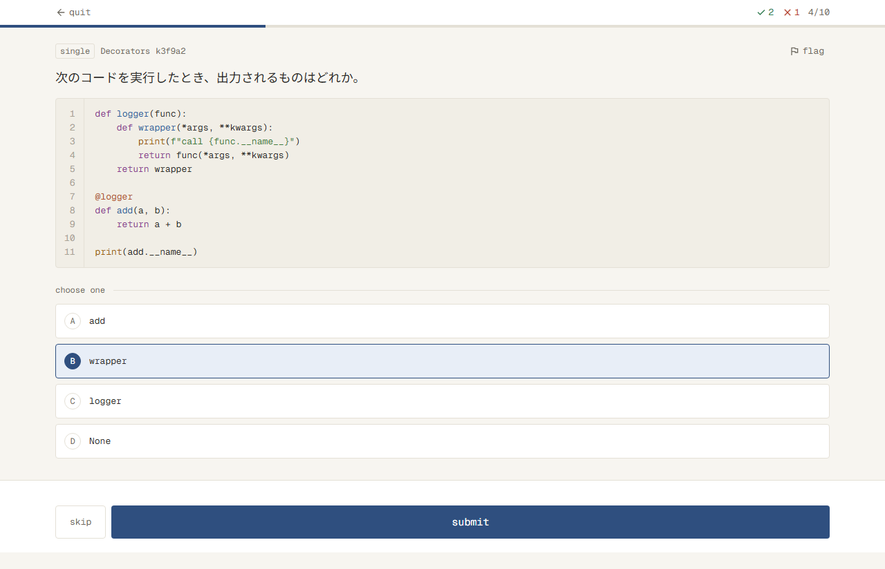
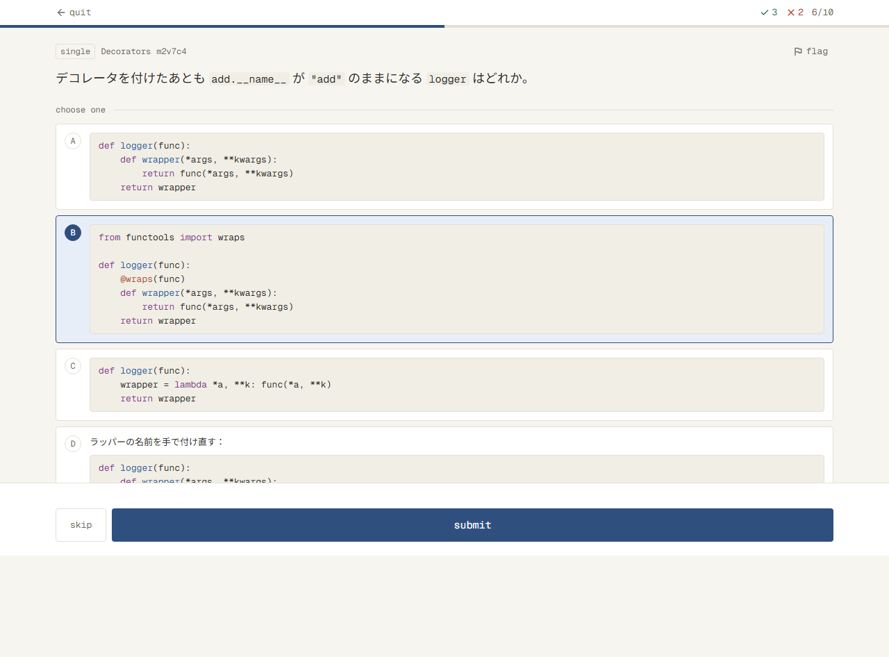
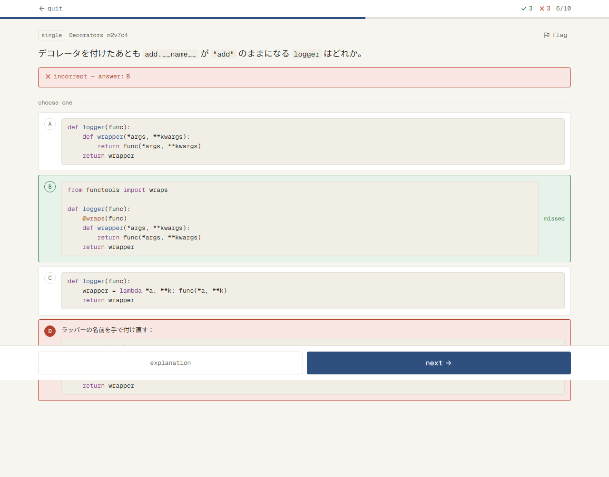
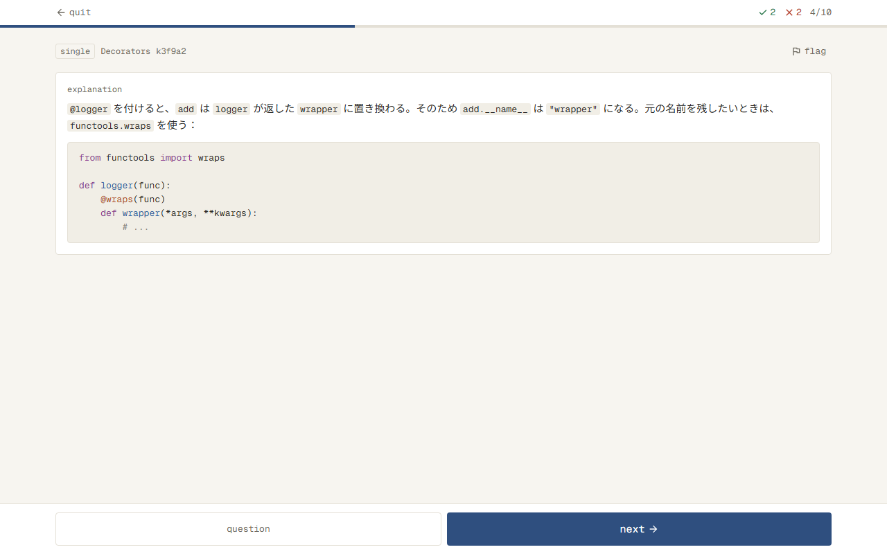
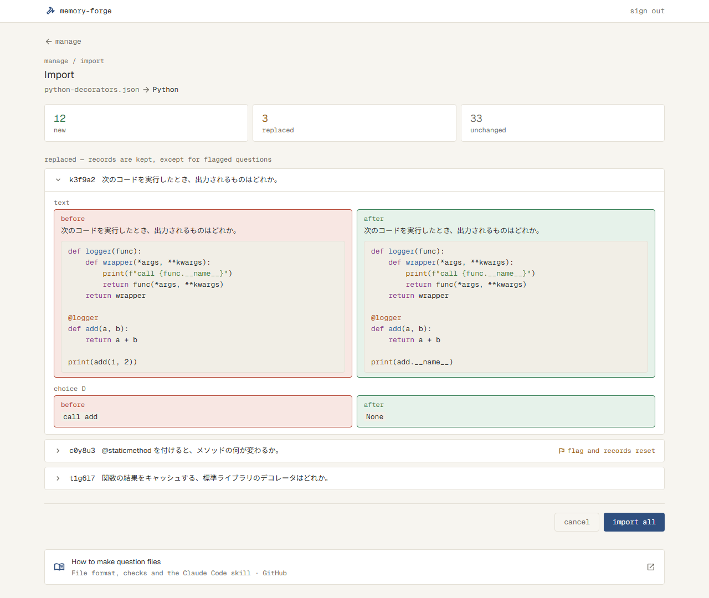

# 問題のコードを色付きで読める（#7）

## なぜ

プログラミング系の題材では、問題文・選択肢・解説にコードが入る。今は全部が1色なので、キーワード・文字列・コメントなどの見分けがつきにくく、コードを読むのに時間がかかる。言語に合わせて色を付け、エディタで読むときと同じように読めるようにする。

Issue #7 にある「問題文のコードには行番号を付ける」は、もう `docs/specs/solve.md` にあり、作られている。今回は色分けだけを作る。

## 影響する今の仕様

- `docs/specs/solve.md` の「Solve」：問題文・選択肢・解説のコードブロックを、言語に合わせて色分けする
- `docs/specs/import.md` の「取り込む前の確認」：置き換わる問題の前と後に出るコードも、同じ決まりで色分けする

## 使う場面

1. Python のデコレーターの問題（問題文に ```` ```python ```` のコード）を解く人が、Solve を開くと、`def`・`return` などのキーワード、`"call ..."` などの文字列、`@logger`、`print` などがそれぞれ別の色で出る。行番号は今のまま
2. 選択肢が4つとも短い Python のコードの問題で、選択肢の中のコードも、問題文と同じ決まりで色が付く。答え合わせのあと、正解の選択肢が success の枠と地になっても、コードの色はそのまま
3. 言語の名前を書かずに ```` ``` ```` だけで囲んだコードは、今と同じ1色で出る
4. 解説を直した Python の問題のファイルを取り込み直す人が、取り込む前の確認で置き換わる問題を開くと、前と後のコードにも Solve と同じ色が付いている

## 受け入れ条件

- 問題文・選択肢・解説のコードブロックに、```` ``` ```` の後ろに書かれた言語に合わせて色を付ける（Solve と、Import の取り込む前の確認の両方）
- 色を付ける言語は、Python・TypeScript・JavaScript・SQL・シェル・JSON
  - 言語の名前は、大文字・小文字を区別しない。短い名前（`py`・`ts`・`js`・`sh`・`bash`・`shell`）も同じ言語として扱う
- 問題を開いたときから色が付いている（1色で出てから色が変わることはない）
- 文の中の短いコード（`` `x` ``）には色を付けない（今のまま）
- 言語の名前は画面に出さない
- Import の取り込む前の確認の前と後では、文とコードを、Solve の選択肢と同じ見せ方で出す（文の中の短いコードは code-bg の地で囲み、```` ``` ```` のところは行番号のないコードブロックにする。```` ``` ```` の記号は出さない）
- 色を付けるのは、キーワード・文字列・関数の名前・組み込みの名前・デコレーター・コメント。それ以外（変数の名前、数、記号など）は今の文字の色のまま
- 色を付けられない言語（言語の名前がない、知らない言語の名前）は、今と同じ1色で出す。エラーは出さない
- 行番号、字下げ、横にはみ出したときのスクロールは、今と同じ
- 答え合わせのあと（正解・不正解の色の付いた選択肢）でも、コードの色は変わらない
- ライトモードとダークモードの両方で、それぞれのモードの色で出す

## 画面

### Solve（solve）

| 状態 | 表示 | スクリーンショット |
| --- | --- | --- |
| 答える前（単一選択） | 問題文のコードに色と行番号 |  |
| 答える前（選択肢がコード） | 選択肢の中のコードに色（行番号なし） |  |
| 答えたあと（選択肢がコード） | 正解・不正解の枠と地の中でも、コードの色はそのまま |  |
| 答えたあと（解説） | 解説の中のコードブロックに色。文の中の短いコードは code-bg の地だけで、色は付けない |  |
| 色を付けられない言語 | 今と同じ1色。行番号は付く |  |

読み込み中・保存のエラーなど、ほかの状態は今のまま。

### Import の取り込む前の確認（import-preview）

| 状態 | 表示 | スクリーンショット |
| --- | --- | --- |
| 置き換わる問題を開いたとき | 前（danger の枠）と後（success の枠）の中に、文と、色の付いたコードブロック（行番号なし） |  |

- コードブロックは、前（danger-soft の地）と後（success-soft の地）の中でも、code-bg の地と border の枠で出す

## やらないこと

- 問題のファイルの取り込みで、言語の名前を確かめること（今のまま確かめない）
- 色の決まり（どの言葉を何色にするか）を、画面から変えられるようにすること
- 文の中の短いコードの色分け
- コードブロックに言語の名前を出すこと
- 今の6つ（キーワード・文字列・関数・組み込み・デコレーター・コメント）より多くの種類に色を分けること（数や型の名前など）

## 決まっていないこと

- [x] 色を付ける言語はどれ？（例：Python・TypeScript・JavaScript・SQL・シェル・JSON。今の題材と、これから作る題材に合わせて絞る） → 例の6つ全部。今後増やす予定
- [x] `py`・`ts`・`sh` のような短い名前や、大文字の `Python` も、同じ言語として色を付ける？ → 付ける
- [x] 文の中の短いコード（`` `x` ``）も色を付ける？（言語の名前を書く場所がないので、付けない理解） → 付けない
- [x] コードブロックに、言語の名前（「python」など）を小さく出す？ → 出さない
- [x] 色の種類は、今あるトークンの6つ（キーワード・文字列・関数・組み込み・デコレーター・コメント）でよい？数（`42` など）や型の名前にも色を付けたい？ → 6つでよい
- [x] 問題を開いたとき、ほんの一瞬だけ1色で出てから色が付いてもよい？（いつも最初から色が付いている必要がある？） → 最初から色が付いているほうがよい
- [x] Import の取り込む前の確認（置き換わる問題の前と後）に出る問題文のコードは、今のまま1色でよい？ → 色を付ける
- [x] Import の取り込む前の確認の前と後は、今は問題文などを ```` ``` ```` の記号ごと1色の等幅の文字で出している。色を付けるとき、Solve の選択肢と同じようにコードブロック（code-bg の地と枠、行番号なし）にして出す？それとも、今の文字の並び（```` ``` ```` の記号も見える）のまま、コードの部分にだけ色を付ける？ → コードブロックにする

## 調べたこと

---

## 設計

### やり方

- 色分けは、ライブラリ Prism（`prismjs` 1.30.0。型は `@types/prismjs`）の `Prism.tokenize` で、コードを言葉の種類ごとに分けて行う。データベースもデータの形も変えない
- 画面を組み立てるとき（サーバーで組み立てるときも、ブラウザで組み立てるときも）に、その場で（待たずに）色を決める。`useEffect` や読み込みを待つ作りにしないので、1色で出てから色が変わることはない
  - Solve の問題はサーバーアクションで受け取ってブラウザで組み立てるが、`Prism.tokenize` は待たずに結果を返すので、最初の表示から色が付く

### 比べた選択肢

| 選択肢 | 選ばなかった理由 |
| --- | --- |
| Prism（選んだ） | — 待たずに色を決められ、軽い（6つの言語で数十KB）。言葉の種類の名前（keyword・string・function・builtin・decorator・comment）が、今の6つのトークンにそのまま合う |
| highlight.js（lowlight） | 種類の名前（`built_in`・`meta`・`title.function_` など）を6つに読み替える表が要る。関数の名前に色が付くのが定義のところだけの言語が多い |
| Shiki | 文法のファイルが大きく、画面に送る量が数百KB増える。ふつうは待ってから色を決める作りなので、最初から色を付けるには、待たずに決める書き方と文法の取り込みを自分で組む必要がある。細かい種類を6つにまとめる表も要る |

### 変えるファイル

- `package.json`：`prismjs` と `@types/prismjs`（開発用）を足す
- `src/server/questions/markup.ts`：コードブロックの `Block` に `language`（```` ``` ```` のあとの最初の語。空白で区切る。なければ空の文字）を足す。今は読み捨てている
- `src/server/questions/highlight.ts`（新しく作る。データベースは使わず、画面の部品から読む）
  - `highlight(code, language)`：コードを、`{ text, kind }` の並びにして返す。`kind` は `keyword`・`string`・`function`・`builtin`・`decorator`・`comment` か `null`（今の文字の色のまま）
  - 言語の名前は、小文字にしてから、決めた表で文法を選ぶ。表にあるのは `python`・`py`・`typescript`・`ts`・`javascript`・`js`・`sql`・`bash`・`sh`・`shell`・`json` だけ。表にない名前と空の名前は、全体を `kind: null` の1つにして返す（エラーにしない）
    - `Prism.languages` をそのまま引かない。Prism には `markup`・`css`・`clike` なども最初から入っていて、6つの言語のほかにも色が付いてしまうため（理由は、この表のそばのコメントに書く）
  - 言葉の種類は、Prism の種類（`type`）、なければ別名（`alias`）で6つに当てはめる。入れ子の言葉（文字列の中の `{...}`、デコレーターの中の `.` など）は、内側から外側へ見て、最初に当てはまった種類にする。どれにも当てはまらなければ `null`
    - 例：Python の三重引用符の文字列（別名が string）は string。JSON の `null`（別名が keyword）は keyword。数・変数・記号は `null`
    - 種類の分け方は Prism に従うので、プロトタイプの画像と色が少し違うところがありうる（`from` の色など）。合わせるのは本番の画面を撮った画像
  - Prism の言語のファイル（`prismjs/components/prism-python` など）は、`prismjs` を読み込んだあとに読み込む。TypeScript は JavaScript を使うので、JavaScript より後にする（順番の理由は、読み込むところのコメントに書く）
- `src/components/code-block.tsx`：`language` を受け取り、`highlight` の結果を、種類ごとの文字の色（`text-code-keyword` など。トークンにある6つ）の `<span>` にして `<pre><code>` の中に並べる。行番号、字下げ、横のスクロールの作りは今のまま（行番号は今と同じく、コードを改行で分けた数で出す。色の `<span>` は行をまたいでもよい）
  - 先頭の「色分けは #7 で足す」のコメントを消す
- `src/components/rich-text.tsx`：コードブロックの `language` を `CodeBlock` に渡す
- `src/components/change-row.tsx`：前と後の中身を、項目が `text`・`choice A〜H`・`explanation` のときは `RichText`（行番号なし）で出す。`topic`・`type`・`correct` は今のまま文字で出す
  - Topic の名前に `` ` `` があっても、文の中のコードにしないため（項目の名前で分ける理由は、ここのコメントに書く）
  - コードブロックは、前（danger-soft の地）と後（success-soft の地）の中でも、`CodeBlock` のまま code-bg の地と border の枠で出す
- `docs/libraries/prismjs.md`：ライブラリの資料の下書き（`docs/process/code-notes.md` の「ライブラリの資料」）

### 理由と前提を残す場所

- 言語の表を `Prism.languages` と分けている理由、言語のファイルを読み込む順番：`src/server/questions/highlight.ts` のコメント
- 入れ子の言葉の種類の決め方：`src/server/questions/highlight.ts` のコメント
- 前と後で `RichText` にする項目の分け方：`src/components/change-row.tsx` のコメント
- どれもそのファイルだけに関わるので、`docs/design.md` には書かない

## 確かめ方

| 受け入れ条件 | 確かめ方 |
| --- | --- |
| 言語に合わせて色を付ける（Solve と Import の確認の両方） | テスト（Vitest）：`highlight` で、Python のコードのキーワード・文字列・関数の名前・組み込みの名前・デコレーター・コメントが、それぞれの種類になる。`parseMarkup` で、```` ``` ```` のあとの最初の語が `language` になる（続きのある ```` ```python title ```` と、言語の名前のない ```` ``` ````）。画面は触って確かめる（本番の画面の画像） |
| 6つの言語・大文字小文字・短い名前 | テスト（Vitest）：`highlight` の言語の名前の選び方で、大文字（`Python`）と短い名前（`py`）を1つずつ。表にない言語（`css` など Prism に入っている名前と、`python3`）と空の名前は全体が `null` |
| 問題を開いたときから色が付いている | コードを見て確かめる：`highlight` を、待たずに、組み立てるときにその場で呼んでいる（`useEffect` や `await` を使っていない） |
| 文の中の短いコードには色を付けない | 触って確かめる（solve-explanation の画像） |
| 言語の名前は画面に出さない | 触って確かめる |
| Import の確認の前と後を、Solve の選択肢と同じ見せ方で出す | 触って確かめる（import-preview の画像） |
| 色を付ける種類は6つで、それ以外は今の色 | テスト（Vitest）：上の `highlight` のテストに、数（`42`）が `null` になること、入れ子の言葉（デコレーターの中の `.`）が外側の decorator になることを入れる |
| 色を付けられない言語は今と同じ1色。エラーは出さない | テスト（Vitest）：上の言語の名前のテスト。画面は触って確かめる（solve-no-language の画像） |
| 行番号・字下げ・横のスクロールは今と同じ | 触って確かめる（solve-question の画像と、横にはみ出すコードを手元で開く） |
| 答え合わせのあとでも、コードの色は変わらない | 触って確かめる（solve-answered-code-choices の画像） |
| ライトモードとダークモードで、それぞれの色 | 触って確かめる（手元でモードを切り替える） |

## タスク

- [x] 1. Solve の問題文・選択肢・解説のコードブロックに、言語に合わせて色が付いたら完了
  - Prism を入れ、`markup.ts`・`highlight.ts`（とそのテスト）・`code-block.tsx`・`rich-text.tsx` を変える。`docs/libraries/prismjs.md` の下書きを書く
  - 画面のテストのデータ（`e2e/solve.spec.ts`）：選択肢がコードの問題（m2v7c4）の選択肢のコードを ```` ```python ```` にする。言語の名前のないコードの問題で、solve-no-language を撮るテストを足す（4問目と同じ問題で、```` ``` ```` だけのもの）
  - 合わせるスクリーンショット：`solve-question.png`・`solve-code-choices.png`・`solve-answered-code-choices.png`・`solve-explanation.png`・`solve-no-language.png`（`docs/changes/2026-11-13-highlight-code/`）
  - 撮り直す画像（`docs/specs/screens/`）：`solve-question.png`・`solve-answered.png`・`solve-explanation.png`・`solve-code-choices.png`・`solve-answered-code-choices.png`・`solve-many.png`・`solve-error.png`・`solve-quit.png`・`solve-answered-flagged.png`（色の付いたコードが写るもの）。新しく `solve-no-language.png`
- [ ] 2. Import の取り込む前の確認で、置き換わる問題の前と後の文とコードが、Solve の選択肢と同じ見せ方（色の付いたコードブロック）で出たら完了
  - `change-row.tsx` を変える
  - 画面のテストのデータ（`e2e/import.spec.ts`）：最初に開いている置き換わる問題（k3f9a2）の問題文を、前と後で最後の行だけが違う ```` ```python ```` のコードのある文にする
  - 合わせるスクリーンショット：`import-preview.png`（`docs/changes/2026-11-13-highlight-code/`）
  - 撮り直す画像（`docs/specs/screens/`）：`import-preview.png`
