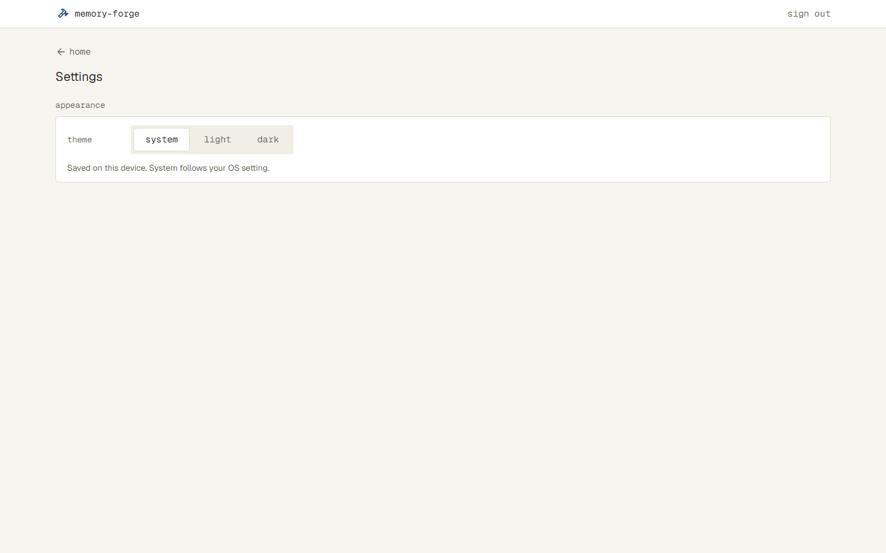
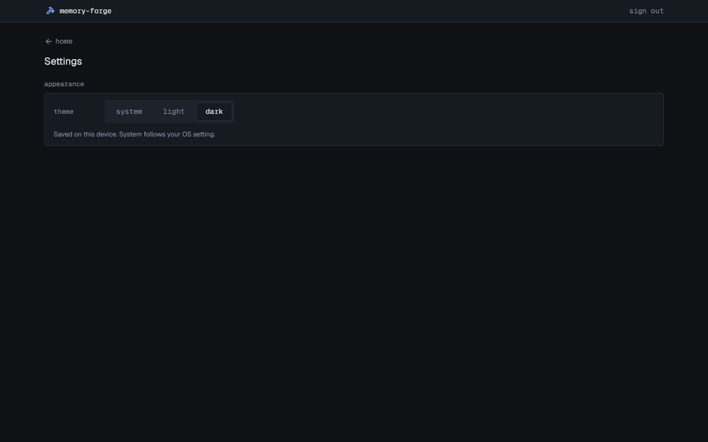
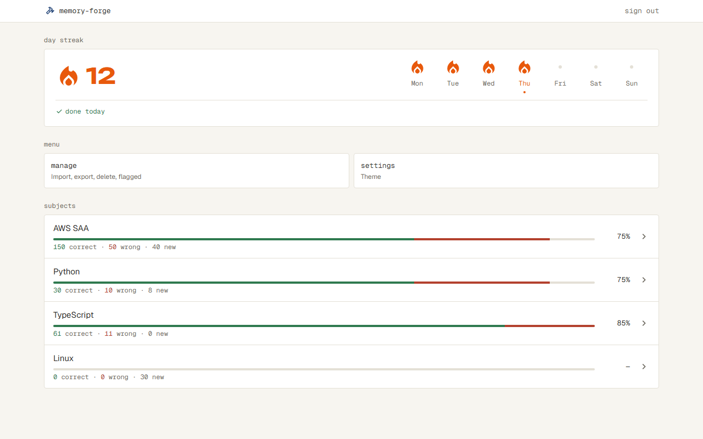

# テーマを切り替えられる（#13）

## なぜ

使う場所や好みに合わせて、画面の明るさを選べるようにするため。今は OS の設定に関係なく、いつも同じ明るさで出る。

## 影響する今の仕様

- 新規：docs/specs/settings.md（Settings 画面）
- docs/specs/home.md の「最初の画面」：menu に settings の枠を足す
- docs/specs/app-bar.md の「上のバー」：上のバーを出す画面に Settings を足す

## 使う場面

1. 夜に PC で問題を解く人が、Home の menu の settings を押し、Settings で dark を選ぶと、その場で画面が暗くなる。Home に戻っても、ほかの画面を開いても暗いまま
2. OS をダークモードにしているスマホで、まだテーマを選んだことのない人が開くと、最初から暗い画面で出る（system のまま）
3. PC で dark を選んだ人が、スマホで開くと、スマホでは選んだことがないので system のまま出る

## 受け入れ条件

- Home の menu に、manage の隣に枠「settings」と「Theme」が出て、押すと Settings に移る
- Settings の左上に戻るリンク「home」、その下に見出し「Settings」が出る（パンくずは出さない）。戻るリンクを押すと Home に移る
- Settings の「appearance」の見出しの下の枠に、ラベル「theme」と「system」「light」「dark」が横に並び、1つを選べる。最初は system が選ばれている
- 枠の下の行に「Saved on this device. System follows your OS setting.」と出る
- 開いた瞬間から、選んだ明るさで出る（一度ほかの明るさで出てから切り替わることはない）
- Login にはテーマを選ぶ手段を置かない。解く画面から Settings へ行く手段も置かない
- 選ぶと、その場で画面の明るさが切り替わる（保存のボタンは押さない）
  - system：OS の設定に合わせる
  - light：いつも明るい
  - dark：いつも暗い
- 選んだ値は端末（ブラウザ）ごとに覚える。読み直しても、閉じて開き直しても、選んだ明るさで出る。ほかの端末には移らない
- 選んだ明るさは、Login を含むすべての画面に効く
- system を選んでいる間に OS の設定を変えると、画面も合わせて変わる
- ログインしていないと Settings は見られない（ほかの画面と同じく Login に移る）

## 画面

### Settings（新規）

| 状態 | 表示 | スクリーンショット |
| --- | --- | --- |
| 通常（system） | 上のバー、戻るリンク「home」、見出し「Settings」、appearance の枠で system が選ばれている |  |
| dark を選んだ | dark が選ばれ、暗い画面 |  |

- テーマの3つ：docs/ui.md の「少しの中から1つ選ぶもの」と同じく、横に並べたボタンで、選んでいるものだけを surface の地にする。3つは surface-raised の地の中に並べる
- light を選んだときは、通常（system）と同じ明るい画面で、light が選ばれる（画像は撮らない）

- 0件・大量・読み込み中・エラー・権限なしは起こらない（読み込むデータがなく、覚えるのは端末の中だけのため。ログインしていないときは Login に移る）

### Home

| 状態 | 表示 | スクリーンショット |
| --- | --- | --- |
| 通常 | menu に manage と settings の2枚の枠 |  |

## やらないこと

- 選んだテーマを、アカウントに保存してほかの端末と合わせること
- Google アカウントの紐づけ（#14）。Settings にはテーマだけを置く
- light / dark 以外の色の組み合わせや、色を自分で決めること

## 決まっていないこと

- [x] Settings の見出し・パンくずの文言は「settings」「settings」でよいか（ほかの画面に合わせると、パンくず「settings」、見出し「Settings」になる） → パンくず「settings」、見出し「Settings」 → プロトタイプに合わせて、パンくずは出さず見出し「Settings」だけ
- [x] テーマの選ぶものの見出しと、3つの書き方（「theme」の見出しの下に「system」「light」「dark」でよいか） → それでよい → プロトタイプに合わせて、見出し「appearance」の枠にラベル「theme」と3つ
- [x] 3つの見せ方：docs/ui.md の「少しの中から1つ選ぶもの」（横に並べたボタンで、選んでいるものだけ surface の地）でよいか → それでよい
- [x] 3つに、説明（system に「match your OS」など）やアイコン（light_mode / dark_mode など）を添えるか → 添えない。枠の下に「Saved on this device. System follows your OS setting.」を1行出す（プロトタイプに合わせる）
- [x] 合意済みのプロトタイプの Settings にある account の欄（email、Google の紐づけ）はどうするか → 今回は出さない（#14 で足す）。Home の menu の settings の枠の説明文も、#14 で「Google account, theme」にする
- [x] Home の menu の settings の枠に出す説明文（manage の「Import, export, delete, flagged」にあたるもの。例：「Theme」） → 「Theme」
- [x] Login 画面にテーマを選ぶ手段を置くか（置かない場合、Login は覚えている値か system で出るだけ） → 置かない
- [x] 解く画面（Solve）から Settings へ行く手段は要らない、でよいか（今の決まりでは Home の menu からだけ） → 要らない
- [x] 画像を比べるテストに、ダークの画面を入れるか。入れるならどの画面か（Settings の dark だけ、全画面のダーク、など） → Settings の dark だけ入れる
- [x] 画面を開いた瞬間に、一度明るい画面が出てから暗くなる（ちらつく）ことを許すか → 許さない（開いた瞬間から選んだ明るさで出る）

## 調べたこと

---

## 設計

### 明るさを決める仕組み

- 選んだ値（`system`・`light`・`dark`）は、ブラウザの `localStorage` に1つのキー（`theme`）で持つ。何も入っていない・知らない値のときは `system` とみなす
- 明るさは、今と同じく `<html>` の `data-theme` で決める（`src/styles/tokens.css` は `[data-theme="dark"]` で同じ名前のトークンを上書きしている。トークンは変えない）
- `src/app/layout.tsx` の `<head>` に、小さなスクリプトを直に書く（`dangerouslySetInnerHTML`）。画面を描く前に動き、`localStorage` の値と OS の設定（`matchMedia("(prefers-color-scheme: dark)")`）から `light` か `dark` を決めて `data-theme` に付ける。`<html>` には `suppressHydrationWarning` を付ける
  - system のときは、同じスクリプトで `matchMedia` の `change` を聞き、OS の設定が変わったら付け直す
  - ルートの layout に置くので、Login を含むすべての画面に効く
  - 根拠：Next.js 16.4 のガイド `node_modules/next/dist/docs/01-app/02-guides/preventing-flash-before-hydration.md` の「Themes」
- 値を決める処理（値の読み方、system を OS の設定から決める、付け直す）は、`src/components/theme.ts` に1つだけ書き、スクリプトの文字列もそこから作る（`fn.toString()` で関数を文字列にして埋める）。Settings の部品も同じファイルの関数で書き込み・付け直しをする
  - 書き込むと、その場で `data-theme` を付け直す。保存のボタンは置かない
- `data-theme` を付けない（スクリプトが動く前・`localStorage` が使えない）ときは、今と同じ明るい画面で出る

### Settings 画面

- `src/app/(app)/settings/page.tsx`（新規）：上のバーの付く画面のグループに置く。ログインの確かめは今の `src/proxy.ts` のまま（`/login` 以外はすべて確かめる）で、足すものはない
  - 上は `PageHeader`（`back={{ href: "/", label: "home" }}`、`title="Settings"`、`crumbs` なし）。並べ方と幅は Manage と同じ `main`
  - 「appearance」の見出しは Home の menu の見出しと同じ書き方（等幅の xs の muted）。その下の枠は surface の地・border の枠（Home の menu の枠と同じ）
- `src/app/(app)/settings/theme-picker.tsx`（新規、クライアントの部品）：ラベル「theme」と、今ある `Segmented`（`src/components/segmented.tsx`）で system・light・dark を並べる。その下に「Saved on this device. System follows your OS setting.」
  - 今選んでいる値は `useSyncExternalStore` で `localStorage` から読む。サーバーで組み立てるときは値がわからないので、サーバーの値は `system` にする（読み終わるまでの一瞬だけ system が選ばれて見えることがある。明るさは上のスクリプトで先に決まっているので、明るさはちらつかない）
  - `Segmented` は今 `flex-1` で幅いっぱいに広がる。スクリーンショットでは中身の幅なので、外側の幅を部品の外から絞る（`Segmented` に幅を決める props を足す必要があれば、実装の前に聞く）
- データベース・サーバーの処理・アクションは足さない

### Home

- `src/app/(app)/page.tsx` の menu に、manage の右に枠「settings」「Theme」を足す（`/settings` へのリンク）。今の「2列の枠の左の1枚」の並びに、右の1枚が入る
- `docs/specs/home.md`・`docs/specs/app-bar.md` を、受け入れ条件に合わせて直す。`docs/specs/settings.md` を新しく書く

### 選んだやり方と理由

- 覚える場所：`localStorage` にした
  - cookie と比べた。cookie はサーバーで読めるが、ルートの layout で読むと Cache Components で全画面が開くたびに組み立てる画面になる（同じガイドの「Storing the theme in a cookie」）。結局スクリプトで読むことになり、期限を決める手間と毎回送る分だけが増えるため、選ばなかった
- 描く前のスクリプト：`useEffect` で付けるやり方は、一度明るい画面が出てからの切り替えになり「ちらつかない」を守れないため選ばなかった。ライブラリ（next-themes など）は、仕様にないパッケージを足さないため使わない
- system の OS への追従を CSS の `@media (prefers-color-scheme: dark)` で書くやり方は、ダークのトークンの値を2か所に書くことになるため選ばなかった

### 仕上げたあとに残す場所

- `docs/design.md` に「テーマ」の節を足す：値は `localStorage` の `theme` に持ち、ルートの layout の `<head>` のスクリプトが描く前に `data-theme` を付けること、決める処理は `src/components/theme.ts` の1か所だけにすること。前提（崩れたら見直す）：選んだテーマをほかの端末と分け合わない（アカウントに持つなら、サーバーで読む作りに変える）。CSP で直に書いたスクリプトを止めるようになったら nonce が要る
- `useSyncExternalStore` のサーバーの値を system にしている理由は、`theme-picker.tsx` のコメントに書く

## 確かめ方

| 受け入れ条件 | 確かめ方 |
| --- | --- |
| Home の menu に settings・Theme が出て、押すと Settings に移る | 触って確かめる（枠は Home の画像でも確かめる） |
| Settings の戻るリンク・見出し、戻るリンクで Home に移る | 触って確かめる（Settings の画像） |
| appearance の枠に theme と3つが並び、最初は system | 触って確かめる（Settings の画像）。最初が system なのは、下の「何も選んでいないと OS に合わせる」テストに含める |
| 枠の下の1行の文言 | 触って確かめる（Settings の画像） |
| 開いた瞬間から選んだ明るさで出る | コードを見て確かめる（スクリプトが `<head>` にあり、描く前に `data-theme` を付けること） |
| Login にテーマを選ぶ手段がない、Solve から Settings へ行く手段がない | 触って確かめる |
| 選ぶとその場で切り替わる（system・light・dark） | テスト（Playwright：Settings で dark を押すと `data-theme` が dark になり、light を押すと light になる） |
| 選んだ値を端末に覚え、読み直しても選んだ明るさで出る。ほかの端末には移らない | テスト（Playwright：dark を選んで読み直すと dark のまま、Settings で dark が選ばれている）。ほかの端末に移らないのは、コードを見て確かめる（`localStorage` だけに持つこと） |
| Login を含むすべての画面に効く | テスト（Playwright：dark を選んだあと Login を開くと dark。ログインしていない状態の Login で確かめる） |
| system の間に OS の設定を変えると合わせて変わる。OS がダークで選んだことがないと最初から暗い | テスト（Playwright：何も選んでいない状態で `emulateMedia({ colorScheme: "dark" })` にすると dark、light に戻すと light） |
| ログインしていないと Settings は見られない | コードを見て確かめる（`src/proxy.ts` が `/login` 以外をすべて確かめていて、Settings を例外にしていないこと） |

- 画像を比べるテスト：Settings の通常（system。Playwright の既定は明るい OS）と dark を足す。dark は Settings で dark を押してから撮る

## タスク

- [x] 1. 端末に覚えた値で、すべての画面の明るさが決まる仕組みができたら完了
  - `src/components/theme.ts`、`src/app/layout.tsx` のスクリプト
  - テスト：OS の設定に合わせる（何も選んでいない状態で、OS をダーク・明るいに切り替える）、`localStorage` に dark を入れて Login を開くと dark
  - 画面の見た目は変わらない（Playwright の既定の OS は明るく、何も選んでいないので、今の画像はそのまま通る）
- [x] 2. Home の menu から Settings を開いて、テーマを選べるようになったら完了
  - `src/app/(app)/settings/page.tsx`・`theme-picker.tsx`、`src/app/(app)/page.tsx` の menu、`docs/specs/settings.md`（新規）・`docs/specs/home.md`・`docs/specs/app-bar.md`
  - 合わせるスクリーンショット：`settings-default.png`、`settings-dark.png`、`home-default.png`
  - 撮り直す画像（menu に settings の枠が写るもの）：`home-default.png`、`home-default-mobile.png`、`home-empty.png`、`home-streak-pending.png`、`home-no-streak.png`、`home-long.png`、`home-long-mobile.png`、`home-many.png`
  - 新しく撮る画像：`settings-default.png`、`settings-dark.png`（`e2e/settings.spec.ts`）
  - テスト：選ぶとその場で切り替わる、読み直しても覚えている
