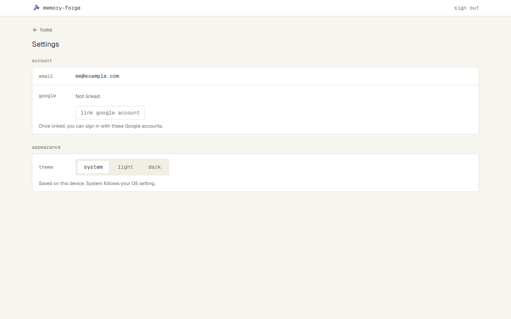
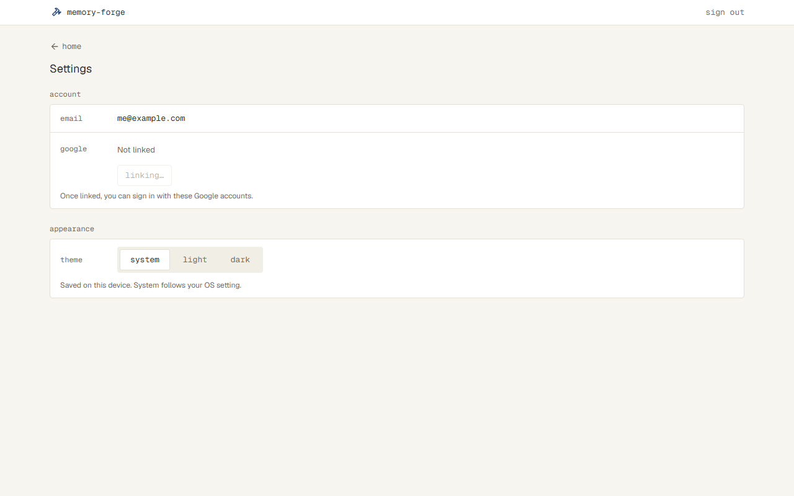
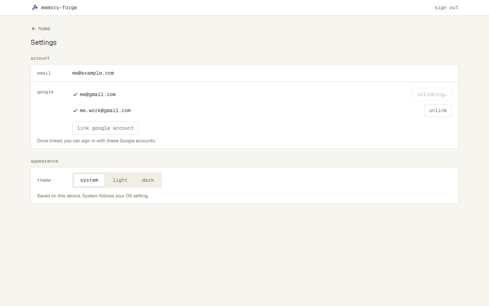
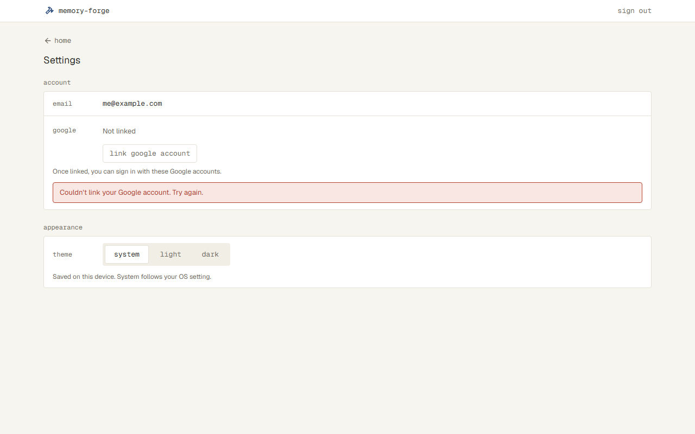

# Google アカウントでもログインできる（#14）

## なぜ

スマホなどで、パスワードを入れずに手早く入れるようにするため。今はメールアドレスとパスワードでしか入れず、スマホで長いパスワードを打つのが手間になっている。

## 影響する今の仕様

- `docs/specs/settings.md`：Settings に Google アカウントの紐づけの枠を足す
- `docs/specs/sign-in.md`：「アカウント」と「Login」に、Google でのログインを足す

## 使う場面

1. メールアドレスとパスワードでログインしている人が、PC で Home の menu から Settings を開き、link google account を押す。Google の画面で自分の Google アカウントを選ぶと Settings に戻り、紐づけた Google アカウントのメールアドレスが出る
2. 紐づけ済みの人が、スマホで Login を開き、sign in with google を押して Google のアカウントを選ぶと、パスワードを打たずに Home に入る
3. 紐づけていない Google アカウントで sign in with google を押すと、Login に戻り、danger の帯でエラーが出る。中には入れない

## 受け入れ条件

### 紐づけ（Settings）

- Settings の appearance の枠の上に、「account」の見出しと枠を出す。枠の中は、email の行（自分のアカウントのメールアドレス）と google の行
- google の行には、紐づけた Google アカウントのメールアドレスを check の印を付けて1つずつ並べ、それぞれの右に unlink のボタンを置く。その下に link google account のボタン、行の下に「Once linked, you can sign in with these Google accounts.」を出す
  - Google アカウントは、いくつでも紐づけられる。自分のアカウントのメールアドレスと違う Google アカウントも紐づけられる
  - 紐づけていなければ、メールアドレスの代わりに muted の「Not linked」を出す
- link google account を押してから Google の画面に移るまでの間は、ボタンが「linking…」になって薄くなり、押せない
- link google account を押すと Google の画面に移り、アカウントを選ぶと Settings に戻って、そのアカウントの行が足される
  - すでに紐づけている Google アカウントを選んだときは、何も変わらずに戻る（エラーは出さない）
- Google の画面でキャンセルしたときは、何も出さずに Settings に戻る
- そのほかで紐づけられなかったときは、Settings に戻り、danger の帯で「Couldn't link your Google account. Try again.」を、google の行の中に出す。紐づけは変わらない
- unlink を押すと、確認のダイアログなしで、その場でその行が消える
  - 外している間は、そのボタンが「unlinking…」になって薄くなり、押せない
  - 外せなかったときは、行を残し、google の行の中に danger の帯で「Couldn't unlink your Google account. Try again.」を出す（retry のボタンは出さない）
  - 最後の1つを外しても、パスワードで入れるので外せる
- 外したあとは、その Google アカウントでは入れない
- 開いたときに紐づけた Google アカウントを読み込めなかったときは、google の行の中に、danger の帯「Couldn't load Google accounts.」と retry を出す。retry で読み直す。link google account のボタンは出さない

### ログイン（Login）

- カードの中の sign in のボタンの下に、線と「or」の区切りを置き、その下に枠だけのボタン「sign in with google」を置く（Google のロゴは付けない）
- 紐づけた Google アカウントを選ぶと、Home に移る（開こうとしていた画面があれば、その画面に移る）
- sign in with google を押してから Google の画面に移るまでの間は、sign in を押したときと同じく、sign in のボタンが「signing in…」になって薄くなり、どちらのボタンと入力も押せない（打てない）
- Google の画面でキャンセルしたときは、何も出さずに Login に戻る
- 紐づけていない Google アカウントを選ぶと、Login に戻り、danger の帯で「This Google account isn't linked. Sign in with your email, then link it in settings.」を出す。新しいアカウントはできない
- つながらないなど、そのほかで入れなかったときは、Login に戻り、danger の帯で「Couldn't sign in. Please try again.」を出す
- パスワードを5回続けて間違えて止めている15分の間も、Google では入れる。Google での失敗は、間違えた回数に数えない
- Google でログインしたあとも、ログインしたままでいられる期間と sign out の扱いは、メールアドレスとパスワードで入ったときと同じ
- メールアドレスとパスワードでのログインは、今までどおり使える

## 画面

### Settings（`/settings`）

| 状態 | 表示 | スクリーンショット |
| --- | --- | --- |
| 紐づけていない | account の枠の google の行に「Not linked」と link google account のボタン |  |
| Google に移っている間 | link google account が「linking…」で薄い |  |
| 紐づけた（複数） | メールアドレスが並び、それぞれの右に unlink。下に link google account のボタン |  |
| 外している間 | 押した行のボタンが「unlinking…」で薄い |  |
| 紐づけの失敗 | google の行の中に danger の帯で「Couldn't link your Google account. Try again.」 |  |
| unlink の失敗 | google の行の中に danger の帯で「Couldn't unlink your Google account. Try again.」。メールアドレスは残る |  |

- 大量：紐づける数は自分の Google アカウントの数なので、数個まで。行が増えるだけで、ページやスクロールは設けない
- 読み込み中：画面を開いた時点で一覧を出すので、別の表示はない
- 読み込みのエラー：google の行の中に danger の帯「Couldn't load Google accounts.」と retry（スクリーンショットはない。Home の「Couldn't load subjects.」と同じ見せ方）
- 権限なし：ログインしていないと見られない（今までどおり）

### Login（`/login`）

| 状態 | 表示 | スクリーンショット |
| --- | --- | --- |
| 通常 | sign in のボタンの下に「or」の区切りと、枠だけの sign in with google のボタン |  |
| 送っている間・Google に移っている間 | sign in が「signing in…」になり、どちらのボタンも薄く、入力と一緒に押せない |  |
| 紐づけていない Google アカウント | danger の帯で「This Google account isn't linked. Sign in with your email, then link it in settings.」 |  |
| サーバーのエラー | danger の帯で「Couldn't sign in. Please try again.」（今と同じ） | |

## やらないこと

- Google アカウントで新しく登録すること（`docs/overview.md` の「やらないこと」）
- Google 以外（GitHub など）でのログイン
- パスワードをなくして Google だけで入るようにすること（パスワードでのログインは残す）

## 決まっていないこと

- [x] 1. 紐づけられる Google アカウントは1つだけ？ → 複数紐づけられる（どれも自分の個人のアカウント）
- [x] 2. Google アカウントのメールアドレスが、自分のアカウントのメールアドレスと違っても紐づけてよい？ → よい（複数の個人のアカウントを紐づけるため）
- [x] 3. Settings の枠の文言 → 合意済みのプロトタイプに合わせる：見出し「account」、email と google の行、ボタン「link google account」「unlink」、0件は「Not linked」、説明「Once linked, you can sign in with these Google accounts.」
- [x] 4. エラーの帯の文言 → 紐づけの失敗「Couldn't link your Google account. Try again.」、外すのの失敗「Couldn't unlink your Google account. Try again.」、Login の紐づけていない Google アカウント「This Google account isn't linked. Sign in with your email, then link it in settings.」（合意済みのプロトタイプの文言）。すでに紐づけた Google アカウントをもう一度選んだときは、何も変わらずに戻る（ほかの人のアカウントは無いので、ほかの人に紐づいている場合は起こらない）
- [x] 5. Google の画面でキャンセルしたとき → 何も出さずに戻る（自分でやめたので、エラーではない）
- [x] 6. unlink の確認と失敗 → 確認のダイアログなしでその場で外す（パスワードで入れるので、外しても困らず、紐づけ直せる）。失敗は danger の帯で、retry のボタンなし（押して送る操作のため。docs/ui.md）
- [x] 7. Login のボタン → sign in の下に「or」の区切りと、枠だけのボタン「sign in with google」。Google のロゴは付けない（主な操作は1画面に1つ、記号は Material Symbols のため）
- [x] 8. Google に移るまでの間 → 合意済みのプロトタイプの「送っている間」と同じ見た目（sign in が「signing in…」、どちらのボタンも薄く押せない）
- [x] 9. パスワードの止めの15分の間、Google で入れる？ → 入れる（止めはパスワードの当て推量を防ぐためで、Google の確かめは別のため）
- [x] 10. Google での失敗をパスワードの間違いに数える？ → 数えない

## 調べたこと

---

## 設計

Better Auth 1.7.10 の Google の機能（`socialProviders.google`、`signInSocial`、`linkSocialAccount`、`unlinkAccount`）を使う。動きは `node_modules/better-auth/dist/api/routes/callback.mjs`・`account.mjs`・`oauth2/link-account.mjs` で確かめた。

### データ

- 表の形は変えない。紐づけた Google アカウントは、Better Auth の `account` の表に `provider_id = 'google'` の行として入る（1つの Google アカウントで1行。複数紐づけると行が増える）
- Settings に出すメールアドレスは、その行の `id_token`（Google の ID トークン。Better Auth が紐づけ・ログインのたびに保存し直す）の中の `email` を、読むときに取り出す
  - 比べた案：`account` に `email` の列を `additionalFields` で足す。素直に読めるが、表の形の変更と、入れるための hook が要るので選ばなかった
  - 前提（崩れたら見直す）：Better Auth が Google の行に `id_token` を保存し続ける。版を上げて変わったら直す。→ 仕上げで `src/server/auth/google-accounts.ts` のコメントに残す
  - ID トークンの署名は確かめない（Google からサーバーが直接受け取ったものを、自分の表から読むだけのため）。同じくコメントに残す

### Better Auth の設定（`src/server/auth/auth.ts`）

- `socialProviders.google`：`clientId`・`clientSecret` を環境変数 `GOOGLE_CLIENT_ID`・`GOOGLE_CLIENT_SECRET` から。`disableSignUp: true`（紐づけていない Google アカウントで、新しいアカウントを作らない）
- `account.accountLinking`
  - `disableImplicitLinking: true`：自分のアカウントと同じメールアドレスの Google アカウントでも、Login からは勝手に紐づけない（紐づけは Settings からだけ）
  - `allowDifferentEmails: true`：メールアドレスが違う Google アカウントも紐づけられる
- `session.freshAge: 0`：`unlinkAccount` は、既定ではログインしてから1日たったセッションを断る。30日ログインしたままの仕様と合わないので外す
  - 比べた案：unlink だけ Better Auth を使わず、Drizzle で自分の行を消す。既定を変えずに済むが、持ち主の確かめなどを自分で書くので選ばなかった
  - 前提（崩れたら見直す）：この制限がかかる機能（パスワードの変更など）を画面から使っていない。足すときに決め直す。→ 仕上げで `auth.ts` のコメントに残す
- パスワードでの止め（`sign_in_attempts`）は、Google のログインでは見ず、書きもしない（`src/server/auth/sign-in.ts` を通らないため。何も足さなくてよい）

### HTTP の入口（Google からの戻り先）

- `src/app/api/auth/callback/google/route.ts` だけを置き、GET を `auth.handler` に渡す。`/api/auth/[...all]` は置かない
  - 比べた案：`/api/auth/[...all]` を置き、`/sign-in/email` などを `disabledPaths` で塞ぐ。Better Auth の標準の形だが、塞ぎ忘れた機能をブラウザから直接呼べるので選ばなかった
  - → 仕上げで `docs/design.md` の「Better Auth の HTTP の入口を置かない」を「戻り先の1本だけを置く」に直す（理由・前提・当てはまる場所）
- `src/proxy.ts` の matcher から `/api/auth/` を外す。紐づけのときはログインしたまま戻ってくるので、`/login` と同じ扱い（ログインしていたら Home に移す）にはできないため。戻り先は、Better Auth が state の cookie で確かめる
  - → 仕上げで `docs/design.md` の「ログインの確かめ」に足す
- Google に登録する戻り先は、本番と `http://localhost:3000` だけ。Preview では Google のログイン・紐づけは使えない（押すと戻ってきてエラーの帯になる。パスワードでは入れる）
  - 比べた案：Preview 用の決まった URL を用意して登録する。Preview で確かめられるが、Vercel と Google の設定が増えるので選ばなかった
  - → 仕上げで `docs/design.md` の環境変数のところ（`BETTER_AUTH_URL` の前提）を直し、`GOOGLE_CLIENT_ID`・`GOOGLE_CLIENT_SECRET` を足す。`.env.example` にも名前を足す
- Google Cloud でのクライアントの作成と、`.env.local`・Vercel（本番）への値の設定は、人間が行う

### Login

- `src/app/login/sign-in-form.tsx`：sign in のボタンの下に、「or」の区切りと、枠だけのボタン（今ある `Button` の枠だけの見た目）「sign in with google」を足す。同じフォーム・同じ `fieldset` の中に置き、ボタンの `name="intent" value="google"` で、1つの `useActionState` の中から別のサーバーアクションを呼び分ける（`formAction` で別のアクションにすると、`pending` が2つに分かれるため）。こうすると、どちらを押しても同じ `pending` で sign in が「signing in…」になり、全部押せなくなる
- `src/app/login/actions.ts` に `signInWithGoogleAction`：`auth.api.signInSocial({ body: { provider: "google", callbackURL: <next のパス>, errorCallbackURL: "/login?next=…", disableRedirect: true } })` で Google の URL を受け取り、`redirect` する（state の cookie は `nextCookies` が付ける）
- 戻ってきたときのエラーは、Better Auth が `errorCallbackURL` に `?error=<コード>` を付ける。`src/app/login/page.tsx` がそれを読み、帯を出す
  - `access_denied`（Google の画面でキャンセル）：何も出さない
  - `signup_disabled`（どのアカウントにもない）・`account_not_linked`（自分のメールアドレスと同じだが紐づけていない）：「This Google account isn't linked. …」
  - そのほか：「Couldn't sign in. Please try again.」
  - コードから文言への出し分けは `src/server/auth/google-errors.ts` の関数にまとめ、Settings と一緒に使う

### Settings

- `src/app/(app)/settings/page.tsx`：appearance の上に「account」の枠。email の行はセッションのユーザーのメールアドレス、google の行は `listGoogleAccounts(userId)` の結果
- `src/server/auth/google-accounts.ts`：`listGoogleAccounts(userId)` が、その人の `provider_id = 'google'` の行を、`{ id, email }` の一覧で返す（紐づけた順）
- `src/app/(app)/settings/actions.ts`
  - `linkGoogleAction`：`requireSession()` のあと、`auth.api.linkSocialAccount({ headers, body: { provider: "google", callbackURL: "/settings", errorCallbackURL: "/settings", disableRedirect: true } })` で Google の URL を受け取り、`redirect` する
  - `unlinkGoogleAction(accountId)`：`requireSession()` のあと `auth.api.unlinkAccount`。失敗したら `{ result: "error" }` を返す。成功したら `/settings` を再検証して行を消す
- 戻ってきたときのエラー：`access_denied` は何も出さない。そのほかは google の行の中に「Couldn't link your Google account. Try again.」。すでに自分に紐づけた Google アカウントは、Better Auth がエラーにせず戻すので、何も変わらない
- link・unlink のボタンは、押した間だけ「linking…」「unlinking…」で薄く押せない（`useActionState` の `pending`。unlink は行ごとに別のフォーム）
- 新しい部品は作らない。帯は `Banner`、ボタンは `Button`、check の印は Material Symbols

## 確かめ方

| 受け入れ条件 | 確かめ方 |
| --- | --- |
| account の枠・email と google の行・説明文・Not linked | 触って確かめる（本番の画面の画像） |
| 紐づけた Google アカウントを並べる（自分のものだけ、メールアドレスを取り出す） | テスト（Vitest：`listGoogleAccounts` が自分の google の行だけを返し、`id_token` からメールアドレスを出す） |
| link を押すと Google に移り、戻ると行が足される・すでに紐づけたものは変わらない・違うメールアドレスも紐づけられる | 触って確かめる（手元で本物の Google を使う）。設定値（`allowDifferentEmails`）はコードを見て確かめる |
| 一覧を読み込めなかったときの帯と retry | コードを見て確かめる（Home の読み込みのエラーと同じ作り。データベースにつながらない状態を画面のテストで作れないため） |
| 「linking…」「unlinking…」「signing in…」で薄く押せない | 触って確かめる（本番の画面の画像） |
| キャンセルは何も出さない・そのほかの失敗は帯（Login・Settings の文言の出し分け） | テスト（Vitest：エラーのコードから文言への関数。`access_denied`・紐づけていない・そのほか） |
| unlink で行が消える・外したあとはその Google で入れない・最後の1つも外せる | テスト（Playwright：表に google の行を入れた状態で unlink を押すと行が消え、Not linked になる）。入れないことは触って確かめる |
| unlink の失敗で行が残り帯が出る | 触って確かめる（本番の画面の画像。失敗の起こし方はテストのときだけの差し替え） |
| Login の「or」の区切りと sign in with google のボタン | 触って確かめる（本番の画面の画像） |
| 紐づけた Google で Home（または開こうとしていた画面）に移る | 触って確かめる（手元で本物の Google） |
| 紐づけていない Google で帯が出る・新しいアカウントはできない | テスト（Playwright：`/login?error=signup_disabled` で文言が出る）。アカウントができないことは `disableSignUp` をコードを見て確かめ、手元で一度触る |
| 止めている15分の間も Google で入れる・Google の失敗を数えない | コードを見て確かめる（Google のログインが `sign-in.ts` を通らない） |
| ログインしたままの期間と sign out が同じ | コードを見て確かめる（セッションの設定を共有） |
| パスワードでのログインは今までどおり | テスト（今ある Login のテストがそのまま通る） |

- 本物の Google の画面は、テストからは通さない（Google の画面を自動で操作できないため）

## タスク

- [x] 1. Login から Google でログインできたら完了
  - Better Auth の設定（Google、`accountLinking`、`freshAge`）、戻り先のルート、proxy の matcher、`.env.example`、Login のボタンとエラーの帯、`google-errors.ts`
  - 合わせるスクリーンショット：`login-default.png`・`login-loading.png`・`login-google-error.png`
  - 撮り直す画像（ボタンが足されるため全部）：`docs/specs/screens/login-default.png`・`login-loading.png`・`login-error.png`・`login-locked.png`・`login-server-error.png`、新しく `login-google-error.png`
  - 仕上げ：`docs/specs/sign-in.md` に Google でのログインを足す。`docs/design.md` の HTTP の入口・ログインの確かめ・環境変数を直す
  - 手元での確かめの前に、人間が Google Cloud でクライアントを作り、`.env.local` に値を入れる
- [ ] 2. Settings で Google アカウントを紐づけ・外せたら完了（1のあと）
  - `google-accounts.ts`、Settings の account の枠、link・unlink のアクション
  - 合わせるスクリーンショット：`settings-default.png`・`settings-linking.png`・`settings-linked.png`・`settings-unlinking.png`・`settings-link-error.png`・`settings-unlink-error.png`
  - 撮り直す画像：`docs/specs/screens/settings-default.png`・`settings-dark.png`、新しく上の状態の画像
  - 仕上げ：`docs/specs/settings.md` に account の枠を足す（「0件・エラーは起こらない」の書きぶりも直す）
  - 1を取り込んだあとでも、2がないうちは紐づける手段がないだけで、壊れない（Google で押すと「isn't linked」の帯になる）
