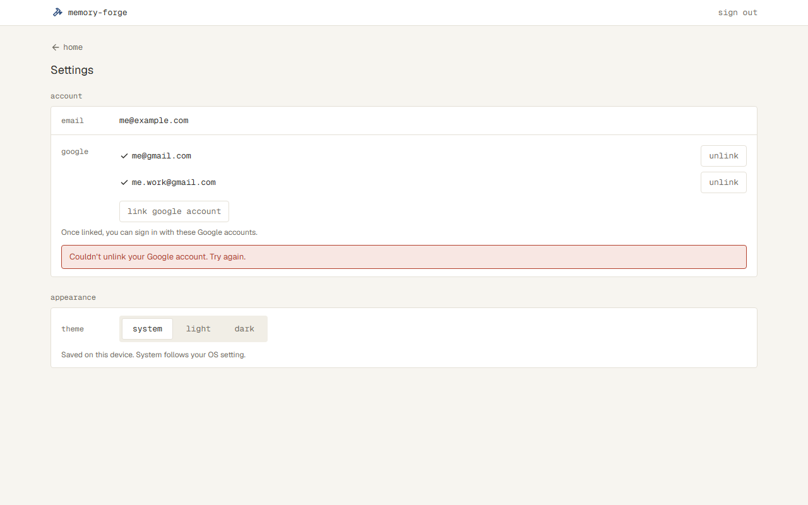
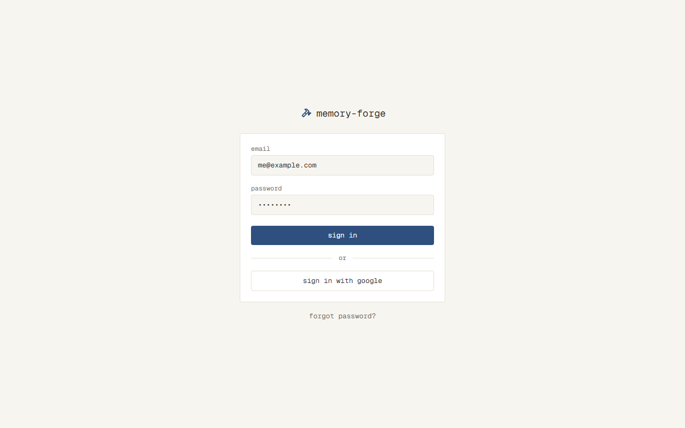
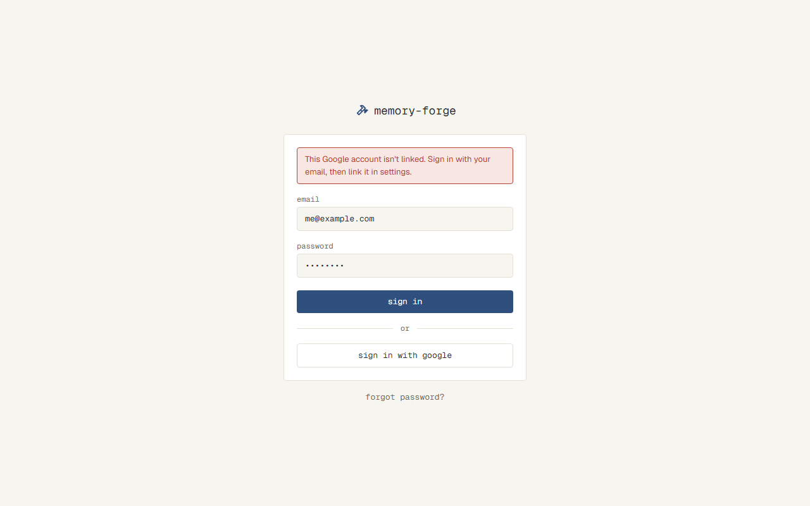

# Google アカウントでもログインできる（#14）

## なぜ

スマホなどで、パスワードを入れずに手早く入れるようにするため。今はメールアドレスとパスワードでしか入れず、スマホで長いパスワードを打つのが手間になっている。

## 影響する今の仕様

- `docs/specs/settings.md`：Settings に Google アカウントの紐づけの枠を足す
- `docs/specs/sign-in.md`：「アカウント」と「Login」に、Google でのログインを足す

## 使う場面

1. メールアドレスとパスワードでログインしている人が、PC で Home の menu から Settings を開き、link google account を押す。Google の画面で自分の Google アカウントを選ぶと Settings に戻り、紐づけた Google アカウントのメールアドレスが出る
2. 紐づけ済みの人が、スマホで Login を開き、sign in with google を押して Google のアカウントを選ぶと、パスワードを打たずに Home に入る
3. 紐づけていない Google アカウントで sign in with google を押すと、Login に戻り、danger の帯でエラーが出る。中には入れない

## 受け入れ条件

### 紐づけ（Settings）

- Settings の appearance の枠の上に、「account」の見出しと枠を出す。枠の中は、email の行（自分のアカウントのメールアドレス）と google の行
- google の行には、紐づけた Google アカウントのメールアドレスを check の印を付けて1つずつ並べ、それぞれの右に unlink のボタンを置く。その下に link google account のボタン、行の下に「Once linked, you can sign in with these Google accounts.」を出す
  - Google アカウントは、いくつでも紐づけられる。自分のアカウントのメールアドレスと違う Google アカウントも紐づけられる
  - 紐づけていなければ、メールアドレスの代わりに muted の「Not linked」を出す
- link google account を押してから Google の画面に移るまでの間は、ボタンが「linking…」になって薄くなり、押せない
- link google account を押すと Google の画面に移り、アカウントを選ぶと Settings に戻って、そのアカウントの行が足される
  - すでに紐づけている Google アカウントを選んだときは、何も変わらずに戻る（エラーは出さない）
- Google の画面でキャンセルしたときは、何も出さずに Settings に戻る
- そのほかで紐づけられなかったときは、Settings に戻り、danger の帯で「Couldn't link your Google account. Try again.」を、google の行の中に出す。紐づけは変わらない
- unlink を押すと、確認のダイアログなしで、その場でその行が消える
  - 外している間は、そのボタンが「unlinking…」になって薄くなり、押せない
  - 外せなかったときは、行を残し、google の行の中に danger の帯で「Couldn't unlink your Google account. Try again.」を出す（retry のボタンは出さない）
  - 最後の1つを外しても、パスワードで入れるので外せる
- 外したあとは、その Google アカウントでは入れない

### ログイン（Login）

- カードの中の sign in のボタンの下に、線と「or」の区切りを置き、その下に枠だけのボタン「sign in with google」を置く（Google のロゴは付けない）
- 紐づけた Google アカウントを選ぶと、Home に移る（開こうとしていた画面があれば、その画面に移る）
- sign in with google を押してから Google の画面に移るまでの間は、sign in を押したときと同じく、sign in のボタンが「signing in…」になって薄くなり、どちらのボタンと入力も押せない（打てない）
- Google の画面でキャンセルしたときは、何も出さずに Login に戻る
- 紐づけていない Google アカウントを選ぶと、Login に戻り、danger の帯で「This Google account isn't linked. Sign in with your email, then link it in settings.」を出す。新しいアカウントはできない
- つながらないなど、そのほかで入れなかったときは、Login に戻り、danger の帯で「Couldn't sign in. Please try again.」を出す
- パスワードを5回続けて間違えて止めている15分の間も、Google では入れる。Google での失敗は、間違えた回数に数えない
- Google でログインしたあとも、ログインしたままでいられる期間と sign out の扱いは、メールアドレスとパスワードで入ったときと同じ
- メールアドレスとパスワードでのログインは、今までどおり使える

## 画面

### Settings（`/settings`）

| 状態 | 表示 | スクリーンショット |
| --- | --- | --- |
| 紐づけていない | account の枠の google の行に「Not linked」と link google account のボタン |  |
| Google に移っている間 | link google account が「linking…」で薄い |  |
| 紐づけた（複数） | メールアドレスが並び、それぞれの右に unlink。下に link google account のボタン |  |
| 外している間 | 押した行のボタンが「unlinking…」で薄い |  |
| 紐づけの失敗 | google の行の中に danger の帯で「Couldn't link your Google account. Try again.」 |  |
| unlink の失敗 | google の行の中に danger の帯で「Couldn't unlink your Google account. Try again.」。メールアドレスは残る |  |

- 大量：紐づける数は自分の Google アカウントの数なので、数個まで。行が増えるだけで、ページやスクロールは設けない
- 読み込み中：画面を開いた時点で一覧を出すので、別の表示はない
- 権限なし：ログインしていないと見られない（今までどおり）

### Login（`/login`）

| 状態 | 表示 | スクリーンショット |
| --- | --- | --- |
| 通常 | sign in のボタンの下に「or」の区切りと、枠だけの sign in with google のボタン |  |
| 送っている間・Google に移っている間 | sign in が「signing in…」になり、どちらのボタンも薄く、入力と一緒に押せない |  |
| 紐づけていない Google アカウント | danger の帯で「This Google account isn't linked. Sign in with your email, then link it in settings.」 |  |
| サーバーのエラー | danger の帯で「Couldn't sign in. Please try again.」（今と同じ） | |

## やらないこと

- Google アカウントで新しく登録すること（`docs/overview.md` の「やらないこと」）
- Google 以外（GitHub など）でのログイン
- パスワードをなくして Google だけで入るようにすること（パスワードでのログインは残す）

## 決まっていないこと

- [x] 1. 紐づけられる Google アカウントは1つだけ？ → 複数紐づけられる（どれも自分の個人のアカウント）
- [x] 2. Google アカウントのメールアドレスが、自分のアカウントのメールアドレスと違っても紐づけてよい？ → よい（複数の個人のアカウントを紐づけるため）
- [x] 3. Settings の枠の文言 → 合意済みのプロトタイプに合わせる：見出し「account」、email と google の行、ボタン「link google account」「unlink」、0件は「Not linked」、説明「Once linked, you can sign in with these Google accounts.」
- [x] 4. エラーの帯の文言 → 紐づけの失敗「Couldn't link your Google account. Try again.」、外すのの失敗「Couldn't unlink your Google account. Try again.」、Login の紐づけていない Google アカウント「This Google account isn't linked. Sign in with your email, then link it in settings.」（合意済みのプロトタイプの文言）。すでに紐づけた Google アカウントをもう一度選んだときは、何も変わらずに戻る（ほかの人のアカウントは無いので、ほかの人に紐づいている場合は起こらない）
- [x] 5. Google の画面でキャンセルしたとき → 何も出さずに戻る（自分でやめたので、エラーではない）
- [x] 6. unlink の確認と失敗 → 確認のダイアログなしでその場で外す（パスワードで入れるので、外しても困らず、紐づけ直せる）。失敗は danger の帯で、retry のボタンなし（押して送る操作のため。docs/ui.md）
- [x] 7. Login のボタン → sign in の下に「or」の区切りと、枠だけのボタン「sign in with google」。Google のロゴは付けない（主な操作は1画面に1つ、記号は Material Symbols のため）
- [x] 8. Google に移るまでの間 → 合意済みのプロトタイプの「送っている間」と同じ見た目（sign in が「signing in…」、どちらのボタンも薄く押せない）
- [x] 9. パスワードの止めの15分の間、Google で入れる？ → 入れる（止めはパスワードの当て推量を防ぐためで、Google の確かめは別のため）
- [x] 10. Google での失敗をパスワードの間違いに数える？ → 数えない

## 調べたこと

---

## 設計

## 確かめ方

-

## タスク

- [ ]
