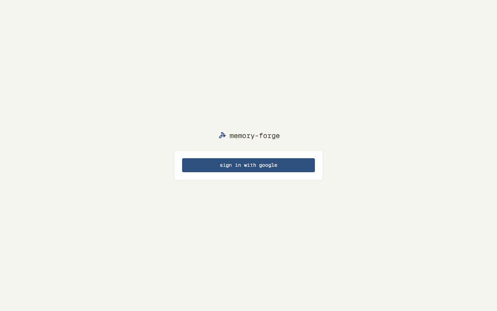
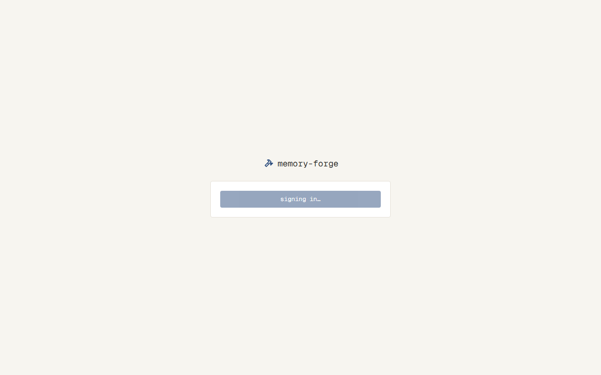
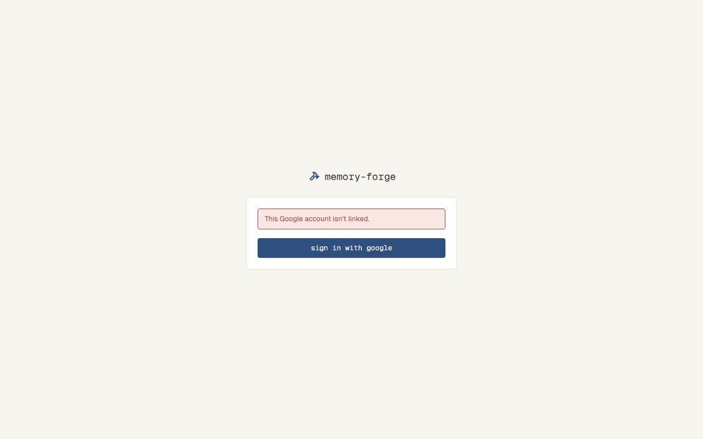
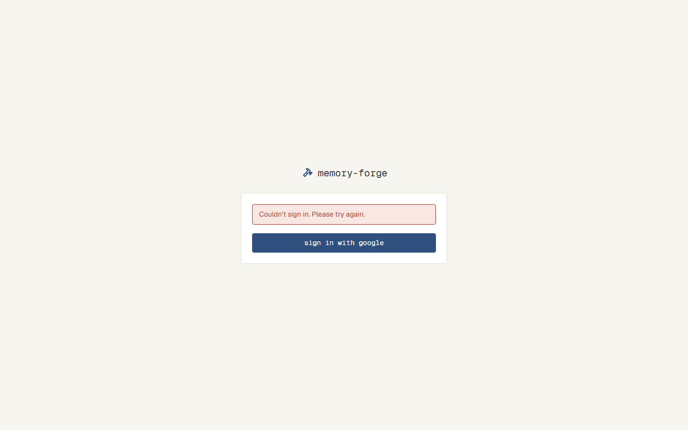
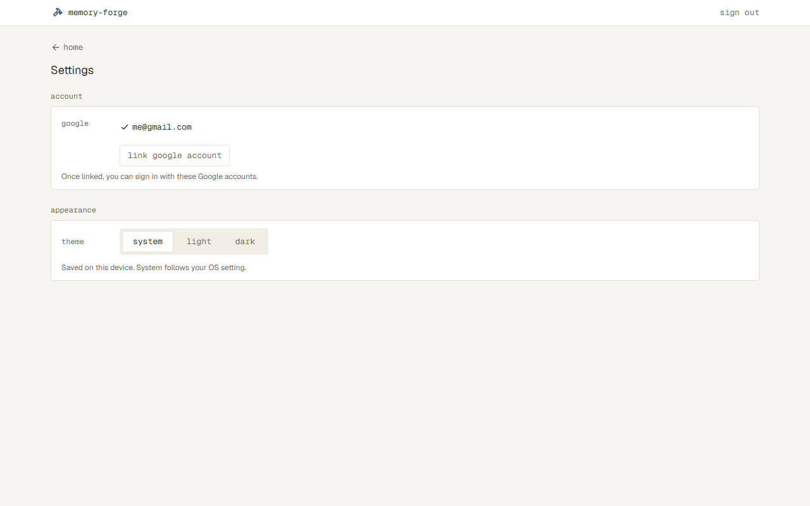
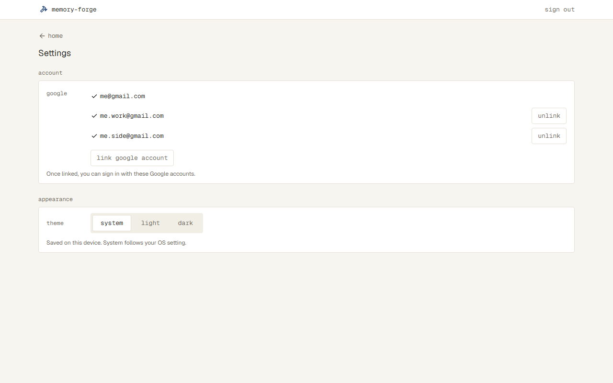

# Google アカウントだけでログインする（#110）

## なぜ

パスワードを覚えたり打ったりせずに済むようにするため。今はメールアドレスとパスワードでも、紐づけた Google アカウントでも入れるが、パスワードを残す限り、覚えておく・漏れないようにする・忘れたら再設定する手間が残る。

## 影響する今の仕様

- `docs/specs/sign-in.md`：「アカウント」と「Login」。メールアドレスとパスワードでのログイン、続けて間違えたときの止め、forgot password? をなくす
- `docs/specs/settings.md`：「account」の枠（email の行をなくす）と「Google アカウントの紐づけ」（自分の Google アカウントは外せない）
- `docs/overview.md`：「主な機能」のログインと、パスワードの再設定

## 使う場面

1. 自分の Google アカウント（アプリの設定に書いたもの）を持つ人が、スマホで Login を開くと、sign in with google のボタンだけが出る。押して Google のアカウントを選ぶと Home に入る
2. 紐づけていない Google アカウントで sign in with google を押すと、Login に戻り、danger の帯で「This Google account isn't linked.」が出る。中には入れない
3. Settings を開くと、google の行のいちばん上に自分の Google アカウントが unlink なしで出て、その下に Settings で足した Google アカウントが並ぶ。足したものは unlink で外せる

## 受け入れ条件

### アカウント

- 自分の Google アカウントは、アプリの設定（画面の外）に書いた1つ。初めから入れて、Settings では外せない
- そのほかに、Settings で足した Google アカウントでも入れる
- 今までのメールアドレスとパスワードでは入れない。パスワードと、続けて間違えた回数の記録は消す

### Login

- カードの中は、上から帯（エラーのとき）と、sign in with google のボタンだけ。email・password の入力、sign in のボタン、「or」の区切り、forgot password? は出さない
- 自分の Google アカウントか、Settings で足した Google アカウントを選ぶと、Home に移る（開こうとしていた画面があれば、その画面に移る）
- sign in with google を押してから Google の画面に移るまでの間は、ボタンが「signing in…」になって薄くなり、押せない
- Google の画面でキャンセルしたときは、何も出さずに Login に戻る
- それ以外の Google アカウントを選ぶと、Login に戻り、danger の帯で「This Google account isn't linked.」を出す。新しいアカウントはできない
- つながらないなど、そのほかで入れなかったときは、Login に戻り、danger の帯で「Couldn't sign in. Please try again.」を出す
- ログインしたままでいられる期間と sign out の扱いは、今までどおり

### Settings

- account の枠は google の行だけにする（email の行は出さない）
- google の行のいちばん上に、自分の Google アカウントのメールアドレスを check の印を付けて出す。右に unlink は置かない
- その下に、Settings で足した Google アカウントを紐づけた順に並べ、それぞれの右に unlink を置く（足す・外す・失敗の扱いは今までどおり）
- 自分の Google アカウントがいつも出るので、「Not linked」は出さない

## 画面

### Login（`/login`）

| 状態 | 表示 | スクリーンショット |
| --- | --- | --- |
| 通常 | ロゴとアプリ名、カードの中に sign in with google のボタン | |
| Google に移っている間 | ボタンが「signing in…」で薄く、押せない | |
| 紐づけていない Google アカウント | ボタンの上に danger の帯で「This Google account isn't linked.」 | |
| サーバーのエラー | ボタンの上に danger の帯で「Couldn't sign in. Please try again.」 | |

- ボタンの見た目（primary か枠だけか）は、このあと見た目を刷新するので、今は問わない

### Settings（`/settings`）

| 状態 | 表示 | スクリーンショット |
| --- | --- | --- |
| 自分の Google アカウントだけ | google の行に、自分の Google アカウント（unlink なし）と link google account | |
| 足した Google アカウントがある | 自分の Google アカウントの下に、足したものが unlink 付きで並ぶ | |

- 読み込み中・エラー・権限なしは、今までどおり

## やらないこと

- Google アカウントで新しく登録すること（自分以外の人のログイン・新しい登録は作らない）
- Google 以外（GitHub など）でのログイン
- パスワードの再設定（#4 は閉じる）
- 自分の Google アカウントを画面から変えること（変えるときはアプリの設定を書き換える）

## 決まっていないこと

- [x] 1. 最初のアカウントはどう作る？ → 作るのではなく、自分の Google アカウント1つが初めからある（アプリの設定＝環境変数に書く）。消せない
- [x] 2. 最後の1つの Google アカウントを外せる？ → 自分の Google アカウントは外せない。Settings で足したものは外せる
- [x] 3. Login の sign in with google のボタンは primary にする？ → 見た目はこのあと刷新するので、今は問わない
- [x] 4. 紐づけていない Google アカウントのエラーの文言は？ → 「This Google account isn't linked.」
- [x] 5. Settings の account の枠の email の行は残す？ → 消す
- [x] 6. 今あるパスワードはどうする？ → 消す
- [x] 7. #4（パスワードを再設定できる）と、`docs/overview.md` のパスワードの再設定は？ → #4 は閉じ、`docs/overview.md` からも消す
- [x] 8. Settings で、自分の Google アカウントはどう出す？ → google の行のいちばん上に、unlink なしで出す
- [x] 9. Login のボタンの文言と、Google に移っている間の文言は？ → 「sign in with google」と「signing in…」

## 調べたこと

---

## 設計

使う Better Auth は 1.7.10（`node_modules/better-auth/package.json`）。下の動きは `dist/oauth2/link-account.mjs` と `dist/plugins/test-utils/` で確かめた。

### 自分の Google アカウントの持ち方

- 環境変数 `OWNER_GOOGLE_EMAIL` に、自分の Google アカウントのメールアドレスを書く（手元と Vercel の本番。`test`・`ci` は `e2e/test-user.ts` の値）
- アカウント（`user` の行）は1つのまま残し、その `email` を `OWNER_GOOGLE_EMAIL` と同じにし、`email_verified` を true にする
- Login で、どのアカウントにも紐づいていない Google アカウントを選んだとき、そのメールアドレスが `user.email` と同じなら、Better Auth の自動の紐づけ（implicit linking）でその場で紐づけて入れる。違えば今までどおり `signup_disabled` で断る
  - `src/server/auth/auth.ts`：`account.accountLinking.disableImplicitLinking` を外す（false）。`emailAndPassword` は消す（下の「パスワードをなくす」）
  - Better Auth は、`user.email_verified` が true で（`requireLocalEmailVerified` の既定）、Google がメールアドレスを確かめ済みのときだけ自動で紐づける。そのため `email_verified` を true にする
  - 自動で紐づくのは `user.email` と同じメールアドレスだけなので、それ以外の Google アカウントでは今までどおり入れない。アカウントが1つしかないので、ほかの人のアカウントに紐づくことはない
- `scripts/create-user.ts`（`npm run user:create`）は、パスワードを聞かずに `--env-file` の `OWNER_GOOGLE_EMAIL` を読み、`user` の行がなければ作り、あれば `email` と `email_verified` を合わせる（`scripts/insert-user.ts` の `createUser` は、パスワードを省けば行を作らない形にする。パスワードの機能のテストがまだ使うので、`password` を渡す形はタスク3で消す）。本番の今のアカウントは、このスクリプトを当て直して合わせる（人間が行う）
  - 自分の Google アカウントを変えるときは、`OWNER_GOOGLE_EMAIL` を書き換えてスクリプトを当て直す
- 理由・前提の置き場所：`docs/design.md` の「データ」の「ログイン」（`user` の行の持ち方、`OWNER_GOOGLE_EMAIL` とスクリプト。複数の場所に関わるため）。`auth.ts` の自動の紐づけの設定には、そのコードだけの理由をコメントで書く
- 比べた選択肢
  - 選んだ：`user.email` を自分のメールアドレスにして、Better Auth の自動の紐づけに任せる。Better Auth の仕組みのままで、書く量が少ない
  - 選ばなかった：Google から戻ったときに、自前のフックで `OWNER_GOOGLE_EMAIL` と比べて通す。Better Auth の外の決まりが増え、版を上げたときに壊れやすい
  - 選ばなかった：環境変数に Google の ID（sub）を書いて account の行を先に入れる。sub は人が調べにくい

### Settings の自分の Google アカウント

- `src/server/auth/google-accounts.ts`：`listGoogleAccounts(userId)` は今のまま。新しく、紐づけた Google アカウントを「自分の Google アカウント（メールアドレスが `user.email` と同じもの）」と「足したもの」に分ける関数を置く。いちばん上には、Google の行がまだなくても（一度も Google で入っていなくても）`user.email` を出す
- `src/app/(app)/settings/page.tsx`：email の行を消し、google の行だけにする
- `src/app/(app)/settings/google-accounts.tsx`：いちばん上に自分の Google アカウントを check 付き・unlink なしで出し、その下に足したものを今までどおり unlink 付きで並べる。「Not linked」は消す
- `src/app/(app)/settings/actions.ts`：`unlinkGoogleAction` は、自分の Google アカウントの行を渡されたら断る（`{ result: "error" }`）。画面にボタンがなくても、アクションは直接呼べるため
- 理由・前提の置き場所：コードのコメント（分ける関数と unlink の止めにだけ関わる）

### パスワードをなくす

- `src/server/auth/auth.ts`：`emailAndPassword` を消す（パスワードで入る機能を止める）。`freshAge: 0` の前提のコメント（パスワードの変更を画面から使っていない）は残す
- `src/app/login/`：`signInAction` と email・password・sign in・「or」の区切り・forgot password? を消し、sign in with google のボタンと帯だけにする。`SignInState` から `incorrect` と `locked` を消す。読み込み中の枠（`SignInFormSkeleton`）もボタン1つの形にする
- 紐づけていない Google アカウントの帯の文言を「This Google account isn't linked.」に変える（出し分けは `signInErrorFromGoogle` のまま）
- `src/server/auth/sign-in.ts`・`lockout.ts` とそのテストを消す
- データ
  - パスワードの行（`account` の `provider_id = 'credential'`）は、drizzle の手書きの形の変更（`DELETE`）で消す。表の形は変えないので、「足す」の決まりに当たらない
  - `sign_in_attempts` の表は、`docs/design.md` の「データベースの形の変更は『足す』ものにする」に従い、使わなくするPRと消すPRの2回に分ける。消すPRで `schema.ts` から外し、drop する
- `docs/design.md`：「Better Auth の HTTP の入口は戻り先の1本だけ」の理由（パスワードを続けて試せてしまう）を、パスワードがなくなったあとの理由（塞ぎ忘れた機能をブラウザから呼べてしまう）だけに直す。「データ」から `credential` の行と `sign_in_attempts` を消す。「全体の構成」の `auth/` の説明から「続けて間違えた回数」を消す
- `docs/overview.md`：主な機能のログインと、パスワードの再設定を直す

### 画面のテストのログイン

- `e2e/global-setup.ts`：Login に打つのをやめ、global setup の中だけで Better Auth の `testUtils` プラグインを付けた別の auth を作り（同じデータベースと `BETTER_AUTH_SECRET`）、`login({ userId })` でセッションと署名付きの cookie を作って `e2e/.auth/` に保存する。本番の `auth.ts` には付けない
- `e2e/test-user.ts` の password と、`e2e/home.spec.ts`・`e2e/login.spec.ts` のパスワードで入るテストは、パスワードの機能と一緒にタスク3で消すか、同じ cookie を使う形に直す（タスク1・2の間はパスワードの機能が残るので、そのテストも残す）
- 理由・前提の置き場所：`docs/design.md` の「画面の画像を撮る・比べる仕組み」の、ログインが要る画面の段落を書き換える（前提：`testUtils` が作る cookie の形が、本番の auth と同じ。版を上げて合わなくなると、ログインが要る画面のテストがすべて Login に移って失敗するので気づける）
- 比べた選択肢
  - 選んだ：`testUtils` の `login`。Better Auth が自分で cookie を作るので、署名の形に頼らない
  - 選ばなかった：session の行を直接入れ、cookie の署名を自分で計算する。Better Auth の cookie の形に頼り、版で壊れやすい

## 確かめ方

### アカウント

- 自分の Google アカウントは設定に書いた1つで、初めから入り、外せない：「コードを見て確かめる」（`auth.ts` の自動の紐づけの設定、`create-user.ts`）。外せないことは「テスト」（Vitest：`unlinkGoogleAction` の止めに使う分ける関数で、自分の行を足したものに入れない）
- Settings で足した Google アカウントでも入れる：Better Auth の動きなので「触って確かめる」（本番で、足したアカウントで入る）
- メールアドレスとパスワードでは入れず、パスワードと回数の記録は消える：「コードを見て確かめる」（`emailAndPassword` を消したこと、`DELETE` と drop の形の変更）

### Login

- カードの中はボタンと帯だけ：「触って確かめる」（画面の画像 `login-default.png`）
- 自分の・足した Google アカウントで Home（開こうとしていた画面）に移る：移る先の決まりは今の `next-path.test.ts` で確かめ済み。Google を通す部分は「触って確かめる」（本番で、自分の Google アカウントで入る。初めて入るときに自動で紐づくことも見る）
- Google に移る間「signing in…」で薄く押せない：「触って確かめる」（画面の画像 `login-loading.png`）
- キャンセルで何も出さず戻る・紐づけていないと「This Google account isn't linked.」・そのほかは「Couldn't sign in. Please try again.」：出し分けは今の `google-errors.test.ts` で確かめ済み。文言は「テスト」（Playwright：`?error=signup_disabled` で開いて帯の文言を見る。今のテストの文言を直す）
- ログインしたままの期間と sign out：今までどおり（変えない）

### Settings

- account の枠は google の行だけ・いちばん上に自分の Google アカウントを unlink なしで・「Not linked」を出さない：「触って確かめる」（画面の画像 `settings-default.png`）
- 足したものを紐づけた順に unlink 付きで並べる：分けて並べる関数を「テスト」（Vitest：自分の行が混ざっていても、足したものだけが紐づけた順に残る。自分の Google の行がまだないときも、いちばん上に `user.email` が出る）。見た目は画面の画像 `settings-linked.png`

## タスク

- [ ] 1. 自分の Google アカウントで入れるようにする（データ・設定）
  - 完了：`OWNER_GOOGLE_EMAIL` のメールアドレスの Google アカウントで Login から入れ、画面のテストが cookie を作ってログインした状態で通ったら完了
  - `auth.ts` の自動の紐づけ、`create-user.ts`・`insert-user.ts`、`e2e/global-setup.ts`・`e2e/test-user.ts` を `testUtils` に、`docs/design.md`（データ・画面の画像の仕組み）
  - パスワードでもまだ入れる（Login の画面は変えない）。マージ後、人間が本番に `OWNER_GOOGLE_EMAIL` を置き、`npm run user:create` を当て直す
  - 撮り直す画像：なし
- [ ] 2. Settings に自分の Google アカウントを unlink なしで出す（画面）
  - 完了：Settings の account の枠が google の行だけになり、いちばん上に自分の Google アカウントが unlink なしで出て、自分の行は unlink のアクションでも外せなくなったら完了
  - 合わせるスクリーンショット：`settings-default.png`・`settings-linked.png`
  - 撮り直す画像（account の枠が写るもの全部）：`settings-default.png`・`settings-linked.png`・`settings-dark.png`・`settings-linking.png`・`settings-unlinking.png`・`settings-link-error.png`・`settings-unlink-error.png`
  - `docs/specs/settings.md` を直す
- [ ] 3. Login からパスワードをなくす（画面）
  - 完了：Login のカードが帯と sign in with google のボタンだけになり、パスワードで入る機能と `sign-in.ts`・`lockout.ts` がなくなったら完了（`sign_in_attempts` の表はまだ残す）
  - 合わせるスクリーンショット：`login-default.png`・`login-loading.png`・`login-google-error.png`・`login-server-error.png`
  - 撮り直す画像：上の4つ。`docs/specs/screens/login-error.png`・`login-locked.png` は消す
  - `createUser` の `password`、`TEST_USER.password`、パスワードで入る画面のテスト（`login.spec.ts`・`home.spec.ts` の sign out）を消すか cookie を使う形に直す
  - `docs/specs/sign-in.md`・`docs/overview.md`・`docs/design.md`（HTTP の入口の理由、`auth/` の説明）を直す
- [ ] 4. パスワードの行と `sign_in_attempts` の表を消す（データ）
  - 完了：形の変更で `account` の `credential` の行が消え、`sign_in_attempts` の表が drop され、`schema.ts` からも外れたら完了
  - `docs/design.md` の「データ」から `credential` の行と `sign_in_attempts` を消す
  - 撮り直す画像：なし
