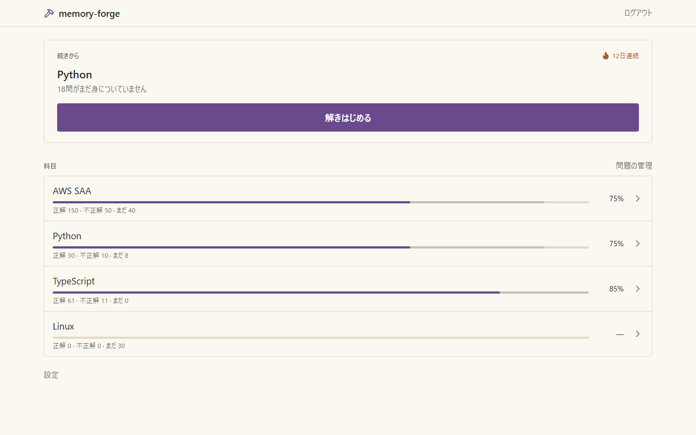
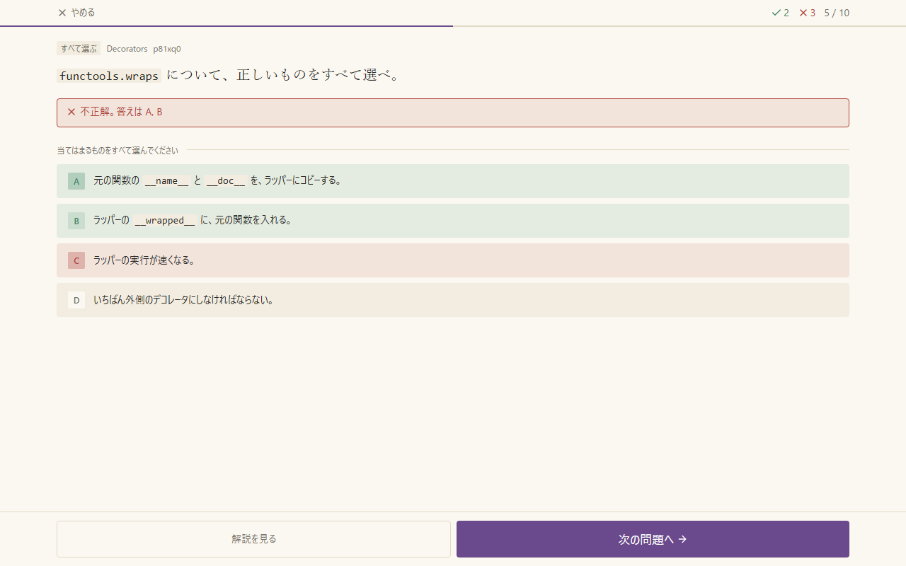

<!--
変更の仕様のひな形。コピーして docs/changes/<年-月-日>-<何をするか>.md を作る（例：2026-09-17-add-due-date.md）。
「なぜ」〜「調べたこと」は、AIが下書きし、人間がプロトタイプを触って直し、合意して決める（/dev-proto）。「画面」のスクリーンショットは、合意したときに足す。
「設計」以降はAIが書いて実装まで進め、人間は機能の PR でレビューする（/dev-build）。
スクリーンショットは、このファイルと同じ名前のフォルダに置く（例：2026-09-17-add-due-date/list-empty.png）。
-->

# 見た目を md-leaf とシリーズで揃える（#119）

## なぜ

memory-forge と md-leaf を、同じ人が作ったシリーズのアプリにする。今の2つは、地の色こそ近いが、差し色・書体・アイコン・部品の作りがばらばらで、並べてもシリーズに見えない。

人と決めたこと（Issue #119 を立てる前）：

- 共通にするもの：地・文字・枠・muted・角丸・影・ダークモードの色、画面の部品（ボタン・一覧・ラベルなど）の書体、アイコン、ロゴの作り（アイコン＋アプリ名）
- アプリごとに分けるもの：差し色（md-leaf は若葉の緑のまま、memory-forge は別の1色）、読むものの書体（md-leaf の本文は明朝、memory-forge のコードは等幅）
- 画面の言葉は日本語に揃える。はじめは別の Issue（#120）にしていたが、プロトタイプで日本語の画面に合意したので、この機能で行う（#120 もこの PR で閉じる）
- md-leaf が歩み寄ってもよい（tsubokura14/md-leaf#31。この機能で決まった骨格に合わせる）

あわせて、/dev-proto の中で人が頼んだ次のことも行う。

- 答えたあとの選択肢の見せ方を直す。今は、選ばなかった正解の行の右端に「missed」を出していて、選択肢の中身の幅が狭くなる。また、選ばなかった正解と、選んで間違えたものの見分けがつきにくい
- Home を「次に何をするか」が1つの主な操作で分かる作りにする（「続きから」のカード）。連続日数は小さな1行にする
- Result で得点を大きく見せる
- 問題文と解説を、md-leaf の本文と同じ明朝で出す

Result の「間違えた問題」の一覧と「間違えた問題を解き直す」は、プロトタイプにはあるが、#125 に分けた（この機能では作らない）。

## 影響する今の仕様

- `docs/ui.md`：トークン、雰囲気、色の使い分け、文字、部品の使い分け（ボタン、ロゴ、記号など）
- `docs/specs/screens/`：すべての画面の画像（見た目が変わるため撮り直す）
- `docs/specs/`：すべての画面の文言（英語から日本語へ）。`solve.md` の答えたあとの選択肢の見せ方（missed をなくす）。Home の仕様の「続きから」のカードと連続日数の出し方。Result の得点の出し方
- `docs/overview.md`：「用語」の「画面の表記はすべて英語」（日本語にする）。「連続日数」の「今週（月〜日）のどの日に答えたか」（出さなくなる）
- `docs/design.md`：「画面の画像を撮る・比べる仕組み」の書体の決まり（「`next/font` でアプリから配り、イメージに入っている書体に頼らない」）。OS の書体を使うと、Docker の中にはヒラギノ・游ゴシック・ui-monospace・SFMono・Consolas がないため（下の「決まっていないこと」）

## 使う場面

1. md-leaf でノートを読んだあと、memory-forge を開いて問題を解く人が、同じ生成りの地・同じゴシックのボタン・同じ形のアイコンを見て、同じシリーズのアプリだと分かる。差し色（若葉の緑と、memory-forge の色）で、どちらのアプリかも分かる
2. ダークモードにしている人が、2つのアプリを行き来しても、地・文字・枠の色が同じに見える
3. きのう Python を解いた人が Home を開くと、「続きから」に Python と「18問がまだ身についていません」が出て、「解きはじめる」で Python の Setup に進める。右上には炎と「12日連続」が出る

## 受け入れ条件

- どの画面も、地・面・文字・補足の文字・枠の色が、ライトでもダークでも md-leaf と同じに見える
- 主な操作・選んでいるもの・リンク・ロゴは、memory-forge の差し色で出る。正解・不正解・不備・連続日数の色は、今の意味のまま分けて見える
- ボタン・一覧・ラベル・数字などの画面の部品の文字は、md-leaf の画面の部品と同じ書体で出る。問題文と解説は md-leaf の本文と同じ明朝で出る。コードは等幅のまま
- 画面の言葉（ボタン・ラベル・見出し・メッセージ・画面の名前）は、すべて日本語で出る。文言は「画面」のスクリーンショットのとおり
- アイコンは、2つのアプリで同じ種類（同じ線の太さ・形の作り）で出る
- 角の丸み・浮かせるものの影が、md-leaf と同じに見える
- ロゴは、アイコンとアプリ名を横に並べる作りで、アプリ名は画面の部品と同じ書体で出る
- 画面の項目・並び・動きは、ここに書いたもののほかは変わらない。答えたあとの選択肢の「missed」はなくす
- Home の「続きから」
  - いちばん最近答えた科目（Subject）を出す。答えた日時は記録の答えた日時で、不備の印の付いた問題の答えは数えない
  - 1度も答えたことがなければ、科目の一覧のいちばん上の科目を出す。科目が1つもないとき・一覧を読み込み中や読み込めなかったときは、カードを出さない
  - 「N問がまだ身についていません」の N は、その科目の、最後に間違えた問題とまだ解いていない問題の数（今の「身についている具合」と同じ数え方。不備の印の付いた問題は数えない）
  - 「解きはじめる」を押すと、その科目の Setup が開く
- Home の連続日数は、カードの右上の1行で出す：今日答えていれば灯った炎と「N日連続」、まだなら灯らない炎と「N日連続・今日はまだ」、0日なら「今日解くと連続日数が始まります」。今週（月〜日）の表示は出さない。読み込めなかったときは「連続日数を読み込めませんでした」を出し、ほかはふつうに出す
- Result は、得点（「8 / 10問 正解」）を大きく出し、その下に正答率と、不正解・飛ばした・不備の印（数えない）の数を出す。その下に「Topic ごと」の正解の数（「3/4」）と線を出す。数える問題がないときは得点を「—」にし、「数える問題がありませんでした（すべてに不備の印）」を出す。下のボタンは「ホームへ戻る」と「もう一度解く」（Setup に戻る）
- 答えたあと、問題の上に結果の帯（「正解」、または「不正解。答えは A, B」）が出る
- 答えたあと、選択肢の右端には何も出ず、選択肢の中身の幅は変わらない
- 答えたあと、選ばなかった正解と、選んで間違えたものが、カードの地の色（緑と赤）で見分けられる
- 選択肢は枠線のないカードで出る

## 画面

すべての画面（login、home、setup、solve、result、manage、import、settings）の見た目と文言が変わる。状態は今の `docs/specs/` と同じ。

画像は `2026-11-18-align-series-look/<画面>-<状態>.png`（ライト）と `<画面>-<状態>-dark.png`（ダーク）。状態は次のとおり。

- login：default、loading、google-error、server-error
- home：default、streak-pending、no-streak、long、streak-loading、streak-error、empty、many、loading、error
- setup：default、few、none、unanswered、many、loading、error
- solve：question、answered、explanation、answered-flagged、multiple、answered-multiple、code-choices、answered-code-choices、flagged、last、many、loading、error、quit、no-language
- result：default、all-flagged（画像の「間違えた問題」の一覧と「間違えた問題を解き直す」は #125 で作る。この機能では出さず、ボタンは「ホームへ戻る」と「もう一度解く」にする）
- manage：default、subject-open、topic-open、topics-many、flagged、flagged-empty、empty、many、loading、error、export-error、delete-question、delete-topic、delete-subject、delete-error
- import：select、checking、errors、preview、preview-new、done、error
- settings：default、dark、linking、linked、link-error、unlinking、unlink-error

例： 

### 見た目の決まり（仕上げで `docs/ui.md` に移す）

- 書体は md-leaf と同じものだけを使う。Web フォントで読み込むのは、日本語の書体がない端末のための Noto Sans JP と Noto Serif JP、等幅の書体がない端末のための Geist Mono だけにする（画面の画像を Docker の中で決まった書体で撮るため）。Unbounded と Geist はやめる
  - 画面の部品：ヒラギノ角ゴ → 游ゴシック UI → Noto Sans JP（md-leaf の font-ui と同じ並び）
  - 読むもの（問題文・解説・Result の問題の文）：ヒラギノ明朝 ProN → 游明朝 → Noto Serif JP（md-leaf の本文と同じ。トークンは font-body）。行の間は広めにする
  - コード：OS の等幅（ui-monospace → SFMono-Regular → Consolas。md-leaf の font-mono と同じ）→ 最後に Geist Mono
- 太さは、ふつう（400）と太字（700）の2つ（md-leaf と同じ）。太字にするのは、アプリ名、画面の見出し、枠の外の上の小さな見出し（「科目」「続きから」など）、主なボタンの文字、Result の得点
- 色の値は md-leaf に揃える（ライトもダークも）。memory-forge だけにあるもの（差し色の江戸紫、炎の弁柄色、border-strong）だけを足す
- 差し色は江戸紫の1色だけ（md-leaf の「差し色は若葉の1色だけ」と同じ考え方）。ふだんの画面に出る色は、地・文字・muted・紫だけにする。例外は連続日数の弁柄色（flame）だけ
  - 炎は暖かい色でないと「灯す」感じが出ない。ほかの場所では使わない
  - 正解（success）・不正解（danger）は答え合わせ（Solve・Result）だけ、不備（warning）は不備の印だけに使う
- 連続日数：今日答えていれば、灯った炎と文字を弁柄色（flame）で出す。まだなら、灯らない炎（線だけ）と muted の文字で出す
- 上のバーと下のボタンの帯、ダイアログの地は bg（白や surface-raised にしない）。ダイアログには浮かせる影を付ける
- 今の身についている具合（Home の科目、Setup の Topic）：線は、最後に正解した問題を紫（primary）、最後に間違えた問題を border-strong（muted より薄く、border より濃い灰色）、まだ解いていない問題を border で塗り分ける。下の数（正解・不正解・まだ）は色を付けず、muted の文字だけにする
- コードの色分けは md-leaf と同じ3色（code-keyword・code-string・code-comment）だけにし、ほかは code-text の色にする。code-function・code-builtin・code-decorator はなくす

- 選択肢（Solve）：枠線を付けず、地の色だけのカード（surface-raised の地、角は radius-md）にする。カードの間は今と同じだけ空ける。状態は地の色で出す
  - 答える前：ふつうは surface-raised、指を乗せると primary-soft、選んでいるものは primary-soft の地で、記号を primary で塗りつぶす
  - 答えたあと：正解の選択肢は success-soft の地、選んで間違えた選択肢は danger-soft の地。ほかは surface-raised のまま
  - 記号（A・B…）：今のまま記号を付け、単一選択は丸、複数選択は四角にする。枠線は付けず、紙の地（bg）の小さな面に太字の文字を置く
    - ふつうは muted の文字。選んでいるものは primary で塗りつぶし、on-primary の文字
    - 答えたあと：記号もカードと同じ色みの面にする。選んで正解は success を 30% の面に success の文字、選ばなかった正解は success を 15% の面に success の文字、選んで間違えたものは danger を 30% の面に danger の文字。ほかは答える前のふつうのまま
  - 問題の上の種類の札は「1つ選ぶ」「すべて選ぶ」。surface-raised の地で、枠線は付けない
  - カードの内側の余白は、左右 px-4・上下 py-3。地の色はゆっくり変える（指を乗せたとき）
  - 札や文字は付けず、行の右端には何も置かない（今の「missed」もやめる）
  - 答えたあとの状態は、見た目は変えず、読み上げ用の名前（`aria-label` など）でも伝える（「正解」「選んだ答え・不正解」など、日本語で）
- 点線・破線は使わない。0件の表示も、border の実線の枠にする（`docs/ui.md` の「0件：点線の枠」を直す）

### 色の値（仕上げで `src/styles/tokens.css` に書く）

| トークン | ライト | ダーク |
| --- | --- | --- |
| bg、surface | `#fbf8f1` | `#1d1c19` |
| surface-raised、code-bg | `#f2ede0` | `#272520` |
| border | `#e2dac7` | `#39362e` |
| border-strong | `#c9c0ad` | `#57534a` |
| text、code-text | `#2b2a26` | `#e6e1d5` |
| muted | `#77736a` | `#a19c8f` |
| primary | `#6a4a8c` | `#b9a0dc` |
| on-primary | `#ffffff` | `#1d1c19` |
| success | `#3f8a6a` | `#7fc4a4` |
| danger | `#b0453a` | `#e58a7f` |
| warning | `#b07a1c` | `#e0b35e` |
| flame | `#b5562b` | `#d98656` |
| backdrop | `rgb(30 28 24 / 0.4)` | `rgb(0 0 0 / 0.55)` |
| code-line | `#a9a395` | `#6b665a` |
| code-keyword | `#8a4f9e` | `#c79ad8` |
| code-string | `#4f7a3a` | `#9cc27f` |
| code-comment | `#8f8a7e` | `#7e796d` |

- -soft の色（primary-soft、success-soft、danger-soft、warning-soft）は、元の色を地（bg）に混ぜて作る。割合はライトで primary 10%・success と danger 12%・warning 14%、ダークはどれも 14%
- 文字の大きさ：xs 0.75rem、sm 0.875rem、base 1.0625rem（行の高さ 1.75rem）、lg 1.25rem（行の高さ 1.75rem）。xl と display は今のまま。Result の得点は display の大きさ（書体は画面の部品と同じ）
- 角の丸み：sm 2px、md 4px。浮かせるものの影：`0 4px 16px rgb(0 0 0 / 0.12)`（ライトもダークも同じ。md-leaf と同じ）
- アイコン：24 の方眼、線の太さ 2、線の端と角は丸（md-leaf と同じ）。形は Lucide のもの（check、x、flag、arrow-left、arrow-right、chevron-right、chevron-left、chevron-down、book-open、external-link、trash-2、flame、hammer）。炎は灯ったら同じ形を塗りつぶす。ロゴは hammer を傾けずに置く。書き写したファイルの先頭のコメントに、Lucide の著作権とライセンス（ISC）の文を書く

## やらないこと

- Result の「間違えた問題」の一覧と「間違えた問題を解き直す」（#125）
- 「受け入れ条件」に書いたもののほかに、画面の項目・並び・動きを変える
- md-leaf のコードを変える（tsubokura14/md-leaf#31 で、決まった骨格に合わせる）

## 先に要る機能

- なし

## 決まっていないこと

- [x] memory-forge の差し色は？（推す答え：藍。今の紺を、生成りの地と若葉の緑に合う深さに直す。若葉と藍で、和の色の組になる。比べた案：鉄・銅の赤茶＝forge らしいが、不正解の色・連続日数の炎と見分けにくい／鉄紺の灰色寄り＝落ち着くが、押せるものが目立たない） → 藍（おすすめのまま）。のちにプロトタイプの作り直し（memory-forge-proto の d817d3c）で、江戸紫 `#6a4a8c`（ダーク `#b9a0dc`）を正とした
- [x] 画面の部品の書体は？（推す答え：md-leaf のゴシック（ヒラギノ角ゴ、游ゴシック UI、Noto Sans JP）に揃える。#120 で日本語になるので、日本語の書体を中心にしたほうがよい。比べた案：Geist に揃える＝英字はきれいだが、md-leaf の日本語の部品がちぐはぐになる） → md-leaf のゴシック（おすすめのまま）
- [x] 今等幅で出しているボタン・ラベル・数字・パンくずは？（推す答え：ゴシックにする。数字は幅をそろえる設定で縦にそろえる。等幅はコードだけにする。比べた案：等幅のまま＝エディタらしさは残るが、部品の書体が md-leaf と揃わない） → ゴシックにする。等幅はコードだけ（おすすめのまま）
- [x] アイコンの種類は？（推す答え：今の memory-forge の Material Symbols（Outlined）に揃え、md-leaf が歩み寄る。memory-forge のほうがアイコンが多く、連続日数の炎の灯る・灯らないを同じ形の塗りの違いで出しているため。比べた案：md-leaf の線のアイコンに揃える＝線が細く本の雰囲気に合うが、炎の塗り分けを作り直す必要がある） → md-leaf の線のアイコンに memory-forge が揃える（推す答えと違う）。炎は、同じ線の形を塗りつぶすかどうかで灯る・灯らないを出す。ロゴのハンマーも線のアイコンにする
- [x] 文字の大きさと詰め方は？（推す答え：md-leaf の画面の部品の段階に合わせ、今より一回り大きく・行間を広くする。日本語にするときに読みやすい。比べた案：今の詰めた大きさのまま＝1画面に多く並ぶが、シリーズの手触りが揃わない） → md-leaf の段階に合わせる（おすすめのまま）
- [x] 地の上の白いカード（上のバー、選択肢、枠）は？（推す答え：md-leaf と同じく、白を使わず地と同じ色にし、枠で囲む。比べた案：白いカードを残す＝面が分かりやすいが、md-leaf にない見せ方になる） → 白をやめ、地と同じ色にして枠で囲む（おすすめのまま）。ただし選択肢（Solve）だけは、あとで枠線のない surface-raised の地のカードに決め直した（「見た目の決まり」の選択肢）
- [x] 連続日数の数字の書体（Unbounded）は？（推す答え：残す。「ごほうび」の見た目で、memory-forge だけの見せ場にしてよい） → 残す（おすすめのまま）。のちにプロトタイプの作り直し（d817d3c）で、やめることを正とした（連続日数は小さな1行になったため）
- [x] 読むもの（問題文・解説）の書体は？（プロトタイプの作り直し d817d3c で明朝になった） → md-leaf の本文と同じ明朝を正とする
- [x] 画面の言葉は？（プロトタイプの作り直し d817d3c で日本語になった） → この機能で日本語にする。#120 もこの PR で閉じる。`docs/overview.md` の「用語」を直す
- [x] Home の「続きから」のカードの動きは？（推す答え：いちばん最近答えた科目を出す（不備の印の付いた問題の答えは数えない）。1度も答えていなければ一覧のいちばん上。N は最後に間違えた問題とまだ解いていない問題の数。「解きはじめる」はその科目の Setup を開く） → おすすめのまま
- [x] Home の連続日数の今週（月〜日）の表示は？（推す答え：プロトタイプのとおりやめ、`docs/overview.md` の「連続日数」も直す） → おすすめのまま
- [x] Result の「間違えた問題」の一覧と「間違えた問題を解き直す」は？（`docs/overview.md` で「あとで作る」とした復習に当たる。推す答え：作る範囲が大きいので別の Issue に分ける） → おすすめのまま。#125 に分けた
- [x] コードの等幅の書体と、画面の画像の比べは？（Docker の中には ui-monospace・SFMono・Consolas、ヒラギノ・游ゴシックがなく、イメージに入っている書体で描かれ、`docs/design.md` の決まりに反する。推す答え：画面の部品は Noto Sans JP を Web フォントで配っているのでそのままでよく、等幅だけ Web フォントを1つ配って並びの最後に置く（例：Geist Mono を残し、ui-monospace → SFMono-Regular → Consolas → Geist Mono）。手元の Mac・Windows では md-leaf と同じに見え、Docker の中では決まった書体で撮れる。比べた案：design.md の決まりを「等幅はイメージの書体でよい」に直す＝書体は md-leaf と同じものだけになるが、イメージの版を上げたときに画像が変わりうる） → おすすめのまま
- [x] 答えたあとの選択肢の状態を、色のほかでも伝えるか？（「missed」をなくすと、選ばなかった正解と選んで間違えたものの違いが、緑と赤の地と記号の色だけになる。推す答え：見た目は変えず、読み上げ用の名前（`aria-label` など）で「correct」「your answer, wrong」などを伝える。比べた案：色だけ＝赤と緑を見分けにくい人と、読み上げでは分からない） → おすすめのまま
- [x] 答える前、指を乗せたときと選んでいるときが、どちらも primary-soft の地でよいか？（違いは記号の塗りだけになる。推す答え：このままでよい。指を乗せるのは PC だけで、選んだら記号が差し色で塗られるので分かる。比べた案：指を乗せたときは primary-soft より薄くする＝見分けやすいが、-soft の色が1つ増える） → おすすめのまま
- [x] Lucide の形を書き写すときのライセンスの表記は？（Lucide は ISC ライセンスで、書き写すときも著作権とライセンスの文を残す必要がある。推す答え：アイコンを書いたファイルの先頭のコメントに、Lucide の著作権とライセンスの文を書く。比べた案：リポジトリに `THIRD_PARTY_NOTICES` を置く＝1か所にまとまるが、ファイルが増える） → おすすめのまま

## 技術の確認表

| 項目 | 当てはまるもの | 決めた人 |
| --- | --- | --- |
| 保存するデータ | なし | AI |
| 外部サービス | なし（Google Fonts の書体を next/font で読み込むのは今と同じ仕組み） | AI |
| 認証・権限 | なし | AI |
| 費用 | なし | AI |
| 個人情報 | なし | AI |
| デプロイの環境 | なし | AI |
| 新しいライブラリ | なし（書体は今と同じ next/font で読み込む） | AI |
| 取り消せない操作 | なし | AI |
| 共通の部品・トークン | `src/styles/tokens.css` の色・書体・文字の大きさ・角丸・影を、md-leaf と揃える。`docs/ui.md` を書き直す | 人（決まっていないこと） |
| `docs/design.md` の決まり | 画面の画像を撮る仕組みの書体の決まりに影響する（決まっていないこと） | 人 |

## 調べたこと

- md-leaf の今の見た目：`md-leaf/docs/ui.md` と `md-leaf/src/styles/tokens.css`（「紙と若葉」。地は生成り、部品はゴシック、本文は明朝、差し色は若葉の緑1色、アイコンは線のアイコン）
- 2つの地の色はほぼ同じ（生成り）。違いが大きいのは、差し色、部品の書体（等幅の英字とゴシック）、面の作り（白いカードと地のまま）、アイコンの種類

---

## 設計

## AIが決めたこと

- ダークモードの地・面・文字・枠の色は、md-leaf のダークの値に揃える
- 正解（success）・不正解（danger）・不備（warning）の色は、md-leaf の同じ意味の色（tip・danger・warning）に近づける（炎の色と、コードの色分けの数は、人と決めた。「画面」の「見た目の決まり」）
- アイコンの形は、Lucide の形を書き写す（ライブラリは入れない。md-leaf も同じ線のアイコンを SVG で書いている）
- 「続きから」の科目と N を数える処理は `src/server/` に置き、Home の今の数え方（`src/server/subjects/subjects.ts`）を使う
- プロトタイプを作り直した（見た目全体が変わるため）。この仕様は、作り直したプロトタイプで人と合意した見た目を書いている

## 確かめ方

-

## タスク

- [ ]
