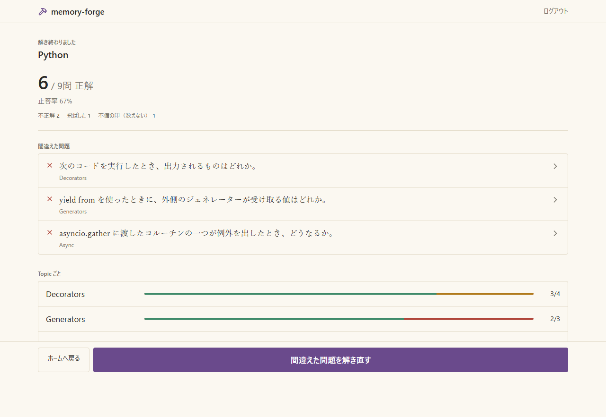
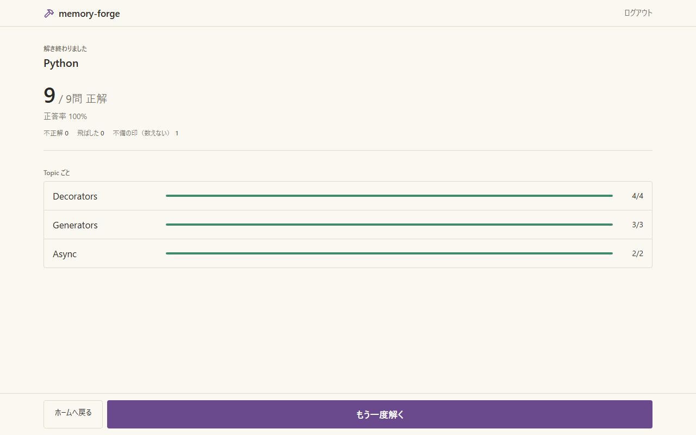
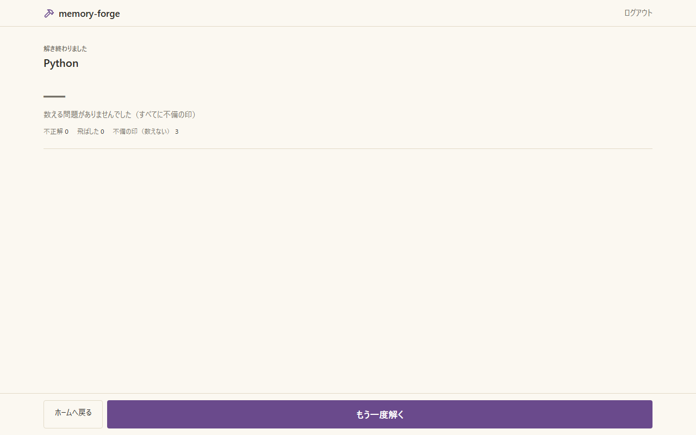
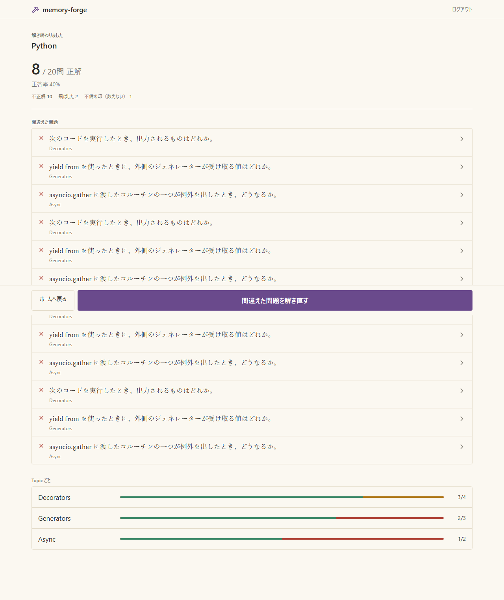
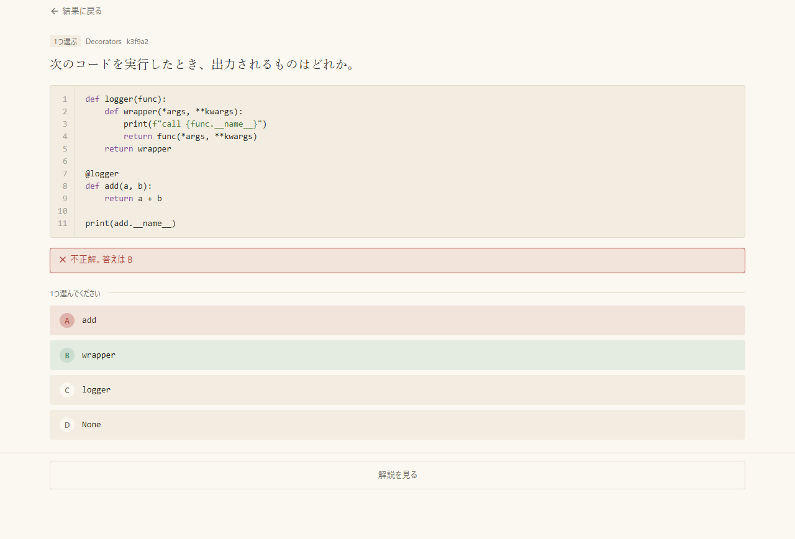
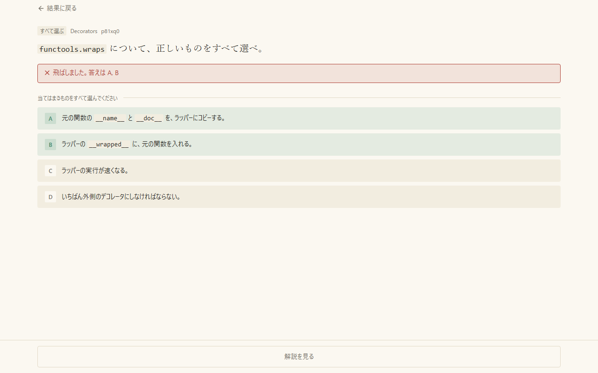
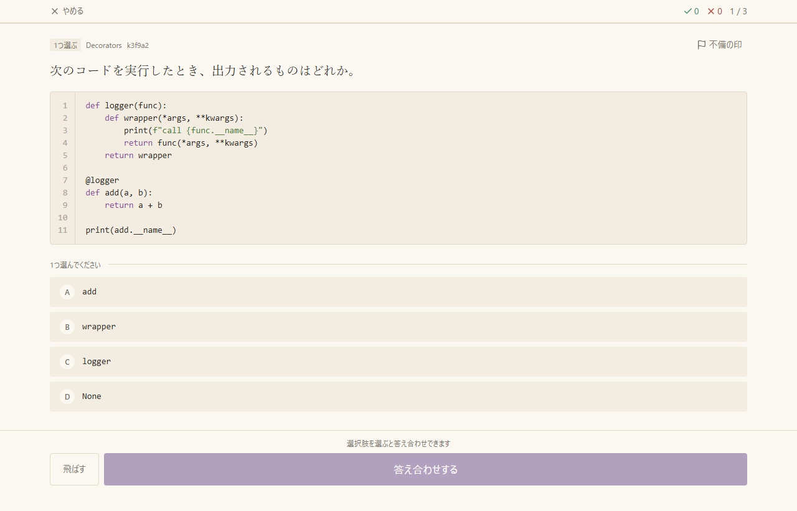

# 間違えた問題を見直し・解き直す（#125）

## なぜ

解き終わったあと、どの問題を間違えたかが Result に出ないので、解説を読み直すには Setup からやり直すしかない。間違えた問題だけをもう一度解く手段もない。#119 のプロトタイプ（memory-forge-proto の d817d3c）の Result に入った「間違えた問題」の一覧と「間違えた問題を解き直す」を作る（`docs/overview.md` の「あとで作る機能」の「復習」のうち、解いた回の中での見直しと解き直し）。

## 影響する今の仕様

- `docs/specs/solve.md` の「Result」（間違えた問題の一覧、下のボタン）
- `docs/specs/solve.md` の「Solve」（解き直しの回、見直し）
- `docs/overview.md` の「主な機能」の「解き終わりの結果」と、「あとで作る機能」の「復習」

## 使う場面

1. Python の Decorators を10問解き、3問を間違え（うち1問は飛ばした）、1問に不備の印を付けた人が、Result を開くと、得点の下の「間違えた問題」に3問が解いた順に並ぶ。印を付けた問題は並ばない
2. その人が一覧の2行目を押すと、その問題の答えたあとの見た目（自分が選んだ答え・正解・結果の帯）が出て、解説も見られる。戻ると Result に戻る
3. その人が「間違えた問題を解き直す」を押すと、3問だけを同じ順番で解く回が始まる。2問正解して1問また間違えると、その回の Result に1問だけが並ぶ。全部正解すると、「間違えた問題を解き直す」の代わりに「もう一度解く」が出て、押すと Setup に戻る

## 受け入れ条件

- Result の得点の数の下（区切り線の下）、「Topic ごと」の上に、「間違えた問題」の見出しと一覧を出す
  - 一覧に入れるのは、その回で不正解と飛ばした問題。不備の印を付けた問題は入れない（答える前に付けても、答えたあとに付けても）
  - 並びは、その回で解いた順
  - 行には、左に danger の x の印、問題文の1行目（明朝。長いときは折り返す）と、その下に Topic の名前（muted の小さな文字）、右に chevron-right の印を出す
  - 間違えた問題が0問のときは、見出しも一覧も出さない
- 一覧の行を押すと、その問題の見直しの画面を出す（下の「見直し」）
- 下に固定したボタン
  - 間違えた問題が1問以上：「ホームへ戻る」（枠だけ）と「間違えた問題を解き直す」（主な操作）
  - 間違えた問題が0問（全部正解・全部に印）：「ホームへ戻る」と「もう一度解く」（今と同じ。Setup に戻る）
- 「間違えた問題を解き直す」を押すと、一覧の問題だけを、一覧と同じ順番で解く回を始める
  - 解き方は、ふつうの回と同じ（答え合わせ・飛ばす・不備の印・やめる・保存のエラー）。答えはふつうに記録する
  - 解き終わると、その回の Result を出す。その回の間違えた問題で、また解き直せる
  - 解き直しの回の Result の「もう一度解く」とやめるは、Setup に戻る。Setup の選び方は、最初の回で選んでいたもののまま
  - 問題を読み込んでいる間は、ふつうの回と同じ点滅する枠を出す
- 見直し（一覧の行から）
  - その回で答えたときの、答えたあとの Solve の見た目で出す（選んだ答え、正解・選んで間違えたものの地の色、結果の帯）。「解説を見る」/「問題に戻る」で解説に切り替えられる
  - 記録は増やさない
- ページを読み込み直すと、今と同じく Setup の最初の選び方からになる（Result・見直し・解き直しの途中のどれでも）

## 画面

### 結果（result）

合意済みのプロトタイプ（d817d3c）の Result から書き起こす。得点・数・Topic ごとの見た目は、今の本番（`docs/specs/solve.md` の Result）のまま。

- 「間違えた問題」の見出しは、枠の外の上の見出し（muted の太字の小さな文字）
- 一覧は、枠で囲んだ行を区切り線で並べる。行に指を乗せると surface-raised の地

| 状態 | 表示 | スクリーンショット |
| --- | --- | --- |
| 通常（間違えた問題あり） | 得点の下に間違えた問題の一覧、Topic ごと、下にホームへ戻ると間違えた問題を解き直す |  |
| 全部正解 | 一覧なし、下にホームへ戻るともう一度解く |  |
| 全部に印 | 今の「—」の表示。一覧なし、もう一度解く |  |
| 間違えた問題が多い | 一覧の行が続き、ページごとスクロールする |  |

### 見直し（review）

- 上のバー：bg の地に、左の「結果に戻る」（arrow-left の印と文字、muted）だけを置く。進み具合の数と線は出さない。押すと Result に戻る（Result の表示はそのまま）
- 問題の上の行：種類の札・Topic・ID。不備の印のボタンは出さない
- 中身：答えたあとの Solve と同じ（結果の帯、選択肢の地の色と記号、読み上げの名前）
  - 不正解：danger の帯「不正解。答えは B」。選んだものと正解の地の色は Solve と同じ
  - 飛ばした：何も選んでいない状態で、正解の選択肢を success-soft の地（記号は選ばなかった正解と同じ）にし、danger の帯「飛ばしました。答えは A, B」（x の印）
- 下に固定した操作：「解説を見る」/「問題に戻る」の切り替えだけ（幅いっぱい。枠だけのボタン）。次の問題へは出さない

| 状態 | 表示 | スクリーンショット |
| --- | --- | --- |
| 不正解の問題 | 結果に戻る、不正解の帯、解説を見る |  |
| 飛ばした問題 | 何も選んでいない選択肢、正解が緑、「飛ばしました。答えは A, B」 |  |

### 解き直し（retry）

- ふつうの Solve と同じ。上のバーの問題の番号と線は、解き直す問題の数で数える（1 / 3 など）

| 状態 | 表示 | スクリーンショット |
| --- | --- | --- |
| 解き直しの1問目 | ふつうの Solve の答える前。1 / 3 |  |

## やらないこと

- 解いた回をまたいだ復習（前の回に間違えた問題を、あとから解き直す）。間隔をあけた出題も作らない（`docs/overview.md` の「あとで作る機能」のまま）
- 間違えた問題の一覧を、データベースや URL に持つこと（読み込み直すと消える）
- 一覧から問題を選んで解き直すこと（解き直すのは一覧の全部）

## 先に要る機能

- #119（main に入っている）

## 決まっていないこと

- [x] 見直しの画面の上と下に何を置くか（推す答え：上のバーは「結果に戻る」（arrow-left と文字）だけにし、進み具合の数と線は出さない。下は「解説を見る」/「問題に戻る」の切り替えだけ（次の問題へは出さない）。良い点：解いている回と見分けがつき、戻り先がひとつ。比べた案：ふつうの Solve の上のバーのまま（やめるが「解いた回をやめる」に見えて紛らわしい）） → 推す答えのとおり
- [x] 見直しで不備の印を付けられるか（推す答え：付けられない（ボタンを出さない）。良い点：印を付けた問題を一覧や解き直しから外す動きを足さずに済む。印は解き直しの回の中で付けられる。比べた案：付けられる（解説を読み直して誤りに気づいたその場で付けられるが、一覧から外すか・解き直しに入れるかを決める必要がある）） → 付けられない
- [x] 飛ばした問題の見直しの見せ方（推す答え：何も選んでいない状態で、正解の選択肢を success-soft の地にし、danger の帯「飛ばしました。答えは B」を出す。比べた案：帯を「不正解。答えは B」にする（飛ばしたことがわからない）） → 推す答えのとおり
- [x] プロトタイプに見直しの画面がないので、足して触って決めるか（推す答え：足す。Result の行から開け、`index.html` からも開けるようにする。比べた案：文だけで仕様に残し、スクリーンショットは付けない） → 足す

## 技術の確認表

| 項目 | 当てはまるもの | 決めた人 |
| --- | --- | --- |
| 保存するデータ | なし（答えは今の `answers` に1行ずつ足すだけ。一覧はブラウザの中だけ） | AI |
| 外部サービス | なし | AI |
| 認証・権限 | 今と同じ（ログインが要る。解き直しの問題を受け取るアクションもセッションを確かめる） | AI |
| 費用 | なし | AI |
| 個人情報 | なし | AI |
| デプロイの環境 | なし | AI |
| 新しいライブラリ | なし | AI |
| 取り消せない操作 | なし | AI |
| 共通の部品・トークン | なし（今の部品とトークンで作る） | AI |
| `docs/design.md` の決まり | 変えない。「解く画面の状態」のとおり、一覧と解き直しの回はブラウザにだけ持つ | AI |

---

## 設計

## AIが決めたこと

- 解き直しの回を始めるときに、一覧の問題を受け取り直す。そのあいだに印を付けた・消した問題は除く。1問も残らなければ、Result のまま danger の帯「問題を読み込めませんでした。」を出す（Setup で読めなかったときと同じ文言）
- 一覧の行は、間違えた問題の数がいくつでも全部出す（1回の問題は多くても科目の問題数まで）
- 一覧の x の印は、不正解も飛ばしたものも同じ（行の見た目で分けない。見直しの帯で分かる）

## 確かめ方

-

## タスク

- [ ]
