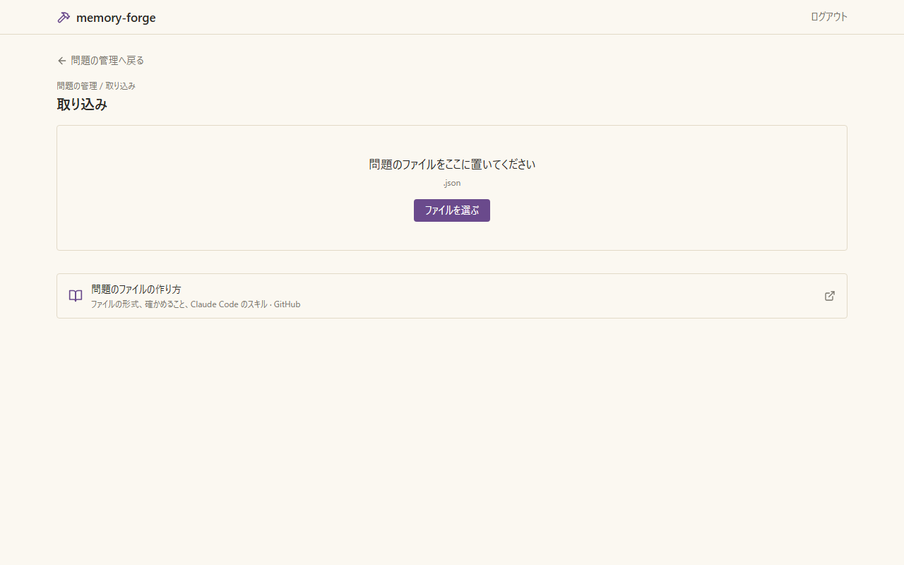
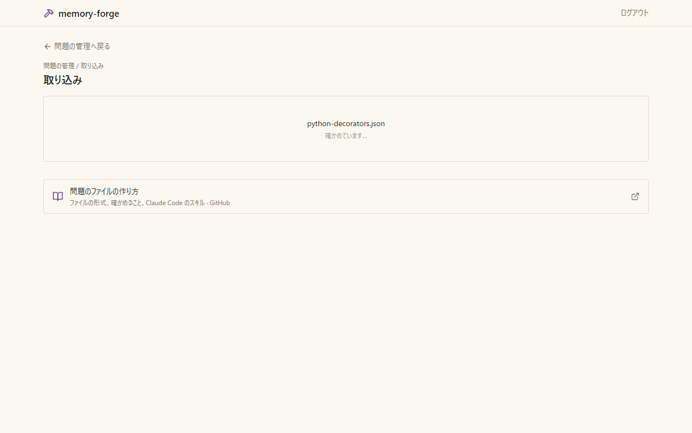
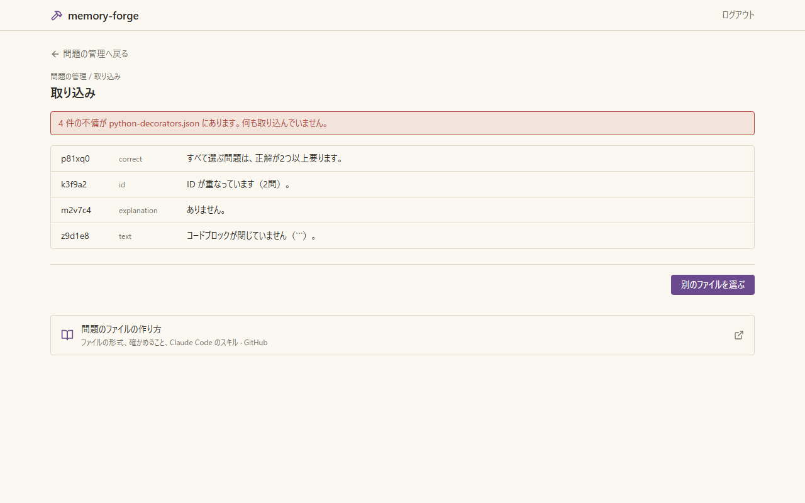
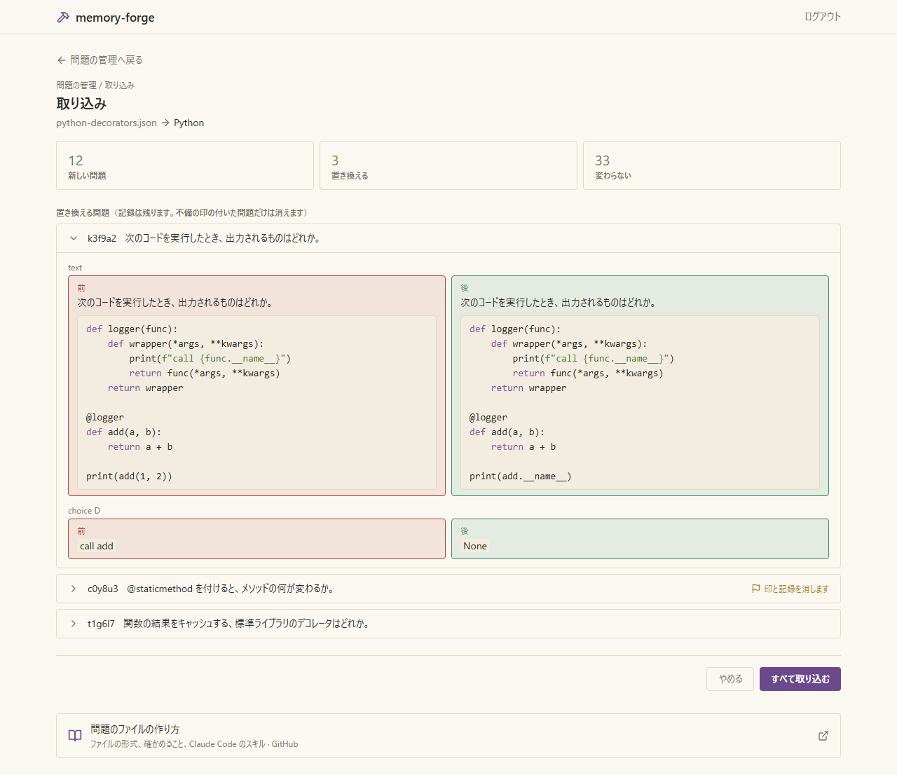
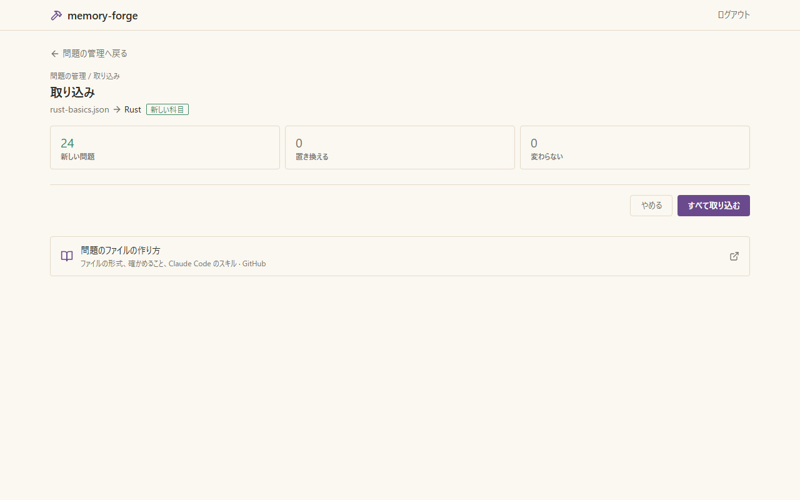
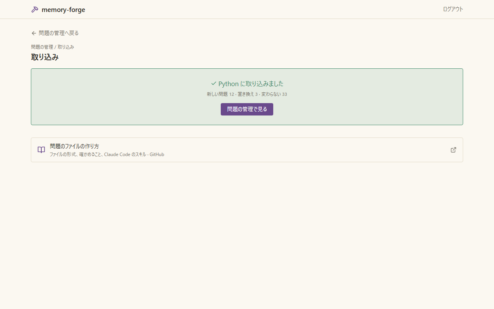
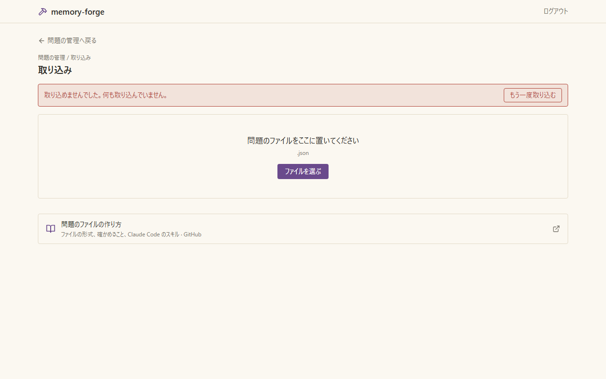

<!--
変更の仕様のひな形。コピーして docs/changes/<年-月-日>-<何をするか>.md を作る（例：2026-09-17-add-due-date.md）。
「なぜ」〜「調べたこと」は、AIが下書きし、人間がプロトタイプを触って直し、合意して決める（/dev-proto）。「画面」のスクリーンショットは、合意したときに足す。
「設計」以降はAIが書いて実装まで進め、人間は機能の PR でレビューする（/dev-build）。
スクリーンショットは、このファイルと同じ名前のフォルダに置く（例：2026-09-17-add-due-date/list-empty.png）。
-->

# Claude Code で問題のファイルを作れる（#15）

## なぜ

問題は、このプロジェクトの中で Claude Code に作らせる（`docs/overview.md` の「問題づくり」）。今は作り方の決まりがないので、作らせるたびに、ファイルの形・ID の付け方・確かめ方を言葉で伝え直すことになる。誤りのあるファイルは Import で止まるが、止まってから直すのは手間がかかる。
そこで、決まった形の、誤りのない問題のファイルを作らせるためのスキル・確かめるスクリプト・ルールと、人が読む作り方のドキュメントを用意する。Import の画面からは、そのドキュメントへ移れるようにする。

## 影響する今の仕様

- `docs/specs/import.md` の「Import（`/manage/import`）」：画面の下に、作り方のドキュメントへのリンクを足す
- 新規：`docs/specs/question-authoring.md`（問題づくりのスキル・確かめるスクリプト・作業場所のフォルダ）
- 新規：`docs/questions.md`（人が読む、問題のファイルの作り方。Import のリンク先）

## 使う場面

1. Python の問題を作りたい人が、Claude Code で `/make-questions Python Decorators 10問` と打つ。Claude Code が `questions/python-decorators.json` に10問を書き、ID を付け、確かめのスクリプトで誤りがないことを確かめてから、「10問を作り、確かめました」とファイルの場所を伝える。その人が Import でそのファイルを選ぶと、取り込む前の確認に「新しい問題 10」と出る
2. 解いていて誤りに気づき、Python の問題に不備の印を3つ付けた人が、Manage で「Python の不備の印を書き出す」を押し、できた `python.json` を `questions/` に置く。Claude Code に「questions/python.json の問題を直して」と頼むと、Claude Code は ID を変えずに3問を直し、確かめてから、何をどう直したかを問題ごとに伝える。Import で取り込むと、3問が「置き換える」に出て、印と記録がリセットされる
3. 問題を手で書き換えた人が、`npm run questions:check -- questions/python.json` を打つ。正解が選択肢にない問題があると、Import の誤りの一覧と同じ文言（ID・項目・内容）で出る

## 受け入れ条件

### Import の画面のリンク

- Import のどの状態でも、画面の下に、枠で囲んだ1行のリンク「問題のファイルの作り方」を置く。題の下に「ファイルの形式、確かめること、Claude Code のスキル · GitHub」、左に book-open の印（primary）、右に external-link の印
- 押すと、GitHub のこのリポジトリの main の `docs/questions.md` を、別のタブで開く

### 作り方のドキュメント（`docs/questions.md`）

- GitHub で読む人向けに、次を書く
  - 問題のファイルの形の短い例と、項目と確かめることの全部（`docs/specs/import.md` の「問題のファイル」「ファイルの確かめ」）へのリンク
  - 作業場所のフォルダ（`questions/`）。ここに置いたファイルは Git に入らないこと
  - Claude Code のスキルの使い方：新しく作る・書き出したファイルを直す、の2つ。打つ文の例を添える
  - 確かめるスクリプトの使い方
  - 作ったファイルを Import で取り込むまでの流れ。直すときは、アプリから書き出したファイルを直して取り込み直すこと（アプリの中身が元）

### 作業場所のフォルダ

- 問題のファイルは、リポジトリの `questions/` に置く。`questions/` の中のファイルは Git に入らない
- スキルは、`questions/` がなければ作る

### 問題づくりのスキル（新しく作る）

- Claude Code で `/make-questions` と打ち、Subject・Topic・問題数と、どんな問題がほしいか（題材、難しさ、単一選択と複数選択の割合など）を言葉で渡す。足りないもの（Subject・Topic・問題数）があれば、作る前に聞く
- 資料（手元のファイルや URL）を渡されたら、それをもとに作る。渡されなければ、Claude の知っていることから作る
- 作った問題は、`questions/` の新しいファイルに書く。ファイルの名前は、Subject と Topic から作る（書き出しのファイル名と同じ決まりで、`python-decorators.json` など）。同じ名前のファイルがあれば、上書きせず、名前の終わりに `-2` などを付ける
- 問題の ID は、スクリプトが付ける（下の「ID を付けるスクリプト」）。Claude Code が ID を考えない
- 作り終えたら、確かめるスクリプトを走らせる。誤りがあれば直して、誤りがなくなるまで繰り返す。最後に、作ったファイルの場所・問題数・Topic を伝える
- 問題は、スキルに書いた作り方のルールに沿う（下の「作り方のルール」）

### 書き出したファイルを直す

- 同じスキルで、`questions/` に置いた書き出したファイルを直せる（「questions/python.json の k3f9a2 の解説を直して」「印の付いた問題を直して」など）
- 直すときは、ID・Subject を変えない。頼まれた問題のほかは変えない
- 直したら確かめるスクリプトを走らせ、問題ごとに何をどう直したかを伝える
- 直したファイルに問題を足すように頼まれたら、新しい問題にだけ ID を付ける

### 確かめるスクリプト

- `npm run questions:check -- <ファイル...>` で、1つ以上のファイルを確かめる
- Import と同じ決まりで確かめ（`docs/specs/import.md` の「ファイルの確かめ」）、誤りは Import と同じ文言で、ファイルごとに「ID・項目・内容」を1行ずつ出す
- そのうえで、`questions/` の中の同じ Subject のほかのファイルと、ID が重なっていないかも確かめる。重なっていれば、`id` の誤り「ほかのファイル（python.json）と ID が重なっています。」にする
  - 書き出したファイルを直して取り込み直すファイルと、新しく作ったファイルが同じ Subject で `questions/` にあるとき、新しい問題が今ある問題を上書きしないようにするため
- 誤りがなければ「python-decorators.json：誤りはありません（Python・10問）。」のように出す
- 誤りが1つでもあれば、終わりのコードを 0 以外にする（スキルが、直すかどうかを判断できるように）

### ID を付けるスクリプト

- `npm run questions:ids -- <ファイル>` で、ID が空（`""`）か、ない問題に ID を付けてファイルに書き戻す。ID のある問題は変えない
- 付ける ID は、英小文字と数字の6文字のでたらめな文字列（`k3f9a2` など）。同じファイルの中と、`questions/` の中の同じ Subject のほかのファイルの ID と重ならないものにする
- 書き戻すときは、書き出しのファイルと同じ形（2文字の字下げ、終わりに改行）にする

### 作り方のルール（スキルに書く）

- 単一選択は、正解と言えるものが1つだけになるようにする。複数選択は、正解が2つ以上で、問題文に「すべて選べ」と分かるように書く
- 間違いの選択肢も、ありそうなものにする。「すべて正しい」「どれでもない」は使わない
- 解説には、正解の理由と、ほかの選択肢がなぜ違うかを書く
- コードは、問題文・選択肢・解説の中に ``` で囲んで書き、言語の名前を付ける（```python など）
- 確かでない事実は、問題にしない。資料を渡されたときは、資料に書いてあることから作る
- 問題文・選択肢・解説は、頼まれた言葉で書く（言われなければ日本語。コードや決まった用語はそのまま）

## 画面

### Import（`/manage/import`）

今の状態のすべてで（取り込み中も）、画面の下（中身の下、間を空けて）に、作り方のドキュメントへのリンクを出す。リンクの見た目は `docs/ui.md` の「外のページへのリンク」のとおり。ほかは変えない。

| 状態 | 表示 | スクリーンショット |
| --- | --- | --- |
| ファイルを選ぶ | 今の表示の下に、リンク |  |
| 確かめ中 | 今の表示の下に、リンク |  |
| 誤り | 今の表示の下に、リンク |  |
| 取り込む前の確認 | 今の表示の下に、リンク |  |
| 取り込む前の確認（まだない Subject） | 今の表示の下に、リンク |  |
| 取り込んだ | 今の表示の下に、リンク |  |
| サーバーのエラー | 今の表示の下に、リンク |  |

## やらないこと

- アプリの中で AI を呼んで問題を作らない（`docs/overview.md` の「やらないこと」）
- アプリに取り込み済みの問題の ID を、スクリプトから読みに行かない（問題を取り出す API は、あとで作る機能）。今ある問題と重なっていないかは、`questions/` に置いたファイルと、Import の取り込む前の確認（置き換わる数）で見る
- 作ったファイルを、スクリプトやスキルから直接アプリに取り込まない（取り込みは Import の画面から）
- `questions/` の問題のファイルを Git に入れない

## 先に要る機能

- なし（取り込み（Import）と書き出し（Manage）は main にある）

## 決まっていないこと

- [x] 問題づくりのスキルを、どこに置く？ スキルの置き場所 `.claude/skills/` は、`docs/template-files.md` で「テンプレートのもの」になっている → 推す答えのとおり。`.claude/skills/make-questions/` に置き、`CLAUDE.project.md` にこのプロジェクトのスキルだと書く
  - 推す答え：`.claude/skills/make-questions/` に置き、`CLAUDE.project.md` に「`make-questions` はこのプロジェクトのスキル」と書く。テンプレートに集める（`/template-harvest`）ときは、このスキルを外す
  - 良い点：Claude Code が `/make-questions` として見つける、決まった場所に置ける。テンプレートから取り込む（`/template-sync`）ときは、テンプレートにないフォルダなので、ぶつからない
  - 悪い点：`docs/template-files.md` の分け方と食い違う。集めるたびに、人が外す
  - 比べた案：テンプレートの `docs/template-files.md` に、「テンプレートにないスキルはプロジェクトのもの」と足す（テンプレートを変えるので、この PR の範囲外。テンプレートのリポジトリで別に直す）
- [x] 資料（手元のファイルや URL）を渡されたら、それをもとに作るのでよい？ → よい。渡されなければ Claude の知っていることから作る
  - 推す答え：よい。渡されなければ Claude の知っていることから作る
  - 良い点：試験の範囲や教科書に沿った問題にでき、事実の誤りを減らせる
  - 悪い点：資料の読み方（PDF・Web のページ）で、Claude Code に確認の出る操作が増える
  - 比べた案：Claude の知っていることだけから作る（作りは簡単だが、範囲に沿わせにくく、誤りが出やすい）

## 技術の確認表

| 項目 | 当てはまるもの | 決めた人 |
| --- | --- | --- |
| 保存するデータ | なし（アプリのデータベースは変えない。問題のファイルは、手元の `questions/` に置き、Git に入れない） | AI |
| 外部サービス | なし（Import のリンクで GitHub のページを開くだけ。資料の URL を読むのは Claude Code で、アプリではない） | AI |
| 認証・権限 | なし（Import は今のまま、ログインが要る） | AI |
| 費用 | なし（Claude Code を使う費用は、今の使い方の範囲） | AI |
| 個人情報 | なし | AI |
| デプロイの環境 | なし（スクリプトは手元だけで使う。環境変数も足さない） | AI |
| 新しいライブラリ | なし（スクリプトは Node.js で TypeScript をそのまま動かし、`src/server/import/validate.ts` を使う） | AI |
| 取り消せない操作 | なし（スキルは同じ名前のファイルを上書きしない。直すときは、頼まれたファイルだけを書き換える） | AI |
| 共通の部品・トークン | なし（`docs/ui.md` の「外のページへのリンク」と、今ある book-open・external-link の印を使う） | AI |
| `docs/design.md` の決まり | 足す：作業場所の `questions/` と、確かめ・ID のスクリプトが `src/server/import/validate.ts` を使うこと（決まりは1か所）。スキルの置き場所（テンプレートの `.claude/skills/` の中に、プロジェクトのスキルを置く）は「決まっていないこと」で人が決めた | AI・人 |

## 調べたこと

---

## 設計

### 変えるファイル

| ファイル | 変えること |
| --- | --- |
| `.gitignore` | `/questions/` を足す（頭の `/` を付け、`src/server/questions/` を外さないようにする） |
| `src/server/authoring/workspace.ts`（新規） | `questions/` のほかのファイルの中身（名前と文字列）の並びから、指定した Subject の ID とそのファイル名を集める。データベースもファイルも読まない |
| `src/server/authoring/check.ts`（新規） | 1つのファイルの中身を `validateQuestionFile` で確かめ、通ったら、ほかのファイルとの ID の重なりを `id` の誤りとして足す。結果を出力の文（誤りの行、誤りがないときの文）にする |
| `src/server/authoring/ids.ts`（新規） | ID が空かない問題に ID を付けた中身を作る。でたらめな文字を作る関数は引数で受け取る（テストで決まった値にするため）。書き戻す文字は `JSON.stringify(…, null, 2)` と終わりの改行 |
| `scripts/questions-check.ts`・`scripts/questions-ids.ts`（新規） | 引数のファイルと `questions/*.json` を読み、上の関数を呼んで、出力と終わりのコードを決める・ファイルに書き戻すだけ。`scripts/create-user.ts` と同じく node が型を外して動かす（読み込むのは拡張子付き、`@/` を使わない） |
| `package.json` | `questions:check`・`questions:ids` を足す |
| `.claude/skills/make-questions/SKILL.md`（新規） | 問題づくりのスキル：作る・直すの手順、作り方のルール、ファイル名の決め方、スクリプトの使い方 |
| `docs/questions.md`（新規） | 人が読む作り方 |
| `src/components/external-link.tsx`（新規） | `docs/ui.md` の「外のページへのリンク」の部品（印・題・説明・href を受け取る） |
| `src/app/(app)/manage/import/import-flow.tsx` | どの状態でも、中身の下にリンクを出す |
| `e2e/import.spec.ts` | リンクの行き先と別のタブで開くことを確かめる。7つの画像を撮り直す |
| `CLAUDE.project.md`・`docs/design.md` | コマンド、`make-questions` がこのプロジェクトのスキルであること、`questions/` とスクリプトの決まり |

### データ

- アプリのデータベースは変えない
- 確かめと ID のスクリプトは、`src/server/import/validate.ts` をそのまま使う（決まりを1か所にする）。`src/server/authoring/` のファイルは、データベースとサーバーだけの仕組みを読み込まない（スクリプトから node で直接動かすため）。読み込みは拡張子付きの相対パスで書く
- ほかのファイルとの重なりは、`questions/` の直下の `*.json` のうち、確かめるファイル自身（同じパス）を除き、JSON として読めて `subject` が文字で、確かめるファイルと Subject が同じもの。読めないファイルは飛ばす（そのファイル自身の誤りは、そのファイルを確かめたときに出る）
- ほかのファイルとの重なりは、ファイルそのものの誤りがなくなってから確かめる（誤りのあるファイルは Subject や ID が決まらないため）
- 出力の形（AIが決めた）
  - 誤りがあるとき：1行目に「python.json：2 件の不備があります。」、その下に誤りごとに「  k3f9a2  correct  選択肢にありません（E）。」（ID・項目・内容を2つの空白で区切る）
  - 誤りがないとき：「python-decorators.json：誤りはありません（Python・10問）。」
  - ファイルが読めないとき（ない、など）：「python.json：ファイルを読めません。」を誤りとして出す
  - ID を付けたとき：「python-decorators.json：3問に ID を付けました。」。付ける問題がなければ「python-decorators.json：ID のない問題はありません。」。JSON として読めない、`questions` が並びでないときは、書き戻さずに誤りの文を出して 0 以外で終わる
- ID を付けた問題は、`id` をいちばん前の項目にする（書き出しのファイルと同じ並び）

### 理由と前提の残し場所

- `questions/` の扱い、スクリプトが `validate.ts` を使うこと、ほかのファイルとの重なりを見ること：`docs/design.md` に「問題づくり」の節を足す
- 出力の形、ID の文字と長さ：`src/server/authoring/` のコメント
- スキルがこのプロジェクトのものであること：`CLAUDE.project.md`

## AIが決めたこと

- 作り方のドキュメントは `docs/questions.md` に置く。理由：プロトタイプのリンク先と同じで、`docs/` の中の人が読む文書と並ぶ。ファイルの項目と確かめることの全部は `docs/specs/import.md` にだけ書き、`docs/questions.md` からはリンクする（同じ決まりを2か所に書かない）
- スキルの名前は `make-questions`。新しく作るのと直すのを、1つのスキルにする。理由：どちらも同じルール・同じスクリプトを使い、直したファイルに問題を足すこともあるため
- 作業場所は、リポジトリの `questions/`（Git に入れない）。理由：Claude Code の作業ディレクトリの中で、確認なしで読み書きでき、スクリプトから同じ Subject のほかのファイルを探せる
- ID は、Claude Code が考えずにスクリプトが付ける。英小文字と数字の6文字のでたらめな文字列。理由：AI はでたらめな文字列を作るのが苦手で、似た ID が重なりやすい。6文字なら、数千問でも偶然重なることはほとんどなく、`questions/` のファイルとも比べる
- 確かめるスクリプトは、Import と同じ `src/server/import/validate.ts` を使い、誤りの文言も同じにする。理由：Import で止まるものを、作る時点ですべて見つけるため
- `questions/` の中の同じ Subject の、ほかのファイルとの ID の重なりも誤りにする。誤りの文言は「ほかのファイル（python.json）と ID が重なっています。」
- 作ったファイルの名前は、書き出しのファイル名（`exportFileName`）と同じ決まりで、Subject と Topic を「-」でつないで作る
- 問題の言葉は、言われなければ日本語にする（`docs/overview.md` の「用語」で、データは日本語で書くこともあるとしているため）

- リンクの部品は、ほかの画面でも使えるように `src/components/external-link.tsx` に分ける。比べた案：`import-flow.tsx` の中に書く（`docs/ui.md` の決まった見せ方なので、部品にしておくほうが揃う）
- スクリプトの出力の形は、上の「データ」のとおり。比べた案：Import の表と同じく表の形で出す（端末では列が揃わず、スキルが読むにも1行ずつのほうが扱いやすい）
- 確かめるファイルに誤りがあるときは、ほかのファイルとの重なりを見ない。比べた案：読めた ID だけで重なりも見る（誤りを直す前に Subject が変わることがあり、出した重なりが外れることがある）
- 作るファイルの名前を決めるスクリプトは作らない（仕様にないため）。スキルに、`exportFileName` と同じ決まりで名前を作ることを書き、そのファイルの場所を示す
- 2つのスクリプトに共通するファイルの読み方（引数のファイル、`questions/*.json`）は `scripts/questions-workspace.ts` に分ける。比べた案：それぞれのスクリプトに書く（同じ中身が2か所になる）
- スクリプトの細かい動き（実装の中で決めたもの。`docs/specs/question-authoring.md` に書いた）
  - 同じ ID が2つ以上のほかのファイルにあるときは、先に読んだファイルの名前を出す（どれか1つを示せば直せるため）
  - 誤りがあるとき、ファイルを指定しないときは、終わりのコードを 1 にし、指定しないときは使い方を出す。`questions:ids` は1つのファイルだけを受け取る
  - 相対パスは、コマンドを打った場所（`INIT_CWD`）から解く（`npm run` は `package.json` のフォルダで動くため）
  - `questions:ids` は、オブジェクトでない問題には ID を付けない（その誤りは `questions:check` で出る）。`questions` が並びでないときは「questions の形が違います。」（Import の「形が違います。」に揃える）
- スキルの手順の細かいところ：同じ誤りを3回直しても消えなければ止めて伝える（繰り返しが終わらないのを防ぐ）。頼まれていない問題に誤りが出たら、直さずに伝えて聞く（「頼まれた問題のほかは変えない」を守る）。直す問題の中では作り方のルールに合わせてよい。ID の重なりは、この回に足した問題なら付け直し、もとからある問題なら人に伝える（書き出した問題の ID を変えると別の問題になるため）。取り込み直すと印と記録がリセットされることを添える
- `docs/questions.md` の取り込みの流れに、新しく作ったファイルで「置き換える」が出たときの直し方（やめて、その問題の `id` を `""` にして付け直す）を書く。比べた案：気づくところまでで止める（読んだ人が次に何をすればよいか分からない）

## 確かめ方

| 受け入れ条件 | 確かめ方 |
| --- | --- |
| Import のどの状態でもリンクを出す・見た目 | テスト（画像を比べるテスト。7つの状態の画像） |
| リンクが main の `docs/questions.md` を別のタブで開く | テスト（`e2e/import.spec.ts`：href と `target="_blank"`） |
| 作り方のドキュメントの中身 | コードを見て確かめる（`docs/questions.md`） |
| `questions/` が Git に入らない | コードを見て確かめる（`.gitignore`） |
| スキルが `questions/` を作る・聞く・資料を使う・ファイル名・上書きしない・ID をスクリプトに付けさせる・確かめを繰り返す・伝える・作り方のルール | コードを見て確かめる（`.claude/skills/make-questions/SKILL.md`）と、触って確かめる（`/make-questions` で作らせ、Import で取り込む） |
| 書き出したファイルを直す（ID・Subject を変えない、ほかは変えない、伝える、足した問題だけに ID） | コードを見て確かめる（SKILL.md）と、触って確かめる |
| 確かめるスクリプトが Import と同じ誤りを同じ文言で出す | テスト（`src/server/authoring/check.test.ts`：validate の誤りがそのまま行になる。代表を1つ） |
| ほかのファイルと ID が重なると `id` の誤り（同じ Subject だけ、自分自身は除く、読めないファイルは飛ばす） | テスト（`check.test.ts`・`workspace.test.ts`） |
| 誤りがないときの文、誤りがあるときの見出しの文 | テスト（`check.test.ts`） |
| 誤りがあれば終わりのコードが 0 以外 | コードを見て確かめる（`scripts/questions-check.ts`）と、触って確かめる |
| 1つ以上のファイルを確かめる | コードを見て確かめる（`scripts/questions-check.ts`） |
| ID が空・ない問題にだけ ID を付ける、6文字の英小文字と数字、同じファイルとほかのファイルの ID と重ならない | テスト（`src/server/authoring/ids.test.ts`。重なる値を返す乱数を渡して、作り直すこと） |
| 書き戻す形（2文字の字下げ、終わりに改行、`id` が先頭） | テスト（`ids.test.ts`） |

## タスク

- [x] 確かめるスクリプト：`.gitignore` に `/questions/`、`src/server/authoring/workspace.ts`・`check.ts` とテスト、`scripts/questions-check.ts`、`npm run questions:check` ができたら完了
- [x] ID を付けるスクリプト：`src/server/authoring/ids.ts` とテスト、`scripts/questions-ids.ts`、`npm run questions:ids` ができたら完了（`workspace.ts` を使う）
- [x] スキルとドキュメント：`.claude/skills/make-questions/SKILL.md`、`docs/questions.md`、`CLAUDE.project.md`（技術・コマンド・このプロジェクトのスキル）、`docs/design.md`（問題づくりの節）が書けたら完了
- [x] Import の画面のリンク：`src/components/external-link.tsx` と `import-flow.tsx` の変更、`e2e/import.spec.ts` のテスト、画像の撮り直しができたら完了。合わせる画像：`import-select.png`・`import-checking.png`・`import-errors.png`・`import-preview.png`・`import-preview-new.png`・`import-done.png`・`import-error.png`（このファイルと同じ名前のフォルダ）
