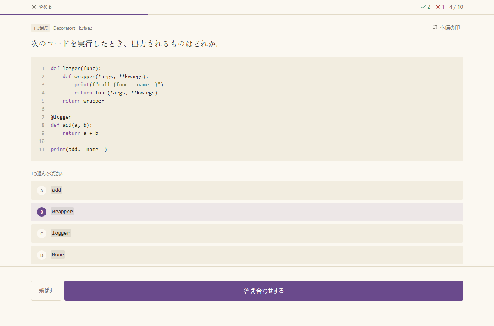
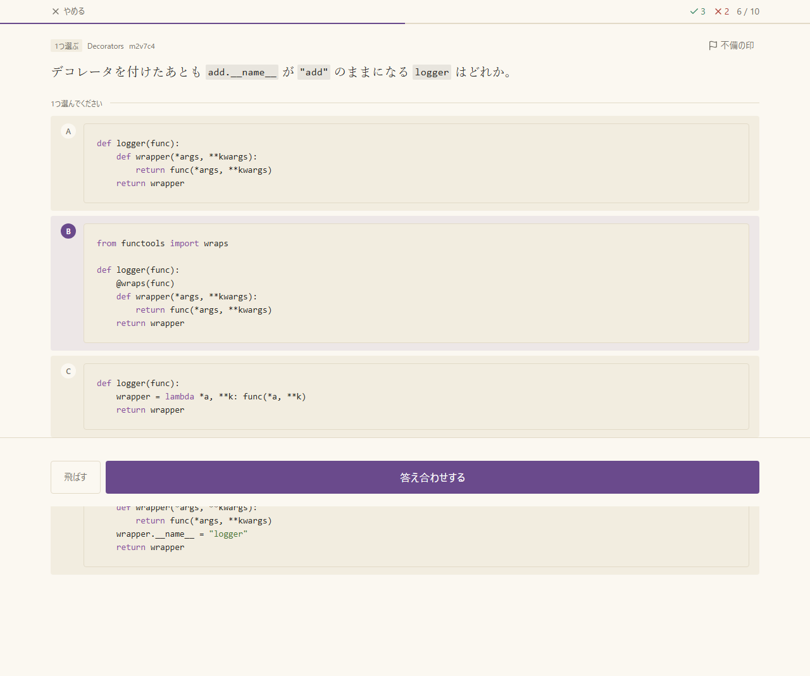
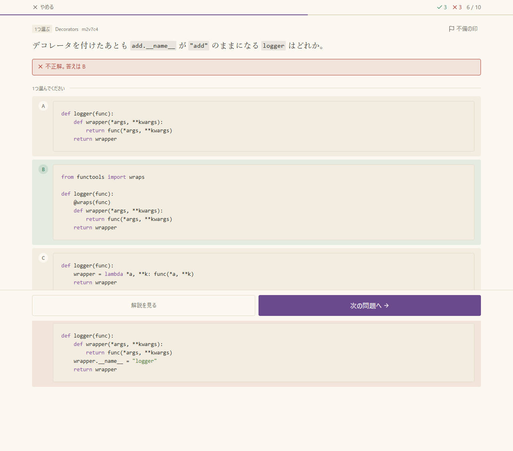
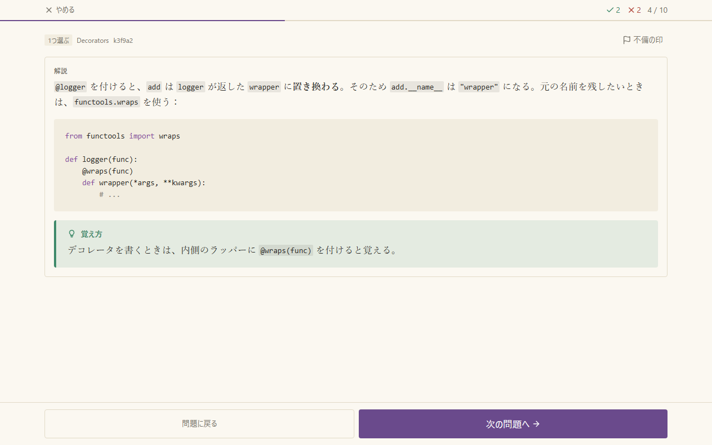
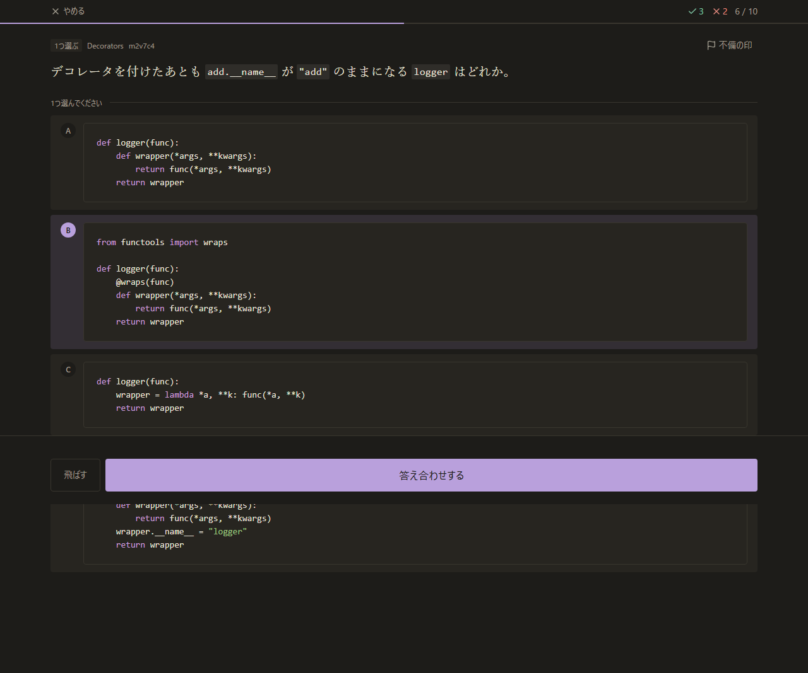
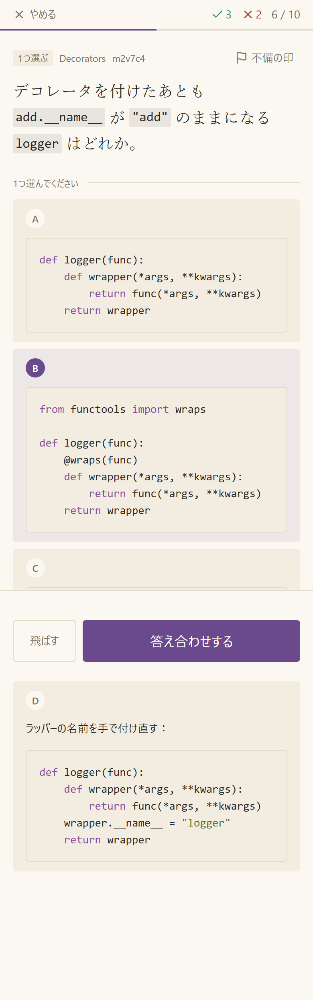
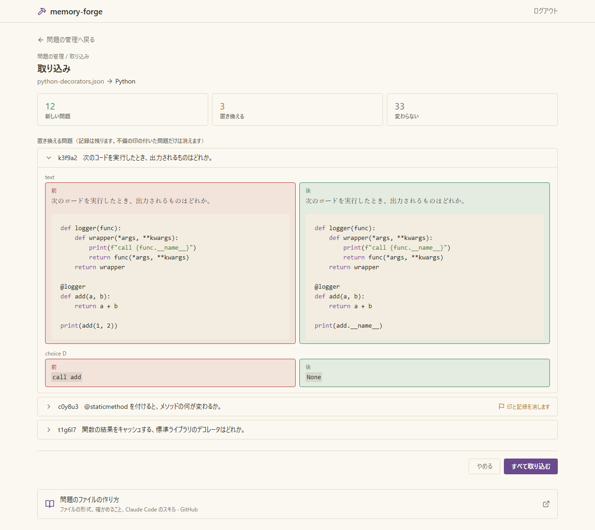

# 問題文・選択肢・解説の表示を kinari-md に替え、Prism を外す（#135）

## なぜ

問題文・選択肢・解説の表示を、memory-forge だけの小さな変換（`src/server/questions/markup.ts`）と Prism（`highlight.ts`）で作っている。md-leaf と同じ Markdown の表示を、シリーズで共通のパッケージ kinari-md にまとめたので（md-leaf は v0.2.0 に替え終わっている）、memory-forge も kinari-md v0.2.0 に替え、コードの見た目と色分けを md-leaf と揃える。Markdown の表示を直すときは、アプリではなく kinari-md で直せるようにする。

## 影響する今の仕様

- `docs/specs/solve.md`：「Solve」の問題文・コードブロック・色を付ける言語、解説、選択肢の中のコード。Result の見直し（同じ部品）
- `docs/specs/import.md`：「取り込む前の確認」の前と後の見せ方
- `docs/questions.md`、`docs/specs/question-authoring.md`：問題文・選択肢・解説に書ける書き方（解説の書き方を広げるなら）
- `docs/ui.md`：「コードブロック」「文の中のコード」「選択肢の中のコードブロック」「コードの色分け」のトークン

## 使う場面

1. Python の問題「次のコードを実行したとき、3行目で出力される値はどれか」を開くと、問題文のコードブロックに 1〜3 の行番号が付き、`def`・文字列・コメントに色が付いている。コードを選んで写すと、行番号は入らない
2. 選択肢がどれもコードブロックの問題で、B を選んで答え合わせすると、B の地が danger-soft、正解の C の地が success-soft になり、どちらのコードも枠で区切られて読める
3. 解説を見ると、`sort()` などの文の中のコードと、**太字**、`> [!tip]` のコールアウトが md-leaf と同じ見た目で出る

## 受け入れ条件

- 問題文・選択肢・解説は、Solve・Result の見直し・取り込む前の確認のどこでも、md-leaf の本文と同じ作りの見た目（kinari-md）で出る
- 問題文
  - 書ける書き方は、段落・改行・文の中のコード・コードブロックだけ。ほかの書き方（`**`・`#`・`-` など）は、書いたままの文字で出る
  - コードブロックには行番号を付ける。行番号は、コードを選んで写したときに入らない
- 選択肢
  - 書ける書き方は、問題文と同じ。コードブロックに行番号は付けない
  - 選択肢の文は、今と同じく画面の部品の書体（sans）で出す
  - 選択肢の中のコードブロックは、選択肢のカードの地と見分けられる（答える前・選んだ・答え合わせのあとのどれでも）
  - スマホの幅でコードブロックのある選択肢は、今と同じく記号を上の行に置き、コードを幅いっぱいに出す
- 解説
  - すべての書き方で出す：段落・改行・文の中のコード・コードブロック・強調・リスト・表・引用・コールアウト・数式・リンク
  - ```` ```mermaid ```` のコードブロックは、図にせずコードブロックのまま出す
  - コールアウトの色は md-leaf と同じ（note は info の色）
  - 問題の作り方（`docs/questions.md`）と `/make-questions` のスキルに、解説ではすべての書き方が使え、問題文と選択肢では文の中のコードとコードブロックだけが使えることを書く
- コードブロックの色
  - ```` ``` ```` の後ろに書かれた言語に合わせて、キーワード・文字列・コメントの3つに色を付ける（md-leaf と同じ）。言語の名前は画面に出さない
  - 色を付ける言語は、今の6つ（Python・TypeScript・JavaScript・SQL・シェル・JSON）とその短い名前を含む、highlight.js の一般的な言語（md-leaf と同じ）
  - 言語の名前がないときと、知らない言語の名前のときは、1色で出す
  - 問題を開いたときから色が付いている。ライトとダークで、それぞれのモードの色で出す
- どこでも、問題のデータの中の HTML のタグは動かさず文字のまま出す。リンクと画像は決まった形（相対・`#`・`/`・`http(s)`・`mailto`）だけを通す
- 文字の大きさは今と同じ（問題文は lg、解説は base、選択肢と取り込む前の確認は sm）
- 問題のファイルの形と、取り込むときに確かめること（コードブロックが閉じているか）は変えない。今取り込んである問題は、取り込み直さなくても新しい見た目で出る
- Manage の一覧や削除の確認のダイアログに出す問題文の1行目は、今と同じく文字のまま出す
- `prismjs` を外す

## 画面

見た目の作りは kinari-md の本文の CSS（`kinari-md/body.css`）に従い、memory-forge で上書きするのは下に書いたところだけにする。

- コードブロック：code-bg の地、角は md。枠は付けない（kinari-md のまま）。ただし選択肢のカードの中では、カードの地（#131 のあとの surface。今の surface-raised）と code-bg が同じ色なので、border の枠を付ける
- 行番号：コードの各行の頭に、code-line の色で右にそろえて出す。今の「番号の列と区切り線」はなくなり、長い行は番号ごと横にスクロールする（kinari-md のまま）
- 文の中のコード：置かれた場所の地に重ねた地で囲む（kinari-md のまま。選択肢のカードや答え合わせの色の上でも見分けられる）
- 書体：問題文・解説は body（明朝）、選択肢の文は sans、コードは mono。今と同じ

### Solve（solve）

| 状態 | 表示 | スクリーンショット |
| --- | --- | --- |
| 答える前（問題文にコード） | 行番号の付いた、枠のないコードブロック。選択肢の文の中のコード |  |
| 答える前（選択肢がコード） | 選択肢のカードの中に、枠の付いたコードブロック |  |
| 答えたあと（選択肢がコード） | 答え合わせの地の色。コードの色とコードブロックの枠はそのまま |  |
| 解説 | 文の中のコード、強調、コードブロック、tip のコールアウト |  |
| 色を付けられない言語 | 問題文のコードブロックが1色。行番号は付く |  |
| ダーク（選択肢がコード） | ダークのコードの色 |  |
| スマホの幅（選択肢がコード） | 記号を上の行に置き、コードを幅いっぱいに出す |  |

### 取り込む前の確認（import）

| 状態 | 表示 | スクリーンショット |
| --- | --- | --- |
| 取り込む前の確認 | 前（danger の枠）と後（success の枠）の中に、文と色の付いたコードブロック（行番号なし）。選択肢は Solve の選択肢と同じ見せ方 |  |

## やらないこと

- kinari-md を直すこと（足りないところが見つかったら、kinari-md の Issue にする）
- 問題のファイルの形や、取り込むときに確かめることを変えること
- 選択肢のカード・答え合わせの色など、kinari-md の外の部品の見た目を変えること
- 目次・見出しの一覧、リンクや画像の書き換え（`resolve`）。問題のデータにはノートへのリンクがないため
- トークンの名前をシリーズの共通の名前に揃えること（#131 で行う）

## 先に要る機能

- #131 トークンの名前を、シリーズの共通の名前に揃える。kinari-md の本文の CSS は `--color-accent`・`--color-surface`（一段上の面）・`--font-ui` などの共通の名前を読むが、今の memory-forge では `--color-surface` が地と同じ色で、`accent`・`font-ui` がない（「決まっていないこと」の1つ目）

## 決まっていないこと

- [x] #131（トークンの名前を揃える）を先に別の PR で終えてから、これを作る？（推す答え：先に #131 を `/dev-fix` で終える） → 先に #131 を `/dev-fix` で終える
  - 先に #131：見た目を変えない整理を、画像を比べるテストが基準のまま通ることで確かめられる。この機能の差分が「見た目が変わるところ」だけになる。悪い点：PR が2つになる
  - この機能に含める：PR が1つで済む。悪い点：名前を変えた差分と見た目が変わる差分が混ざり、画像の差が名前の変え間違いか、kinari-md によるものか見分けにくい
- [x] `info`（情報の意味の色）を足す？（推す答え：解説をすべての書き方にするなら、md-leaf と同じ値で足す。#131 では「まだ使わないので足さない」としていた） → md-leaf と同じ値で、この機能で足す
  - kinari-md は、コールアウトの note・info を `--color-info` で塗る。足さないと、そのコールアウトの色がなくなる。使うのはコールアウトの中だけで、ふだんの画面の色（`docs/ui.md` の「色の使い分け」）には出さない
- [x] 解説で使える書き方は？（推す答え：すべての書き方） → すべての書き方
  - すべての書き方：強調・リスト・表・引用・コールアウト・数式・リンクで、長い解説を読みやすく書ける。kinari-md を入れる狙いの1つ。悪い点：今の解説に、コードの外で `$…$`・`*…*`・`|` などが書かれていると、数式・斜体・表として見え方が変わる（手元の `questions/` にファイルがないので、今のデータでは確かめていない。気になるなら、書き出して見る）。`/make-questions` のスキルと `docs/questions.md` に、解説で使える書き方を書き足す
  - コードだけ（今と同じ）：見え方が変わる心配がない。悪い点：解説が文とコードだけのまま
- [x] 解説の中の Mermaid の図（```` ```mermaid ````）を図として描く？（推す答え：描かない。コードブロックのまま出す） → 描かない
  - 描かない：大きな `mermaid` を読み込まずに済む。問題を作るときに図を使う予定がまだない（`docs/overview.md` の「使うアプリがまだない書き方を先に作らない」と同じ考え）。図が要る問題が出たら足す
  - 描く：図で説明できる。悪い点：解説を開くたびに図を描く処理が要り、ダークへの切り替えでも描き直す
- [x] 選択肢のカードの中のコードブロックに枠を付ける？（推す答え：選択肢の中だけ border の枠を付け、ほかは kinari-md のまま枠なし） → 選択肢の中だけ枠を付ける
  - 選択肢の中だけ枠：選択肢のカードの地と code-bg が同じ色なので、枠がないとコードブロックの境目が消える。ほかは md-leaf と同じ見た目になる
  - どこでも枠（今と同じ）：今の見た目に近い。悪い点：md-leaf と見た目がずれ、上書きが増える
  - どこでも枠なし（kinari-md のまま）：上書きがない。悪い点：選択肢の中でコードの境目が見えない（答え合わせの色の上では少し見える）
- [x] プロトタイプを作る？（推す答え：作る。Solve の問題文・選択肢がコード・答えたあと・解説・色を付けられない言語・ダークと、取り込む前の確認を、kinari-md の見た目で作る） → 作る

## 技術の確認表

| 項目 | 当てはまるもの | 決めた人 |
| --- | --- | --- |
| 保存するデータ | なし（問題のデータの形も持ち方も変えない。表示のときに変換する） | AI |
| 外部サービス | なし | AI |
| 認証・権限 | なし | AI |
| 費用 | なし | AI |
| 個人情報 | なし | AI |
| デプロイの環境 | `kinari-md` を GitHub のタグから入れるので、Vercel のビルドで GitHub から取ってくる（公開のリポジトリなので鍵は要らない）。`next.config.ts` に `transpilePackages: ["kinari-md"]` を足す。環境変数は変わらない | AI |
| 新しいライブラリ | `kinari-md` v0.2.0（`github:tsubokura14/kinari-md#v0.2.0`。中で unified・highlight.js・KaTeX などを入れる）。Prism（`prismjs`・`@types/prismjs`）を外す | 人（シリーズの机上の検討で合意。#135） |
| 取り消せない操作 | なし | AI |
| 共通の部品・トークン | 問題文・選択肢・解説の部品（Solve・Result・Import）。コードの色（`code-*`）は memory-forge のトークンから外し、`kinari-md/tokens.css` から読む。`--reading-size` を足す。`info` を md-leaf と同じ値で足す（コールアウトの中だけで使う） | 人（2026-11-26 に合意） |
| `docs/design.md` の決まり | Markdown の変換と本文の見た目は kinari-md に任せ、直すときは kinari-md で直すことを足す。`src/server/questions/` の変換をなくす | 人（2026-11-26 に合意） |

## 調べたこと

- kinari-md v0.2.0 の本文の CSS が読むアプリのトークン：`--color-bg`・`--color-surface`・`--color-text`・`--color-muted`・`--color-border`・`--color-accent`・`--color-success`・`--color-warning`・`--color-danger`・`--color-info`・`--font-body`・`--font-ui`・`--font-mono`・`--reading-size`・`--radius-sm`・`--radius-md`・`--spacing`・`--leading-*`・`--font-weight-bold`
- kinari-md のコードブロックは枠がなく、code-bg の値は memory-forge の今の値と同じ（どちらも md-leaf の値）。コードの文字の色は `--color-text`（memory-forge の `code-text` も text と同じ値）
- 「コードだけ」では、字下げしたコードブロック（4つの空白）も止めてあり、```` ``` ```` だけがコードブロックになる（今と同じ）
- Mermaid の印（`pre[data-mermaid]`）は「すべて」のときだけ付き、`drawMermaid` を呼ばなければ、ふつうのコードブロックのまま出る

---

## 設計

### 変換はサーバーで行い、HTML を画面に渡す

- `src/server/questions/render.ts`（データベースは使わない）に、kinari-md の `renderMarkdown` を呼ぶ3つの関数を置く
  - `renderQuestionText(text)`：`syntax: "code"`・`lineNumbers: true`。HTML の文字を返す
  - `renderChoice(text)`：`syntax: "code"`。`{ html, hasCode }` を返す（`hasCode` はコードブロックがあるか。選択肢をスマホの幅で縦に並べるかに使う）
  - `renderExplanation(text)`：`syntax: "all"`。HTML の文字を返す。`drawMermaid` は呼ばない（```` ```mermaid ```` はコードブロックのまま出る）
- 画面に問題を渡すサーバーの関数が、元の文字に加えて、変換した HTML を返す
  - `src/server/solve/start.ts`・`retry.ts` の `SolveQuestion`：`textHtml: string`、`choicesHtml: { html: string; hasCode: boolean }[]` を足す
  - `src/server/solve/answer.ts` の `AnswerResult`・`SkipResult`：`explanationHtml: string` を足す
  - `src/server/solve/result.ts` の見直し用のデータ（`review`）：解説の HTML（`explanationHtml`）も持たせ、Result の見直しで使う（Solve の画面のタスクで行う）
  - `src/server/import/` の取り込む前の確認のデータ（`previewImport` が返す置き換わる問題の `changes`）：項目が text・choice・explanation のときは、前と後の HTML（`beforeHtml`・`afterHtml`）を足す。text と choice は `syntax: "code"`（行番号なし）、explanation は `"all"`。topic・type・correct は今と同じく文字のまま
  - 元の文字（`text`・`choices`・`explanation`・`before`・`after`）は、画面で使わなくなったら外してよい（ほかに使っているところが残るなら残す）
- 理由：unified・highlight.js・KaTeX はブラウザに送ると大きい（数百 KB）。スマホでも解くので、変換はサーバーで済ませ、ブラウザには HTML だけを送る。`render.ts` は画面の部品から読み込まない。残す場所：`docs/design.md`（「全体の構成」に足す）
- 前提（崩れたら見直す）：開くたびに変換しても重くない（1回に最大100問）。残す場所：`docs/design.md`

### 画面

- `src/components/rich-text.tsx` を、HTML を受け取って `.kinari-body` の入れ物に `dangerouslySetInnerHTML` で入れる部品にする。入れ物の種類（`question`・`choice`・`explanation`・`preview`）で、下の CSS のクラスを付ける
  - HTML は kinari-md がいつも安全にしたもの（タグは文字、危ないリンクと画像は通さない）なので、そのまま入れてよい。残す場所：部品のコメント
- `src/components/choice.tsx`：`text` の代わりに `html` と `hasCode` を受け取る。`parseMarkup` を使わない
- `src/components/change-row.tsx`：text・choice・explanation は HTML で出す。問題文の1行目（行の見出し）は今と同じく元の文字
- `src/app/subjects/[id]/solve-view.tsx`・`review-view.tsx`：HTML の項目を渡す。問題文・解説の入れ物の `font-body text-lg` などの大きさは、入れ物の CSS の `--reading-size` に置き換える
- 消すもの：`src/server/questions/markup.ts`・`highlight.ts` とそのテスト、`src/components/code-block.tsx`、`prismjs`・`@types/prismjs`、`docs/libraries/prismjs.md`

### トークンと CSS

- `npm install github:tsubokura14/kinari-md#v0.2.0`。`next.config.ts` に `transpilePackages: ["kinari-md"]`
- `src/styles/globals.css`：`kinari-md/tokens.css`・`kinari-md/body.css` を、memory-forge の `tokens.css` のあとに読み込む。Tailwind が kinari-md の中のトークンの使い方も見つけられるよう、必要なら `@source "../../node_modules/kinari-md/src"` を足す（md-leaf と同じ）
- `src/styles/tokens.css`
  - `--color-code-*` の6つを消す（kinari-md の `tokens.css` が持つ。`code-text` は kinari-md では `--color-text`）。Prism の部品を消すタスクで消す
  - `--color-info` を md-leaf と同じ値で足す（ライト `#3d6ea8`、ダーク `#86aee0`）。コールアウトの中だけで使う
  - `--reading-size` を足す（既定は base の大きさ。入れ物ごとに上書きする）
  - kinari-md が読むトークン（`--leading-tight`・`--leading-normal`・`--leading-relaxed`・`--font-weight-bold`・`--spacing`・`--default-transition-duration`・`--default-transition-timing-function`）が、memory-forge で値を持つか、ブラウザで確かめる。値がなければ md-leaf と同じ値で足し、「AIが決めたこと」に書く
- 入れ物ごとの上書きは、`src/styles/question-body.css`（globals.css から読み込む）に、トークンの値だけで書く。Tailwind の `[&_pre]` のような書き方は ESLint で止まるため（`docs/design.md` の「トークンにない値は、ESLint で止める」）
  - `question`：`--reading-size` を lg。コードブロックの文字を sm
  - `explanation`：`--reading-size` を base。ほかは kinari-md のまま
  - `choice`：`--reading-size` を sm。`--font-body` を `--font-ui` に当てる。コードブロックと文の中のコードの文字を 1em（文と同じ sm）。コードブロックに `border` の色の枠（thin solid）
  - `preview`：`--reading-size` を sm。コードブロックと文の中のコードの文字を 1em。choice の項目は `choice` と同じ書体の上書きをする（枠は付けない。前と後の地は code-bg と違う色のため）
  - 理由は CSS のコメントに書く（1か所だけに関わるため）
- 見た目の決まりは `docs/ui.md` の「コードブロック」「文の中のコード」「選択肢の中のコードブロック」「コードの色分け」と色の表を、kinari-md に任せる形に書き直す（`code-*` の行は「kinari-md の `tokens.css` が持つ」にする。`info` を足し、コールアウトの中だけで使うと書く）

### 画面のテストのデータ

- `e2e/questions.ts` の Decorators の問題の解説に、強調（`**`）と `> [!tip]` のコールアウトと文の中のコードを入れ、`solve-explanation.png` で見えるようにする。ほかのテストが文言で探しているところを壊さない
- 新しい画像：`solve-code-choices-dark.png`（ダークで選択肢がコード）、`solve-code-choices-mobile.png`（スマホの幅で選択肢がコード）

## AIが決めたこと

- 文字の大きさ（`--reading-size`）は、問題文・解説・選択肢・取り込む前の確認の入れ物ごとに、今の大きさ（lg・base・sm）に当てる
- 選択肢の文の書体は、選択肢の入れ物の中で `--font-body` を `--font-ui` に当てて sans にする（kinari-md の CSS を直さずに済む）
- 行番号の見た目（番号の列と区切り線がなくなる）は kinari-md のまま受け入れる。kinari-md を直さない範囲で、写したときに番号が入らない作りを持てるため
- コードの文字の大きさは今と同じ sm にそろえる：問題文のコードブロックは sm（kinari-md の 0.82em のままだと lg の文の中で大きく、スマホの幅で横にはみ出しやすい）。選択肢と取り込む前の確認のコード（ブロックも文の中も）は、文と同じ大きさ（sm。0.82em のままだと小さくなりすぎる）。解説のコードは kinari-md のまま（base の 0.82em で、今の sm とほぼ同じ）
- 選択肢のコードブロックの内側の余白は kinari-md のまま（今より少し広い）
- 変換はサーバーで行い、問題を渡すサーバーの関数が HTML も返す（`src/server/questions/render.ts`）。理由：unified・highlight.js・KaTeX をブラウザに送らずに済む。比べた案：今の `RichText` のようにブラウザの部品の中で `renderMarkdown` を呼ぶ（変える場所は少ないが、Solve を開くたびに数百 KB を送る）
- 入れ物ごとの上書きは、Tailwind のクラスではなく CSS のファイル（`src/styles/question-body.css`）に書く。理由：`pre` や `code` の中まで変えるには `[&_pre]` のような書き方が要り、ESLint の `no-restricted-classes` で止まるため
- 入れ物の種類は、クラスではなく `data-body` の属性（`question`・`choice`・`explanation`）で分ける。`kinari-body` のクラスは ESLint の `no-unknown-classes` の `ignore` に足す（Tailwind のクラスではないため。ほかの名前のクラスを増やさずに済む）
- kinari-md が読む `--leading-*`・`--font-weight-bold`・`--spacing`・`--default-transition-*` は、Tailwind の既定の値（md-leaf と同じ）がビルドした CSS に出ていることを確かめたので、`tokens.css` には足さない
- 画面のテストの k3f9a2 の選択肢を文の中のコード（`` `add` `` など）にし、解説に強調と `> [!tip] 覚え方` のコールアウトを足す（`solve-question.png`・`solve-explanation.png` のスクリーンショットに合わせるため。データは `e2e/questions.ts` ではなく `e2e/solve.spec.ts` の `decorators` にある）

## 確かめ方

| 受け入れ条件 | 確かめ方 |
| --- | --- |
| どこでも kinari-md の見た目 | テスト（画像を比べる：`solve-*`・`import-preview*` を撮り直し、仕様の画像と見比べる） |
| 問題文は段落・改行・文の中のコード・コードブロックだけ。ほかは書いたまま | テスト（Vitest：`render.test.ts` の `renderQuestionText`） |
| 問題文のコードブロックに行番号。写すと入らない | テスト（Vitest：行番号のクラスが付き、HTML の文字に番号が入らない）＋テスト（画像：`solve-question.png`） |
| 選択肢は問題文と同じ書き方。行番号なし | テスト（Vitest：`renderChoice`） |
| 選択肢の文は sans | テスト（画像：`solve-question.png`）＋コードを見て確かめる（`question-body.css` の `choice`） |
| 選択肢の中のコードブロックがカードの地と見分けられる | テスト（画像：`solve-code-choices.png`・`solve-answered-code-choices.png`・`solve-code-choices-dark.png`） |
| スマホの幅で記号が上の行、コードが幅いっぱい | テスト（画像：`solve-code-choices-mobile.png`）＋テスト（Vitest：`renderChoice` の `hasCode`） |
| 解説はすべての書き方 | テスト（Vitest：`renderExplanation` で強調・リスト・表・引用・コールアウト・数式・リンクが出る）＋テスト（画像：`solve-explanation.png`） |
| 解説の mermaid はコードブロックのまま | テスト（Vitest：`pre` のまま出る）＋コードを見て確かめる（`drawMermaid` を呼んでいない） |
| コールアウトの色は md-leaf と同じ（note は info） | コードを見て確かめる（`tokens.css` の `--color-info`）＋テスト（画像：`solve-explanation.png` の tip） |
| 問題の作り方とスキルに書ける書き方を書く | コードを見て確かめる（`docs/questions.md`・`.claude/skills/make-questions/SKILL.md`） |
| 言語に合わせて3色。言語名は出さない | テスト（Vitest：`hljs-keyword` などのクラスが付く）＋テスト（画像：`solve-question.png`） |
| 今の6つと短い名前を含む一般的な言語に色 | テスト（Vitest：python・py・typescript・ts・javascript・js・sql・bash・sh・shell・json で色のクラスが付く） |
| 言語なし・知らない言語は1色 | テスト（Vitest）＋テスト（画像：`solve-no-language.png`） |
| 開いたときから色。ライトとダーク | テスト（画像：`solve-code-choices.png`・`solve-code-choices-dark.png`） |
| HTML のタグは文字のまま。リンクと画像は決まった形だけ | テスト（Vitest：`<script>` が文字で出る、`javascript:` のリンクが通らない） |
| 文字の大きさは今と同じ | テスト（画像）＋コードを見て確かめる（`question-body.css` の `--reading-size`） |
| ファイルの形と取り込みの確かめは変えない。今の問題は取り込み直さなくても新しい見た目 | テスト（今の `validate.test.ts` が通る）＋コードを見て確かめる（データベースの形を変えず、表示のときに変換する） |
| Manage の一覧と削除のダイアログの1行目は文字のまま | テスト（今の画像：`manage-*` が変わらない） |
| `prismjs` を外す | コードを見て確かめる（`package.json`） |

## タスク

- [x] kinari-md を入れ、問題文・選択肢・解説を HTML に変換する関数を作る：`src/server/questions/render.ts` とテスト、`next.config.ts`、`docs/libraries/kinari-md.md` の下書き（画面は変えない）
- [x] 問題を画面に渡すサーバーの関数が、変換した HTML も返す：`SolveQuestion`・`AnswerResult`・`SkipResult`・取り込む前の確認の `changes`（画面は変えない）
- [ ] Solve と Result の見直しを kinari-md の見た目にする：トークン（`info`・`reading-size`）、kinari-md の CSS の読み込み、`question-body.css`、`RichText`・`Choice`・solve-view・review-view、画面のテストのデータと画像（`solve-question.png`・`solve-code-choices.png`・`solve-answered-code-choices.png`・`solve-explanation.png`・`solve-no-language.png`・`solve-code-choices-dark.png`・`solve-code-choices-mobile.png` に合わせる。ほかの `solve-*` は撮り直して差を確かめる）。取り込む前の確認は、このタスクでは古い変換のまま動かす
- [ ] 取り込む前の確認を kinari-md の見た目にし、古い変換と Prism を消す：`ChangeRow`、`import-preview.png` に合わせる（`import-preview-new.png` も撮り直して確かめる）、`markup.ts`・`highlight.ts`・`code-block.tsx`・`prismjs`・`@types/prismjs`・`docs/libraries/prismjs.md`・トークンの `code-*` を消す
- [ ] 文書を今の作りに合わせる：`docs/specs/solve.md`・`import.md`・`question-authoring.md`、`docs/questions.md`、`.claude/skills/make-questions/SKILL.md`（解説ではすべての書き方、問題文と選択肢は文の中のコードとコードブロックだけ）、`docs/ui.md`、`docs/design.md`、`docs/overview.md` の「技術」、`CLAUDE.project.md` の「技術」
