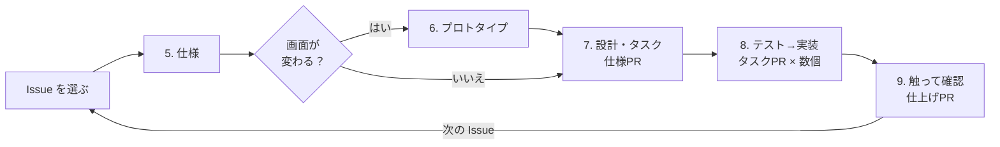

# 開発の進め方

## 3つの原則

1. **仕様が先、コードは後**：作る前に何を作るかを書き、決まっていないことを残さない。途中でズレたら、コードより先に仕様を直す
2. **人間は判断とレビュー、AIは下書きと実装**：完成の条件を決める、決まっていないことに答える、マージする、実際に触って確かめる、の4つは人間がやる
3. **同じ注意は2回しない**：うまくいかなかったことは `CLAUDE.md` に書き足す。PR レビューで同じ指摘を2回したら、機能の途中でもそのときに足す

決まった時間割（スプリントなど）は使わない。**1つの機能ができたら、次の機能へ進む。**

## 立ち上げ（最初の1回だけ）

Claude Code のフック（「Claude Code の設定」）は Node.js で動くので、先に入れておく。

### 1. 目的とやらないことを書く

- [ ] `docs/overview.md` の「目的」「使う人」「主な機能」「やらないこと」を書く（技術の話はまだしない）

AIに頼むなら：

```
docs/overview.md を一緒に書きたい。次のアイデアについて、目的・使う人・やらないことの観点で
あいまいな点を質問して。まだ技術の話はしないで。
（アイデアを数行で書く）
```

### 2. GitHub の設定

GitHub にリポジトリを作って push したあと、gh CLI でログインして実行する。

```bash
bash scripts/setup-github.sh
```

- `next` ラベルと、流れのラベル（`flow:light`・`flow:medium`・`flow:heavy`。「流れの選び方」）を作る
- PR の取り込み方法を **Squash merge だけ** にし、PR のタイトルが main のコミットメッセージになるようにする
- 取り込んだブランチを自動で消す
- main への push を、手元の Git のフック（`.githooks/pre-push`）で断る。push の書き方に関係なく、送り先が main なら止まる。秘密情報（`.env` のファイルと、決まった形のトークン）を含むコミットの push も止まる
- 秘密情報を含む push を、GitHub でも断る（push protection）。非公開のリポジトリでは有料なので、使えなければ手元のフックだけが守りになる
- main のブランチ保護（PR を通さないと入れない。承認の数は0）を設定する。非公開のリポジトリで GitHub Free の場合は使えないので、そのときは手元のフックだけが守りになる

Git のフックを使う設定（`core.hooksPath`）は clone で引き継がれない。clone し直しても、Claude Code で会話を始めると設定し直される（「Claude Code の設定」）。Claude Code を開かずに push するなら、先に `git config core.hooksPath .githooks` を実行する。

### 3. 画面の雰囲気と流れを決める（`/dev-proto`）

見た目は言葉だけでは合わせにくいので、先に見て決める。プロトタイプは HTML なので、技術を決める前にできる。

- [ ] プロトタイプのフォルダを、このリポジトリの外に作る（例：`../<リポジトリ名>-prototype/`。`docs/process/prototype.md` の「置き場所と、本番に見せない仕組み」）
  - 自分の `~/.claude/settings.json` の `additionalDirectories` に、そのフォルダや親のフォルダを入れない。入れると、本番の作業でも確認なしで読める範囲に入る（フックは止めるが、守りが1つ減る）
- [ ] 雰囲気を決める：AIが代表の画面1つを、雰囲気の違う2〜3案で作る。**自分で1つ選び**、AIがそれを元に `docs/ui.md`（見た目の決まり）を書く
- [ ] 主な画面と流れを決める：AIが主な機能の画面を、状態（0件、エラーなど）も含めて作る。触って直しを伝え、合意するまで繰り返す。決まった機能・用語・やらないことは、その場で `docs/overview.md` に書く
- [ ] 主な機能を、それぞれ GitHub の Issue にする：AIが分け方の案を出し、**自分で決める**（タイトルは「〇〇できる」の1文）

画面ごとの細かい仕様は、ここではまだ書かない。その機能に取りかかるとき（手順5・6）に書く。先に全部書くと、作る前に古くなるため。

### 4. 技術を決めて、動くだけのアプリを作る

技術は自分で決める。それ以外はAIに頼み、できたものを確かめる。

- [ ] AIが技術の候補を比べ、**自分で決める**。AIが、決めたものと理由を `docs/overview.md` の「技術」に書く
- [ ] AIがアプリのひな形を作る（`create-next-app` などが既存ファイルで失敗する場合は、別のフォルダで作ってからこのリポジトリに移す）
- [ ] AIが、**テストが実行できる** ようにする（ここが整わないと、テストを先に書けない）
- [ ] AIが、プロトタイプの `tokens.css` を本番のトークンファイルとして置き、場所を `docs/ui.md` の「トークン」に書く（これ以降、トークンは本番のファイルだけを直し、プロトタイプはそれをコピーして使う）
- [ ] AIが、**本番の画面を撮る仕組み** を作る（`docs/process/screenshots.md`）
  - 複数のタスクを並べて進める（worktree などでフォルダを分ける）なら、撮るときに立ち上げるサーバーのポートを、フォルダごとに変えられるようにする。同じポートだと、別のフォルダのサーバーを撮ってしまうことがある（Playwright の `reuseExistingServer` など）
- [ ] AIが、PR ごとにテスト・Lint・型チェック・画像を比べるテストを走らせる **CI**（GitHub Actions）を作る。画像を比べるテストは、撮るのと同じ環境で走らせる
  - `pull_request` で動かす
  - 画像を比べるテストのジョブは、`container:` に Playwright 公式の Docker イメージを指定する。タグのバージョンは、入れた Playwright と同じにする（Playwright を上げるときは一緒に上げる）
  - 失敗したら、Playwright のレポート（基準・今回・差分の画像）をアーティファクトとして残す。どの画面がどう変わったかを、レビューで見るため
  - CI では基準の画像を更新しない。撮り直しは手元の同じイメージで行い、PR に入れる
  - CI が PR で動いたら、main のブランチ保護で CI のジョブを必須にする（`required_status_checks`）。CI が失敗している PR をマージできなくなる。ブランチ保護が使えない場合（手順2）は、マージの前に自分で CI を確かめる
- [ ] AIが、ファイルを編集したあとにフォーマットと Lint を走らせる **フック** を `.claude/settings.json` に作る（「Claude Code の設定」）
  - `PostToolUse` で、matcher は `Edit|Write`
  - 入力の `tool_input.file_path` のファイルだけにかける。全体にかけると遅く、頼んでいない所まで変わるため。対象でない種類のファイル（`.md`、画像など）では何もしない
  - 失敗しても作業は止めない。Lint のエラーは、テストと CI で見る
  - `command` と `args` で書き、shell を通さずに起動する。Bash と PowerShell の違いを考えずに済む。Windows では `npx` などの `.cmd` を直接起動できないので、`node` でスクリプトを起動する
  - Windows で、実際にファイルを編集して動くことを確かめる
- [ ] AIが、`.claude/rules/testing.md` の `paths:` を、決めた技術のテストのファイルの置き場所に合わせる（「Claude Code の設定」の「AIが読む文書」）
- [ ] AIが、フォルダ構成と層の分け方を `docs/design.md` の「全体の構成」に書く
- [ ] AIが、`CLAUDE.md` の「技術」「よく使うコマンド」を埋める
- [ ] AIが、`README.md` を GitHub で見た人向けに埋める

CI とフックは、ファイルのひな形を置かずに、作るときの要点だけをここに書いておく。ひな形を `.github/workflows/` に置くと、手順4の前から push のたびに動いて失敗するため。また、コマンドや Docker イメージのバージョンは、技術を決めるまで決まらないため。

## スキル（Claude Code で使うコマンド）

`.claude/skills/` に、各手順をAIに頼むためのスキルがある。Claude Code で `/名前 引数` と入力して使う。
どれもブランチや PR を作るので、**AIが勝手に使わず、人間が入力したときだけ動く** ように設定してある。

| 入力 | 手順 | すること | 出す PR |
| --- | --- | --- | --- |
| `/dev-proto` | 3 | 雰囲気の案と、主な画面のプロトタイプを作る。`docs/ui.md` を書く | 立ち上げのPR |
| `/dev-triage 12` | 流れを選ぶ | Issue #12 をどの流れで進めるか、理由つきで案を出す。決めたらラベルを付ける | なし |
| `/dev-spec 12` | 5 | Issue #12 の仕様ファイルを作り、あいまいな点を質問する | なし |
| `/dev-proto docs/changes/2026-09-17-add-due-date.md` | 6 | 変わる画面のプロトタイプを作り、合意した画面を撮る | なし |
| `/dev-plan docs/changes/2026-09-17-add-due-date.md` | 7 | 設計・確かめ方・タスクを書く | 仕様PR |
| `/dev-impl docs/changes/2026-09-17-add-due-date.md 期限を保存できるようにする` | 8 | テストを先に書いて1タスク実装する | タスクPR |
| `/dev-finish docs/changes/2026-09-17-add-due-date.md` | 9 | 受け入れ条件を確かめ、今の仕様と今の設計を更新する | 仕上げPR |
| `/dev-fix 15` | 軽い・中くらい | 小さな変更・バグ修正・整理を、仕様ファイルなしで直す（中くらいならテストを先に書く） | 1つのPR |

うまく動かなかったら、`.claude/skills/<名前>/SKILL.md` の手順を直す（同じ注意を2回しないため）。

## Claude Code の設定

`.claude/settings.json` で、AIが実行してよいコマンドを決めてある。

| 扱い | コマンド |
| --- | --- |
| 確認なしで実行 | Issue・PR・CI の結果・差分・ログを見る、main を最新にする、ブランチを作る、コミットする、作業ブランチに push する、テスト・Lint を実行する |
| 毎回確認する | PR や Issue を作る・閉じる・ラベルなどを変える、`git reset --hard`、`git clean`、コミットしていない変更を捨てるブランチの切り替え（`git switch -f`・`--discard-changes`）、`.githooks/` と `package.json` を書き換える |
| 実行させない | **PR のマージ**（`gh api` 経由も）、force push、Git のフックを飛ばす・外すコマンド（`--no-verify`、`core.hooksPath` を変える）、`.env` を読む |

- どれをどの扱いにするかは、[docs/process/permissions.md](process/permissions.md) の4つの問い（取り消せるか、自分以外に届くか、ほかの仕組みで止まっているか、確認の画面で判断できるか）で決める。中身は GitHub の PR でレビューするので、確認を出すのは、確認の画面で判断できるものだけにする。判断できない危ないものは、確認ではなく仕組みで止める
- 作業ブランチへの push は確認なしにしてある。push の確認の画面では、秘密情報が入っているかを判断できないため。秘密情報は `.githooks/pre-push` で止め、main への push と force push は、フックと「実行させない」で止める。AIが push するのは、PR を出すときだけ（`CLAUDE.md`）
- 機能を仕上げるとき（`/dev-finish`）に、断った確認・毎回そのまま承認した確認・確認なしで困ったものを聞かれる。答えると、AIが権限の変え方の案を出す
- main への直接 push は、この設定ではなく、手順2で入れる Git のフックで止める。push の書き方（`-u`、`HEAD:main` など）は何通りもあり、コマンドの形では止めきれないため
- 技術に合わせて、テストや Lint のコマンドを書き換える（最初は npm の場合で書いてある）。Bash と PowerShell の両方に同じものを書く
- `.env` を読ませない設定は、ファイル名を1つずつ書いてある（`.env.*` とまとめると `.env.example` も読めなくなるため）。別の名前の `.env` ファイルを作ったら書き足す
- 自分だけの設定は `.claude/settings.local.json` に書く（Git には入らない）。承認のときに「今後も許可」を選ぶと `settings.json` に1回限りのコマンドが入ることがあるので、コミット前に差分を確かめる
- この設定は「AIがふだん書くコマンドの形」で判定するので、完全な防御ではない。マージしない・秘密情報を書かないことは `CLAUDE.md` にも書いてある

### フック

`CLAUDE.md` の文章だけでは、確認の出ない操作（リポジトリの中のファイルを読むなど）は止まらない。守らないと進め方が崩れるものは、フック（`.claude/hooks/guard.mjs`）で止める。

| 止めるもの | 通すもの |
| --- | --- |
| 過去の `docs/changes/` を読む・検索する（`cat` や `git show` などのコマンドにパスを書いたものも） | `_template.md`。会話で名前の出た仕様ファイル（スキルの引数か、人間のメッセージ）と、同じ名前のフォルダ。このブランチで足した・変えた仕様ファイル。ファイル名の一覧を見ること |
| `.env` をコマンドで読む・触る（Read は `permissions` の deny で止める） | `.env.example`。`--env-file` で読み込ませること |
| リポジトリの外を読む・検索する（プロトタイプのフォルダを読ませないため）。コマンドでは、ホームフォルダの中でリポジトリの外を指すパス（`../〇〇`、`C:/Users/...`、`~/...`） | `/dev-proto` を使った会話。一時フォルダと `~/.claude`。コマンドでは、ホームフォルダの外（`/dev/null`、`C:/Program Files` など） |
| Git のフックを飛ばす・外すコマンド（`--no-verify`、`core.hooksPath`） | なし |
| pr-check が、見るだけでない git コマンドを使う | 1つずつ実行する `git diff`・`git log`・`git show`・`git status` |
| test-runner が、基準の画像を更新する・git で書き込む・ファイルを消す・動かす・書き出す | テスト・Lint・型チェックのコマンド（技術で変わるので、止めるものだけを決めてある） |

- 会話を始めるたびに、`git config core.hooksPath .githooks` を実行する（clone し直しても main への push が止まるように）
- プロトタイプのフォルダの場所は、どこにも書かない。リポジトリの外をまとめて止めるので、人によって場所が違ってもよい
- リポジトリ全体や `docs/` を検索したときは、`.rgignore` で外してあるので、過去の `docs/changes/` は結果に出ない。ただし Grep に glob（`*.md` など）を付けると `.rgignore` が効かなくなるので、glob が過去の仕様ファイルに当たる検索は止める
- コマンドは、書かれたパスだけを見る。止められないもの：`grep -r 〇〇 docs` のようにパスを書かずに中を読むものと、`git log -p` で過去の差分を出すもの、`$HOME` などの変数で書いたパス。`CLAUDE.md` のルールと、レビューで補う
- コミットメッセージや PR のタイトル・本文に、過去の仕様ファイルのパス、`docs/changes` だけ、`.env`、リポジトリの外のパス（`../〇〇` など）を書いても止まる。止まったら、言い換えるか、ファイルから渡す（`git commit -F`、`gh pr create --body-file`）
- 止まったときは、AIは別の方法で読もうとせず、止まって伝える。今の仕様ファイルが止められたら、そのパスをメッセージに書くと読めるようになる
- 編集したあとのフォーマットと Lint のフックは、手順4で足す。作業の終わりにテストを走らせるフックは置かない。テストを先に書いて失敗を確かめる途中でも止められてしまうため。テストが通っているかは CI で見る

### AIが読む文書

AIが読む量が多いと、会話の始めから使える量（コンテキスト）が減り、決まりも守られにくくなる。要るときに、要る分だけを読ませる。

| いつ | 読まれるもの |
| --- | --- |
| 会話の始めに、毎回 | `CLAUDE.md` と、そこから `@` で読み込む `docs/overview.md`・`docs/design.md`。毎回要るものだけを置く |
| スキルを使ったとき | スキルの本文と、スキルが指す `docs/process/` のファイル（流れの選び方、テストの基準、画面のプロトタイプ、本番の画面を撮る、コードを読むための補足） |
| 決まったファイルを触ったとき | `.claude/rules/` のルール。`paths:` に当たるファイル（テスト、`docs/specs/screens/`、`docs/design.md`、権限の設定とフック）を読むと読み込まれ、`docs/process/` の要るファイルを読むよう案内する |

- この文書（how-we-work.md）は人間が全体を追うためのもので、AIには読ませない。AIに守らせる決まりは `docs/process/` に置き、ここからはリンクする
- スキルの手順には、`@` で読み込むファイル（`docs/overview.md`・`docs/design.md`）を「読む」と書かない。会話の始めに読み込まれているので、2回読むことになる
- 決まりを足すときは、毎回要るなら `CLAUDE.md`、特定の作業でだけ要るならスキルか `docs/process/`、特定のファイルを触るときだけ要るなら `.claude/rules/` に置く

## 流れの選び方（`/dev-triage`）

Issue をどの流れ（軽い・中くらい・重い）で進めるか。変更の大きさではなく、うまくいかなかったときの影響で決める。
→ [docs/process/flow.md](process/flow.md)

## 1つの機能を作る流れ

「流れの選び方」で重い流れにしたもの。



### 5. 仕様を書く（`/dev-spec`）

- `next` ラベルの Issue から1つ選ぶ（流れのラベルが `flow:heavy` のもの）
- `docs/changes/_template.md` をコピーして `docs/changes/<年-月-日>-<何をするか>.md` を作る（例：`2026-09-17-add-due-date.md`）
- AIが `<Issue番号>-spec` ブランチを作り、下書きをこまめにコミットする。手順6・7も同じブランチで続け、手順7の仕様PRになる（コミットしないまま手順をまたぐと、途中で別の Issue を直したときに、その PR に混ざるため）
- 書くのは「なぜ」「使う場面」「受け入れ条件」「画面」「やらないこと」「決まっていないこと」
- AIが「使う場面」を具体的な人・データ・操作で書き、自分の理解を言い換えて確かめてくる。**違っていたら、ここで直させる**（言葉の受け取り方のずれは、具体例にすると見つかる）
- 画面が変わるなら、AIが「画面」に、変わる画面と状態（0件、大量、読み込み中、エラー、権限なし）ごとの表示を書く
- AIに抜けやあいまいな点を質問させ、**自分で答える**。答えも残す
- 作り方がわからなければ、先に調べて「調べたこと」に書く
- **決まっていないことが0になったら** 次へ。画面が変わり、`docs/process/prototype.md` の「作るかどうか」で作るに当たるなら手順6、それ以外は手順7

### 6. 画面のプロトタイプを作る（`/dev-proto`。画面が変わるときだけ）

- AIが、変わる画面のプロトタイプを作る。ブラウザで触って直しを伝え、合意するまで繰り返す
- 決まったことは、AIがその場で仕様ファイルに書き戻す。**プロトタイプにしかない決めごとを残さない**
- 合意したら、AIが状態ごとのスクリーンショットを撮り、仕様ファイルの「画面」に載せる
- 終わったら **会話を区切り**、手順7は新しい会話で始める（本番の作業に、プロトタイプの中身を持ち込まないため）

### 7. 設計して、タスクに分ける（`/dev-plan`）

- AIが「設計」「確かめ方」「タスク」を同じファイルに書き足し、自分がレビューする
- レビューで見ること
  - すべての受け入れ条件に、確かめ方（テスト・触って確かめる・コードを見て確かめる）が決まっているか
  - `docs/process/testing.md` の「テストを書かないもの」に、テストを付けていないか
  - 各タスクが「〜ができたら完了」と1文で言えるか。言えなければ分ける
  - 画面のタスクに、合わせるスクリーンショットが書かれているか
  - 理由と前提に、仕上げたあとに残す場所（コメントか `docs/design.md`）が書かれているか（`docs/process/code-notes.md`）
  - `docs/design.md` と食い違っていないか
- このファイルと、スクリーンショットのフォルダだけの **仕様PR** を出して取り込む（どのブランチからも仕様を読めるように）

### 8. テストを先に書いて、実装する（`/dev-impl`）

- **1タスク = 1ブランチ = 1PR**。タスクごとに会話を区切ってよい
- タスクは、前のタスクPRを取り込んでから始める。AIは、main の仕様ファイルで前のタスクにチェックが付いていなければ止まる（順番に関係のないタスクなら、そう伝えれば進める）
- AIが `docs/process/testing.md` に合うテストを書き、**失敗を確かめてから** 実装する
- テストの実行は、AIがサブエージェント `test-runner`（`.claude/agents/test-runner.md`）に任せる。失敗したものだけが短く返るので、長いログが実装の会話を圧迫しない
- AIが止まって質問してきたら、自分が決め、仕様ファイルを先に直してから再開する
- PR を出す前に、AIが別の目（サブエージェント `pr-check`、`.claude/agents/pr-check.md`）で、差分を仕様ファイル・`docs/design.md`・テストの基準・`docs/ui.md` と照らし合わせて直す。書いた本人の会話は、自分の判断を正しいと思いがちなため
- PR の差分をレビューし、**CI が通っていることを確かめてから、自分で Squash merge** する。設計で決めた場所（コメントか `docs/design.md`）に、理由と前提が入っているかも見る
- 画面のタスクでは、AIがタスクに書かれた画面だけを本番から撮り直し、合意したスクリーンショットと見比べてから PR を出す。PR の画像の差分と、撮り直した画像の一覧がタスクの画面と合っているかを見る

### 9. 触って確かめ、仕上げる（`/dev-finish`）

- 受け入れ条件を1つずつ、**実際にアプリを触って** 確かめる
- 触って出てきた新しい要望は作らずに、新しい Issue にする
- 変わった動きを `docs/specs/` に反映し、**仕上げPR**（`Closes #番号`）で取り込む（画面の画像は、タスクPRで撮り直してある）
- 「設計」のうち、複数の場所に関わるものを `docs/design.md` に反映する。そのコードだけに関わるものは、コメントに入っているか確かめる（AIは過去の `docs/changes/` を読まないため）。新しい見た目の決まりは `docs/ui.md` に反映する
- うまくいかなかったことがあれば `CLAUDE.md` に1行足す

## テストの基準

どこにテストを書き、どこに書かないか。確かめ方（テスト・触って確かめる・コードを見て確かめる）の選び方。
→ [docs/process/testing.md](process/testing.md)

## 画面のプロトタイプ

本番の前に、触れる HTML のプロトタイプで見た目と流れを合意する。作るもの・作るかどうか・置き場所・合意したものの残し方。
→ [docs/process/prototype.md](process/prototype.md)

## 本番の画面を撮る

本番の画面を Playwright で撮り、「今の画面」と画像を比べるテストの基準にする。仕組みと、撮り直すときの決まり。
→ [docs/process/screenshots.md](process/screenshots.md)

## 小さな変更・バグ修正・整理（`/dev-fix`）

「流れの選び方」で軽い・中くらいにしたもの。仕様ファイルは作らない。

1. Issue に「どうなるべきか」を書く。バグなら「今どうなっているか」「再現手順」も書く
2. 中くらいなら、**バグを再現するテスト、または新しい動きのテスト** を先に書き、失敗を確かめてから直す。軽いなら新しいテストは書かない
3. 1 Issue = 1ブランチ = 1PR（`Closes #番号`）
4. 動きや文言が変わったなら、`docs/specs/` も同じ PR で直す（仕様のほうが間違っていた場合も）
5. 原因が、どこにも書かれていなかった前提だったなら、その前提を書く（`docs/process/code-notes.md`）
6. 中くらいなら、PR の前に pr-check で差分を確かめる

動きを変えない整理（リファクタ）は軽い流れで、テストが通り続けることを確かめる。

## 仕様と設計

| 種類 | 場所 | 書くこと | 増え方 |
| --- | --- | --- | --- |
| **今の仕様** | `docs/specs/<機能のまとまり>.md`、`docs/specs/screens/` | アプリが今どう動くか（現在形。理由は書かない）。今の画面の画像（AIが本番から撮る） | 新しいまとまりのときだけ増える。それ以外は書き直す |
| **今の設計** | `docs/design.md` | アプリが今どう作られているか。複数の場所に関わるものだけ（現在形。理由と前提も書く） | 1ファイルを書き直す。長くなったら `docs/design/` に分ける |
| **今の見た目の決まり** | `docs/ui.md` | 色・余白・文字・部品の使い分けと、その理由。値はトークンファイルに書く | 1ファイルを書き直す |
| **変更の仕様** | `docs/changes/<年-月-日>-<何をするか>.md` と同じ名前のフォルダ | 今回何を・なぜ・どう変えるか。合意した画面のスクリーンショット | 機能ごとに1つ増える。終わったら書き換えず、経緯の記録として残す（AIは読まない） |

- 変更の仕様は、今の仕様を読んでから書く。その「設計」は、今の設計も読んでから書く
- 仕上げPRで、変更の仕様の動きと画面を `docs/specs/` に、「設計」を `docs/design.md` かコードのコメントに、新しい見た目の決まりを `docs/ui.md` に移す（`docs/process/code-notes.md`）
- `docs/specs/` のファイルは「タスク管理」「ログイン」のような機能のまとまりで分ける。迷ったら今あるファイルに書き足し、長くなってから分ける

## コードを読むための補足

判断の理由と前提を、影響する範囲で1か所だけに書く（コメントか `docs/design.md`）。ライブラリの資料の書き方。
→ [docs/process/code-notes.md](process/code-notes.md)

## 大きさの決め方

「AIが書ける量」ではなく **「自分がレビューできる量」** で決める。

| こんなとき | どうする |
| --- | --- |
| 仕様がなかなか固まらない | 受け入れ条件のまとまりで機能（Issue）を分ける |
| タスクの完了条件を1文で言えない | 分ける |
| PR が大きすぎてレビューがつらい | 取り込まずに、タスクを分け直す |
| データの変更と画面を1タスクにしていた | 分ける |

## Git と Issue

| もの | ルール |
| --- | --- |
| Issue | 1つの機能、小さな変更1つ、またはバグ1つ。次にやるもの（1〜3件）に `next` ラベル。流れを決めたら流れのラベル |
| ブランチ | `<Issue番号>-<英語の短い名前>`。main から作る |
| コミット | テストが通ったとき、AIに次の大きな変更を頼む前。細かくても雑でもよい |
| PR | 1タスク分。タイトルは何をしたかの1文。途中は `Refs #番号`、最後は `Closes #番号` |
| 取り込み | Squash merge だけ。main の履歴は 1PR = 1コミットになる |

## 困ったとき

| 困ったこと | 最初にやること |
| --- | --- |
| 実装中に、仕様にない場合が出てきた | AIを止めて自分で決め、仕様に書き足してから再開する |
| AIが頼んでいない所まで変えた | その部分を取り除かせる。繰り返すなら `CLAUDE.md` に書く |
| テストは通るのに、触ると動かない | 受け入れ条件に対応するテストが足りない。テストを足す |
| 本番の画面が、合意したスクリーンショットと違う | タスクPRのレビューで違うところを伝えて直させる。合意した見た目の方を変えたいなら、仕様ファイルを先に直す |
| 画面を変えていないのに、画像を比べるテストが失敗した | AIに、どの画面がどう変わったかを見せてもらう。意図した変化なら撮り直させ、意図しない変化なら原因を直させる |
| 画像を比べるテストが、何もしていなくても失敗する | 撮るたびに変わるもの（日時、アニメーション）か、Docker イメージの外で撮った画像が混ざった。AIに原因を探させ、止め方を `docs/design.md` に書かせる |
| AIが、仕様にない要素を画面に足した | 取り除かせる（スクリーンショットに写っていても、仕様になければ作らない） |
| 本番の作業中に、プロトタイプのフォルダを読む確認が出た | 断る（ふつうはフックが止めるので、確認は出ない）。繰り返すなら、会話を区切ってやり直す |
| AIが、今の仕様ファイルを読もうとしてフックに止められた | 仕様ファイルのパスをメッセージに書く。スキルを使わずに頼んだときや、会話をやり直したときに起きる |
| AIが、リポジトリの外の要るファイルを読もうとしてフックに止められた | 中身を会話に貼る。プロトタイプでないことを確かめてから |
| push が「秘密情報らしいもの」で止まった | 出たファイルの中身を自分で確かめる。本物なら、コミットの履歴から取り除かせる（push の前に止まったので、外には出ていない）。誤検知なら、自分で `git push --no-verify` する |
| フックのエラーが毎回出る | Node.js が入っているか確かめる。入っていないとフックが動かず、何も止まらない（`.claude/hooks/guard.mjs` が動いたうえで失敗したときは、止める側に倒してある） |
| AIが古い書き方をしてエラーになる | インストールされているバージョンを確かめさせる。`CLAUDE.md` にも書く |
| AIが毎回同じことを聞いてくる | 答えを `docs/overview.md`（用語・技術）、`docs/design.md`（作り方の決まり）、`docs/ui.md`（見た目の決まり）、`CLAUDE.md`（進め方）のどれかに書く |
| 会話が長くなって、AIが前提を忘れる | 会話を区切り、コマンドからやり直す（前提はファイルにある） |
| 仕様どおりなのに使いにくい | 今の機能は完成にする。直したい点は新しい Issue にする |
| `Closes` を書き忘れて Issue が開いたまま | 手で閉じる |
