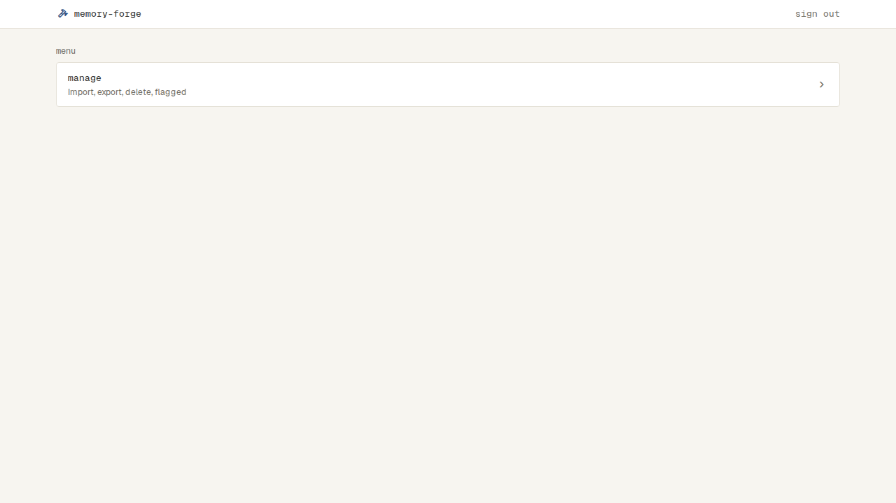

# 上のバー

## 上のバー

- Login と解く画面以外の、すべての画面のいちばん上に出る（今は Home だけ）
- 左にロゴとアプリ名（memory-forge）。押すと Home に移る
- 右に sign out。押すとログインが終わり、Login に移る（そのあとの扱いは `docs/specs/sign-in.md`）

| 状態 | 表示 | スクリーンショット |
| --- | --- | --- |
| 通常 | 左にロゴとアプリ名、右に sign out | （Home の画像の、上のバーの部分） |
