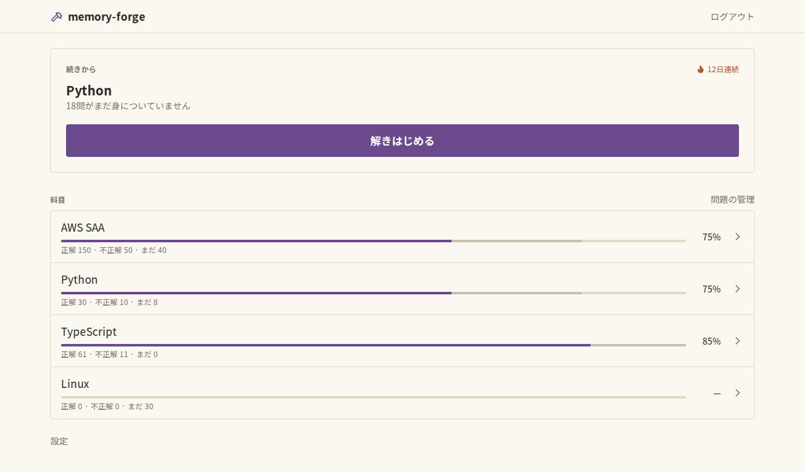
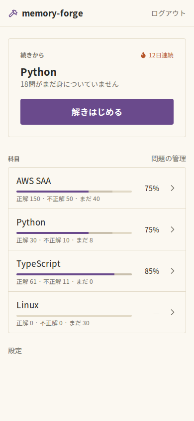
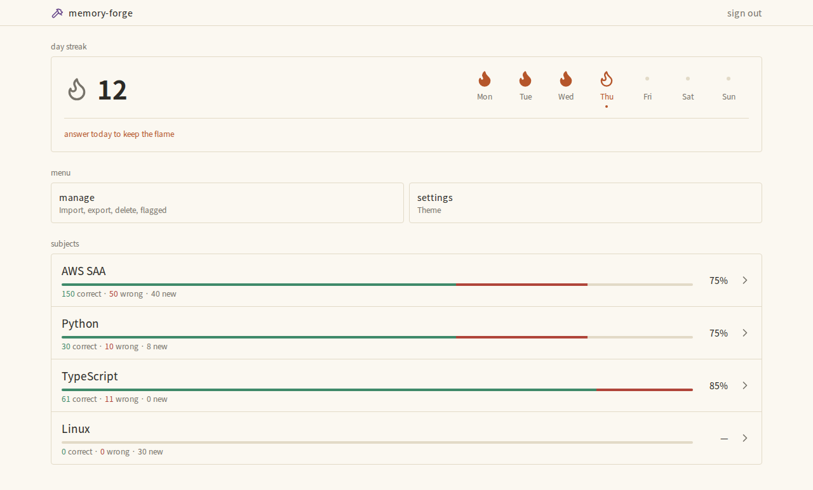
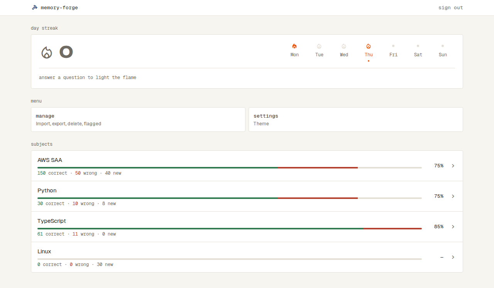
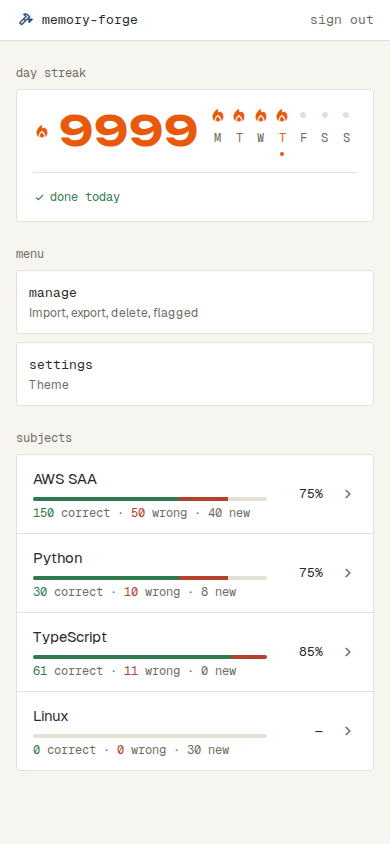
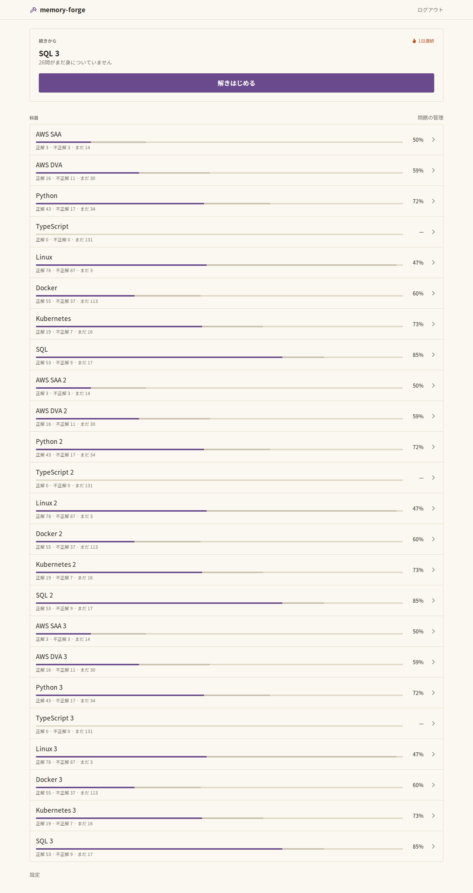
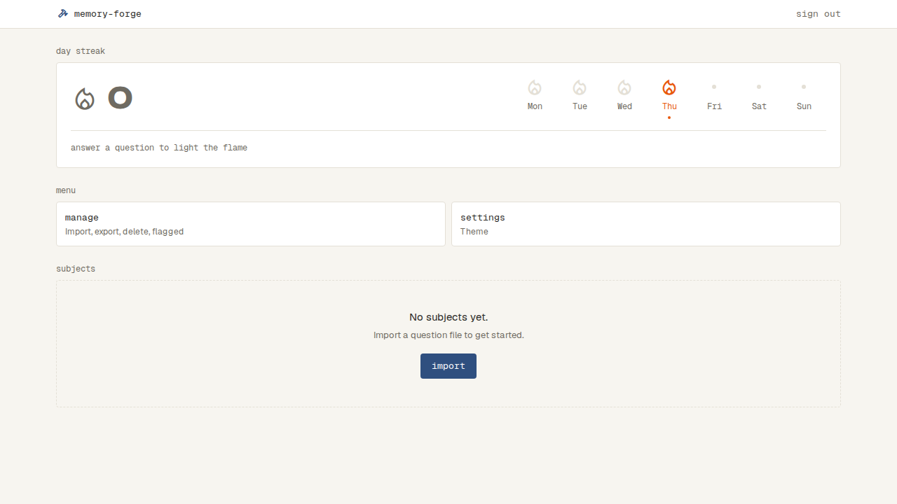

# ホーム

## 最初の画面（`/`）

- ログインしていないと見られない（`docs/specs/sign-in.md`）
- いちばん上に上のバーが出る（`docs/specs/app-bar.md`）
- 上から「続きから」のカード、「科目」、「設定」のリンクの順に並べる
- 「続きから」のカード（下の「続きから」）
  - 左上に「続きから」の見出し、右上に連続日数の1行（下の「連続日数」）を出す
  - その下に科目の名前と「N問がまだ身についていません」、いちばん下に「解きはじめる」を出す。解きはじめるを押すと、その科目の Setup（`docs/specs/solve.md`）に移る
  - 科目が1つもないとき、科目を読み込んでいる間・読み込めなかったときは、カードを出さない（連続日数も出ない）
- 連続日数の1行
  - 今日答えた：灯った炎と「N日連続」を flame で出す
  - 今日答えていない（日数が1以上）：灯らない炎と「N日連続・今日はまだ」を muted で出す
  - 日数が0：灯らない炎と「今日解くと連続日数が始まります」を muted で出す
  - 日数は3桁ごとに「,」で区切る。4桁（9999）まで1行に収まる
  - 読み込んでいる間は何も出さない。読み込めなかったときは、muted の「連続日数を読み込めませんでした」を出す。ほかはふつうに出す
  - Home を開いたときの日付で出す。開いたまま日付が変わっても変わらず、開き直すと（読み直しを含む）今の日付で出る
- 「科目」の見出しの右に「問題の管理」のリンクを出す。押すと Manage（`docs/specs/manage.md`）に移る
- 「科目」の見出しの下に、科目を取り込んだ順に、枠で囲んだ行を区切り線で並べる
  - 行には、左に名前と、その下にその科目の全部の問題の身についている具合（下の「身についている具合」の線と数）を出し、右に %、その右に chevron-right の印を出す。名前が長いときは、行の中で折り返す
  - 印の数は出さない
  - 押すと、その科目の Setup（`docs/specs/solve.md`）に移る
- 科目が0件のときは、「科目」の見出しの下に、実線の枠で「まだ科目がありません。」「問題のファイルを取り込むと、ここに科目が並びます。」と「取り込む」を出す。取り込むを押すと Import（`docs/specs/import.md`）に移る
- 科目を読み込んでいる間は、「科目」の見出しの下に、線と数のある科目の行と同じ高さの枠を4つ点滅させる
- 科目を読み込めなかったときは、「科目」の見出しの下に、danger の帯「科目を読み込めませんでした。」ともう一度のボタンを出す。押すと読み直す
- いちばん下の「設定」のリンクを押すと、Settings（`docs/specs/settings.md`）に移る

| 状態 | 表示 | スクリーンショット |
| --- | --- | --- |
| 通常（科目が1つ以上、今日答えた） | 続きからのカードに、いちばん最近答えた科目と、右上の灯った炎と「N日連続」。科目の行に線・数・%。まだ解いていない科目は、線が全部 border、「正解 0 · 不正解 0 · まだ 30」と「—」 |  |
| 通常（スマホの幅） | 同じ並びが1列に収まる |  |
| 今日まだ（昨日まで続いている） | 灯らない炎と「N日連続・今日はまだ」 |  |
| 連続日数が0日 | 灯らない炎と「今日解くと連続日数が始まります」 |  |
| 連続日数が大きい | 4桁の日数でも、連続日数が1行に収まる |   |
| 科目が多い | 科目の行が続く |  |
| 科目が0件 | 続きからのカードはなく、科目の実線の枠と取り込む |  |

## 続きから

- いちばん最近答えた科目を出す。答えた日時は記録の答えた日時で、印の付いた問題への答えは数えない
- 1度も答えたことがなければ、科目の一覧のいちばん上の科目を出す
- N は、その科目の、最後に間違えた問題とまだ解いていない問題の数（下の「身についている具合」と同じ数え方。印の付いた問題は数えない）

## 連続日数

Home の「続きから」のカードの右上で出す。

- 日の区切りは日本時間の0時。1日に1問でも答えた日を「取り組んだ日」とする
  - スキップも答えたことに数える
  - 印の付いた問題への答えは数えない（印を付ける前に答えていても）
  - Manage で問題を消しても、その問題への答えは数え続ける（消したときに印の付いていた問題への答えは数えない）
- 日数は、今日までさかのぼって取り組んだ日が何日続いているか
  - 今日答えていれば、今日を含めて数える
  - 今日まだ答えていなくても、昨日答えていれば、昨日までの日数を出す（切れない）
  - 今日も昨日も答えていなければ0
- Solve で答えてから Home に戻ると、その答えを含めて出る

## 身についている具合

Home の科目の行と、Setup の Topic の行（`docs/specs/solve.md`）で、同じ数え方で出す。

- 問題ごとに、最後の答えで「正解」「不正解」「まだ」のどれかに数える
  - 最後の答えが正解：正解。不正解かスキップ：不正解。答えた記録がない：まだ
- 印の付いた問題は、どれにも数えない
- 名前の下に細い線を出し、左から正解（accent）・不正解（border-strong）・まだ（border）の割合で塗り分ける
- 線の下に、muted の小さな文字で「正解 30 · 不正解 10 · まだ 8」と出す（数に色は付けない）。0の項目も含めて、いつも3つを並べる
- 行の右に、「正解 ÷（正解 + 不正解）」を整数に四捨五入した %（例：2 ÷ 3 は 67%）を、決まった幅で右にそろえて出す。正解 + 不正解が0のときは「—」
- 全部の問題に印が付いているときは「正解 0 · 不正解 0 · まだ 0」と「—」にし、線は全部 border にする
- スマホの幅で数が1行に収まらないときは、折り返す
