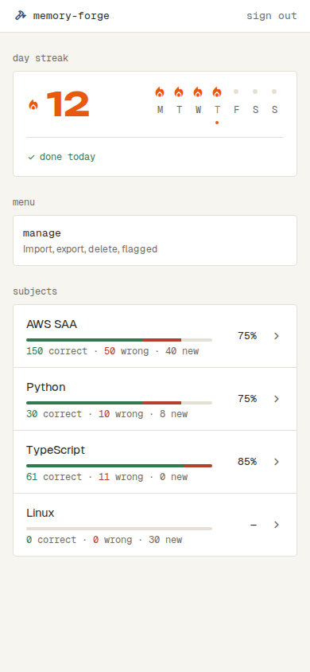
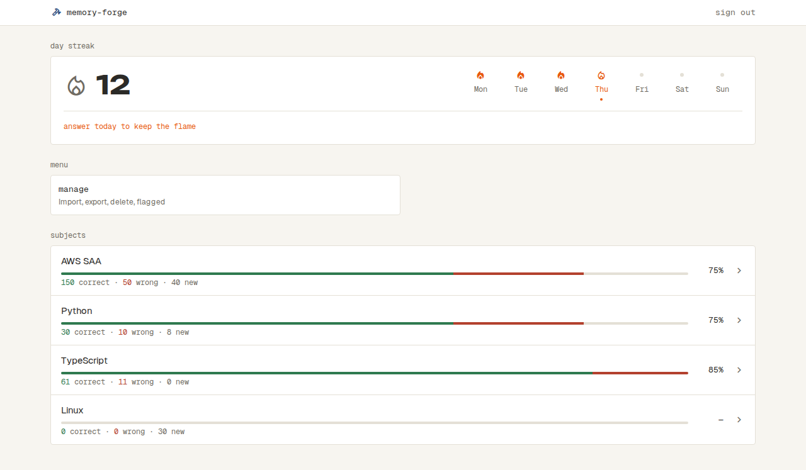
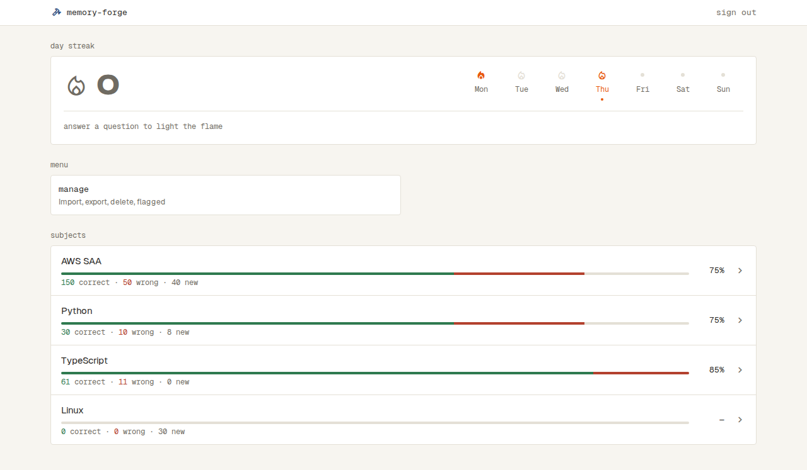
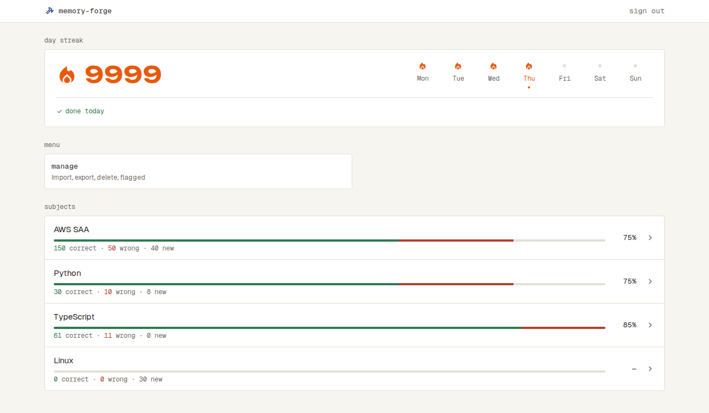
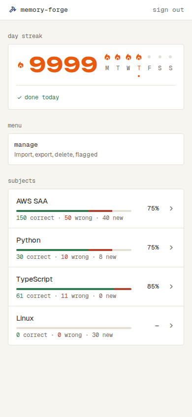

# ホーム

## 最初の画面（`/`）

- ログインしていないと見られない（`docs/specs/sign-in.md`）
- いちばん上に上のバーが出る（`docs/specs/app-bar.md`）
- 上から「day streak」「menu」「subjects」の順に並べる
- 「day streak」の見出しの下に、連続日数（下の「連続日数」）の枠を出す
  - 左に炎と日数、右に今週（月〜日）の7日を、PC でもスマホの幅でも1行に並べる。日数が4桁（9999）まで1行に収まる
  - 日数は数字だけを出し、単位は添えない
  - 今日答えた：炎が灯り、日数は flame。今日答えていない（日数が1以上）：炎は線だけで、日数は text。日数が0：炎は線だけで、日数は muted
  - 今週の7日は、日ごとに、答えた日は灯った炎、答えなかった日は border の線だけの炎、今日まだ答えていなければ flame の線だけの炎が点滅、これからの日は点を出す。下に曜日（PC は「Mon」、スマホの幅は「M」）を出し、今日の曜日は flame にして下に flame の小さな点を付ける
  - 区切り線の下に今日の様子を出す。今日答えた：success の check の印と「done today」。今日答えていない（日数が1以上）：flame の「answer today to keep the flame」。日数が0：muted の「answer a question to light the flame」
  - スマホの幅では、炎を小さくし、7日の間を詰めて右に寄せる
  - Home を開いたときの日付で出す。開いたまま日付が変わっても変わらず、開き直すと（読み直しを含む）今の日付で出る
- 連続日数を読み込んでいる間は、「day streak」の見出しの下に、連続日数の枠と同じ高さの枠を点滅させる。Subject の一覧とは別に出す
- 連続日数を読み込めなかったときは、「day streak」の見出しの下に、danger の帯「Couldn't load day streak.」と retry を出す。retry で読み直す。Subject の一覧はふつうに出す
- 「menu」の見出しの下に、枠「manage」と「Import, export, delete, flagged」を出す。PC の幅では、2列の枠の左の1枚の大きさ。押すと Manage（`docs/specs/manage.md`）に移る
- 「subjects」の見出しの下に、Subject を取り込んだ順に、枠で囲んだ行を区切り線で並べる
  - 行には、左に名前と、その下にその Subject の全部の問題の身についている具合（下の「身についている具合」の線と数）を出し、右に %、その右に chevron_right の印を出す。名前が長いときは、行の中で折り返す
  - 印の数は出さない
  - 押すと、その Subject の Setup（`docs/specs/solve.md`）に移る
- Subject が0件のときは、「subjects」の見出しの下に、点線の枠で「No subjects yet.」「Import a question file to get started.」と primary の import を出す。import を押すと Import（`docs/specs/import.md`）に移る
- Subject を読み込んでいる間は、「subjects」の見出しの下に、線と数のある Subject の行と同じ高さの枠を4つ点滅させる
- Subject を読み込めなかったときは、「subjects」の見出しの下に、danger の帯「Couldn't load subjects.」と retry を出す。retry で読み直す

| 状態 | 表示 | スクリーンショット |
| --- | --- | --- |
| 通常（Subject が1つ以上、今日答えた） | day streak の灯った炎と日数、今週の答えた日の炎、「done today」。menu の manage、subjects の Subject の行に線・数・%。まだ解いていない Linux は、線が全部 border、「0 correct · 0 wrong · 30 new」と「—」 |  |
| 通常（スマホの幅） | 炎が小さく、7日の間を詰めて右に寄せ、曜日は1文字 |  |
| 今日まだ（昨日まで続いている） | 線だけの炎と日数、今日の炎が点滅、「answer today to keep the flame」 |  |
| 連続日数が0日 | 線だけの炎と「0」（muted）、muted の「answer a question to light the flame」 |  |
| 連続日数が大きい | 4桁の日数でも、炎・日数・今週の7日が1行に収まる |   |
| Subject が多い | Subject の行が続く |  |
| Subject が0件 | menu の manage、subjects の点線の枠と import |  |

## 連続日数

Home の「day streak」で出す。

- 日の区切りは日本時間の0時。1日に1問でも答えた日を「取り組んだ日」とする
  - スキップも答えたことに数える
  - 印の付いた問題への答えは数えない（印を付ける前に答えていても）
  - Manage で問題を消しても、その問題への答えは数え続ける（消したときに印の付いていた問題への答えは数えない）
- 日数は、今日までさかのぼって取り組んだ日が何日続いているか
  - 今日答えていれば、今日を含めて数える
  - 今日まだ答えていなくても、昨日答えていれば、昨日までの日数を出す（切れない）
  - 今日も昨日も答えていなければ0
- 今週の7日では、今日より前で取り組んだ日を「答えた日」、取り組んでいない日を「答えなかった日」とする。今日は、答えていれば「答えた日」、まだなら「今日まだ」。今日より後は「これからの日」
- Solve で答えてから Home に戻ると、その答えを含めて出る

## 身についている具合

Home の Subject の行と、Setup の Topic の行（`docs/specs/solve.md`）で、同じ数え方で出す。

- 問題ごとに、最後の答えで「correct」「wrong」「new」のどれかに数える
  - 最後の答えが正解：correct。不正解かスキップ：wrong。答えた記録がない：new
- 印の付いた問題は、どれにも数えない
- 名前の下に細い線を出し、左から correct（success）・wrong（danger）・new（border）の割合で塗り分ける
- 線の下に、muted の等幅の小さな文字で「30 correct · 10 wrong · 8 new」と出す。correct の数は success、wrong の数は danger。0の項目も含めて、いつも3つを並べる
- 行の右に、等幅で「correct ÷（correct + wrong）」を整数に四捨五入した %（例：2 ÷ 3 は 67%）を、決まった幅で右にそろえて出す。correct + wrong が0のときは「—」
- 全部の問題に印が付いているときは「0 correct · 0 wrong · 0 new」と「—」にし、線は全部 border にする
- スマホの幅で数が1行に収まらないときは、折り返す
