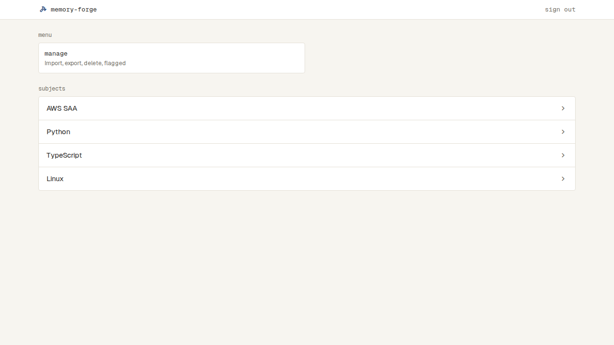
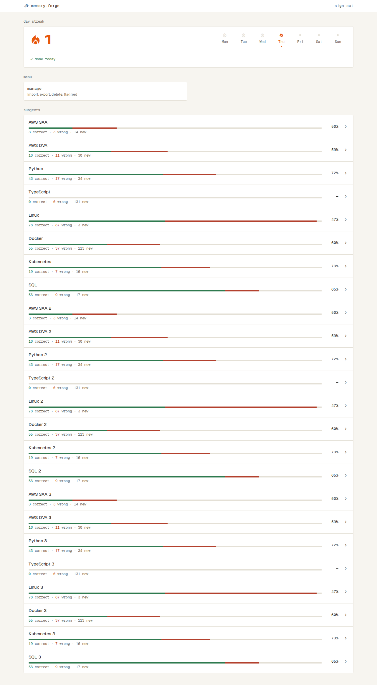
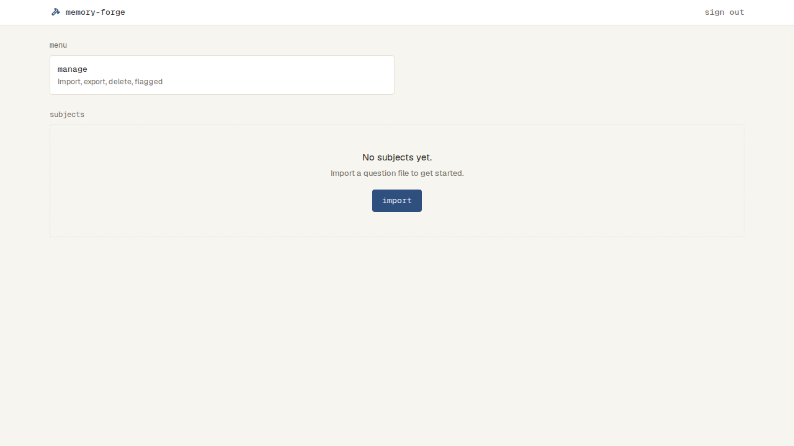

# ホーム

## 最初の画面（`/`）

- ログインしていないと見られない（`docs/specs/sign-in.md`）
- いちばん上に上のバーが出る（`docs/specs/app-bar.md`）
- 上から「menu」「subjects」の順に並べる
- 「menu」の見出しの下に、枠「manage」と「Import, export, delete, flagged」を出す。PC の幅では、2列の枠の左の1枚の大きさ。押すと Manage（`docs/specs/manage.md`）に移る
- 「subjects」の見出しの下に、Subject を取り込んだ順に、枠で囲んだ行を区切り線で並べる
  - 行には、名前と、右に chevron_right の印を出す。名前が長いときは、行の中で折り返す
  - 押すと、その Subject の Setup（`docs/specs/solve.md`）に移る
- Subject が0件のときは、「subjects」の見出しの下に、点線の枠で「No subjects yet.」「Import a question file to get started.」と primary の import を出す。import を押すと Import（`docs/specs/import.md`）に移る
- Subject を読み込んでいる間は、「subjects」の見出しの下に、Subject の行と同じ形の枠を4つ点滅させる
- Subject を読み込めなかったときは、「subjects」の見出しの下に、danger の帯「Couldn't load subjects.」と retry を出す。retry で読み直す

| 状態 | 表示 | スクリーンショット |
| --- | --- | --- |
| 通常（Subject が1つ以上） | menu の manage、subjects の Subject の行 |  |
| Subject が多い | Subject の行が続く |  |
| Subject が0件 | menu の manage、subjects の点線の枠と import |  |
