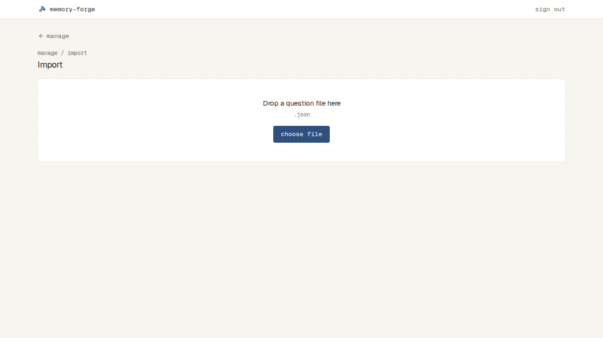
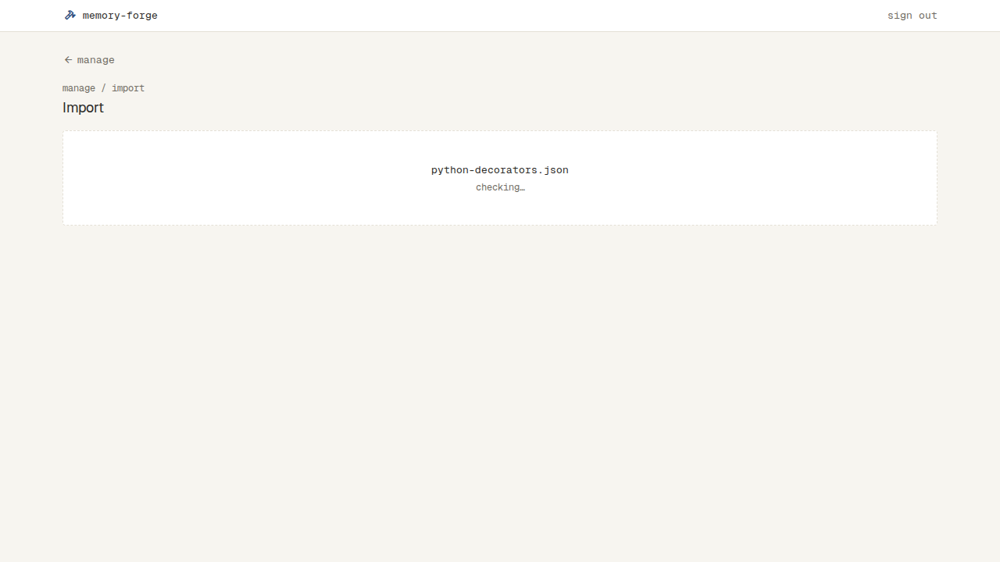
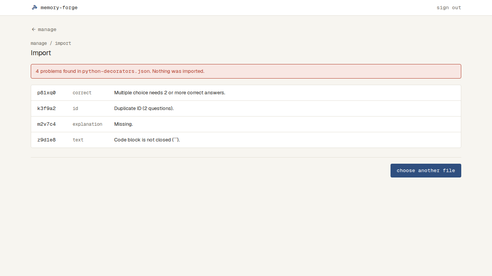
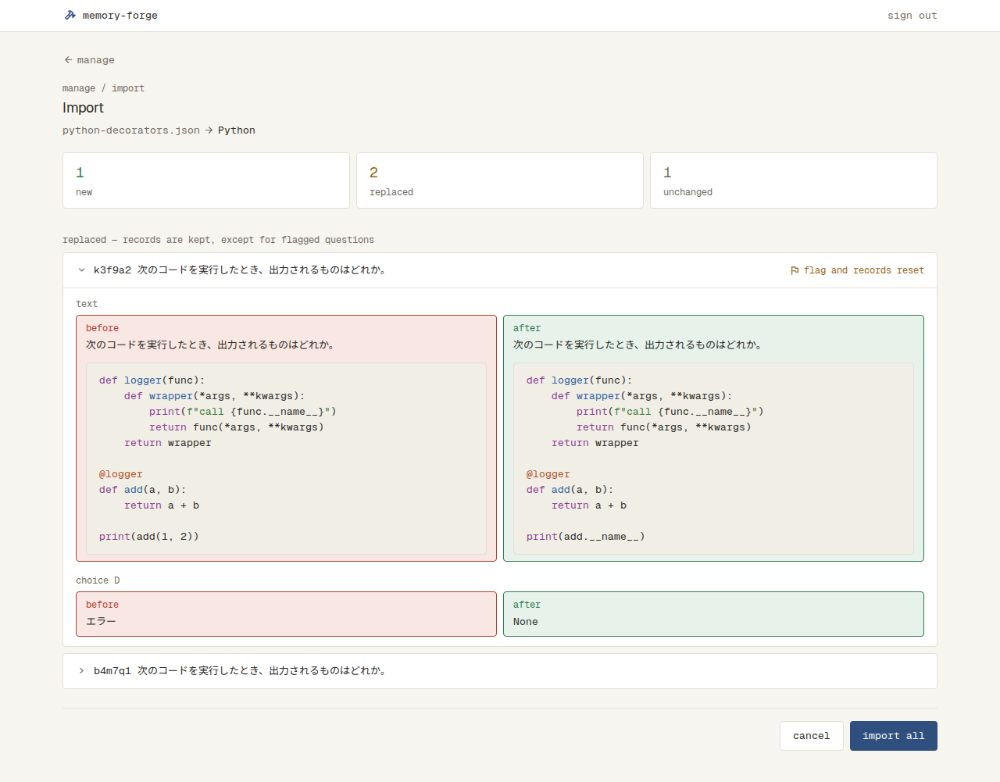
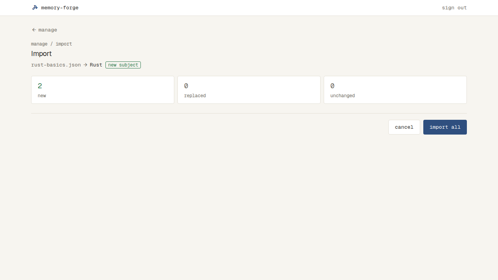
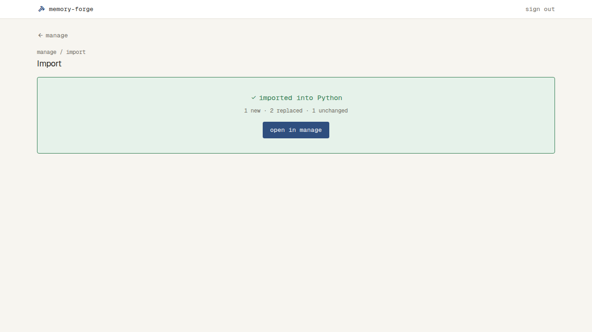
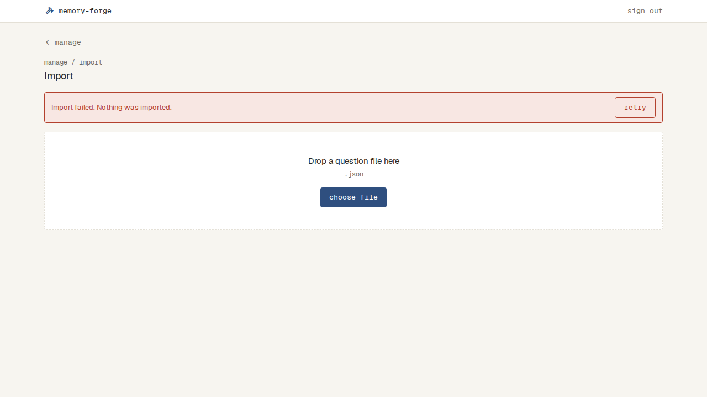

# 問題の取り込み

## 問題のファイル

- 受け付けるのは JSON のファイル。1つのファイルに書ける Subject は1つだけ

```json
{
  "subject": "Python",
  "questions": [
    {
      "id": "k3f9a2",
      "topic": "Decorators",
      "type": "single",
      "text": "次のコードを実行したとき、出力されるものはどれか。\n\n```python\n...\n```",
      "choices": ["call add", "add", "None", "エラー"],
      "correct": ["C"],
      "explanation": "..."
    }
  ]
}
```

| 項目 | 中身 |
| --- | --- |
| `subject` | Subject の名前。ファイルのいちばん上に1つだけ書く |
| `id` | 問題の ID。同じ Subject の中で重ならない |
| `topic` | Topic の名前 |
| `type` | `single`（単一選択）か `multiple`（複数選択） |
| `text` | 問題文 |
| `choices` | 選択肢の文の並び（2〜8つ）。並び順に A・B・C… の記号になる |
| `correct` | 正解の選択肢の記号（A〜H）の並び。単一選択は1つ、複数選択は2つ以上 |
| `explanation` | 解説 |

- 前後の空白だけのものは、空とみなす。それ以外は、書かれたまま（空白も含めて）取り込み、比べる
- 決まった項目のほかに書かれた項目は、誤りにせず、取り込まない

## ファイルの確かめ

- 次のどれかに当たると誤りとし、何も取り込まない
  - ファイルの中に、同じ ID の問題が2つ以上ある（取り込み済みの問題と同じ ID なのは誤りではなく、「同じ問題」として置き換える）
  - 決まった項目がない、または空
  - 正解が選択肢の中にない。単一選択で正解が1つでない。複数選択で正解が2つ以上でない。正解に同じ記号が2回以上ある
  - 選択肢が2つより少ない、または8つより多い
  - コードブロックの書き方が崩れている（問題文・選択肢・解説の中で、``` の開きと閉じが対になっていない。言語の名前は確かめない）
  - ファイルの形が決まった形でない（JSON として読めない、項目の形が違う、Subject が2つ以上ある）
  - 問題が0問。問題が1,000問より多い（1,000問ちょうどは取り込める）
  - ファイルが 4MB（4 × 1024 × 1024 バイト）より大きい（4MB ちょうどは取り込める）。大きすぎるファイルは、送らずに誤りにする
- 誤りがあると、danger の帯で、誤りの数と、何も取り込んでいないことを出す。その下に、誤りごとに、問題（ID）・項目・内容を1行ずつ、全部を出す
  - ファイル全体の誤りは、ID の列に「—」を出す
  - ID が書かれていない問題は、ID の列に何問目か（`#3` など）を出す
  - 誤りの数は、1つのときは単数（「1 problem found in …」）、2つ以上は複数（「4 problems found in …」）

| 誤り | 項目 | 内容 |
| --- | --- | --- |
| 項目がない・空 | その項目 | Missing. |
| ID が重なる | id | Duplicate ID (2 questions). |
| 複数選択で正解が2つ未満 | correct | Multiple choice needs 2 or more correct answers. |
| 単一選択で正解が1つでない | correct | Single choice needs exactly 1 correct answer. |
| 正解が選択肢にない | correct | Not one of the choices (E). |
| 選択肢の数 | choices | Needs 2 to 8 choices. |
| 種類が違う | type | Must be single or multiple. |
| コードブロックが閉じていない | text・choice B・explanation | Code block is not closed (\`\`\`). |
| 項目の形が違う（文字でない、など） | その項目 | Wrong format. |
| 正解に同じ記号が2回以上ある | correct | Wrong format. |
| 問題がオブジェクトでない | question | Wrong format. |
| ファイル全体がオブジェクトでない | file | Wrong format. |
| JSON として読めない | file | Not valid JSON. |
| 大きすぎる | file | Too large. Up to 4 MB. |
| 問題が多すぎる | questions | Too many questions (1,200). Up to 1,000. |
| 問題が0問 | questions | No questions. |

## 取り込む前の確認

- 誤りがなければ、取り込む前の確認を出す。この時点では、まだ何も変わっていない
- ファイル名と Subject の名前を出す。まだない Subject なら、「new subject」と添える
- 増える問題・置き換わる問題・変わらない問題の数を出す
  - 増える：その Subject に、同じ ID の問題がない
  - 置き換わる：同じ ID の問題があり、中身（Topic、問題の種類、問題文、選択肢、正解、解説のどれか）が違う。Topic だけが違う問題も、置き換わる
  - 変わらない：同じ ID の問題があり、中身がすべて同じ
- 置き換わる問題の見出しは「replaced — records are kept, except for flagged questions」。印の付いた問題が置き換わるときは、その問題の行の右に、warning の flag の印と文字で「flag and records reset」と出す
- 置き換わる問題ごとに、変わった項目（topic・type・text・choice A〜H・correct・explanation）の前と後を出す。正解は「A, C」のように出す。選択肢の数が変わったときは、ない側を空にする
- import all を押すと、全部を取り込み、取り込んだという知らせを出す。知らせの open in manage で Manage に移る
- cancel を押すと、ファイルを選ぶところに戻る。何も変わらない

## 取り込んだあと

- 増える問題が足され、置き換わる問題は新しい中身になる。変わらない問題はそのまま
- 置き換わった印の付いた問題は、印が消え、その問題の記録も消える。変わらない印の付いた問題は、印も記録もそのまま
- ファイルにない、取り込み済みの問題は、消えずに残る
- 取り込み先の Subject は、ファイルに書いた Subject で決まる。まだなければ新しくできる。Subject が違えば、ID が同じでも別の問題
- 問題が1つもなくなった Topic は消える
- 取り込みは、全部が入るか、何も入らないかのどちらか
- 確かめ中や取り込む前の確認のときに、ほかの画面へ移ったりページを閉じたりしても、何も変わらない

## Import（`/manage/import`）

- ログインしていないと見られない（`docs/specs/sign-in.md`）。いちばん上に上のバーが出る（`docs/specs/app-bar.md`）
- 上に、戻るリンク（manage。Manage へ）、パンくず（manage / import）、見出し「Import」を置く
- choose file でファイルを選ぶか、点線の枠にファイルを落とすと、確かめが始まる。確かめている間は、別のファイルを選べない
- 誤りの一覧の choose another file で、ファイルを選ぶところに戻る
- 増える・置き換わる・変わらない数は、3つの枠に横に並べ、増えるは success、置き換わるは warning（0なら muted）、変わらないは muted の数字にする
- 置き換わる問題は、1問ずつ開閉する行にする。行には ID と問題文の1行目を出し、開くと、変わった項目ごとに、前（danger の枠）と後（success の枠）を横に並べる（スマホの幅では縦）。最初の1問だけを開いておく
- 確かめや取り込みの途中で、つながらないなどのサーバーのエラーが起きたら、danger の帯と retry を出し、何も変えない。retry は、最後に失敗した操作（確かめ・取り込み）を同じ中身でやり直す

| 状態 | 表示 | スクリーンショット |
| --- | --- | --- |
| ファイルを選ぶ | 点線の枠の中に「Drop a question file here」「.json」と choose file |  |
| 確かめ中 | 点線の枠の中に、ファイル名と、点滅する「checking…」。choose file は出さない |  |
| 誤り | danger の帯「4 problems found in python-decorators.json. Nothing was imported.」、誤りの一覧（ID・項目・内容）、choose another file |  |
| 取り込む前の確認 | 「python-decorators.json → Python」、new・replaced・unchanged の数、「replaced — records are kept, except for flagged questions」の見出しと置き換わる問題（印付きの行の右に「flag and records reset」）、cancel と import all |  |
| 取り込む前の確認（まだない Subject） | Subject の名前の右に、success の枠の「new subject」。置き換わる問題がなければ、一覧は出さない |  |
| 取り込み中 | import all の文字が「importing…」になって押せない。cancel も押せない | |
| 取り込んだ | success の枠に「imported into Python」と数（1 new · 2 replaced · 1 unchanged など）、open in manage |  |
| サーバーのエラー | danger の帯「Import failed. Nothing was imported.」と retry。その下にファイルを選ぶところ |  |
