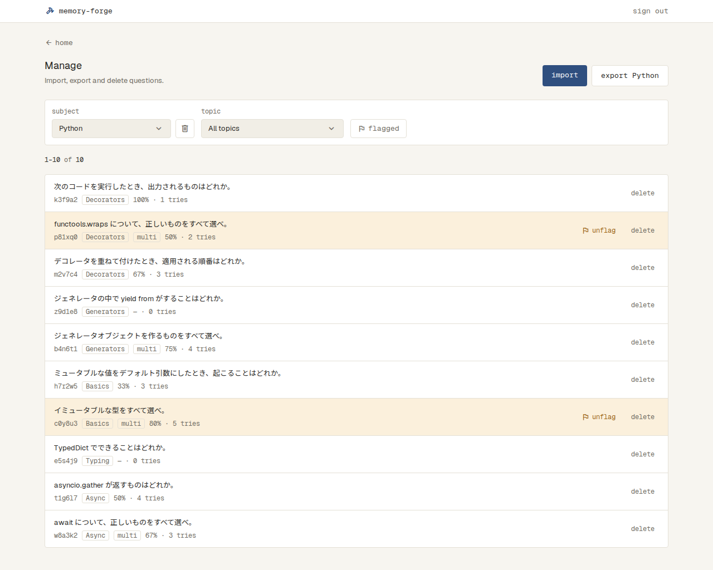

# 問題の管理

## Manage（`/manage`）

- ログインしていないと見られない（`docs/specs/sign-in.md`）。いちばん上に上のバーが出る（`docs/specs/app-bar.md`）
- 上に、戻るリンク（home。Home へ）、見出し「Manage」と「Import, export and delete questions.」を置く
- 右に primary の import。押すと Import（`docs/specs/import.md`）に移る
- 問題の一覧・書き出し・削除は、まだない

| 状態 | 表示 | スクリーンショット |
| --- | --- | --- |
| 通常 | 戻るリンク、見出しと説明、右に import |  |
