# 問題の管理

## Manage（`/manage`）

- ログインしていないと見られない（`docs/specs/sign-in.md`）。いちばん上に上のバーが出る（`docs/specs/app-bar.md`）
- 上に、戻るリンク（home。Home へ）、見出し「Manage」と「Import, export and delete questions.」を置く
- 右に primary の import と、枠だけの export <Subject の名前>（例：export Python）を並べる。import を押すと Import（`docs/specs/import.md`）に移る
  - 最初に開いて読み込んでいる間、読み込めなかったとき、Subject が0件のときは、export を出さない

## 一覧

- 上の下に、surface の枠の中に subject と topic のプルダウン（見出しは muted の等幅の小さな文字）を横に並べる。スマホの幅では縦に並べる
- Subject のプルダウンで Subject を選び、Topic のプルダウンで All topics か Topic を1つ選ぶと、その問題が一覧に並ぶ
  - プルダウンの一覧の行には、名前と問題数を出す。選んでいる行は primary-soft の地と primary の文字で、左に check の印。All topics は一番上で、ほかと区切り線で分ける
  - Subject は取り込んだ順に、Topic は Setup と同じ順（その Topic の問題が最初に出てくる順）に並べる
  - 行が多いときは、一覧の高さを止めて中をスクロールする
  - 選ぶ・Esc・外側を押すと閉じる
- 一覧は50問ずつのページに分ける。絞り込みと一覧の間に、左に「151–200 of 480」、右に前後のボタンとページの番号を出す（`docs/ui.md` の「ページ」）
  - 番号は、最初・最後・今のページの前後だけを出し、間は「…」にする
  - スマホの幅では番号を出さず、前後のボタンの間に「4 / 10」と出す
  - 1ページで収まるときは、前後のボタンと番号を出さない
- 開いたときは、取り込んだ順で最初の Subject と All topics、1ページ目を選んでいる
- Subject を変えると、All topics と1ページ目に戻る。Topic を変えると、1ページ目に戻る
- 読み込み直したときや、ほかの画面から戻ったときは、選んでいた Subject・Topic・ページのまま
  - 選んでいた Subject がなくなっていたら、最初の Subject と All topics、1ページ目にする
  - 選んでいた Topic がなくなっていたら、All topics と1ページ目にする
  - 選んでいたページがなくなっていたら、最後のページを出す
- 選び方を変えている間は、一覧の場所に、行と同じ形の枠を6つ点滅させる
- 問題は取り込んだ順に並べる。行には、問題文の1行目（長いときは「…」で切る）と、その下に muted の等幅で ID、枠で囲んだ Topic、枠で囲んだ「multi」（複数選択のときだけ）、問題ごとの正答率（整数に四捨五入）と解いた回数（「75% · 3 tries」）を出す。まだ解いていない問題は「— · 0 tries」
- 行を押しても、問題の中身は開かない
- Subject が0件のときは、点線の枠で「No subjects yet.」「Import a question file to get started.」を出す（Import へは、上の import で移る）。プルダウンと一覧は出さない
- 読み込めなかったときは、danger の帯「Couldn't load questions.」と retry を出す。retry で、同じ選び方をもう一度読み込む

## 書き出し

- export <Subject の名前> で、選んでいる Subject の全部の問題を、1つのファイルに保存する。Topic で絞っていても、Subject の全部を書き出す
- ファイルの名前は、Subject の名前を小文字にし、空白とファイル名に使えない記号（`\ / : * ? " < > |` と制御文字）を「-」にしたもの（Python → python.json、Web API → web-api.json）
  - 続く「-」は1つにまとめ、頭と終わりの「-」は除く（C++ / Rust → c++-rust.json）
  - それで名前が空になるときは subject.json
- ファイルには、取り込むファイル（`docs/specs/import.md` の「問題のファイル」）と同じ項目だけを入れる（記録は入れない）。問題は取り込んだ順
- 書き出したファイルは、そのまま Import で取り込み直せる。取り込み直すと、全部「変わらない」になる
  - 取り込み直せるのは、Import の上限（1,000問・4MB）までの Subject。上限を超える Subject も、止めずに書き出す
- 書き出せなかったときは、絞り込みの下に danger の帯「Couldn't export Python.」を出す（retry は置かない）。もう一度書き出せたときと、選び方を変えたときに消える

## 削除

- Subject のプルダウンのすぐ右の、delete の印だけの枠のボタンで、その Subject を消す。Topic のプルダウンのすぐ右の同じボタンで、その Topic を消す（All topics のときは、ボタンを出さない）。指を乗せると danger の色
- 問題の行の右の「delete」（muted の等幅の文字だけのボタン。指を乗せると danger の文字と danger-soft の地）で、その1問を消す
- 消す前に、確認のダイアログを出す。右下に cancel（枠だけ）と delete（danger の地）。cancel と Esc ではそのまま、delete で消える
  - Subject：「Delete “Python”?」「5 topics, 480 questions and their records will be deleted. This can't be undone.」
  - Topic：「Delete “Typing”?」「12 questions and their records will be deleted. This can't be undone.」
  - 1問：「Delete this question?」、その下に問題文の1行目（長いときは折り返して全部出す）、「Its records will be deleted too. This can't be undone.」
  - 数が1のときは単数にする（「1 topic, 1 question and its records will be deleted.」）
- 消した問題の記録も一緒に消える
- 消したものは、一覧・Home・Setup から消える。問題が1つもなくなった Topic と Subject も消える
- 消したあと（消したことの知らせは出さない）
  - Subject を消したら、次の Subject の All topics、1ページ目を出す。最後の Subject を消したら前の Subject。Subject が1つもなくなったら0件の表示
  - 最後の Topic や最後の1問を消して Subject ごと消えたときも、Subject を消したときと同じ
  - Topic を消したら、All topics の1ページ目を出す。Topic の最後の1問を消して Topic がなくなったときも同じ
  - 1問を消して今のページが空になったら、前のページを出す
- delete を押してから消え終わるまでは、cancel と delete を押せず、Esc でも閉じない
- 消せなかったときは、ダイアログを閉じずに、ボタンの上に danger の帯「Couldn't delete.」を出し、何も消さない。帯は、閉じて開き直したときと、もう一度 delete を押したときに消える
- 別のタブで消していて、消すものがもうないときは、消せたのと同じに扱う

| 状態 | 表示 | スクリーンショット |
| --- | --- | --- |
| 通常 | Python・All topics の1ページ目 |  |
| Subject を開く | Subject のプルダウンを開いたところ | 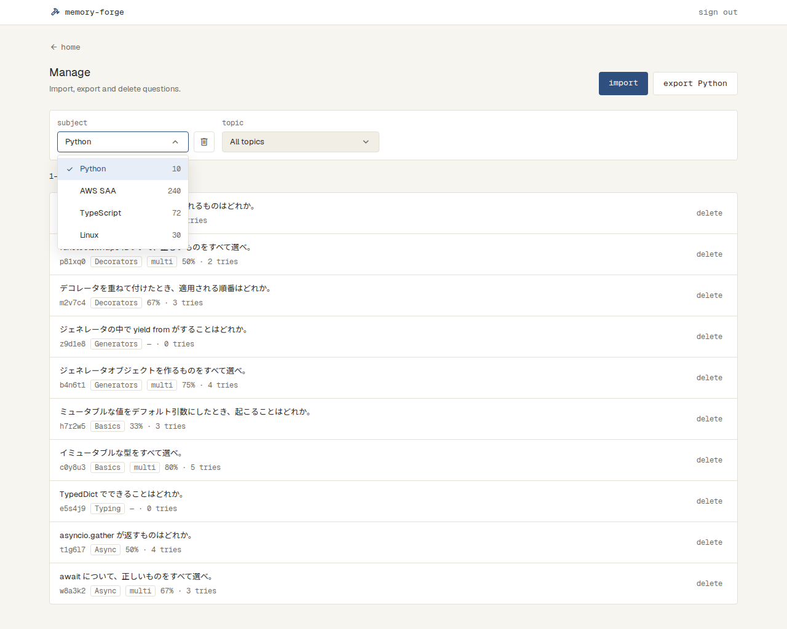 |
| Topic を開く | Topic のプルダウンを開いたところ（Decorators を選んでいる） | 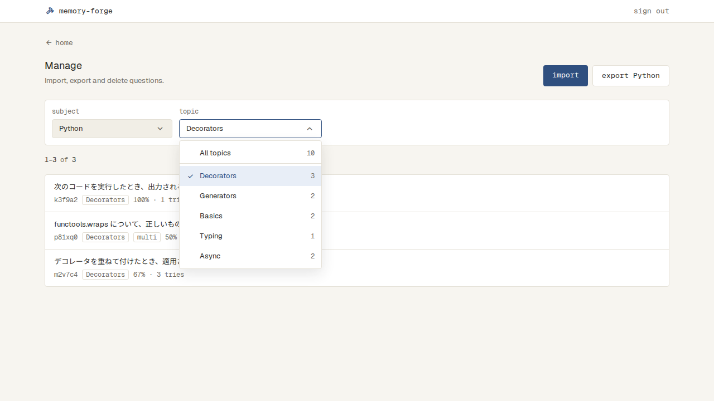 |
| Topic が多い | プルダウンの一覧の高さを止め、中をスクロールする | 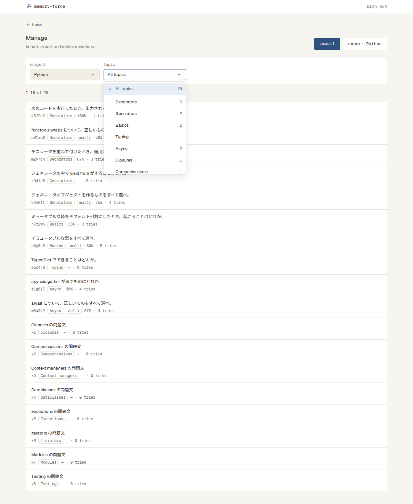 |
| Subject が0件 | 点線の枠。export とプルダウンは出さない | 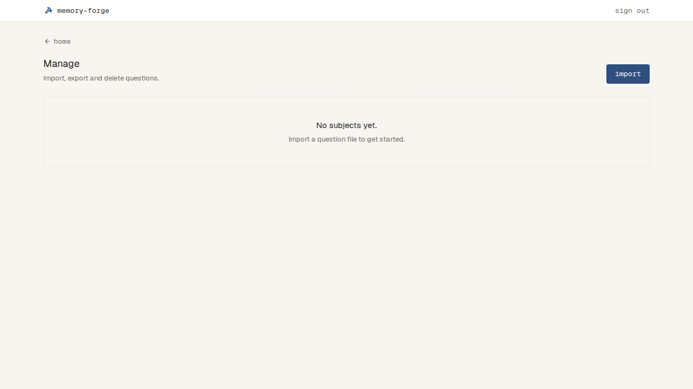 |
| 問題が多い | 480問の4ページ目。「151–200 of 480」とページの番号 | 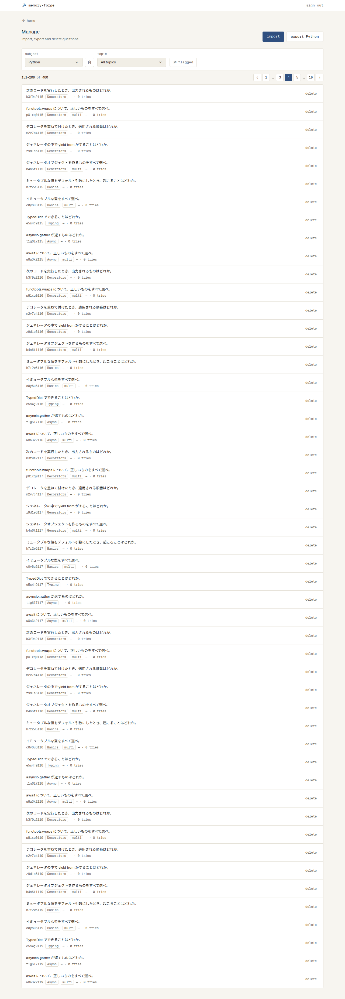 |
| 問題が多い（スマホの幅） | 番号を出さず、前後のボタンの間に「4 / 10」 | 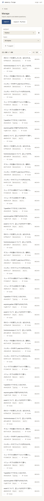 |
| 読み込み中 | 行と同じ形の枠を点滅させる | 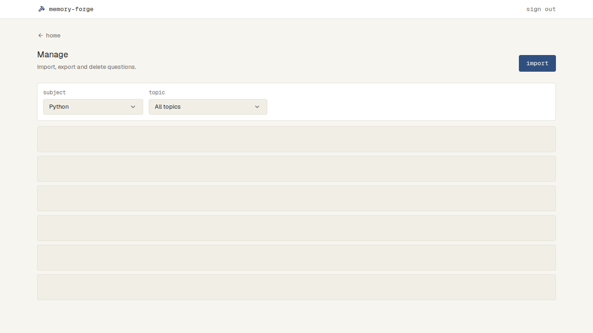 |
| 読み込めない | danger の帯「Couldn't load questions.」と retry | 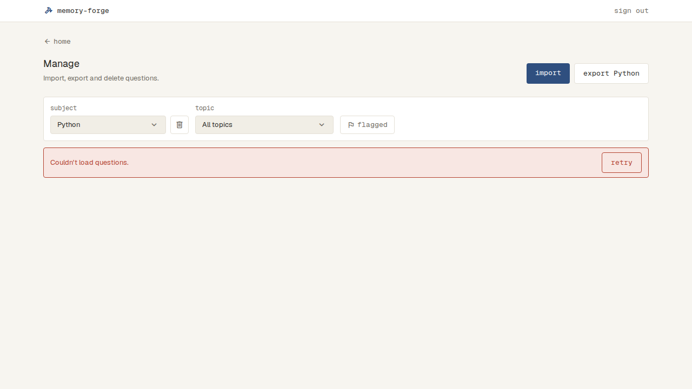 |
| 書き出せない | 絞り込みの下に danger の帯「Couldn't export Python.」 | 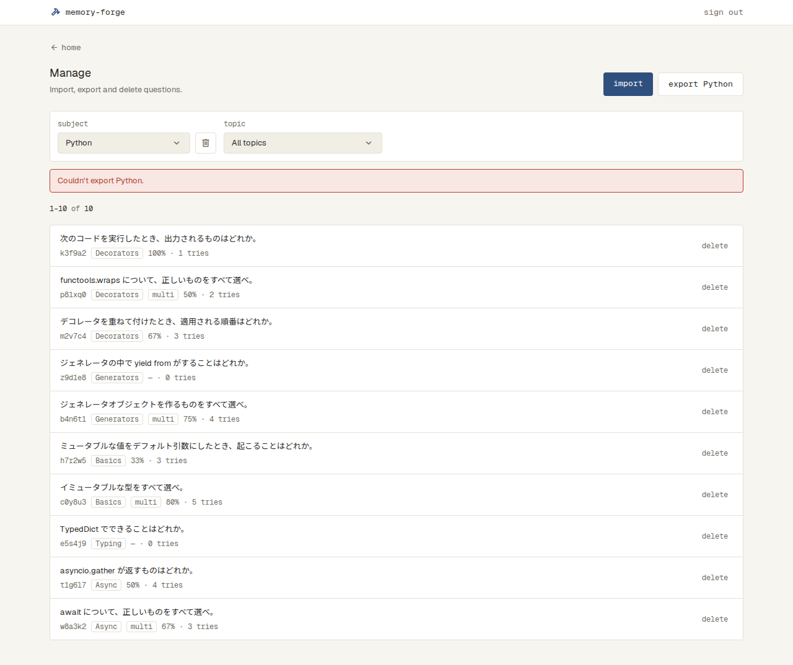 |
| 1問を消す | 確認のダイアログ。問題文の1行目を出す | 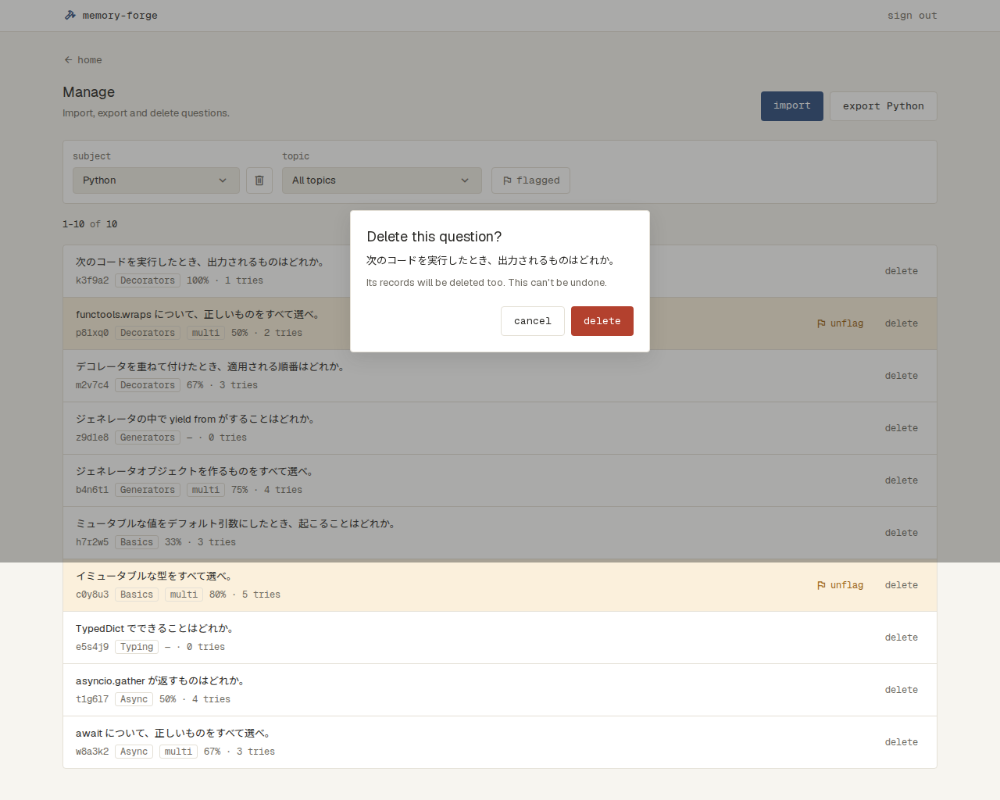 |
| Topic を消す | 確認のダイアログ | 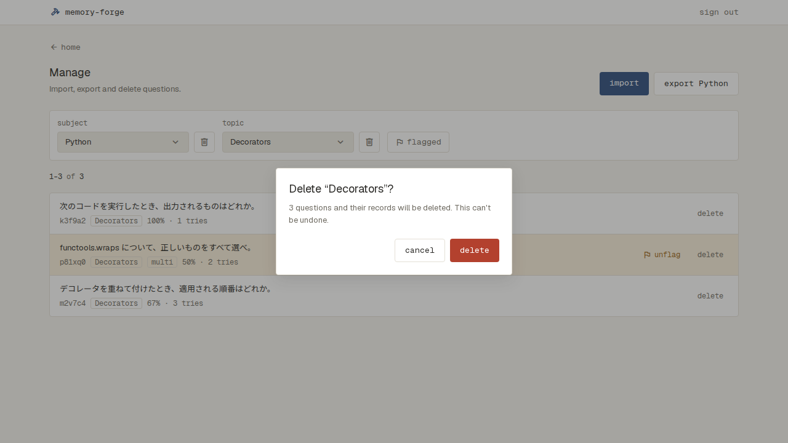 |
| Subject を消す | 確認のダイアログ | 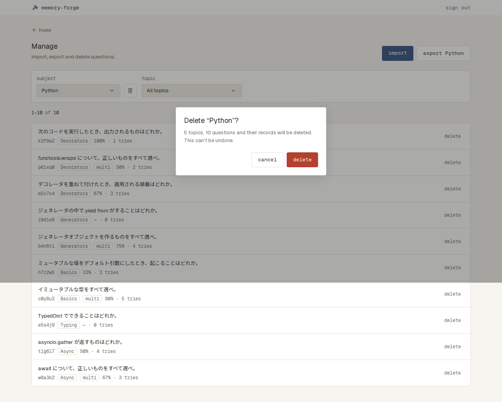 |
| 消せない | ダイアログの中に danger の帯「Couldn't delete.」 | 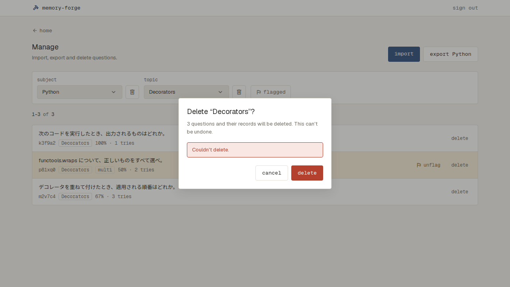 |
