# 問題の管理

## Manage（`/manage`）

- ログインしていないと見られない（`docs/specs/sign-in.md`）。いちばん上に上のバーが出る（`docs/specs/app-bar.md`）
- 上に、戻るリンク（ホームへ戻る。Home へ）、見出し「問題の管理」と「問題の取り込み・書き出し・削除をします。」を置く
- 右に accent の「取り込む」と、枠だけの「<Subject の名前> を書き出す」（例：Python を書き出す）を並べる。取り込むを押すと Import（`docs/specs/import.md`）に移る
  - 不備の印の一覧を見ている間は、「<Subject の名前> の不備の印を書き出す」（例：Python の不備の印を書き出す）にする
  - 最初に開いて読み込んでいる間、読み込めなかったとき、Subject が0件のとき、不備の印の一覧で Subject に印の付いた問題がないときは、書き出すを出さない

## 一覧

- 上の下に、bg の枠の中に 科目と Topic のプルダウン（見出しは muted の小さな文字）を横に並べる。スマホの幅では縦に並べる
- Subject のプルダウンで Subject を選び、Topic のプルダウンで すべての Topic か Topic を1つ選ぶと、その問題が一覧に並ぶ
  - プルダウンの一覧の行には、名前と問題数を出す。印の付いた問題があれば、問題数の左に warning の flag の印と数を出す。選んでいる行は accent-soft の地と accent の文字で、左に check の印。すべての Topic は一番上で、ほかと区切り線で分ける
  - Subject は取り込んだ順に、Topic は Setup と同じ順（その Topic の問題が最初に出てくる順）に並べる
  - 行が多いときは、一覧の高さを止めて中をスクロールする
  - 選ぶ・Esc・外側を押すと閉じる
- Topic のプルダウン（と削除）の右に、「不備の印」のボタン（枠だけ。muted の文字と flag の印）を置く。スマホの幅では、Topic のプルダウンの下の行に左寄せで置く
  - 押すと、印の付いた問題だけの一覧になり、もう一度押すと戻る。押している間は、warning の枠・warning-soft の地・warning の文字
  - 押すと1ページ目に戻る。Topic と組み合わせて絞れる（Decorators の印の付いた問題だけ）
  - 不備の印の一覧が0件のときは、一覧の場所に実線の枠で「Python に不備の印の付いた問題はありません。」を出す。Topic で絞っているときは「Decorators に不備の印の付いた問題はありません。」
- 一覧は50問ずつのページに分ける。絞り込みと一覧の間に、左に「480問中 151–200」、右に前後のボタンとページの番号を出す（`docs/ui.md` の「ページ」）
  - 番号は、最初・最後・今のページの前後だけを出し、間は「…」にする
  - スマホの幅では番号を出さず、前後のボタンの間に「4 / 10」と出す
  - 1ページで収まるときは、前後のボタンと番号を出さない
- 開いたときは、取り込んだ順で最初の Subject と すべての Topic、1ページ目を選んでいる
- Subject を変えると、すべての Topic と1ページ目に戻り、不備の印の絞り込みが外れる。Topic を変えると、1ページ目に戻る（不備の印の絞り込みはそのまま）
- 読み込み直したときや、ほかの画面から戻ったときは、選んでいた Subject・Topic・ページ・不備の印の絞り込みのまま
  - 選んでいた Subject がなくなっていたら、最初の Subject と すべての Topic、1ページ目にし、不備の印の絞り込みを外す
  - 選んでいた Topic がなくなっていたら、すべての Topic と1ページ目にする（不備の印の絞り込みはそのまま）
  - 選んでいたページがなくなっていたら、最後のページを出す
- 選び方（不備の印の絞り込みを含む）を変えている間は、一覧の場所に、行と同じ形の枠を6つ点滅させる
- 問題は取り込んだ順に並べる。行には、問題文の1行目（長いときは「…」で切る）と、その下に muted の文字で ID、枠で囲んだ Topic、枠で囲んだ「すべて選ぶ」（複数選択のときだけ）、問題ごとの正答率（整数に四捨五入）と解いた回数（「75% · 3回」）を出す。まだ解いていない問題は「— · 0回」
- 印の付いた問題の行は、不備の印の一覧でもふつうの一覧でも、warning-soft の地にし、削除の左に「印を外す」（flag の印と warning の文字）を出す
- 行を押しても、問題の中身は開かない
- 一覧の行と削除の確認のダイアログに出す問題文の1行目は、Markdown として表示せず、ファイルに書かれた文字のまま出す
- Subject が0件のときは、実線の枠で「まだ科目がありません。」「問題のファイルを取り込むと、ここに科目が並びます。」を出す（Import へは、上の取り込むで移る）。プルダウンと一覧は出さない
- 読み込めなかったときは、danger の帯「問題を読み込めませんでした。」と「もう一度読み込む」を出す。もう一度読み込むで、同じ選び方をもう一度読み込む

## 印を外す

- 印を外すで、その場で印が外れる。外しても記録は変わらない
  - ふつうの一覧では、行の地が戻り、印を外すが消える
  - 不備の印の一覧では、行が消える。今のページが空になったら前のページ、全部外したら0件の表示
- 外せなかったときは、絞り込みの下に danger の帯「k3f9a2 の印を外せませんでした。」（その問題の ID。もう一度読み込むは置かない）を出し、印は残す。もう一度外せたときと、選び方を変えたときに消える

## 書き出し

- <Subject の名前> を書き出すで、選んでいる Subject の全部の問題を、1つのファイルに保存する。Topic で絞っていても、Subject の全部を書き出す
- <Subject の名前> の不備の印を書き出すで、Subject の印の付いた問題を全部、1つのファイルに保存する。Topic で絞っていても、Subject の全部の印の付いた問題を書き出す。ファイルの名前と形は、<Subject の名前> を書き出すと同じ
- ファイルの名前は、Subject の名前を小文字にし、空白とファイル名に使えない記号（`\ / : * ? " < > |` と制御文字）を「-」にしたもの（Python → python.json、Web API → web-api.json）
  - 続く「-」は1つにまとめ、頭と終わりの「-」は除く（C++ / Rust → c++-rust.json）
  - それで名前が空になるときは subject.json
- ファイルには、取り込むファイル（`docs/specs/import.md` の「問題のファイル」）と同じ項目だけを入れる（記録は入れない）。問題は取り込んだ順
- 書き出したファイルは、そのまま Import で取り込み直せる。取り込み直すと、全部「変わらない」になる
  - 取り込み直せるのは、Import の上限（1,000問・4MB）までの Subject。上限を超える Subject も、止めずに書き出す
- 書き出せなかったときは（不備の印を書き出すでも）、絞り込みの下に danger の帯「Python を書き出せませんでした。」を出す（もう一度読み込むは置かない）。もう一度書き出せたときと、選び方を変えたときに消える

## 削除

- Subject のプルダウンのすぐ右の、削除の印（ごみ箱）だけの枠のボタン（読み上げの名前は「科目を削除」「Topic を削除」）で、その Subject を消す。Topic のプルダウンのすぐ右の同じボタンで、その Topic を消す（すべての Topic のときは、ボタンを出さない）。指を乗せると danger の色
- 問題の行の右の「削除」（muted の文字だけのボタン。指を乗せると danger の文字と danger-soft の地）で、その1問を消す
- 消す前に、確認のダイアログを出す。右下に「やめる」（枠だけ）と「削除する」（danger の地）。やめると Esc ではそのまま、削除するで消える
  - Subject：「「Python」を削除しますか？」「5 の Topic と 480 問、その記録を削除します。元に戻せません。」
  - Topic：「「Typing」を削除しますか？」「12問と、その記録を削除します。元に戻せません。」（不備の印の一覧でも、Topic の全部の問題の数）
  - 1問：「この問題を削除しますか？」、その下に問題文の1行目（長いときは折り返して全部出す）、「この問題の記録も削除します。元に戻せません。」
- 消した問題の記録も一緒に消える。ただし、Home の連続日数には、消した問題に答えた日も数え続ける（消したときに印の付いていた問題は数えない）
- 消したものは、一覧・Home・Setup から消える。問題が1つもなくなった Topic と Subject も消える
- 消したあと（消したことの知らせは出さない）
  - Subject を消したら、次の Subject の すべての Topic、1ページ目を出す。最後の Subject を消したら前の Subject。Subject が1つもなくなったら0件の表示
  - 最後の Topic や最後の1問を消して Subject ごと消えたときも、Subject を消したときと同じ
  - Topic を消したら、すべての Topic の1ページ目を出す（不備の印の一覧なら、そのまま）。Topic の最後の1問を消して Topic がなくなったときも同じ
  - 1問を消して今のページが空になったら、前のページを出す
- 削除するを押してから消え終わるまでは、やめると削除するを押せず、Esc でも閉じない
- 消せなかったときは、ダイアログを閉じずに、ボタンの上に danger の帯「削除できませんでした。」を出し、何も消さない。帯は、閉じて開き直したときと、もう一度削除するを押したときに消える
- 別のタブで消していて、消すものがもうないときは、消せたのと同じに扱う

| 状態 | 表示 | スクリーンショット |
| --- | --- | --- |
| 通常 | Python・すべての Topic の1ページ目。印の付いた行は warning-soft の地と印を外す、絞り込みの右に不備の印 | 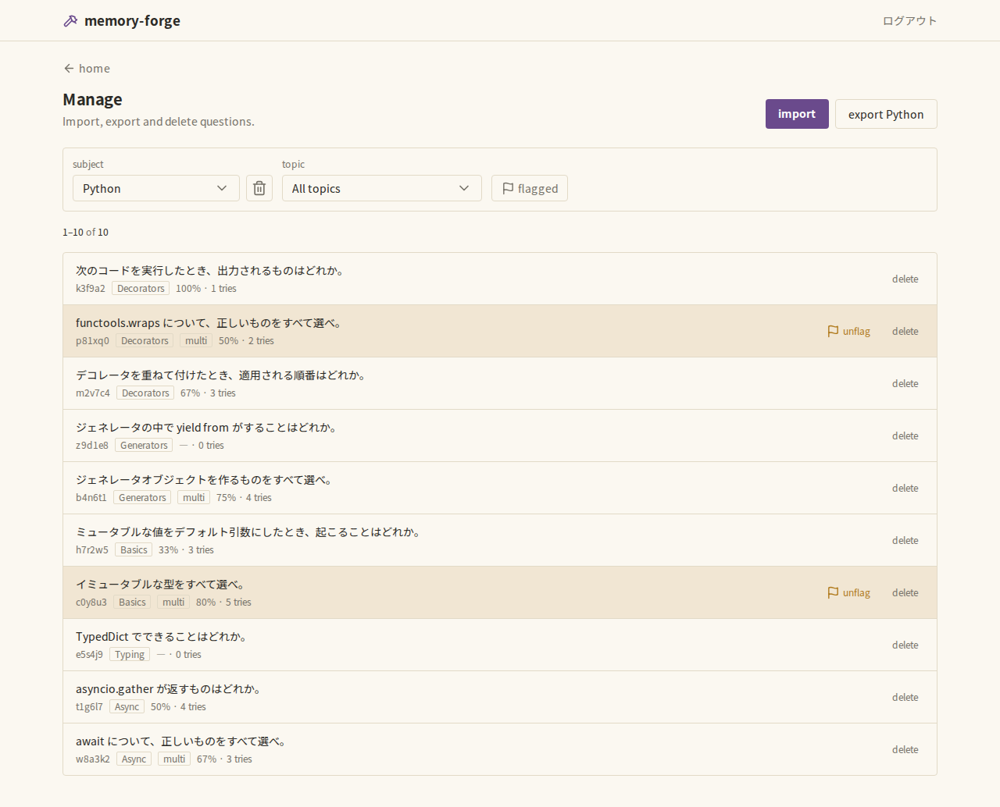 |
| Subject を開く | Subject のプルダウンを開いたところ。行に印の数 | 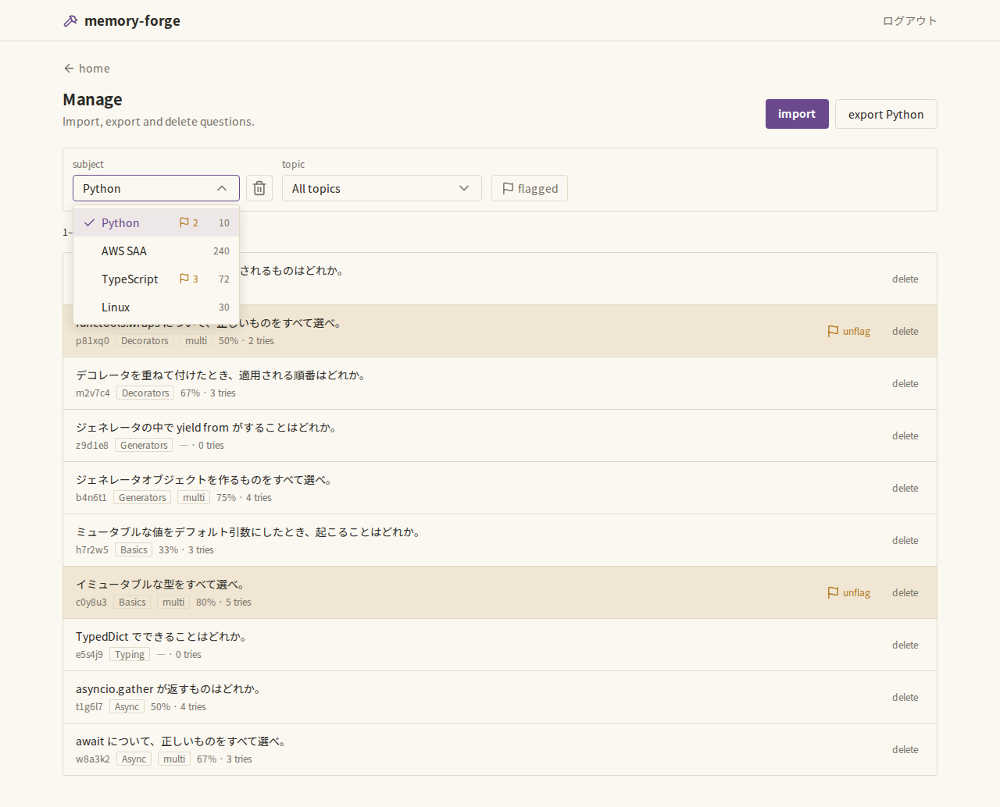 |
| Topic を開く | Topic のプルダウンを開いたところ（Decorators を選んでいる）。行に印の数 | 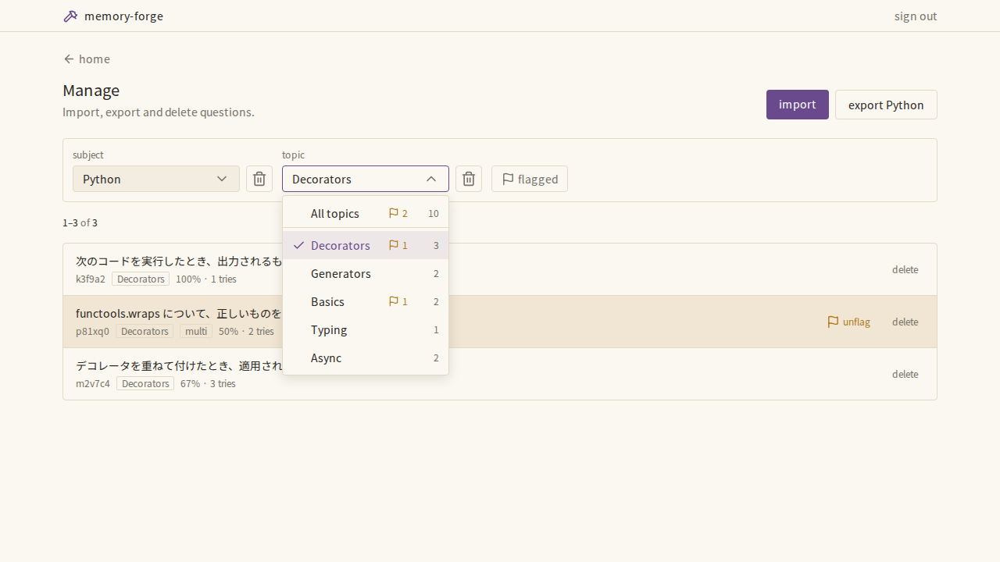 |
| 不備の印 | 印の付いた問題だけ。Python の不備の印を書き出す | 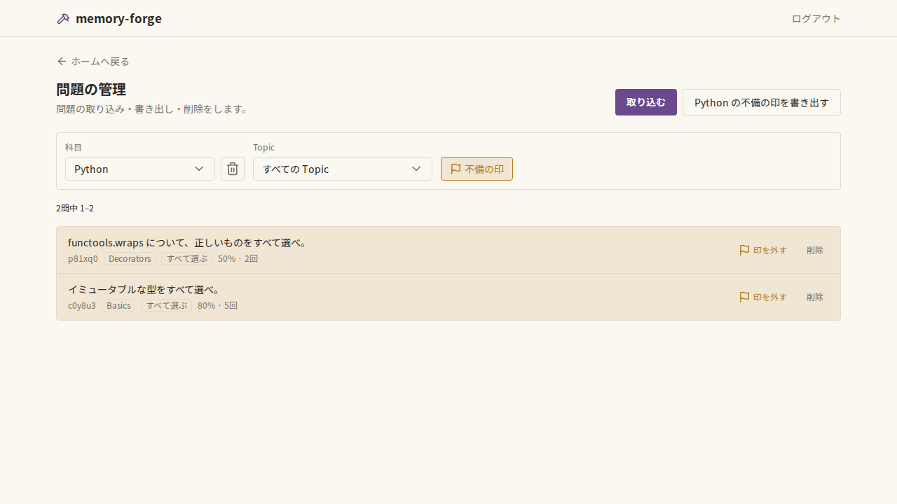 |
| 不備の印が0件 | 実線の枠「Python に不備の印の付いた問題はありません。」。書き出すは出さない | 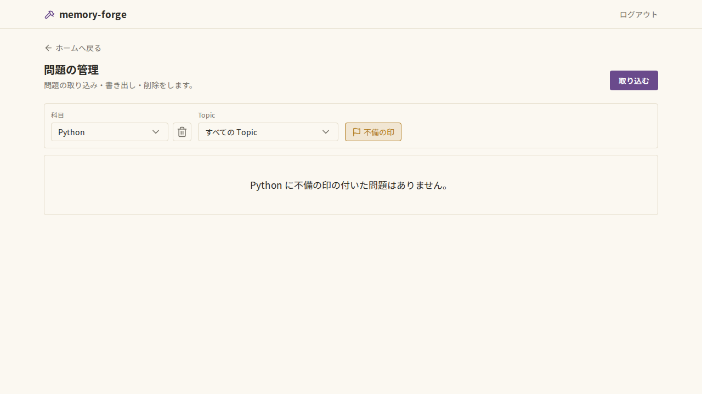 |
| Topic が多い | プルダウンの一覧の高さを止め、中をスクロールする | 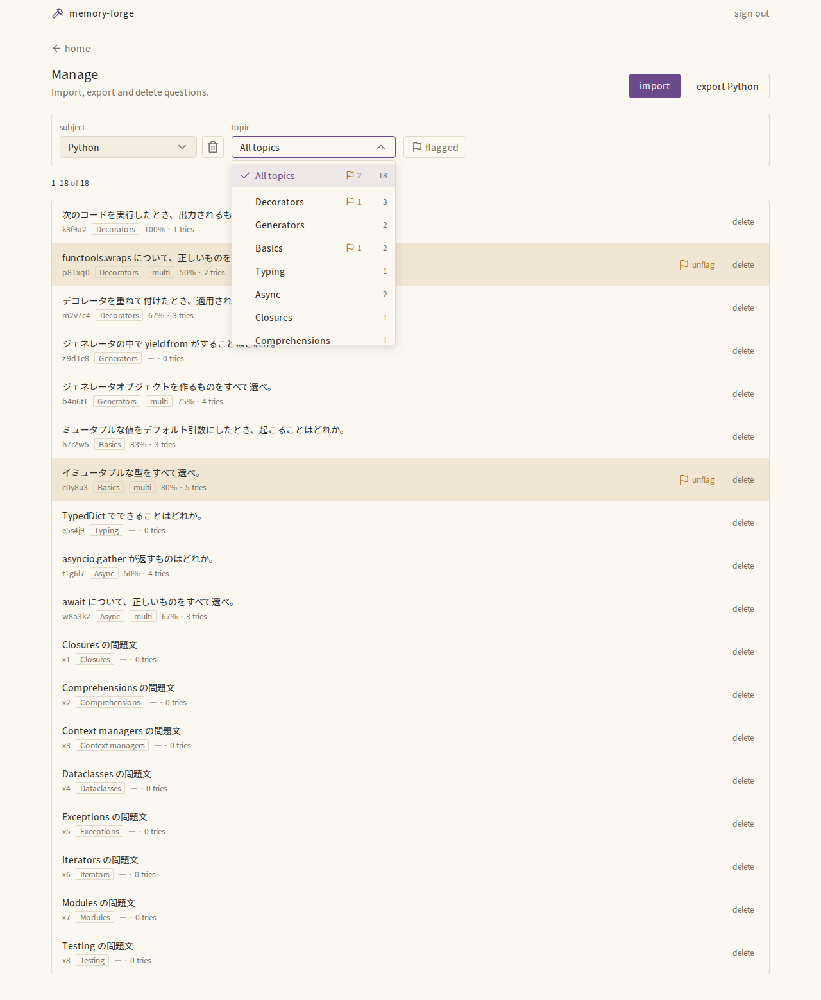 |
| Subject が0件 | 実線の枠「まだ科目がありません。」。書き出すとプルダウンは出さない | 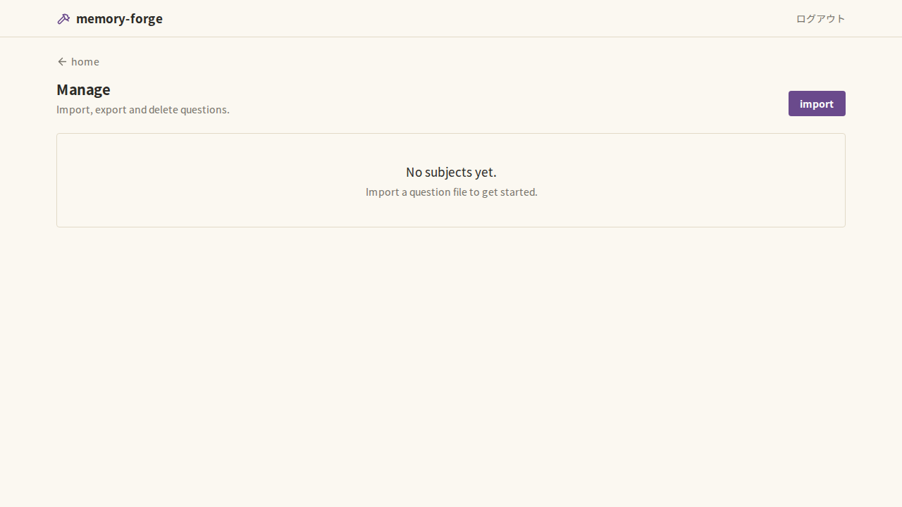 |
| 問題が多い | 480問の4ページ目。「480問中 151–200」とページの番号 | 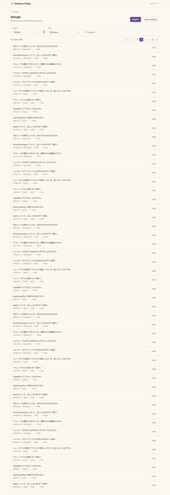 |
| 問題が多い（スマホの幅） | 番号を出さず、前後のボタンの間に「4 / 10」 | 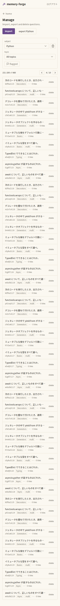 |
| 読み込み中 | 行と同じ形の枠を点滅させる | 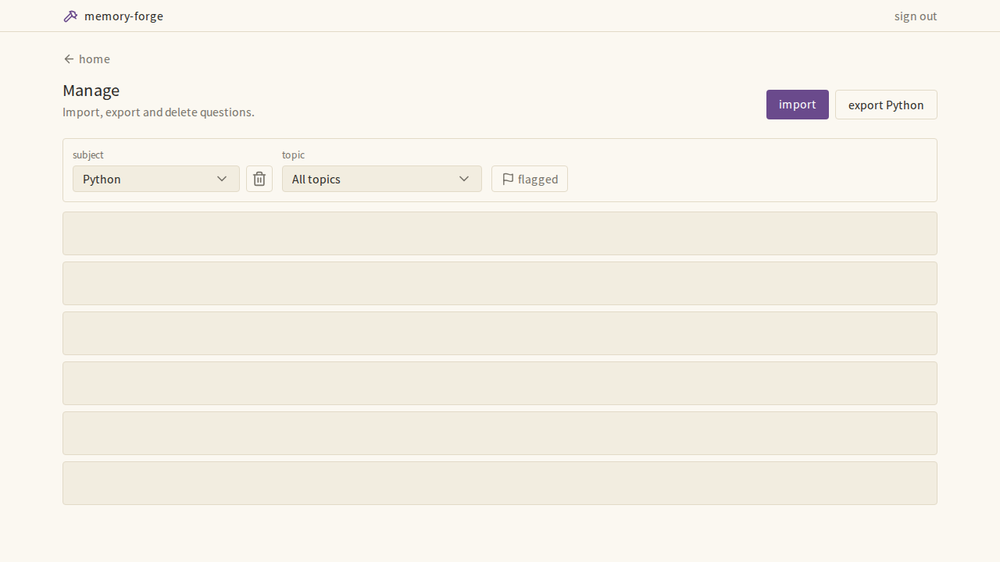 |
| 読み込めない | danger の帯「問題を読み込めませんでした。」と「もう一度読み込む」 | 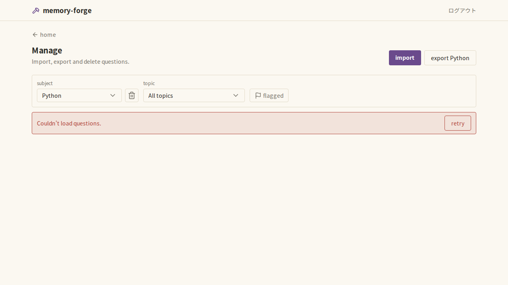 |
| 書き出せない | 絞り込みの下に danger の帯「Python を書き出せませんでした。」 | 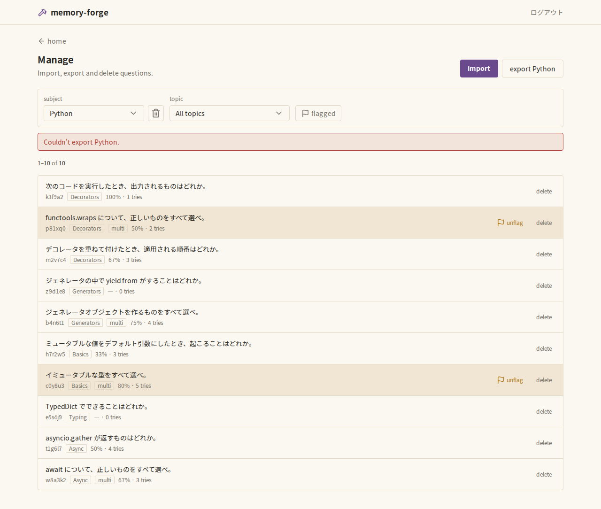 |
| 1問を消す | 確認のダイアログ。問題文の1行目を出す | 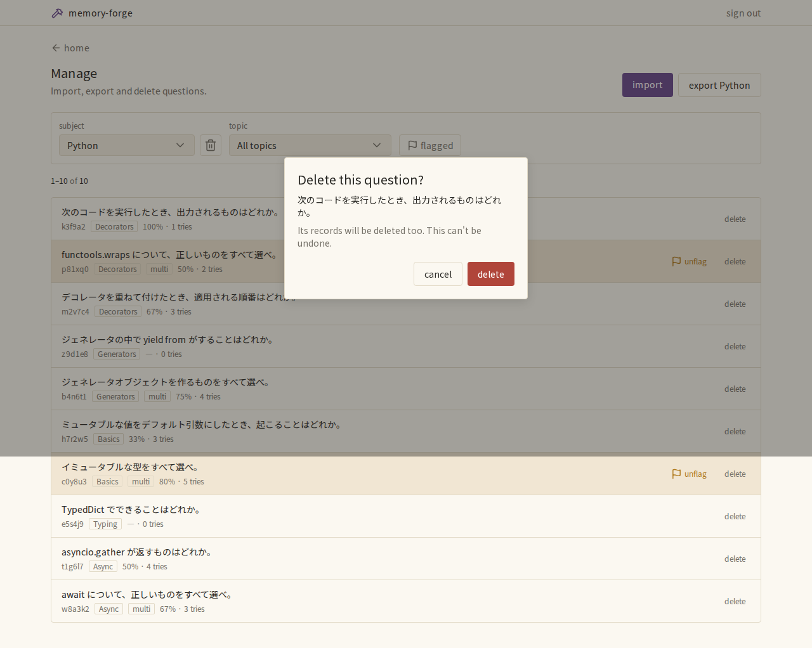 |
| Topic を消す | 確認のダイアログ | 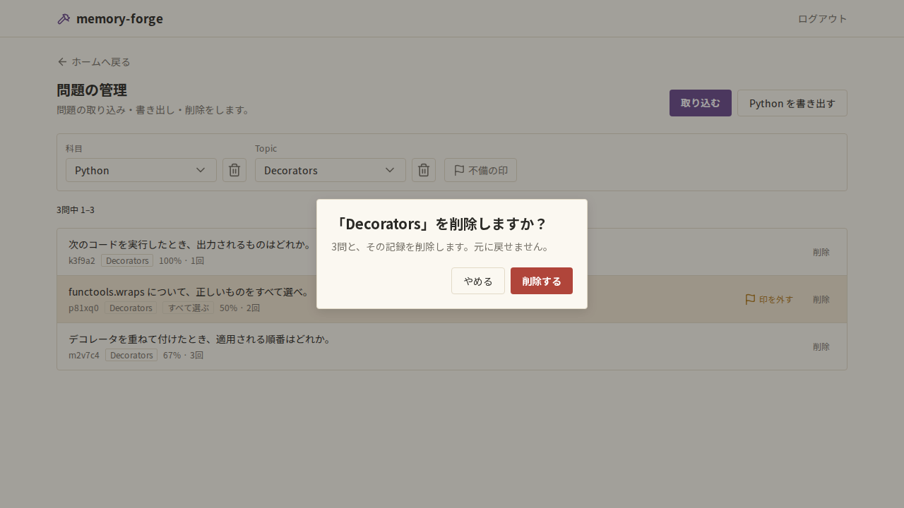 |
| Subject を消す | 確認のダイアログ | 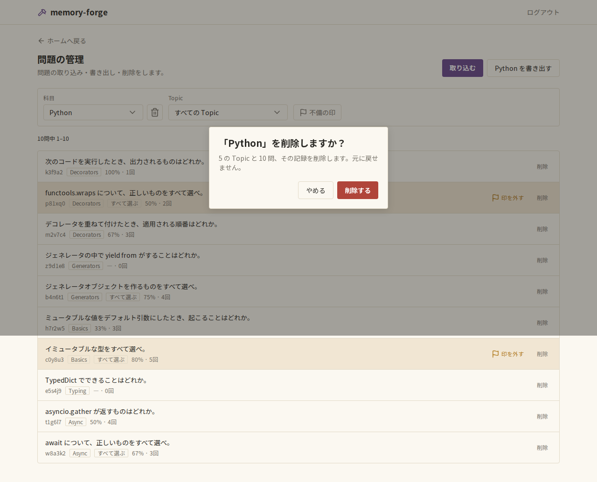 |
| 消せない | ダイアログの中に danger の帯「削除できませんでした。」 | 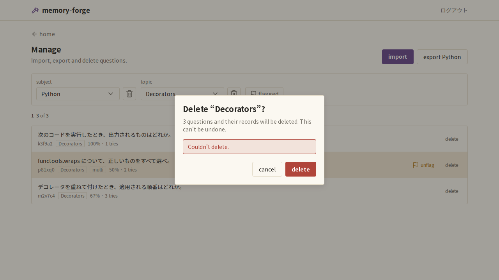 |
