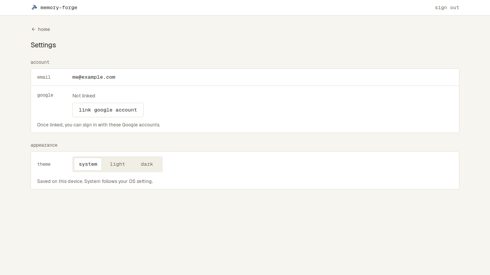
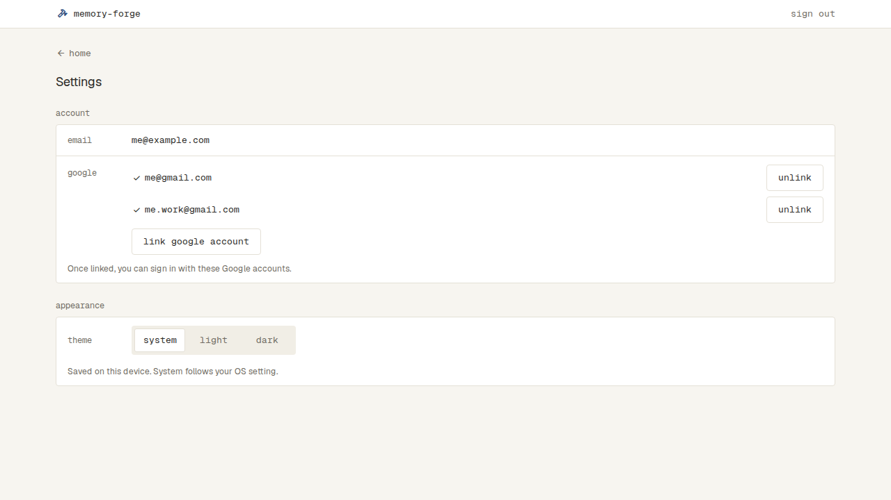
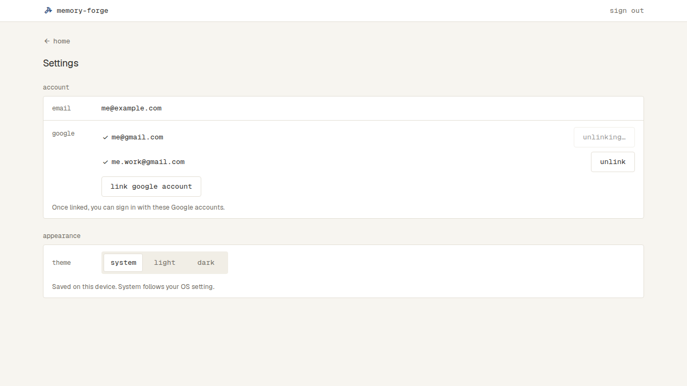
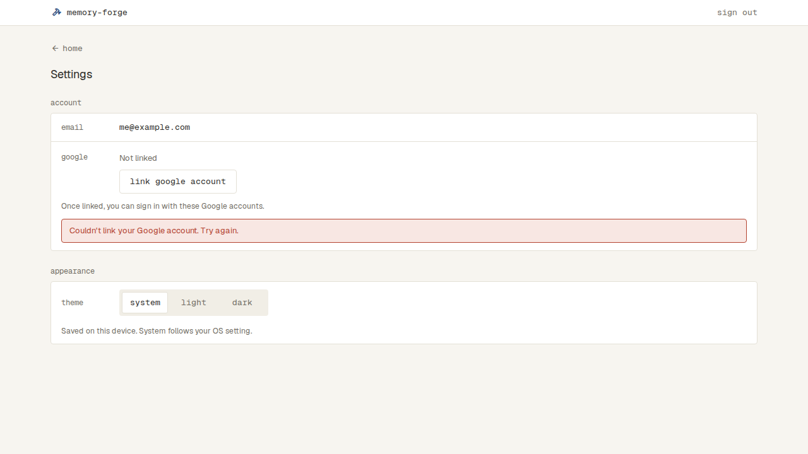
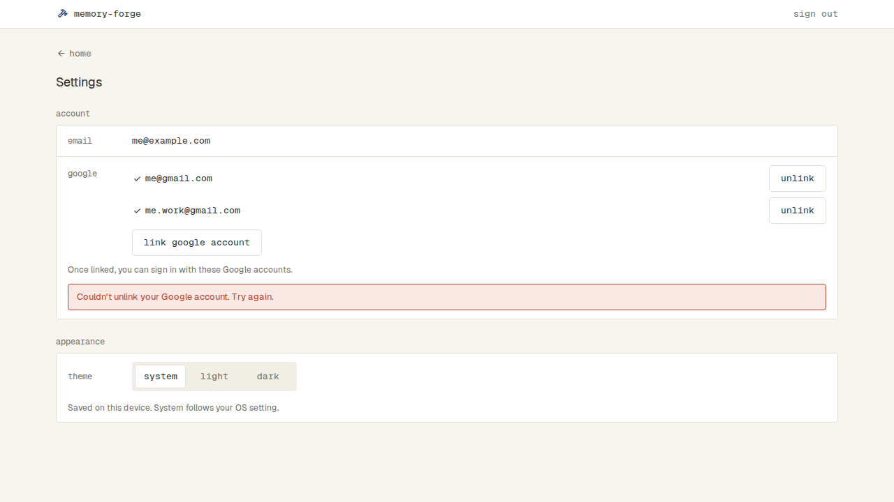

# 設定

## Settings（`/settings`）

- ログインしていないと見られない（`docs/specs/sign-in.md`）
- いちばん上に上のバーが出る（`docs/specs/app-bar.md`）
- Home の menu の settings から開く。解く画面や Login からは開けない
- 左上に戻るリンク「home」、その下に見出し「Settings」を出す（パンくずは出さない）。戻るリンクを押すと Home に移る
- 「account」の見出しの下の枠に、email の行（自分のアカウントのメールアドレス）と google の行を出す（「Google アカウントの紐づけ」）
- その下の「appearance」の見出しの下の枠に、ラベル「theme」と「system」「light」「dark」を横に並べ、1つを選べる。下の行に「Saved on this device. System follows your OS setting.」を出す
  - 3つは docs/ui.md の「少しの中から1つ選ぶもの」と同じく、選んでいるものだけを surface の地にする
- 読み込み中の別の表示はない。権限なしは、ログインしていないと見られない（上）

| 状態 | 表示 | スクリーンショット |
| --- | --- | --- |
| 通常（system） | 戻るリンク「home」、見出し「Settings」、account の枠（Google は Not linked）、appearance の枠で system が選ばれている |  |
| dark を選んだ | dark が選ばれ、暗い画面 |  |

## Google アカウントの紐づけ

- google の行には、紐づけた Google アカウントのメールアドレスを check の印を付けて紐づけた順に1つずつ並べ、それぞれの右に unlink のボタンを置く。その下に link google account のボタン、行の下に「Once linked, you can sign in with these Google accounts.」を出す
  - 紐づけていなければ、メールアドレスの代わりに muted の「Not linked」を出す
  - Google アカウントは、いくつでも紐づけられる。自分のアカウントのメールアドレスと違う Google アカウントも紐づけられる。数個までなので、行が増えるだけで、ページやスクロールは設けない
- link google account を押すと Google の画面に移り、アカウントを選ぶと Settings に戻って、そのアカウントの行が足される
  - 押してから Google の画面に移るまでの間は、ボタンが「linking…」になって薄くなり、押せない
  - すでに紐づけている Google アカウントを選んだときは、何も変わらずに戻る
  - Google の画面でキャンセルしたときは、何も出さずに戻る
  - そのほかで紐づけられなかったときは、google の行の中に danger の帯で「Couldn't link your Google account. Try again.」を出す。紐づけは変わらない
- unlink を押すと、確認のダイアログなしで、その場でその行が消える。外したあとは、その Google アカウントでは入れない
  - 外している間は、そのボタンが「unlinking…」になって薄くなり、押せない
  - 外せなかったときは、行を残し、google の行の中に danger の帯で「Couldn't unlink your Google account. Try again.」を出す（retry のボタンは出さない）
  - 最後の1つを外しても、パスワードで入れるので外せる
- 開いたときに紐づけた Google アカウントを読み込めなかったときは、google の行の中に danger の帯「Couldn't load Google accounts.」と retry を出す。retry で読み直す。link google account のボタンは出さない

| 状態 | 表示 | スクリーンショット |
| --- | --- | --- |
| 紐づけた（複数） | メールアドレスが並び、それぞれの右に unlink。下に link google account |  |
| Google に移っている間 | link google account が「linking…」で薄い |  |
| 外している間 | 押した行のボタンが「unlinking…」で薄い |  |
| 紐づけの失敗 | google の行の中に danger の帯で「Couldn't link your Google account. Try again.」 |  |
| unlink の失敗 | google の行の中に danger の帯で「Couldn't unlink your Google account. Try again.」。メールアドレスは残る |  |

## テーマ

- 選ぶと、その場で画面の明るさが切り替わる（保存のボタンはない）
  - system：OS の設定に合わせる。選んでいる間に OS の設定を変えると、画面も合わせて変わる
  - light：いつも明るい
  - dark：いつも暗い
- まだ選んだことがなければ system
- 選んだ値は端末（ブラウザ）ごとに覚える。読み直しても、閉じて開き直しても、選んだ明るさで出る。ほかの端末には移らない
- 選んだ明るさは、Login を含むすべての画面に効く。開いた瞬間から選んだ明るさで出る
