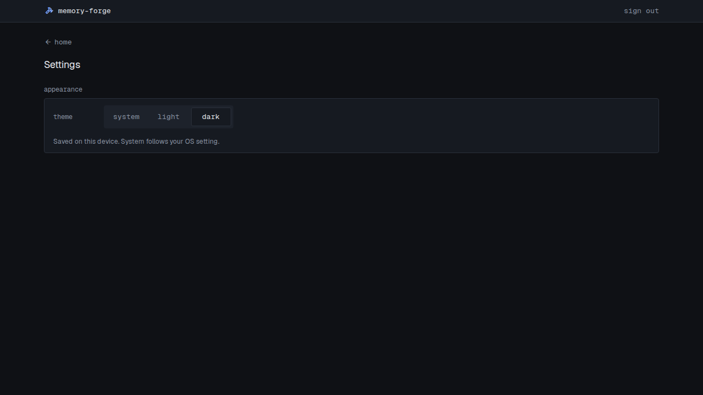
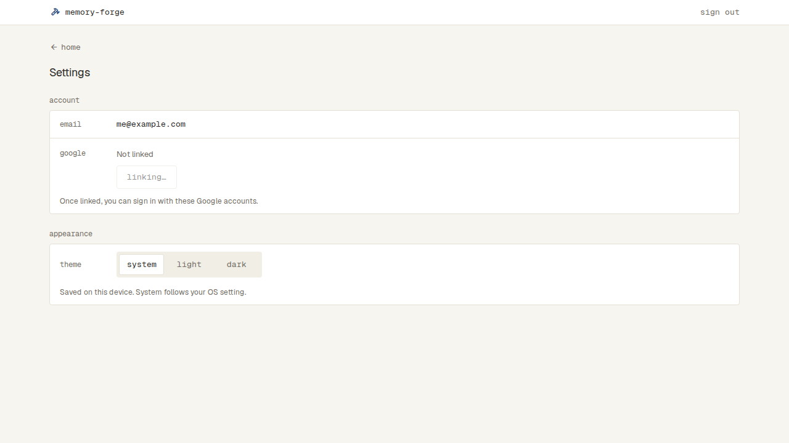

# 設定

## Settings（`/settings`）

- ログインしていないと見られない（`docs/specs/sign-in.md`）
- いちばん上に上のバーが出る（`docs/specs/app-bar.md`）
- Home のいちばん下の「設定」のリンクから開く。解く画面や Login からは開けない
- 左上に戻るリンク「ホームへ戻る」、その下に見出し「設定」を出す（パンくずは出さない）。戻るリンクを押すと Home に移る
- 「アカウント」の見出しの下の枠に、Google の行だけを出す（「Google アカウントの紐づけ」）
- その下の「見た目」の見出しの下の枠に、ラベル「テーマ」と「端末に合わせる」「ライト」「ダーク」を横に並べ、1つを選べる。下の行に「この端末に保存します。「端末に合わせる」は OS の設定に従います。」を出す
  - 3つは docs/ui.md の「少しの中から1つ選ぶもの」と同じく、選んでいるものだけを surface の地にする
- 読み込み中の別の表示はない。権限なしは、ログインしていないと見られない（上）

| 状態 | 表示 | スクリーンショット |
| --- | --- | --- |
| 通常（端末に合わせる） | 戻るリンク「ホームへ戻る」、見出し「設定」、アカウントの枠（自分の Google アカウントだけ）、見た目の枠で端末に合わせるが選ばれている |  |
| ダークを選んだ | ダークが選ばれ、暗い画面 |  |

## Google アカウントの紐づけ

- Google の行のいちばん上に、自分の Google アカウント（アプリの設定に書いたもの。`docs/specs/sign-in.md`）のメールアドレスを check の印を付けて出す。右に「外す」は置かず、外せない
- その下に、Settings で足した Google アカウントのメールアドレスを check の印を付けて紐づけた順に1つずつ並べ、それぞれの右に「外す」のボタンを置く。その下に「Google アカウントを紐づける」のボタン、行の下に「紐づけた Google アカウントでも、ログインできます。」を出す
  - Google アカウントは、いくつでも紐づけられる。自分のアカウントのメールアドレスと違う Google アカウントも紐づけられる。数個までなので、行が増えるだけで、ページやスクロールは設けない
- Google アカウントを紐づけるを押すと Google の画面に移り、アカウントを選ぶと Settings に戻って、そのアカウントの行が足される
  - 押してから Google の画面に移るまでの間は、ボタンが「紐づけています…」になって薄くなり、押せない
  - すでに紐づけている Google アカウントを選んだときは、何も変わらずに戻る
  - Google の画面でキャンセルしたときは、何も出さずに戻る
  - そのほかで紐づけられなかったときは、Google の行の中に danger の帯で「Google アカウントを紐づけられませんでした。もう一度試してください。」を出す。紐づけは変わらない
- 外すを押すと、確認のダイアログなしで、その場でその行が消える。外したあとは、その Google アカウントでは入れない
  - 外している間は、そのボタンが「外しています…」になって薄くなり、押せない
  - 外せなかったときは、行を残し、Google の行の中に danger の帯で「Google アカウントを外せませんでした。もう一度試してください。」を出す（もう一度読み込むのボタンは出さない）
  - 足したものを全部外しても、自分の Google アカウントで入れる
- 開いたときに紐づけた Google アカウントを読み込めなかったときは、Google の行の中に danger の帯「Google アカウントを読み込めませんでした。」と「もう一度読み込む」を出す。もう一度読み込むで読み直す。Google アカウントを紐づけるのボタンは出さない

| 状態 | 表示 | スクリーンショット |
| --- | --- | --- |
| 足した Google アカウントがある | 自分の Google アカウント（外すなし）の下に、足したものが並び、それぞれの右に外す。下に Google アカウントを紐づける |  |
| Google に移っている間 | Google アカウントを紐づけるが「紐づけています…」で薄い |  |
| 外している間 | 押した行のボタンが「外しています…」で薄い |  |
| 紐づけの失敗 | Google の行の中に danger の帯で「Google アカウントを紐づけられませんでした。もう一度試してください。」 |  |
| 外すの失敗 | Google の行の中に danger の帯で「Google アカウントを外せませんでした。もう一度試してください。」。メールアドレスは残る |  |

## テーマ

- 選ぶと、その場で画面の明るさが切り替わる（保存のボタンはない）
  - 端末に合わせる（system）：OS の設定に合わせる。選んでいる間に OS の設定を変えると、画面も合わせて変わる
  - ライト（light）：いつも明るい
  - ダーク（dark）：いつも暗い
- まだ選んだことがなければ端末に合わせる
- 選んだ値は端末（ブラウザ）ごとに覚える。読み直しても、閉じて開き直しても、選んだ明るさで出る。ほかの端末には移らない
- 選んだ明るさは、Login を含むすべての画面に効く。開いた瞬間から選んだ明るさで出る
