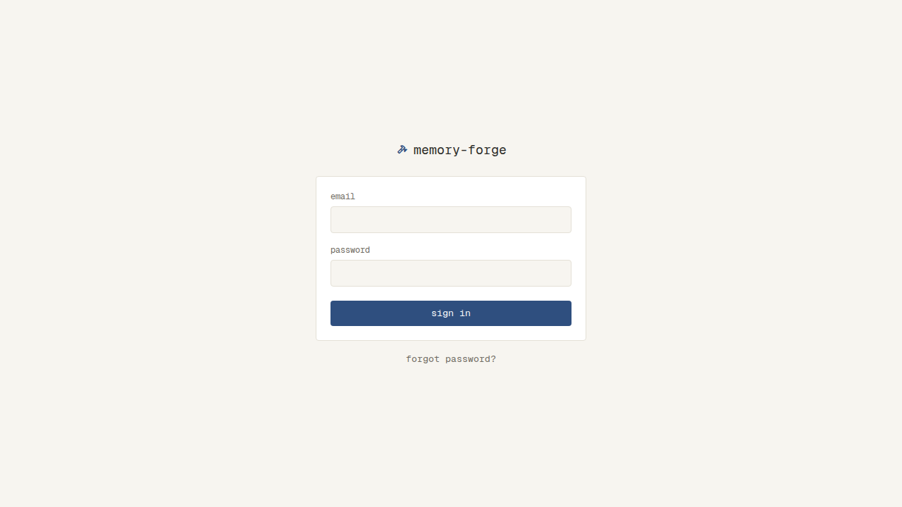
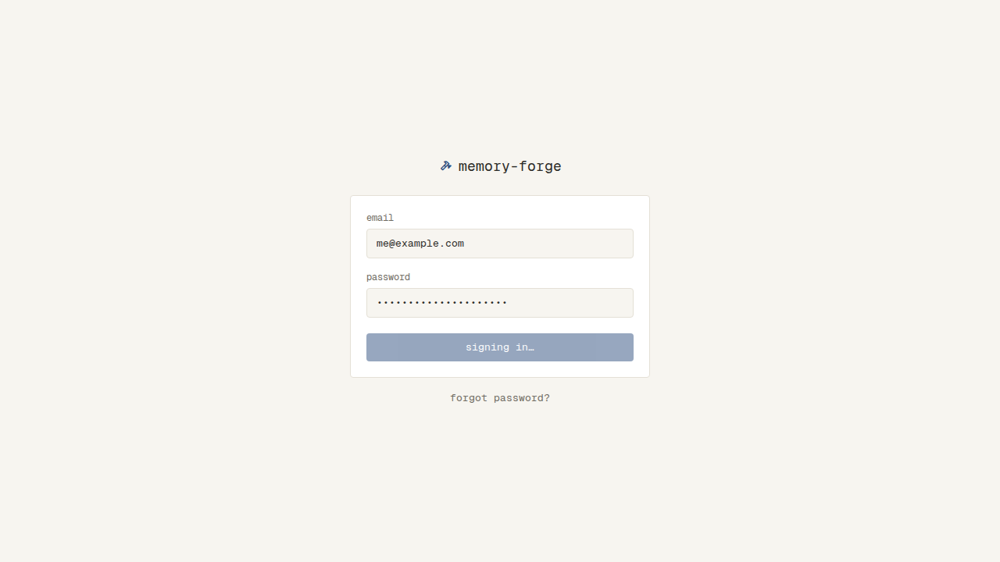
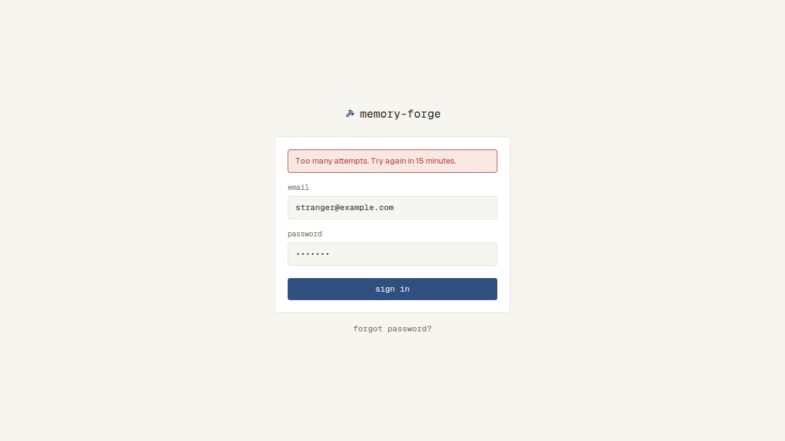
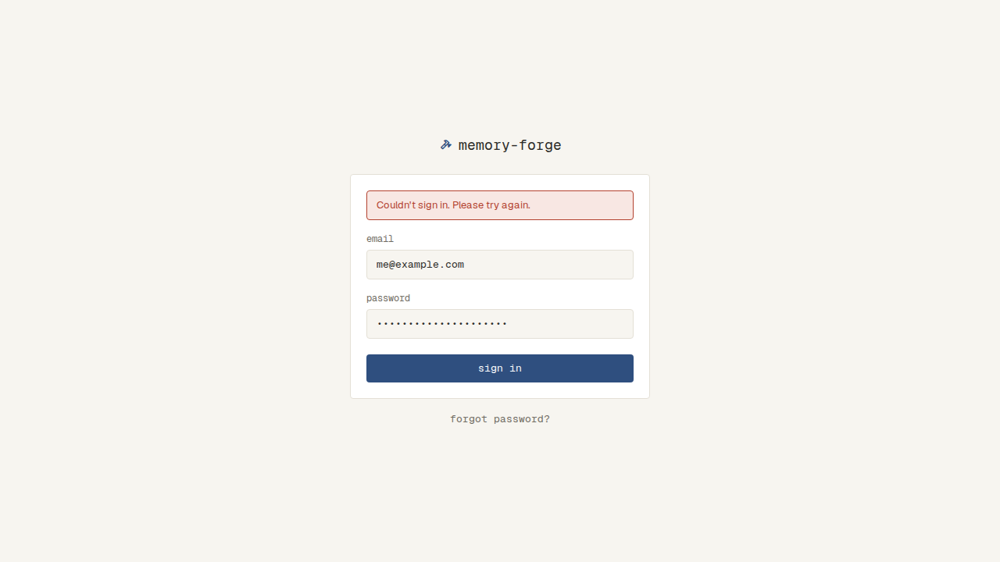

# ログイン

## ログインしていないとき

- Login（`/login`）以外のどの画面を開いても、Login に移る。sign in すると、開こうとしていた画面に移る
- Login を直接開いて sign in すると、Home に移る
- ログインしている人が Login を開くと、Home に移る
- ログインしたままでいられるのは、最後に使ってから30日。過ぎたら、ログインしていない人と同じ扱いになる
- sign out（上のバー。`docs/specs/app-bar.md`）したあとは、ログインしていない人と同じ扱いになる。ブラウザの戻るで前の画面に戻っても、Login が出る

## アカウント

- 通るのは、画面の外（`npm run user:create`）で作った自分のアカウントだけ。アプリの画面から新しく登録する手段はない

## Login（`/login`）

- 上のバーは出さない。画面の真ん中に、ロゴとアプリ名、その下に sm の幅のカード、カードの下の外に forgot password? を置く
- カードの中は、上から帯（エラーのとき）、email の入力、password の入力、sign in のボタン（primary）
- email か password が空のまま sign in を押すと、ブラウザの「入力してください」が出て、送らない
- 送っている間は、ボタンが「signing in…」になって薄くなり、ボタンと入力が押せない（打てない）
- メールアドレスかパスワードが違うと、Login のまま、danger の帯で「Incorrect email or password.」を出す。どちらが違ったかは出さない。入れた email と password は残り、password の枠が danger になる
- 同じメールアドレスで5回続けて間違えると、そこから15分は、正しいパスワードでも入れず、danger の帯で「Too many attempts. Try again in 15 minutes.」を出す
  - 登録されていないメールアドレスも、同じに数える
  - 止めている間に試しても、15分は延びない。15分たてば、また入れる
  - 15分たったあとは、0から数え直す
  - 入れたら、間違えた回数は0に戻る
- つながらないなど、サーバーのエラーのときは、Login のまま、danger の帯で「Couldn't sign in. Please try again.」を出す。retry のボタンは出さない
- forgot password? は、押しても何も起きない

| 状態 | 表示 | スクリーンショット |
| --- | --- | --- |
| 通常 | ロゴとアプリ名、email・password の入力、sign in のボタン、forgot password? |  |
| 送っている間 | ボタンが「signing in…」になって薄くなり、ボタンと入力が押せない |  |
| 違う | 入力の上に danger の帯で「Incorrect email or password.」。email と password は残り、password の枠が danger |  |
| 止めている | 入力の上に danger の帯で「Too many attempts. Try again in 15 minutes.」 |  |
| サーバーのエラー | 入力の上に danger の帯で「Couldn't sign in. Please try again.」 |  |
