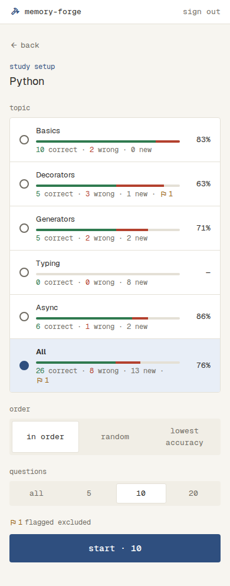
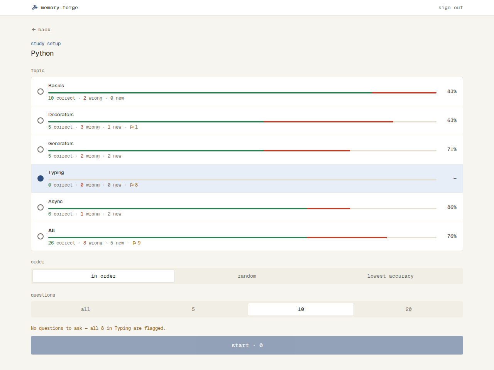
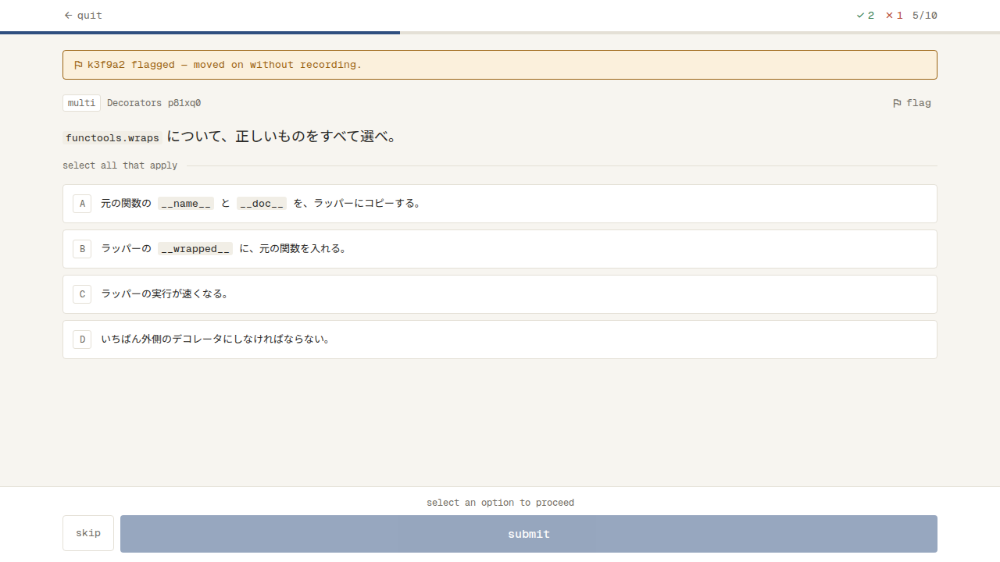
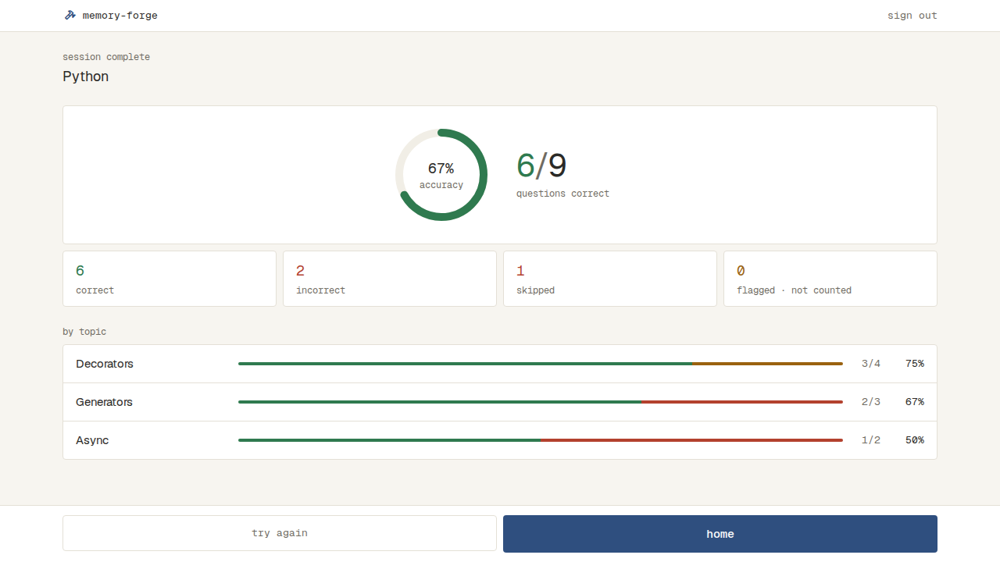
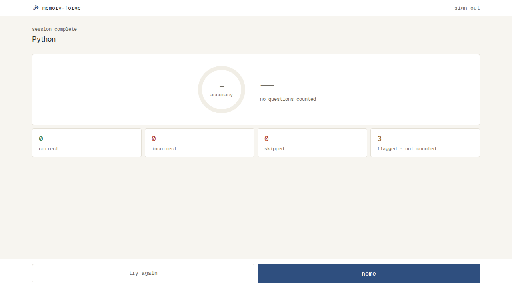

# 問題を解く

Subject の中から Topic・順番・問題数を選び（Setup）、1問ずつ解き（Solve）、解き終わりに結果を見る（Result）。どれも `/subjects/<Subject の id>` の1つの画面で、Setup から start で Solve に、Solve の最後の問題から Result に切り替わる。

- ログインしていないと見られない（`docs/specs/sign-in.md`）
- Home の Subject の行から入る（`docs/specs/home.md`）

## Setup

- いちばん上に上のバーが出る（`docs/specs/app-bar.md`）
- 上から、戻るリンク（back。Home へ）、primary の等幅の小さな「study setup」、Subject の名前（見出し）
- 「topic」：丸の付いた行で、Topic の名前を、その Topic の問題が最初に出てくる順に並べ、最後に太字の「All」（全部の Topic）。選んでいる行は primary-soft の地
  - 各行の名前の下に、その Topic（All なら Subject の全部）の身についている具合の線と数を出し、行の右に % を出す（数え方と見せ方は `docs/specs/home.md` の「身についている具合」）
  - 印の付いた問題があれば、数の並びの終わりに「· ⚑1」（flag の印と数は warning）を出す。スマホの幅で数が折り返すときも、「⚑1」の印と数は分けない
  - 選んでいる行でも、線と数の色はほかの行と同じ
- 「order」：in order・random・lowest accuracy から選ぶ
  - in order：取り込んだ順（最初の取り込みではファイルの順。取り込み直して増えた問題は最後）
  - random：start を押すたびにランダムに並べる
  - lowest accuracy：問題ごとの正答率（全部の回答のうち正解の割合）の低い順。まだ一度も解いていない問題は出さない。正答率が同じ問題は、その中でランダムに並べる
  - どの順番でも、印の付いた問題（Solve の flag）は出さない
- 「questions」：all・5・10・20 から選ぶ。出せる問題が選んだ数より少ないときは、ある分だけ出す
- 開いたときは、All・in order・10 を選んでいる
- 下に、幅いっぱいの start と、出す問題の数（start · 10 など）。押すと、選んだ問題で Solve が始まる
- 出せる問題の数（start の数と、下の「has only」の数）は、印の付いた問題を除いて数える
- 出せる問題が選んだ数より少ないときは、start の上に muted の等幅の小さな文字で「Decorators has only 8 questions to ask.」と出す。All を選んでいるときは、Topic の名前の代わりに Subject の名前（「Python has only 8 questions to ask.」）
- 選んだ Topic（All なら Subject）に印の付いた問題があり、出せる問題が1問以上あるときは、start の上に「⚑1 flagged excluded」（muted の等幅の小さな文字。flag の印と数は warning）を出す
- 選んだ Topic（All なら Subject）の問題に全部印が付いていると、どの順番でも、warning の文字で「No questions to ask — all 8 in Typing are flagged.」（問題の数と Topic の名前。All なら Subject の名前）と出し、start · 0 を薄くして押せない
- lowest accuracy で、全部に印が付いてはいないが、印のない問題に一度でも解いた問題がないときは、warning の文字で「No questions to ask — none in Typing have been answered yet.」と出し、start · 0 を薄くして押せない
- start を押して問題を読めなかったときは、Setup のまま、start の上に danger の帯「Couldn't load questions.」と retry を出す。retry で、同じ選び方でもう一度始める
- Solve の quit と Result の try again で戻ったときは、直前に選んでいた Topic・順番・問題数のまま。身についている具合は、それまでに答えた分を入れて出す
- 読み込んでいる間は、Subject の名前の場所と、Topic の行の形の枠を6つ点滅させる
- 読み込めなかったときは、Subject の名前（見出し）を出さず、danger の帯「Couldn't load this subject.」と retry を出す
- ない Subject の Setup を開くと、見つからない画面（This page could not be found.）を出す

| 状態 | 表示 | スクリーンショット |
| --- | --- | --- |
| 通常 | All・in order・10 を選んでいる。Topic の行と All の行に線・数・%。印の付いた問題があり、Decorators と All に「· ⚑1」、start の上に「⚑1 flagged excluded」 |  |
| 通常（スマホの幅） | 数が折り返し、「⚑1」は次の行にまとめて出る |  |
| 全部に印 | Typing を選び、Typing の行が「0 correct · 0 wrong · 0 new · ⚑8」、線が全部 border、「—」。warning の案内「No questions to ask — all 8 in Typing are flagged.」と、押せない start · 0 |  |
| 問題が足りない | 案内と、ある分の数の start |  |
| 解いた問題がない（lowest accuracy） | warning の案内と、押せない start · 0 |  |
| Topic が多い | Topic の行が続く |  |

## Solve

- 上のバー：左に quit（arrow_back の印）、右に、ここまでの正解の数・不正解の数（スキップを含む）・今の問題の番号（4/10 など）。下の端に、終えた問題（答えた・スキップした・答える前に印を付けた）の割合だけ伸びる線
- 問題の上の行：枠で囲んだ「single」か「multi」、Topic の名前、問題の ID。右に flag（muted の等幅の文字だけのボタン。指を乗せると warning の文字と warning-soft の地）
- 問題文。コードがあるときは、行番号つきのコードブロックで出す。選択肢の中のコードには行番号を付けない
- 問題文・選択肢・解説のコードブロックには、```` ``` ```` の後ろに書かれた言語に合わせて色を付ける
  - 色を付ける言語は、Python・TypeScript・JavaScript・SQL・シェル・JSON。言語の名前は大文字・小文字を区別せず、短い名前（`py`・`ts`・`js`・`sh`・`bash`・`shell`）も同じ言語として扱う
  - 色を付けるのは、キーワード・文字列・関数の名前・組み込みの名前・デコレーター・コメント。それ以外（変数の名前、数、記号など）は、コードブロックの文字の色のまま
  - 言語の名前がないときと、知らない言語の名前のときは、1色で出す
  - 問題を開いたときから色が付いている。答え合わせのあと（正解・不正解の色の付いた選択肢）でも、コードの色は変わらない。ライトモードとダークモードで、それぞれのモードの色で出す
  - 言語の名前は画面に出さない。文の中の短いコード（`` `x` ``）には色を付けない
- 選択肢は、ファイルの順に A・B・C… の記号を付けて出す。単一選択（「choose one」）は丸い記号で1つだけ選べ、選び直すと前の選択が外れる。複数選択（「select all that apply」）は四角い記号で、いくつでも選べる
- 下に固定した操作
  - 答える前：skip と submit。何も選んでいない間は、上に「select an option to proceed」を出し、submit を薄くして押せない
  - 答えたあと：explanation / question の切り替えと、next（最後の問題は results）
  - 答えを送っている間は、下のボタンを押せない
- submit すると、同じ画面で答え合わせをする
  - 正解は success の帯「correct」、不正解は danger の帯「incorrect — answer: B」（複数選択は「A, B」）
  - 複数選択は、正解を全部選び、ほかを選んでいないときだけ正解（部分点なし）
  - 選択肢に、選んだ正解・選んだ不正解の色を付ける。選ばなかった正解には missed を出す
- explanation で解説（枠の中に「explanation」の見出しと解説の文）に切り替え、question で問題に戻る
- next で次の問題に進む。最後の問題の results は、Result に移る
- skip で、答えずに次の問題に進む。スキップは不正解として数える。最後の問題の skip は、Result に移る
- 答えを保存できなかったときは、数を進めずに、選択肢の下に danger の帯「Couldn't save your answer.」と retry を出す
  - retry は、失敗した操作（submit か skip）を同じ中身で送り直す
  - 帯を出している間も、選び直し・submit・skip はでき、どれかが通れば帯は消える
- flag で、問題に印を付ける。答える前・答えたあとのどちらでも押せる。印を付けた問題は、ほかの解く回でも出題しない。Solve の中では印を外せない（外すのは Manage）
  - 答える前に押すと、答えずに次の問題に進み、その問題は記録しない。正解・不正解の数は増やさず、問題の番号と線は進める。次の問題の上に、warning の枠と warning-soft の地の帯で「k3f9a2 flagged — moved on without recording.」（flag の印と、印を付けた問題の ID）を出す。帯は、次の操作（選ぶ・submit・skip・flag）まで出す
  - 最後の問題で答える前に押すと、Result に移る（帯は出さない）
  - 答えたあとに押すと、その場でボタンが warning-soft の地と warning の文字の「flagged」に変わる。答えた記録は残り、上の正解・不正解の数も減らさない
  - 印を付けられなかったときは、答えの保存と同じ場所に danger の帯「Couldn't flag this question.」と retry を出す。答える前の flag なら、次の問題に進まない。解説を見ているときは、解説の枠の下に出す。帯が出たまま次の問題に進むと消える（印は付かないまま）
- quit を押すと、ダイアログ「Quit this session?」「Answers so far are kept.」を出し、後ろの画面を暗くする
  - continue と Esc で閉じて、そのまま続ける。外側を押しても閉じない
  - quit で Setup に戻る
- start を押してから問題を受け取るまでは、問題の上の行・問題文・コード・選択肢の形の枠を点滅させ、quit を薄くして押せない
- 解いている途中でページを読み込み直したり閉じたりすると、続きからは解けない。Setup の最初の選び方からやり直す

| 状態 | 表示 | スクリーンショット |
| --- | --- | --- |
| 答える前（単一選択） | choose one と丸い記号の選択肢。問題の上の行の右に flag |  |
| 答えたあとに印 | flag が flagged に変わる |  |
| 答える前に印 | 次の問題の上に「k3f9a2 flagged — moved on without recording.」 |  |
| 答えたあと（問題） | 答え合わせの色、結果の帯、explanation と next |  |
| 答えたあと（解説） | 解説と、question と next |  |
| 答える前（複数選択） | select all that apply と四角い記号の選択肢 |  |
| 答えたあと（複数選択） | 選ばなかった正解に missed |  |
| 答える前（選択肢がコード） | 選択肢の中にコードブロック |  |
| 答えたあと（選択肢がコード） | 答え合わせの色。選択肢の中のコードの色はそのまま |  |
| 色を付けられない言語 | 問題文のコードブロックが1色。行番号は付く |  |
| 最後の問題 | next の代わりに results |  |
| 問題が多い | 37/100 など |  |
| 読み込み中 | 点滅する枠と、押せない quit |  |
| 保存のエラー | danger の帯と retry |  |
| quit の確かめ | ダイアログ（continue と quit） |  |

## Result

- いちばん上に上のバーが出る（`docs/specs/app-bar.md`）。戻るリンクは置かない
- 上に、muted の等幅の小さな「session complete」と、Subject の名前（見出し）
- 枠の真ん中に、正答率の円（success の線。真ん中に % と accuracy）と、得点（正解の数 / 解いた問題の数。例：6/9。正解の数は success）と「questions correct」を横に並べる
  - 得点と正答率では、スキップを不正解として数える
  - 正答率は、整数に四捨五入する（6/9 は 67%）
- 枠の下に、correct（success）・incorrect（danger）・skipped（danger）・flagged · not counted（warning）の数を、小さなカード4枚で出す（PC は横に4枚、スマホの幅では2行2列）
  - incorrect は、答えて間違えた数だけ（スキップは skipped にだけ数える）
  - flagged は、この回で印を付けた問題の数
- 印を付けた問題は、答える前でも答えたあとでも、得点・正答率・correct / incorrect / skipped・by topic に数えない
- 数える問題が0問（全部に印を付けた）のときは、円を線だけにし、% と得点を muted の「—」、得点の下を「no questions counted」にする。by topic の一覧は出さない
- 「by topic」の見出しの下に、Topic ごとの行を区切り線で並べる。行には、Topic の名前、割合の線、得点（3/4）、% を出す
  - 割合の線は、左から、正解（success）、前は正解したのに今回間違えた（warning）、前にも正解したことがない不正解（danger）の順に塗り分ける
  - 「前は正解したのに今回間違えた」は、今回不正解かスキップで、今回より前の記録に一度でも正解がある問題
  - 黄色の問題も、得点・%・incorrect と skipped のカードでは、不正解として数える
  - Topic ごとの % も、整数に四捨五入する
  - 並びは Setup の Topic と同じ順。解いた回に出た Topic だけを出す。Setup を開いたあとに取り込み直して、Setup にない Topic が解いた回に出たときは、Setup の順のあとに、出た順で置く
  - Topic を1つ選んで解いたときも、その1行を出す
  - Topic の名前は決まった幅（スマホの幅では狭くする）に置き、長いときは1行に収めて「…」で切る。割合の線は、名前と得点の間の残りの幅いっぱいに伸ばす
  - Topic が多いときは、行が続き、ページごとスクロールする
- 下に固定して、try again（枠だけ）と home（主な操作）を同じ幅で横に並べる
  - try again で、同じ Subject の Setup に移る。Topic・順番・問題数は、直前に選んでいたもののまま
  - home で、Home に移る
- 結果は解き終わったときに手元で数えるので、読み込み中とエラーの状態はない
- Result で読み込み直すと、結果は出ず、Setup の最初の選び方（All・in order・10）からになる。それまでに答えた分の記録は残る

| 状態 | 表示 | スクリーンショット |
| --- | --- | --- |
| 通常 | 正答率の円と得点、4つの数（flagged · not counted が 1）、Topic ごとの行、try again と home |  |
| 全部に印 | 線だけの円、「—」と no questions counted。by topic は出さない |  |

## 記録

- 答えるたびに（submit とスキップ）、その問題の正解・不正解を記録する。スキップは不正解
- 答える前に印を付けた問題は、記録しない。答えたあとに印を付けても、答えた記録は残る
- quit・読み込み直し・ページを閉じても、それまでに答えた分の記録は残る
- 記録は、Setup の lowest accuracy の並びと解いた問題の数、Result の「前は正解したのに今回間違えた」に使う
