# 問題を解く

Subject の中から Topic・順番・問題数を選び（Setup）、1問ずつ解き（Solve）、解き終わりに結果を見る（Result）。どれも `/subjects/<Subject の id>` の1つの画面で、Setup から解きはじめるで Solve に、Solve の最後の問題から Result に切り替わる。

- ログインしていないと見られない（`docs/specs/sign-in.md`）
- Home の Subject の行から入る（`docs/specs/home.md`）

## Setup

- いちばん上に上のバーが出る（`docs/specs/app-bar.md`）
- 上から、戻るリンク（「ホームへ戻る」。Home へ）、太字の小さな「解く準備」、Subject の名前（見出し）
- 「Topic」：丸の付いた行で、Topic の名前を、その Topic の問題が最初に出てくる順に並べ、最後に太字の「All」（全部の Topic）。選んでいる行は accent-soft の地
  - 各行の名前の下に、その Topic（All なら Subject の全部）の身についている具合の線と数を出し、行の右に % を出す（数え方と見せ方は `docs/specs/home.md` の「身についている具合」）
  - 印の付いた問題があれば、数の並びの終わりに「· ⚑1」（flag の印と数は warning）を出す。スマホの幅で数が折り返すときも、「⚑1」の印と数は分けない
  - 選んでいる行でも、線と数の色はほかの行と同じ
- 「順番」：順番どおり・ばらばら・苦手な順から選ぶ
  - 順番どおり：取り込んだ順（最初の取り込みではファイルの順。取り込み直して増えた問題は最後）
  - ばらばら：解きはじめるを押すたびにランダムに並べる
  - 苦手な順：問題ごとの正答率（全部の回答のうち正解の割合）の低い順。まだ一度も解いていない問題は出さない。正答率が同じ問題は、その中でランダムに並べる
  - どの順番でも、印の付いた問題（Solve の flag）は出さない
- 「問題数」：すべて・5問・10問・20問から選ぶ。出せる問題が選んだ数より少ないときは、ある分だけ出す
- 開いたときは、All・順番どおり・10問を選んでいる
- 下に、幅いっぱいの「10問を解きはじめる」（数は出す問題の数）。出せる問題がないときは「解きはじめる」。押すと、選んだ問題で Solve が始まる
- 出せる問題の数（解きはじめるの数と、下の「出せるのは」の数）は、印の付いた問題を除いて数える
- 出せる問題が選んだ数より少ないときは、解きはじめるの上に muted の小さな文字で「Decorators で出せるのは 8 問だけです。」と出す。All を選んでいるときは、Topic の名前の代わりに Subject の名前（「Python で出せるのは 8 問だけです。」）
- 選んだ Topic（All なら Subject）に印の付いた問題があり、出せる問題が1問以上あるときは、解きはじめるの上に「⚑1 問は不備の印があるので出しません」（muted の小さな文字。flag の印と数は warning）を出す
- 選んだ Topic（All なら Subject）の問題に全部印が付いていると、どの順番でも、warning の文字で「Typing の 8 問すべてに不備の印があるので、出せる問題がありません。」（問題の数と Topic の名前。All なら Subject の名前）と出し、「解きはじめる」を薄くして押せない
- 苦手な順で、全部に印が付いてはいないが、印のない問題に一度でも解いた問題がないときは、warning の文字で「Typing にはまだ解いた問題がないので、苦手な順では出せません。」と出し、「解きはじめる」を薄くして押せない
- 解きはじめるを押して問題を読めなかったときは、Setup のまま、解きはじめるの上に danger の帯「問題を読み込めませんでした。」と「もう一度読み込む」を出す。もう一度読み込むで、同じ選び方でもう一度始める
- Solve のやめると Result のもう一度解くで戻ったときは、直前に選んでいた Topic・順番・問題数のまま。身についている具合は、それまでに答えた分を入れて出す
- 読み込んでいる間は、Subject の名前の場所と、Topic の行の形の枠を6つ点滅させる
- 読み込めなかったときは、Subject の名前（見出し）を出さず、danger の帯「科目を読み込めませんでした。」と「もう一度読み込む」を出す
- ない Subject の Setup を開くと、見つからない画面（This page could not be found.）を出す

| 状態 | 表示 | スクリーンショット |
| --- | --- | --- |
| 通常 | All・順番どおり・10問を選んでいる。Topic の行と All の行に線・数・%。印の付いた問題があり、Decorators と All に「· ⚑1」、解きはじめるの上に「⚑1 問は不備の印があるので出しません」 | 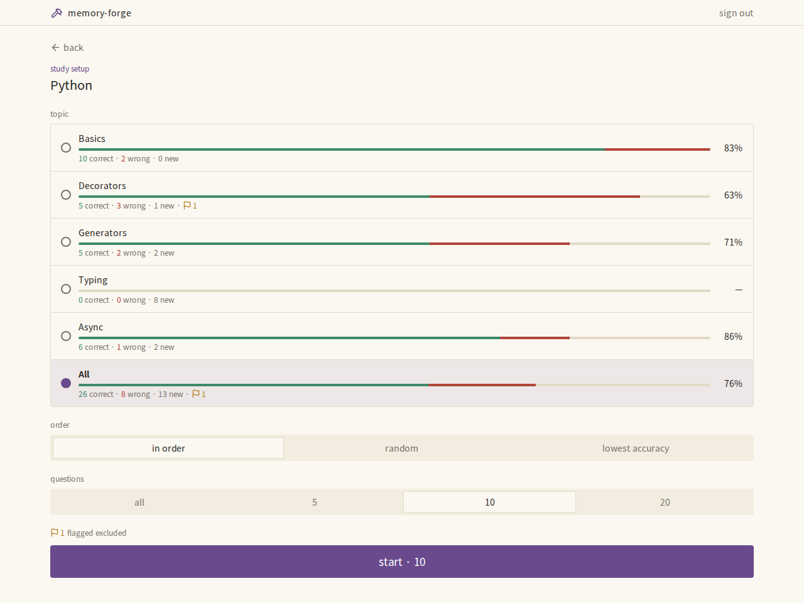 |
| 通常（スマホの幅） | 数が折り返し、「⚑1」は次の行にまとめて出る | 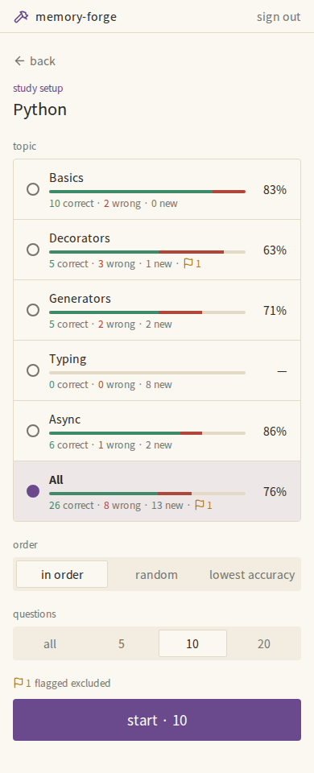 |
| 全部に印 | Typing を選び、Typing の行が「正解 0 · 不正解 0 · まだ 0 · ⚑8」、線が全部 border、「—」。warning の案内「Typing の 8 問すべてに不備の印があるので、出せる問題がありません。」と、押せない「解きはじめる」 | 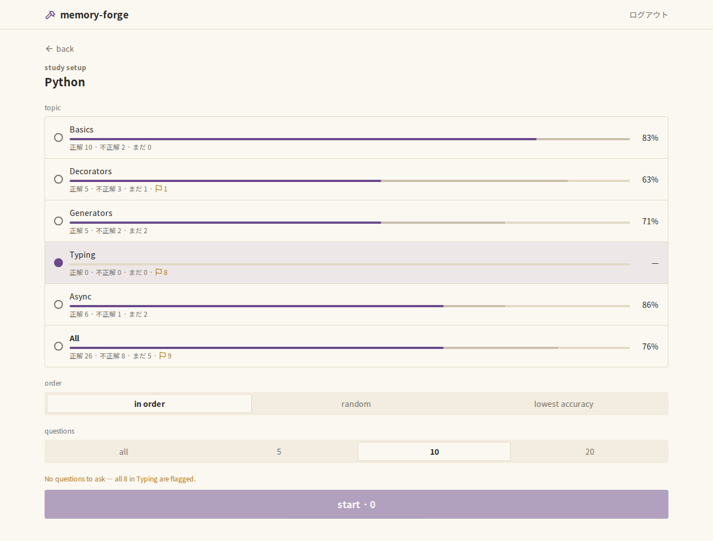 |
| 問題が足りない | 案内と、ある分の数の「8問を解きはじめる」 | 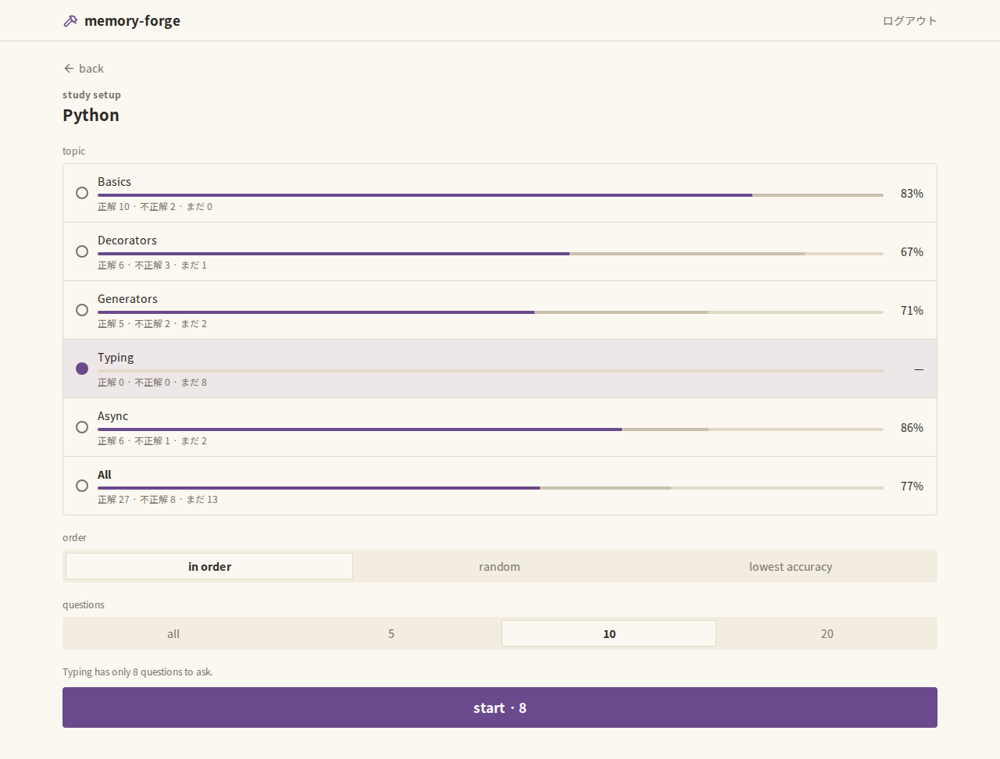 |
| 解いた問題がない（苦手な順） | warning の案内と、押せない「解きはじめる」 | 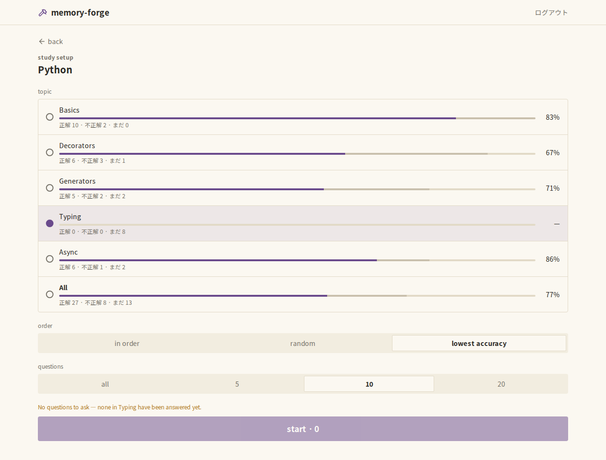 |
| Topic が多い | Topic の行が続く | 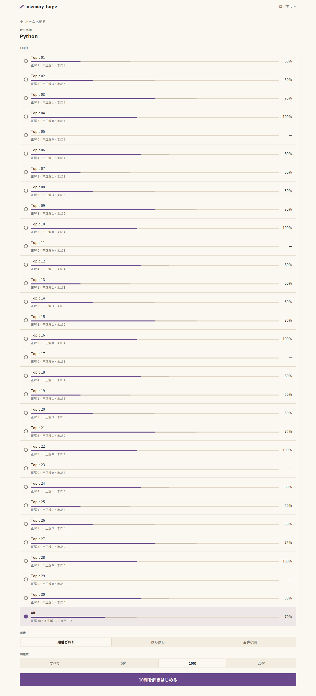 |

## Solve

- 上のバー：左に「やめる」（× の印）、右に、ここまでの正解の数・不正解の数（スキップを含む）・今の問題の番号（4 / 10 など）。下の端に、終えた問題（答えた・飛ばした・答える前に印を付けた）の割合だけ伸びる線
- 問題の上の行：surface の地の札「1つ選ぶ」か「すべて選ぶ」、Topic の名前、問題の ID。右に「不備の印」（muted の文字だけのボタン。指を乗せると warning の文字と warning-soft の地）
- 問題文は明朝で出す。コードがあるときは、行番号つきのコードブロックで出す。選択肢の中のコードには行番号を付けない
- 問題文・選択肢・解説のコードブロックには、```` ``` ```` の後ろに書かれた言語に合わせて色を付ける
  - 色を付ける言語は、Python・TypeScript・JavaScript・SQL・シェル・JSON。言語の名前は大文字・小文字を区別せず、短い名前（`py`・`ts`・`js`・`sh`・`bash`・`shell`）も同じ言語として扱う
  - 色を付けるのは、キーワード・文字列・コメント。それ以外（変数や関数の名前、数、記号など）は、コードブロックの文字の色のまま
  - 言語の名前がないときと、知らない言語の名前のときは、1色で出す
  - 問題を開いたときから色が付いている。答え合わせのあと（正解・不正解の色の付いた選択肢）でも、コードの色は変わらない。ライトモードとダークモードで、それぞれのモードの色で出す
  - 言語の名前は画面に出さない。文の中の短いコード（`` `x` ``）には色を付けない
- 選択肢は、枠線のないカード（surface の地）で、ファイルの順に A・B・C… の記号を付けて出す。単一選択（「1つ選んでください」）は丸い記号で1つだけ選べ、選び直すと前の選択が外れる。複数選択（「当てはまるものをすべて選んでください」）は四角い記号で、いくつでも選べる
  - 選んでいるカードは accent-soft の地で、記号を accent で塗りつぶす
- 下に固定した操作
  - 答える前：「飛ばす」と「答え合わせする」。何も選んでいない間は、上に「選択肢を選ぶと答え合わせできます」を出し、答え合わせするを薄くして押せない
  - 答えたあと：「解説を見る」/「問題に戻る」の切り替えと、「次の問題へ」（最後の問題は「結果を見る」）
  - 答えを送っている間は、下のボタンを押せない
- 答え合わせするを押すと、同じ画面で答え合わせをする
  - 問題の上に、正解は success の帯「正解」、不正解は danger の帯「不正解。答えは B」（複数選択は「A, B」）
  - 複数選択は、正解を全部選び、ほかを選んでいないときだけ正解（部分点なし）
  - 正解の選択肢は success-soft の地、選んで間違えた選択肢は danger-soft の地にする。記号は、選んだ正解・選ばなかった正解・選んで間違えたもので色の濃さを変える。選択肢の右端には何も出さない
  - 答えたあとの状態は、読み上げの名前でも伝える（「選んだ答え・正解」「正解」「選んだ答え・不正解」）
- 解説を見るで解説（枠の中に「解説」の見出しと、明朝の解説の文）に切り替え、問題に戻るで問題に戻る
- 次の問題へで次の問題に進む。最後の問題の結果を見るは、Result に移る
- 飛ばすで、答えずに次の問題に進む。飛ばした問題は不正解として数える。最後の問題で飛ばすと、Result に移る
- 答えを保存できなかったときは、数を進めずに、選択肢の下に danger の帯「答えを保存できませんでした。」と「もう一度保存する」を出す
  - もう一度保存するは、失敗した操作（答え合わせか飛ばす）を同じ中身で送り直す
  - 帯を出している間も、選び直し・答え合わせ・飛ばすはでき、どれかが通れば帯は消える
- 不備の印で、問題に印を付ける。答える前・答えたあとのどちらでも押せる。印を付けた問題は、ほかの解く回でも出題しない。Solve の中では印を外せない（外すのは Manage）
  - 答える前に押すと、答えずに次の問題に進み、その問題は記録しない。正解・不正解の数は増やさず、問題の番号と線は進める。次の問題の上に、warning の枠と warning-soft の地の帯で「k3f9a2 に不備の印を付けました。記録せずに次へ進みました。」（flag の印と、印を付けた問題の ID）を出す。帯は、次の操作（選ぶ・答え合わせ・飛ばす・不備の印）まで出す
  - 最後の問題で答える前に押すと、Result に移る（帯は出さない）
  - 答えたあとに押すと、その場でボタンが warning-soft の地と warning の文字の「印を付けた」に変わる。答えた記録は残り、上の正解・不正解の数も減らさない
  - 印を付けられなかったときは、答えの保存と同じ場所に danger の帯「不備の印を付けられませんでした。」と「もう一度保存する」を出す。答える前の印なら、次の問題に進まない。解説を見ているときは、解説の枠の下に出す。帯が出たまま次の問題に進むと消える（印は付かないまま）
- やめるを押すと、ダイアログ「途中でやめますか？」「ここまでの答えは残ります。」を出し、後ろの画面を暗くする
  - 「続ける」と Esc で閉じて、そのまま続ける。外側を押しても閉じない
  - 「やめる」で Setup に戻る
- 解きはじめるを押してから問題を受け取るまでは、問題の上の行・問題文・コード・選択肢の形の枠を点滅させ、やめるを薄くして押せない
- 解いている途中でページを読み込み直したり閉じたりすると、続きからは解けない。Setup の最初の選び方からやり直す

| 状態 | 表示 | スクリーンショット |
| --- | --- | --- |
| 答える前（単一選択） | 1つ選んでくださいと丸い記号の選択肢。問題の上の行の右に不備の印 | 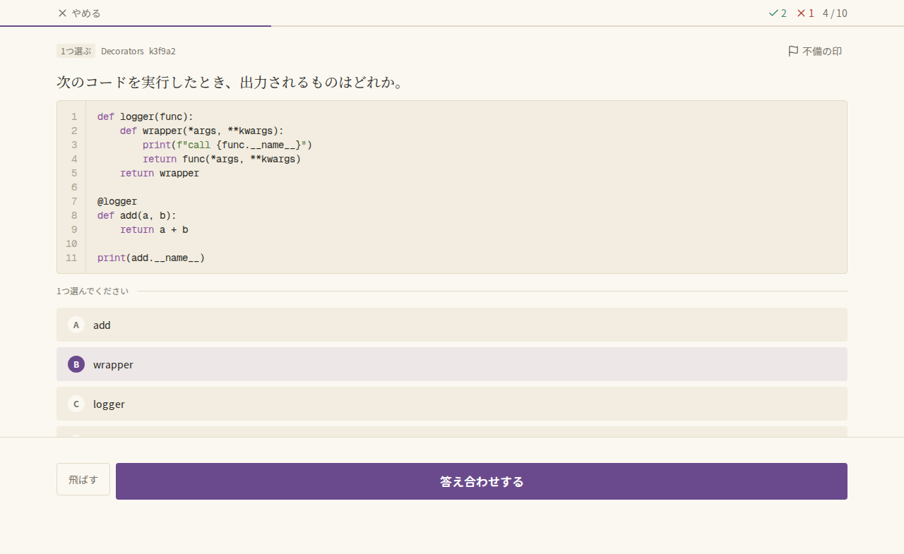 |
| 答えたあとに印 | 不備の印が「印を付けた」に変わる | 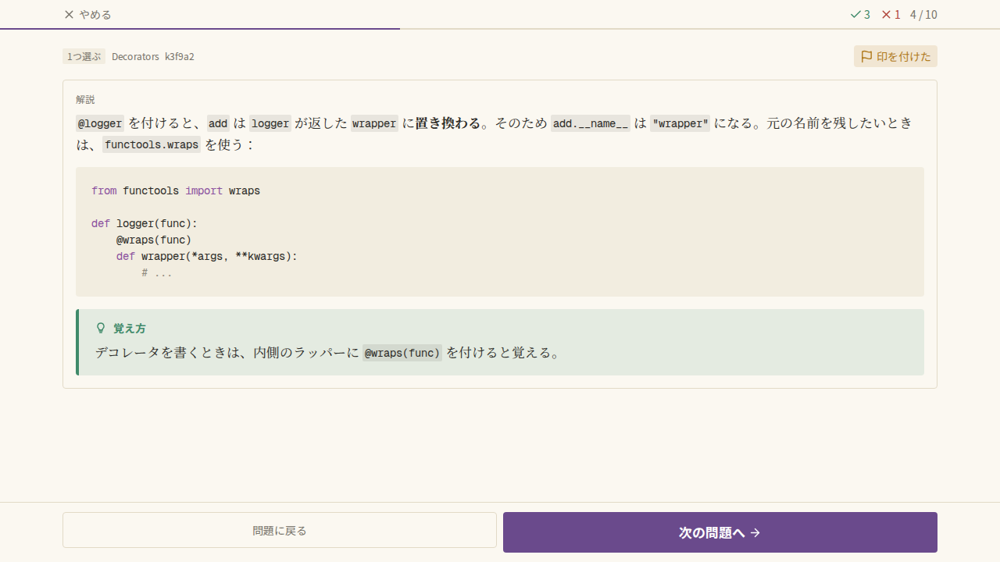 |
| 答える前に印 | 次の問題の上に「k3f9a2 に不備の印を付けました。記録せずに次へ進みました。」 | 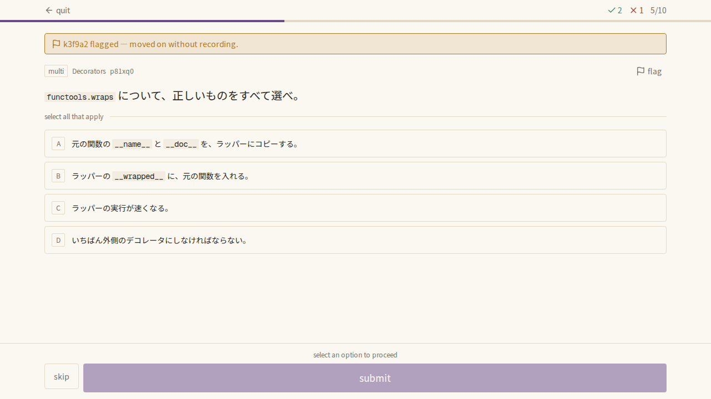 |
| 答えたあと（問題） | 答え合わせの地の色、結果の帯、解説を見ると次の問題へ | 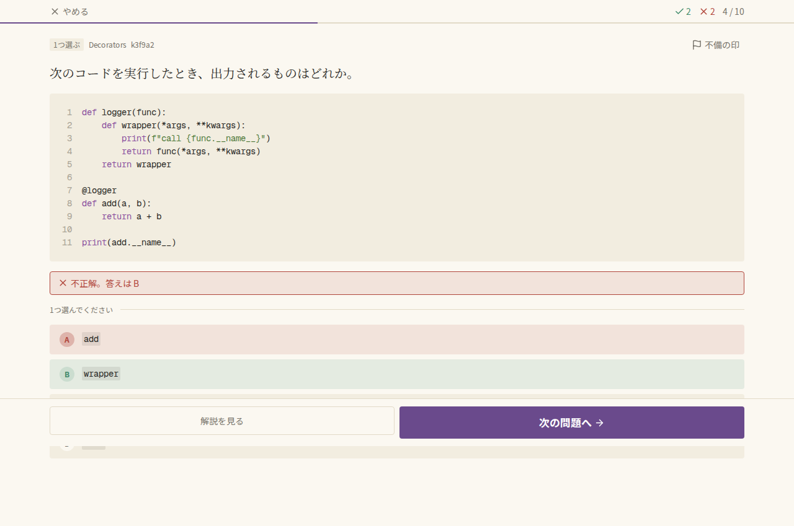 |
| 答えたあと（解説） | 解説と、問題に戻ると次の問題へ | 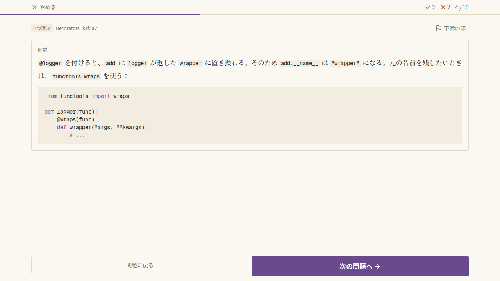 |
| 答える前（複数選択） | 当てはまるものをすべて選んでくださいと四角い記号の選択肢 | 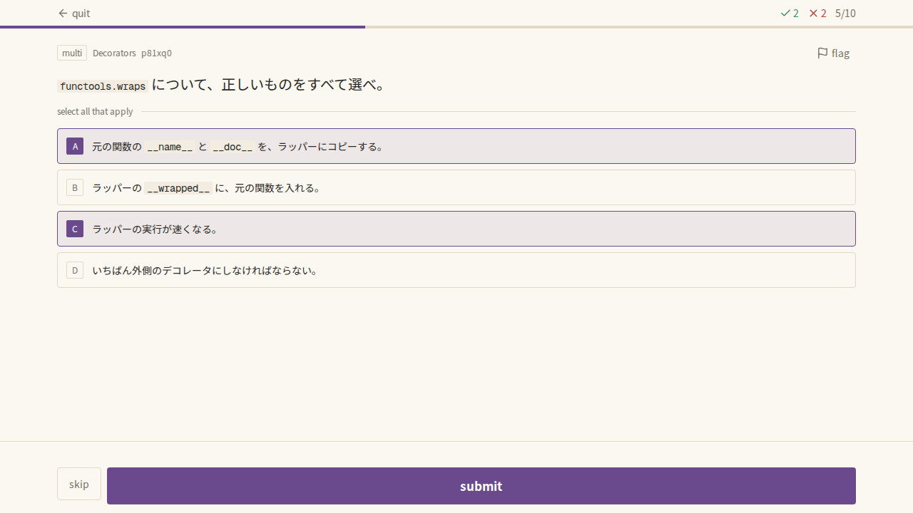 |
| 答えたあと（複数選択） | 選ばなかった正解は緑、選んで間違えたものは赤の地。右端には何も出ない | 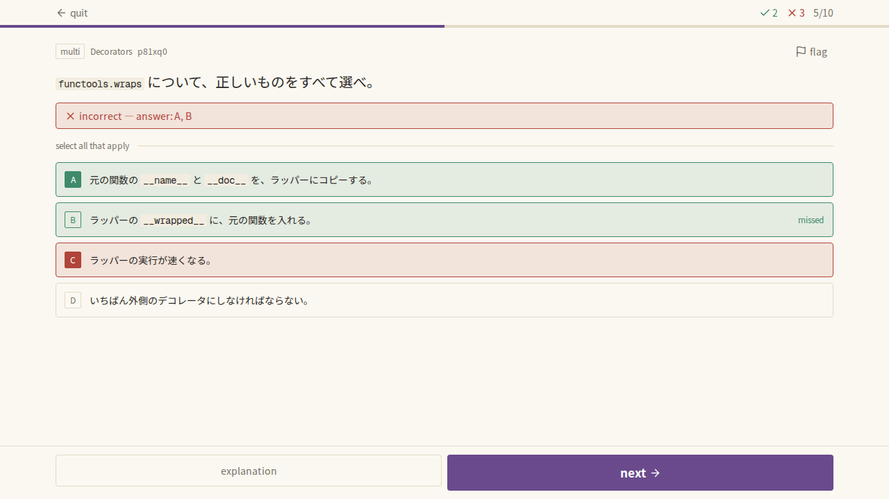 |
| 答える前（選択肢がコード） | 選択肢の中にコードブロック | 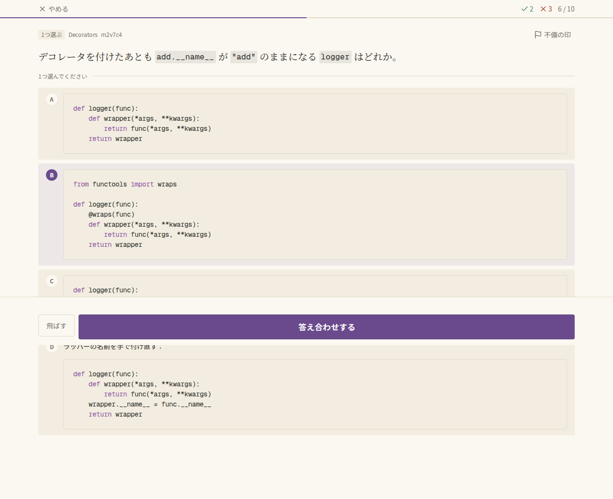 |
| 答えたあと（選択肢がコード） | 答え合わせの地の色。選択肢の中のコードの色はそのまま | 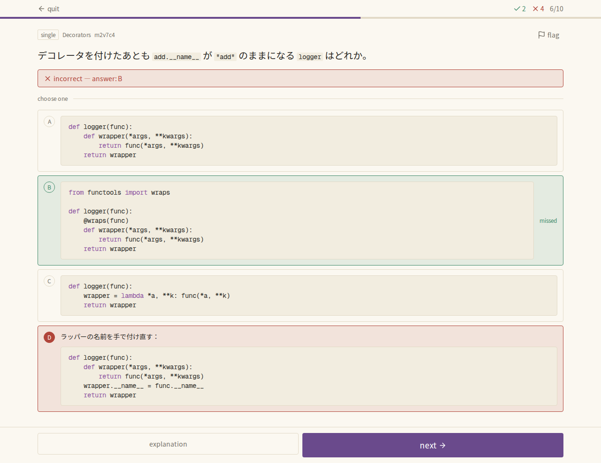 |
| 色を付けられない言語 | 問題文のコードブロックが1色。行番号は付く |  |
| 最後の問題 | 次の問題への代わりに結果を見る | 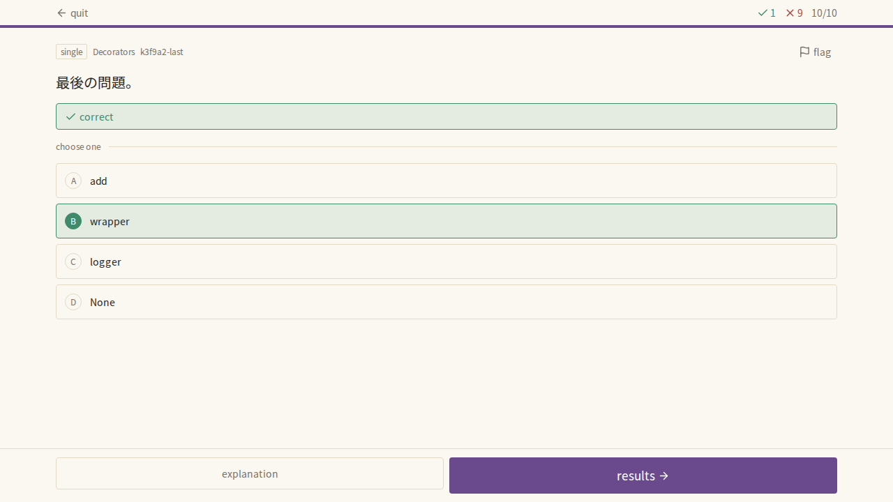 |
| 問題が多い | 37 / 100 など | 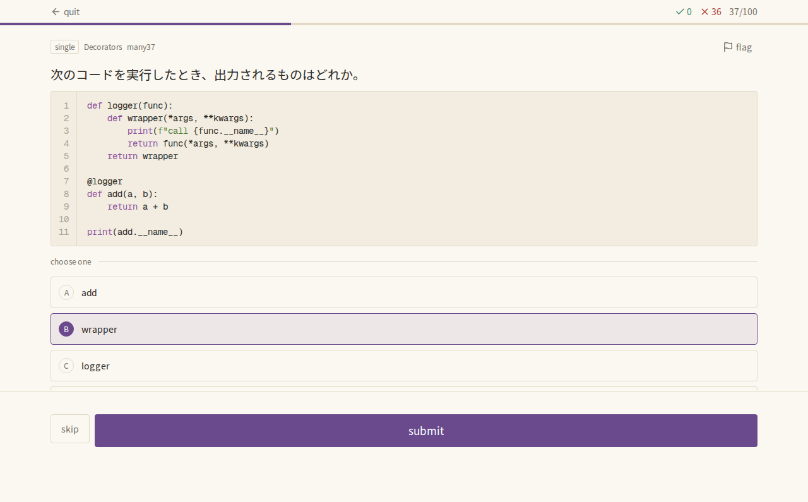 |
| 読み込み中 | 点滅する枠と、押せないやめる | 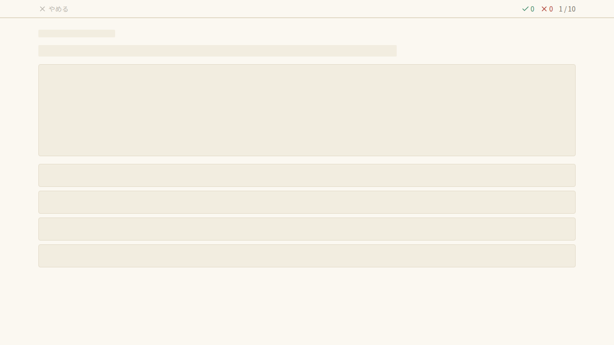 |
| 保存のエラー | danger の帯ともう一度保存する | 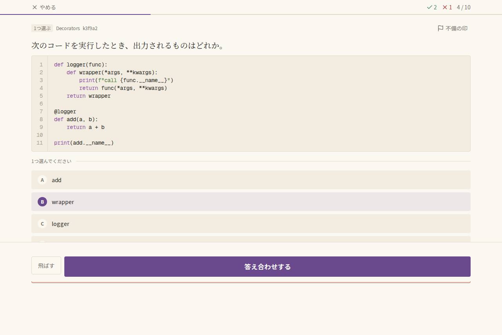 |
| やめるの確かめ | ダイアログ（続けるとやめる） | 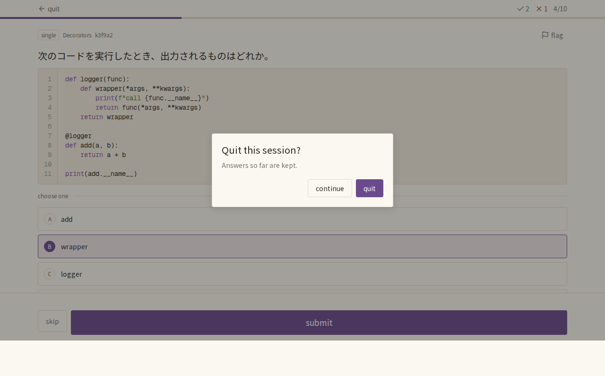 |

## Result

- いちばん上に上のバーが出る（`docs/specs/app-bar.md`）。戻るリンクは置かない
- 上に、muted の太字の小さな「解き終わりました」と、Subject の名前（見出し）
- その下に、得点（「6 / 9問 正解」。正解の数を display の大きさの太字で大きく出す）
  - 得点と正答率では、スキップを不正解として数える
- 得点の下に「正答率 67%」（muted）。正答率は、整数に四捨五入する（6/9 は 67%）
- その下に、小さな muted の文字で「不正解 2」「飛ばした 1」「不備の印（数えない） 0」を横に並べる（数は text の色）。下に区切り線
  - 不正解は、答えて間違えた数だけ（スキップは飛ばしたにだけ数える）
  - 不備の印は、この回で印を付けた問題の数
- 印を付けた問題は、答える前でも答えたあとでも、得点・正答率・不正解・飛ばした・Topic ごとに数えない
- 数える問題が0問（全部に印を付けた）のときは、得点を muted の「—」にし、その下を「数える問題がありませんでした（すべてに不備の印）」にする。Topic ごとの一覧は出さない
- 「Topic ごと」の見出しの下に、Topic ごとの行を区切り線で並べる。行には、Topic の名前、割合の線、得点（3/4）を出す
  - 割合の線は、左から、正解（success）、前は正解したのに今回間違えた（warning）、前にも正解したことがない不正解（danger）の順に塗り分ける
  - 「前は正解したのに今回間違えた」は、今回不正解かスキップで、今回より前の記録に一度でも正解がある問題
  - 黄色の問題も、得点・正答率・不正解と飛ばしたの数では、不正解として数える
  - 並びは Setup の Topic と同じ順。解いた回に出た Topic だけを出す。Setup を開いたあとに取り込み直して、Setup にない Topic が解いた回に出たときは、Setup の順のあとに、出た順で置く
  - Topic を1つ選んで解いたときも、その1行を出す
  - Topic の名前は決まった幅（スマホの幅では狭くする）に置き、長いときは1行に収めて「…」で切る。割合の線は、名前と得点の間の残りの幅いっぱいに伸ばす
  - Topic が多いときは、行が続き、ページごとスクロールする
- 区切り線の下・「Topic ごと」の上に、「間違えた問題」の見出し（muted の太字の小さな文字）と、枠で囲んだ行の一覧を出す
  - 一覧に入れるのは、その回で不正解と飛ばした問題。不備の印を付けた問題は入れない（答える前でも答えたあとでも）
  - 並びは、その回で解いた順。何問でも全部出す
  - 行には、左に danger の x の印（不正解も飛ばしたものも同じ）、問題文の1行目（明朝。長いときは折り返す）と、その下に Topic の名前（muted の小さな文字）、右に chevron-right の印。行に指を乗せると surface の地
  - 行を押すと、その問題の見直しを出す（下の「見直し」）
  - 間違えた問題が0問のときは、見出しも一覧も出さない
- 下に固定して、「ホームへ戻る」（枠だけ）と主な操作（残りの幅いっぱい）を横に並べる
  - 間違えた問題が1問以上：主な操作は「間違えた問題を解き直す」。押すと、一覧の問題だけを一覧と同じ順番で解く回を始める（下の「解き直し」）
  - 間違えた問題が0問（全部正解・全部に印）：主な操作は「もう一度解く」。同じ Subject の Setup に移る。Topic・順番・問題数は、直前に選んでいたもののまま
  - ホームへ戻るで、Home に移る
- 解き直しの問題を読めなかったとき（一覧の問題がどれも印が付いたか消えていたときも）は、Result のまま、「間違えた問題」の見出しの上に danger の帯「問題を読み込めませんでした。」を出す
- 結果は解き終わったときに手元で数えるので、結果そのものの読み込み中とエラーの状態はない
- Result・見直し・解き直しの途中で読み込み直すと、結果は出ず、Setup の最初の選び方（すべて・順番どおり・10問）からになる。それまでに答えた分の記録は残る

| 状態 | 表示 | スクリーンショット |
| --- | --- | --- |
| 通常 | 大きな得点「6 / 9問 正解」、正答率、3つの数（不備の印（数えない）が 1）、間違えた問題の一覧、Topic ごとの行、ホームへ戻ると間違えた問題を解き直す | 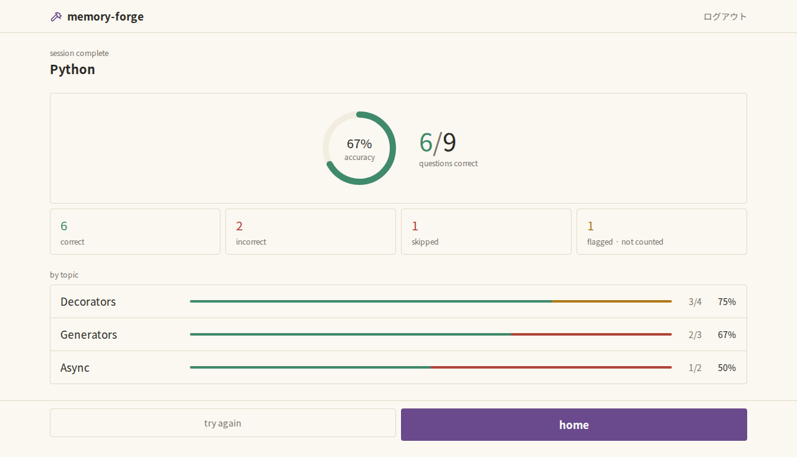 |
| 全部正解 | 一覧なし、ホームへ戻るともう一度解く | 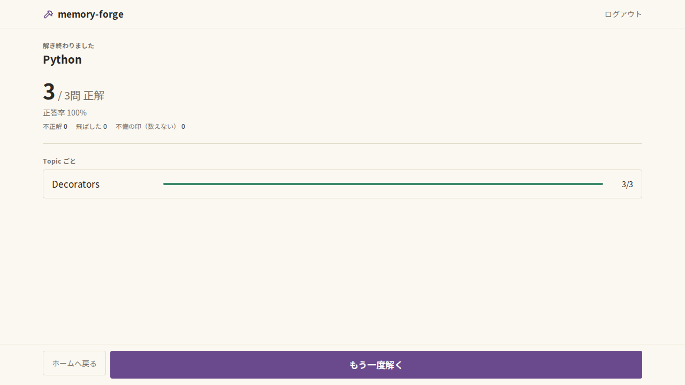 |
| 全部に印 | 「—」と「数える問題がありませんでした（すべてに不備の印）」。一覧と Topic ごとは出さず、もう一度解く | 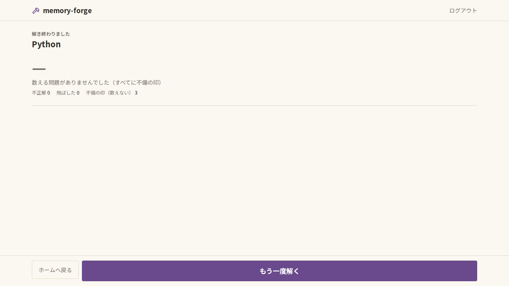 |
| 間違えた問題が多い | 一覧の行が続き、ページごとスクロールする | 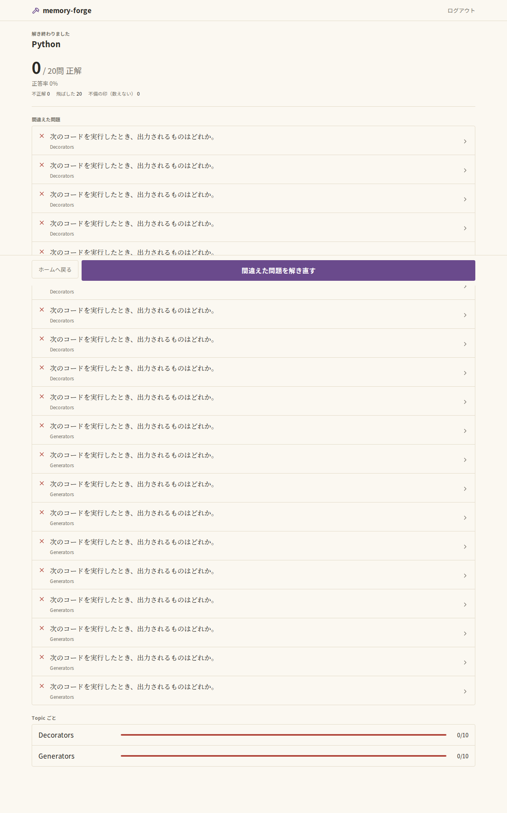 |

## 見直し

- Result の「間違えた問題」の行から開く。その回で答えたときの、答えたあとの Solve の見た目で出す
- 上のバー：bg の地に、左の「結果に戻る」（arrow-left の印と文字、muted）だけ。進み具合の数と線は出さない。押すと Result に戻る（Result の表示はそのまま）
- 問題の上の行：種類の札・Topic・ID。不備の印のボタンは出さない
- 中身は答えたあとの Solve と同じ（結果の帯、選択肢の地の色と記号、読み上げの名前）
  - 不正解：danger の帯「不正解。答えは B」。選んだものと正解の地の色は Solve と同じ
  - 飛ばした：何も選んでいない状態で、正解の選択肢を success-soft の地（記号は選ばなかった正解と同じ）にし、danger の帯「飛ばしました。答えは A, B」（x の印）
- 下に固定した操作は、「解説を見る」/「問題に戻る」の切り替えだけ（幅いっぱい。枠だけのボタン）
- 記録は増やさない

| 状態 | 表示 | スクリーンショット |
| --- | --- | --- |
| 不正解の問題 | 結果に戻る、不正解の帯、解説を見る | 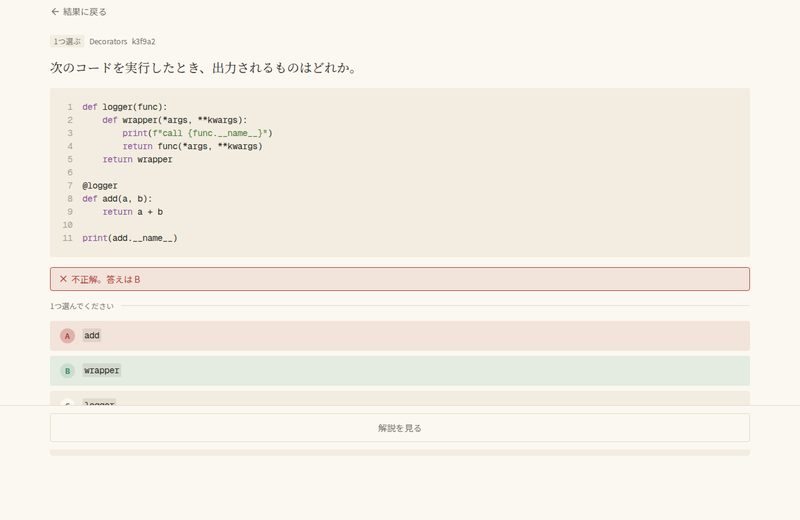 |
| 飛ばした問題 | 何も選んでいない選択肢、正解が緑、「飛ばしました。答えは A, B」 | 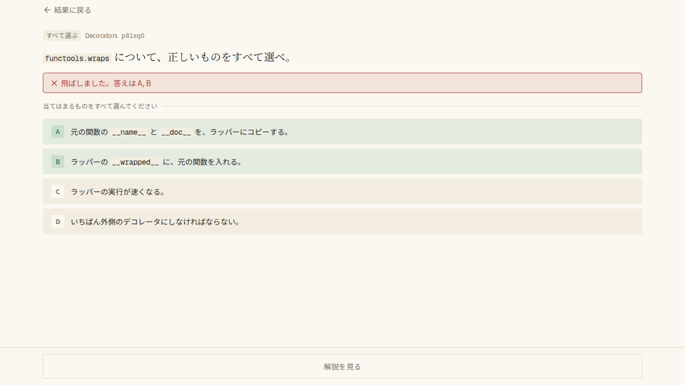 |

## 解き直し

- Result の「間違えた問題を解き直す」で始まる、一覧の問題だけを一覧と同じ順番で解く回。始めるときに問題を受け取り直し、そのあいだに印を付けた・消えた問題は除く
- 解き方はふつうの Solve と同じ（答え合わせ・飛ばす・不備の印・やめる・保存のエラー）。答えはふつうに記録する。上のバーの問題の番号と線は、解き直す問題の数で数える
- 問題を受け取るまでは、ふつうの回と同じ点滅する枠を出す
- 解き終わると、その回の Result を出す。その回の間違えた問題で、また解き直せる
- 解き直しの回のやめると、その回の Result の「もう一度解く」は、Setup に戻る。Setup の選び方は、最初の回で選んでいたもののまま

| 状態 | 表示 | スクリーンショット |
| --- | --- | --- |
| 解き直しの1問目 | ふつうの Solve の答える前。1 / 2 | 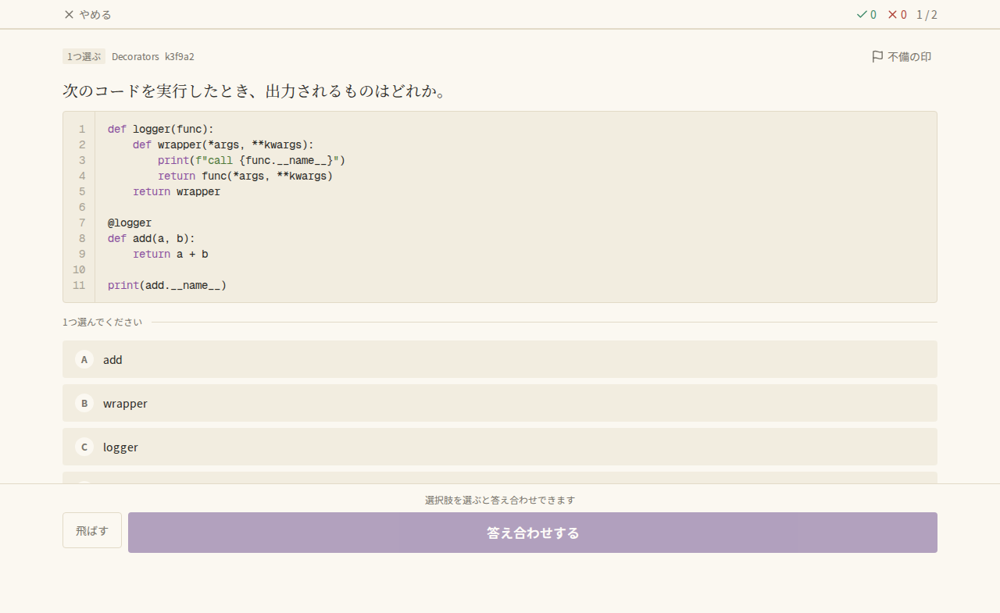 |

## 記録

- 答えるたびに（submit とスキップ）、その問題の正解・不正解を記録する。スキップは不正解
- 答える前に印を付けた問題は、記録しない。答えたあとに印を付けても、答えた記録は残る
- quit・読み込み直し・ページを閉じても、それまでに答えた分の記録は残る
- 記録は、Setup の 苦手な順 の並びと解いた問題の数、Result の「前は正解したのに今回間違えた」に使う
