# 問題を解く

Subject の中から Topic・順番・問題数を選び（Setup）、1問ずつ解く（Solve）。どちらも `/subjects/<Subject の id>` の1つの画面で、Setup から start で Solve に切り替わる。

- ログインしていないと見られない（`docs/specs/sign-in.md`）
- Home の Subject の行から入る（`docs/specs/home.md`）

## Setup

- いちばん上に上のバーが出る（`docs/specs/app-bar.md`）
- 上から、戻るリンク（back。Home へ）、primary の等幅の小さな「study setup」、Subject の名前（見出し）
- 「topic」：丸の付いた行で、Topic の名前を、その Topic の問題が最初に出てくる順に並べ、最後に太字の「All」（全部の Topic）。選んでいる行は primary-soft の地
- 「order」：in order・random・lowest accuracy から選ぶ
  - in order：取り込んだ順（最初の取り込みではファイルの順。取り込み直して増えた問題は最後）
  - random：start を押すたびにランダムに並べる
  - lowest accuracy：問題ごとの正答率（全部の回答のうち正解の割合）の低い順。まだ一度も解いていない問題は出さない。正答率が同じ問題は、その中でランダムに並べる
- 「questions」：all・5・10・20 から選ぶ。出せる問題が選んだ数より少ないときは、ある分だけ出す
- 開いたときは、All・in order・10 を選んでいる
- 下に、幅いっぱいの start と、出す問題の数（start · 10 など）。押すと、選んだ問題で Solve が始まる
- 出せる問題が選んだ数より少ないときは、start の上に muted の等幅の小さな文字で「Decorators has only 8 questions to ask.」と出す。All を選んでいるときは、Topic の名前の代わりに Subject の名前（「Python has only 8 questions to ask.」）
- lowest accuracy で、選んだ Topic に一度でも解いた問題がないときは、warning の文字で「No questions to ask — none in Typing have been answered yet.」と出し、start · 0 を薄くして押せない
- start を押して問題を読めなかったときは、Setup のまま、start の上に danger の帯「Couldn't load questions.」と retry を出す。retry で、同じ選び方でもう一度始める
- Solve から戻ったとき（quit・results・最後の問題の skip）は、直前に選んでいた Topic・順番・問題数のまま
- 読み込んでいる間は、Subject の名前の場所と、Topic の行の形の枠を6つ点滅させる
- 読み込めなかったときは、Subject の名前（見出し）を出さず、danger の帯「Couldn't load this subject.」と retry を出す
- ない Subject の Setup を開くと、見つからない画面（This page could not be found.）を出す

| 状態 | 表示 | スクリーンショット |
| --- | --- | --- |
| 通常 | All・in order・10 を選んでいる | 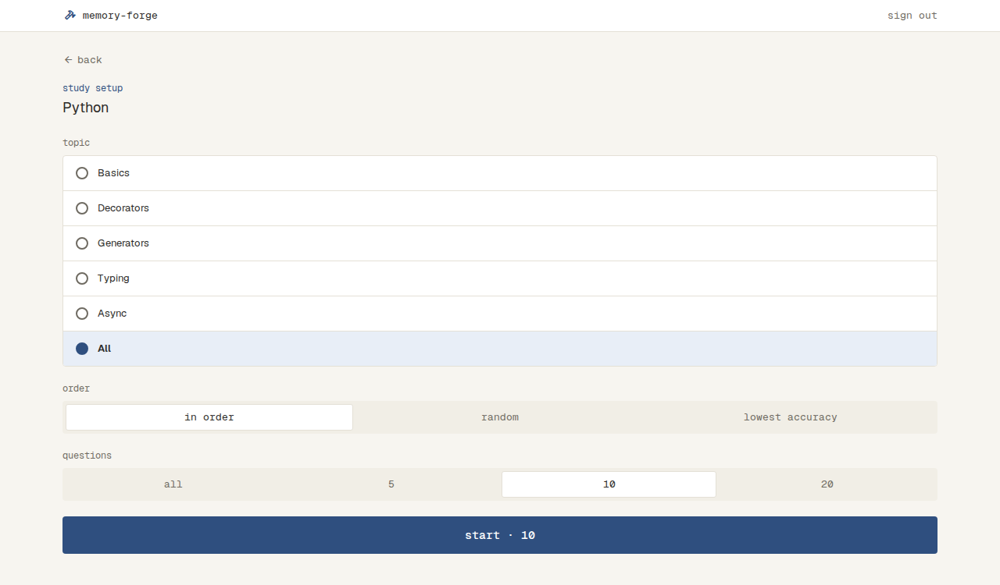 |
| 問題が足りない | 案内と、ある分の数の start | 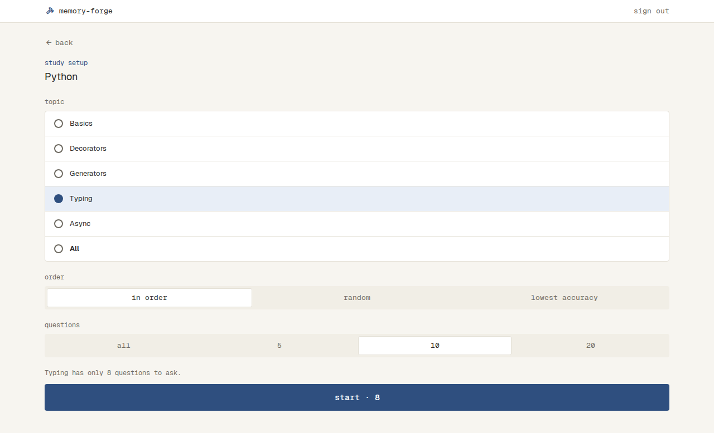 |
| 解いた問題がない（lowest accuracy） | warning の案内と、押せない start · 0 | 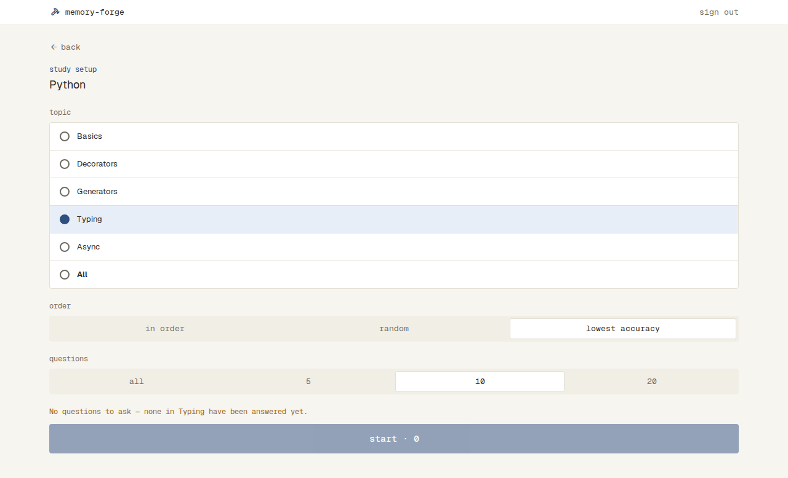 |
| Topic が多い | Topic の行が続く | 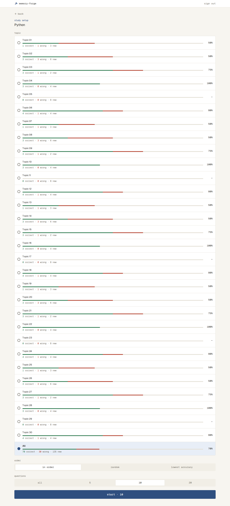 |

## Solve

- 上のバー：左に quit（arrow_back の印）、右に、ここまでの正解の数・不正解の数（スキップを含む）・今の問題の番号（4/10 など）。下の端に、答えた割合だけ伸びる線
- 問題の上の行：枠で囲んだ「single」か「multi」、Topic の名前、問題の ID
- 問題文。コードがあるときは、行番号つきのコードブロックで出す。選択肢の中のコードには行番号を付けない
- 選択肢は、ファイルの順に A・B・C… の記号を付けて出す。単一選択（「choose one」）は丸い記号で1つだけ選べ、選び直すと前の選択が外れる。複数選択（「select all that apply」）は四角い記号で、いくつでも選べる
- 下に固定した操作
  - 答える前：skip と submit。何も選んでいない間は、上に「select an option to proceed」を出し、submit を薄くして押せない
  - 答えたあと：explanation / question の切り替えと、next（最後の問題は results）
  - 答えを送っている間は、下のボタンを押せない
- submit すると、同じ画面で答え合わせをする
  - 正解は success の帯「correct」、不正解は danger の帯「incorrect — answer: B」（複数選択は「A, B」）
  - 複数選択は、正解を全部選び、ほかを選んでいないときだけ正解（部分点なし）
  - 選択肢に、選んだ正解・選んだ不正解の色を付ける。選ばなかった正解には missed を出す
- explanation で解説（枠の中に「explanation」の見出しと解説の文）に切り替え、question で問題に戻る
- next で次の問題に進む。最後の問題の results は、Setup に戻る
- skip で、答えずに次の問題に進む。スキップは不正解として数える。最後の問題の skip は、Setup に戻る
- 答えを保存できなかったときは、数を進めずに、選択肢の下に danger の帯「Couldn't save your answer.」と retry を出す
  - retry は、失敗した操作（submit か skip）を同じ中身で送り直す
  - 帯を出している間も、選び直し・submit・skip はでき、どれかが通れば帯は消える
- quit を押すと、ダイアログ「Quit this session?」「Answers so far are kept.」を出し、後ろの画面を暗くする
  - continue と Esc で閉じて、そのまま続ける。外側を押しても閉じない
  - quit で Setup に戻る
- start を押してから問題を受け取るまでは、問題の上の行・問題文・コード・選択肢の形の枠を点滅させ、quit を薄くして押せない
- 解いている途中でページを読み込み直したり閉じたりすると、続きからは解けない。Setup の最初の選び方からやり直す

| 状態 | 表示 | スクリーンショット |
| --- | --- | --- |
| 答える前（単一選択） | choose one と丸い記号の選択肢 | 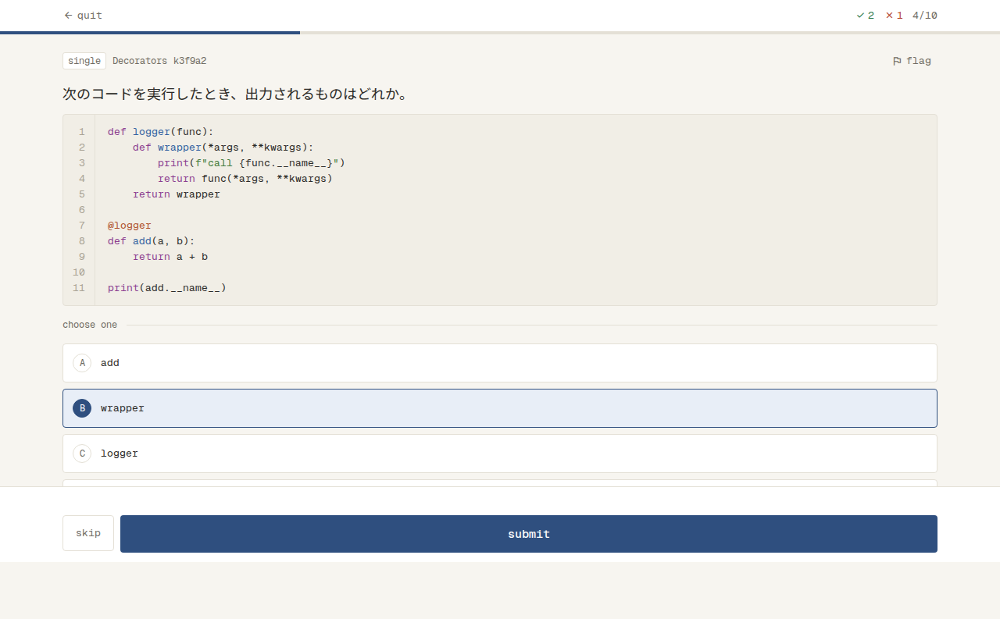 |
| 答えたあと（問題） | 答え合わせの色、結果の帯、explanation と next | 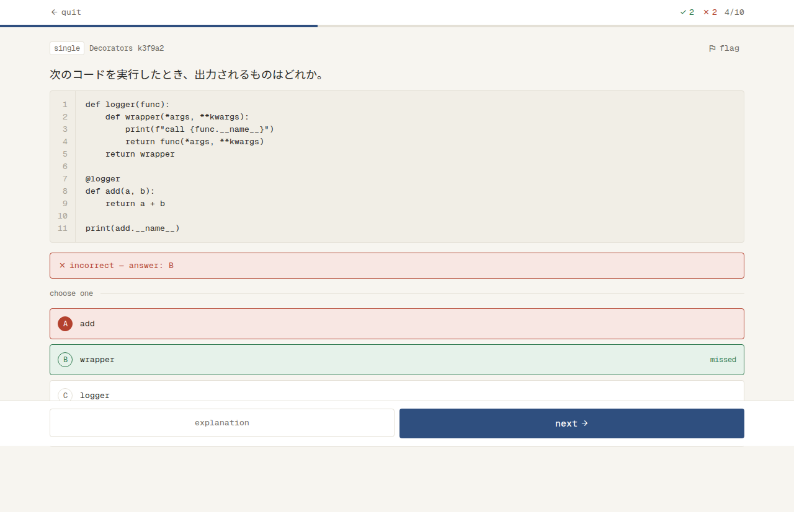 |
| 答えたあと（解説） | 解説と、question と next | 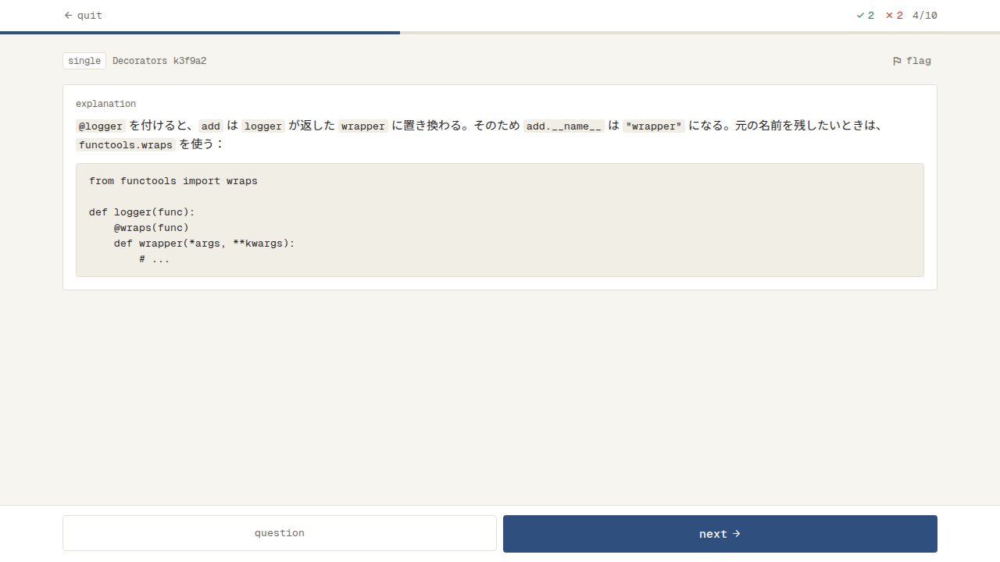 |
| 答える前（複数選択） | select all that apply と四角い記号の選択肢 | 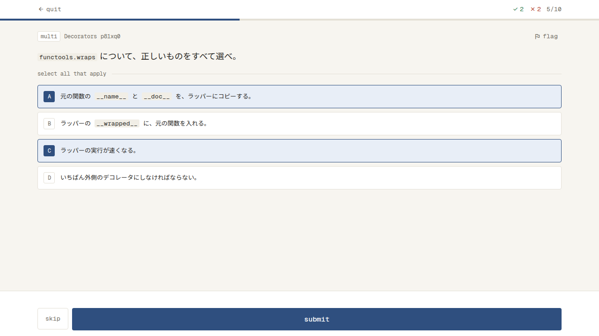 |
| 答えたあと（複数選択） | 選ばなかった正解に missed | 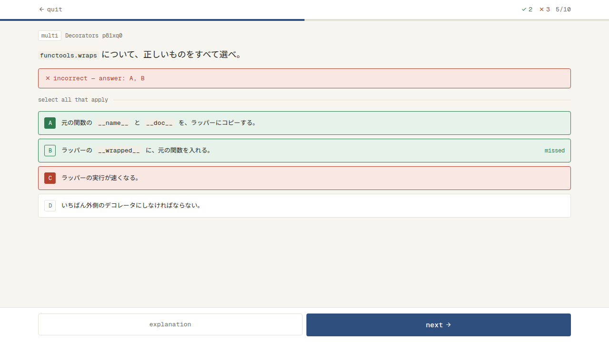 |
| 答える前（選択肢がコード） | 選択肢の中にコードブロック | 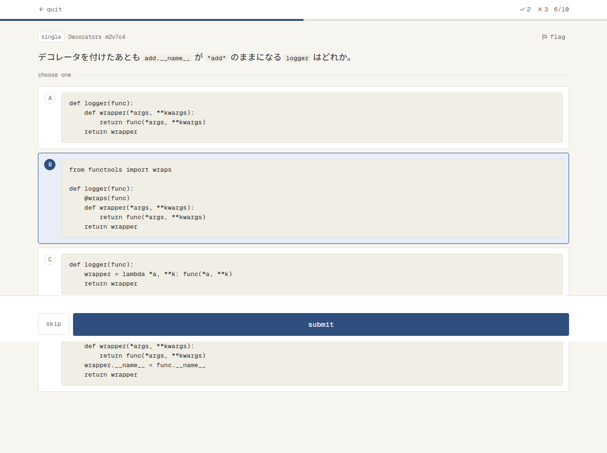 |
| 答えたあと（選択肢がコード） | 答え合わせの色 | 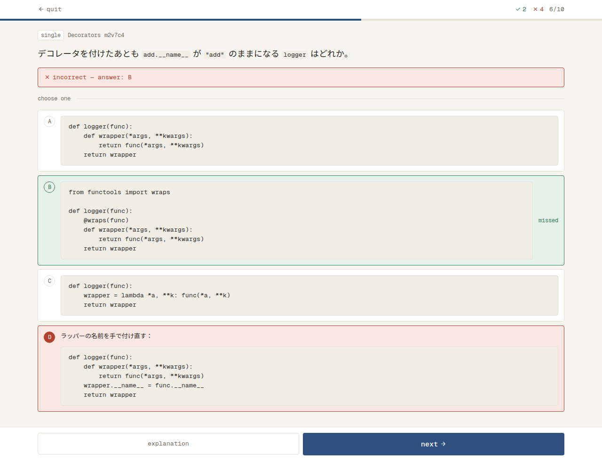 |
| 最後の問題 | next の代わりに results |  |
| 問題が多い | 37/100 など | 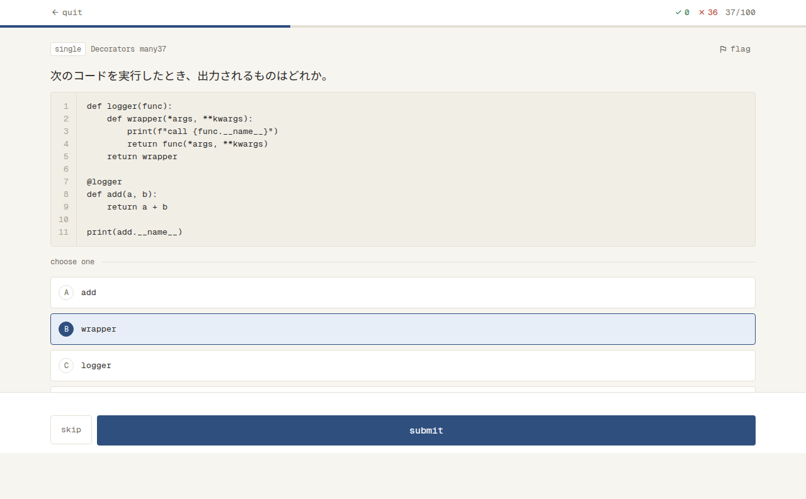 |
| 読み込み中 | 点滅する枠と、押せない quit | 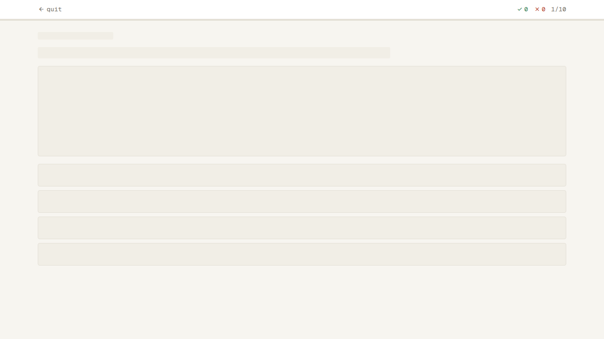 |
| 保存のエラー | danger の帯と retry | 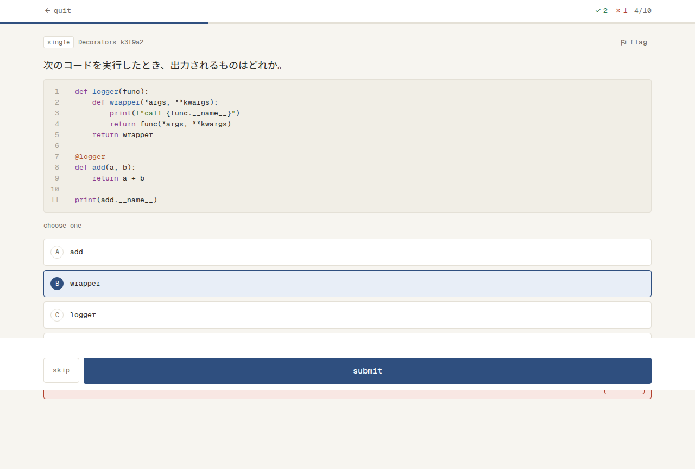 |
| quit の確かめ | ダイアログ（continue と quit） | 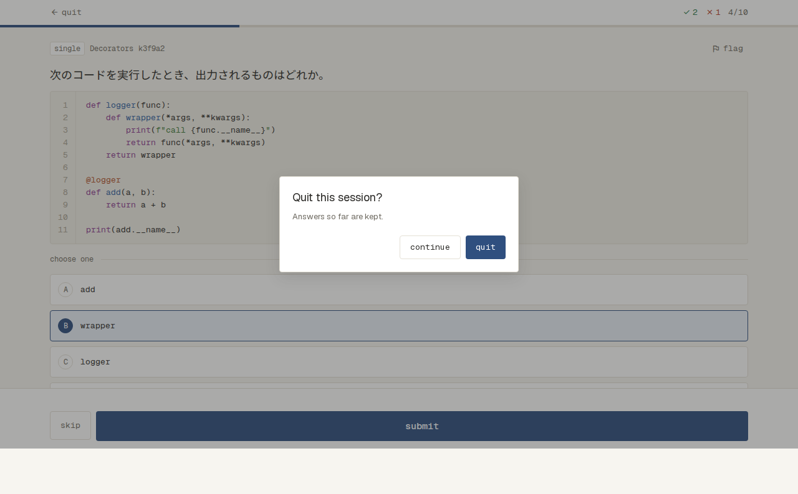 |

## 記録

- 答えるたびに（submit とスキップ）、その問題の正解・不正解を記録する。スキップは不正解
- quit・読み込み直し・ページを閉じても、それまでに答えた分の記録は残る
- 記録は、Setup の lowest accuracy の並びと、解いた問題の数に使う
